# FINAL PROJECT PROPOSAL
## \<The 16th e-ICON World Contest\>

| | |
|---|---|
| **[Team No.] Global Team Name** | [H1] SnapCare |
| **Web App Name** | SnapCare |
| **Name of Korean Students** | Yunsu NAM · Dohun KIM |
| **Name of International Students** | Cristian RUDICO · Daniel STANCHEVICI (Moldova) |
| **Related SDGs** | Target 3.4 비감염성 질환 · Target 3.8 보편적 건강보장 · Target 3.d 보건 위기 관리 |
| **URL** | Github Repository: https://github.com/16th-eicon-contest/h1-SnapCare<br>Deployment URL: https://snapcare.fly.dev |

---

## □ Summary of Web App
SnapCare 는 처방전·영양성분표·의약품·음식을 사진 한 장으로 찍으면 그림과 음성과 색 하나로 답하는 웹 앱으로, 글을 읽지 못하거나 읽기 어려운 저문해 성인과 고령자가 스스로 약을 먹고 음식을 고를 수 있게 하는 것을 목적으로 한다. 전 세계 성인 7억 3,900만 명이 기초 문해 능력을 갖추지 못했고 선진 31개국에서도 성인의 18%가 가장 기초적인 수준에 미치지 못하는데, 이들은 처방전을 받는 순간부터 그 내용에 접근하지 못해 복약 오류·치료 실패·항생제 내성에 노출된다. 앱은 자체 개발한 두 엔진, 픽토그램을 문법으로 합성하는 SIGIL(형태소 78종)과 음성 지시를 재구성하는 VOCA 를 통해 화면 어디에서도 글을 읽거나 입력할 것을 요구하지 않으며, 판정은 사용자의 나이와 조건에서 기준치를 유도해 기기 안에서 이루어지므로 인터넷 없이도 동작한다.

---

## □ Problem Statement and Background

### 1.1 비문해 인구의 규모와 추세

전 세계 비문해 성인은 7억 3,900만 명이며, 그중 약 3분의 2인 4억 6,600만 명이 여성이다 (UNESCO, *Youth and Adult Literacy: International Literacy Day 2025 Factsheet*, UNESCO, 2025). 성인 문해율은 2015년 86%에서 2024년 88%로 올랐고 숫자만 보면 개선되고 있다 (UNESCO, *Youth and Adult Literacy: International Literacy Day 2025 Factsheet*, UNESCO, 2025).

그러나 비율의 개선이 인구의 증가를 따라잡지 못하는 지역이 있다. 사하라이남 아프리카의 문해율은 같은 기간 65%에서 69%로 올랐는데, 비문해 성인의 절대수는 1억 9,600만 명에서 2억 2,500만 명으로 오히려 늘었다 (UNESCO, *Youth and Adult Literacy: International Literacy Day 2025 Factsheet*, UNESCO, 2025). 중앙·남아시아는 3억 4,700만 명으로 사하라이남 아프리카 다음으로 많다 (UNESCO, *Youth and Adult Literacy: International Literacy Day 2025 Factsheet*, UNESCO, 2025). 비문해 성인의 절반 이상인 4억 4,100만 명이 10개국에 집중되어 있다 (UNESCO, *Youth and Adult Literacy: International Literacy Day 2025 Factsheet*, UNESCO, 2025).

즉 이 문제는 시간이 해결해 주는 종류가 아니다. 교육이 확대되는 동안에도 지금 약을 받아 가는 사람의 수는 줄지 않는다.

평균은 이 문제의 크기를 감춘다. 성인 문해율이 가장 낮은 15개국의 값은 29%에서 60% 사이이며, 차드는 28%다 (UNESCO, *Youth and Adult Literacy: International Literacy Day 2025 Factsheet*, UNESCO, 2025).

아래 값은 기간 평균이 아니다. **2015~2024년 인구조사 기간 중 각 나라에서 가장 최근에 확보된 조사 한 해의 값**이므로, 나라마다 기준 연도가 다르다. 국가별 문해율은 조사 연도와 정의에 따라 크게 달라지므로 (같은 나라가 다른 집계에서 10%p 이상 차이 나는 경우가 있다) 여기서는 한 출처 안의 값만 써서 서로 비교할 수 있게 했다.

[표 1] 성인 문해율이 낮은 국가 (2015~2024 인구조사, UNESCO, *Youth and Adult Literacy: International Literacy Day 2025 Factsheet*, UNESCO, 2025)

| 국가 | 성인 문해율 | 국가 | 성인 문해율 |
|---|---|---|---|
| 차드 | 28% | 기니 | 48% |
| 남수단 | 35% | 라이베리아 | 48% |
| 부르키나파소 | 37% | 에티오피아 | 51.8% |
| 아프가니스탄 | 37% | 소말리아 | 54% |
| 니제르 | 38% | 기니비사우 | 56% |
| 중앙아프리카공화국 | 38% | 베냉 | 58% |
| 말리 | 44% | 파키스탄 | 58% |
| | | 시에라리온 | 60% |

차드에서는 성인 열 명 중 일곱 명이 처방전을 읽지 못한다. 이 나라들에서 종이 처방전은 말 그대로 백지에 가깝다.

그런데 비율이 가장 나쁜 나라와 사람이 가장 많은 나라는 대체로 겹치지 않는다. 비문해 성인의 절반 이상인 4억 4,100만 명이 열 개 나라에 몰려 있는데, 그 열 곳은 대체로 인구가 큰 나라들이다.

[표 2] 비문해 성인이 가장 많은 10개국 (UNESCO, *Youth and Adult Literacy: International Literacy Day 2025 Factsheet*, UNESCO, 2025)

| 국가 | 비문해 성인 | 국가 | 비문해 성인 |
|---|---|---|---|
| 인도 | 1억 9,100만 명 | 에티오피아 | 3,000만 명 |
| 파키스탄 | 5,900만 명 | 방글라데시 | 2,500만 명 |
| 나이지리아 | 4,300만 명 | 이집트 | 1,900만 명 |
| 중국 | 3,800만 명 | 아프가니스탄 | 1,400만 명 |
| | | 브라질 | 1,100만 명 |
| | | 콩고민주공화국 | 1,100만 명 |

**열 곳 합계 4억 4,100만 명 (전체 7억 3,900만 명의 60%)**

두 표를 나란히 놓으면 이 문제가 어떤 종류인지 보인다. 표 1에 있는 나라 가운데 표 2에도 있는 것은 파키스탄, 에티오피아, 아프가니스탄 셋뿐이다. 나머지는 비율은 세계 최악인데 인구가 작아 총계에서 보이지 않는 나라(차드·남수단·기니비사우)이거나, 비율은 세계 평균에 가까운데 인구가 커서 사람 수가 압도적인 나라(인도·중국·브라질)다.

이 구분이 설계에 영향을 준다. 비율이 높은 곳에서는 앱이 다수의 조건을 상대하고, 사람 수가 많은 곳에서는 소수이지만 절대수가 큰 집단을 상대한다. 인도의 문해율은 81%로 세계 평균에 가깝지만 그 19%가 1억 9,100만 명이다. 어느 쪽이든 한 사람이 약을 받아 가는 순간의 문제는 같으며, 비율이 아니라 머릿수가 이 앱이 닿아야 할 크기다.

그리고 같은 나라 안에서도 분포가 고르지 않다. 일부 사하라이남 아프리카 국가에서 **고령 여성의 문해율은 31%인 반면 고령 남성은 55%**이고, 유럽과 북미 일부 지역의 남성은 99%다 (UNESCO, *Youth and Adult Literacy: International Literacy Day 2025 Factsheet*, UNESCO, 2025).

우리가 물은 전문가들의 답이 이 통계와 어긋나는 방향으로 나왔다는 점을 여기 적어 둔다. §5.7 의 35명 가운데 15명이 글로 된 복약 지시를 읽지 못하는 사람을 "거의 마주치지 않는다" 고 답했고, 거의 매일 마주친다고 답한 사람은 4명이다. 응답자의 절반이 한국에서 일하므로 이 답은 §1.2 에서 볼 국가 안의 분포를 반영한 것이지 §1.1 의 세계 통계를 반박하는 것이 아니다. 충남대학교 약학대학 윤휘열 교수가 그 사정을 그대로 적었다.

> "한국인은 글을 읽지 못하는 비율이 거의 0에 가깝기에 주로 외국인 환자 분들이 많습니다. 그래서 영어로 설명 합니다."
> (윤휘열 교수, 충남대학교 약학대학)

문해율이 높은 나라에서 이 문제는 사라지는 것이 아니라 다른 얼굴로 나타난다. 읽지 못하는 사람이 드문 대신 자기 언어가 아닌 종이를 받는 사람이 생기고, 약사는 그것을 제3의 언어로 메운다.

이 분포가 말하는 것은 대상을 좁혀야 한다는 것이 아니라, 필요가 가장 큰 지점이 어디인지다. SnapCare 는 읽기를 요구하지 않는 앱이므로 글을 읽을 수 있는 사람도 그대로 쓸 수 있고, 실제로 처방 지시를 놓치는 것은 문해력과 무관하게 일어난다 (§1.3). 다만 같은 앱이 어디에서 가장 큰 차이를 만드는지를 묻는다면 이런 격차가 있는 곳이며, 그것이 현지 평가를 계획에 넣은 이유다 (§5.10).

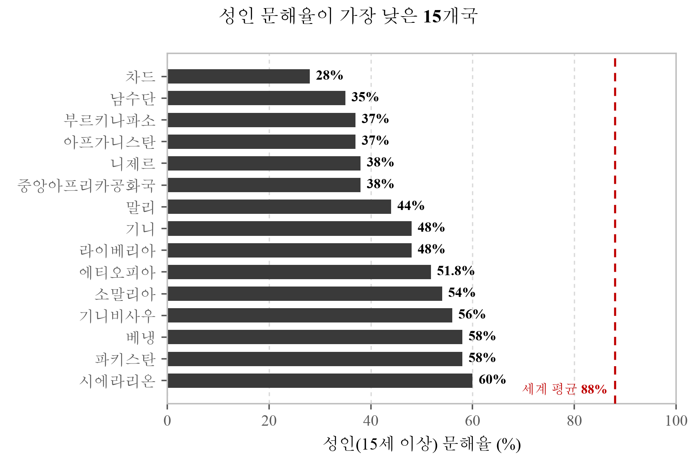

**[그림 1]** 성인 문해율이 낮은 15개국 (UNESCO, *Youth and Adult Literacy: International Literacy Day 2025 Factsheet*, UNESCO, 2025). 세계 평균 88%에서 얼마나 떨어져 있는지를 보면 된다. 이 나라들에서는 처방전을 읽지 못하는 사람이 다수다.

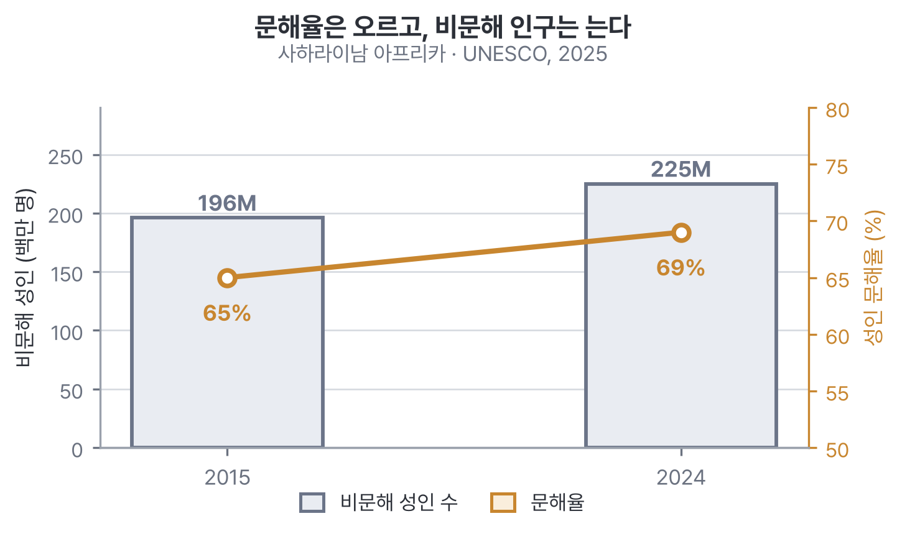

**[그림 2]** 사하라이남 아프리카의 문해율과 비문해 성인 수 (UNESCO, *Youth and Adult Literacy: International Literacy Day 2025 Factsheet*, UNESCO, 2025). 막대는 절대수, 선은 비율이다. 두 축이 반대로 움직이는 것이 이 절의 논지다. 비율은 4%p 올랐는데 사람 수는 2,900만 명 늘었다. 비율만 보면 개선이고, 머릿수로 보면 악화다. 이 문제가 시간이 해결해 줄 종류가 아니라는 근거가 여기 있다.


### 1.2 건강 문해력의 분포

글자를 읽을 수 있는 것과 건강 정보를 이해하는 것은 다르다. 유럽 17개국에서 42,445명을 면접한 HLS19 조사는 일반 건강문해력을 우수·충분·문제적·부적절 네 수준으로 나누어 재었고, 참여한 모든 나라에서 낮은 건강문해력이 상당한 비율로 남아 있음을 보고했다 (HLS19 Consortium of the WHO Action Network M-POHL, *International Report on the Methodology, Results, and Recommendations of the European Health Literacy Population Survey 2019–2021*, Austrian National Public Health Institute, Vienna, 2021). 다만 이 보고서는 자료 수집 시기와 방법이 나라마다 달라 국가 간 비교를 신중히 하라고 명시하며, 17개국을 하나로 묶은 대표값을 내세우지 않는다. 따라서 여기서는 통합 백분율 대신 한국 자료를 본다.

[표 3] 한국 성인의 건강정보이해능력 (질병관리청, *국민건강영양조사 제9기 2차년도*, 2023)

| 집단 | 충분한 수준 | 그 여집합 | 출처 |
|---|---|---|---|
| 한국 65세 이상 | 40.3% | **59.7%** | 국민건강영양조사 (2023) |
| 한국 전체 성인 | 60.4% | 39.6% | 국민건강영양조사 (2023) |
| 한국 소득 하위층 | 54.4% | 45.6% | 국민건강영양조사 (2023) |
| 한국 소득 상위층 | 66.3% | 33.7% | 국민건강영양조사 (2023) |

건강정보이해능력이 "적절한 수준" 이라 함은 40점 만점에 30점 이상을 뜻한다 (질병관리청, *국민건강영양조사 제9기 2차년도*, 2023).

표 3이 보여주는 것은 이 문제가 나라 사이보다 나라 안에서 더 크게 갈린다는 점이다. 한국 성인 전체에서 건강정보이해능력이 충분한 비율은 60.4%인데, 65세 이상에서는 40.3%로 떨어진다. 여집합으로 보면 59.7% 대 39.6%, 20.1%p 차이다. 소득으로 갈라도 같은 방향이 나와, 하위층은 54.4%, 상위층은 33.7%다. 즉 이것은 "글을 못 읽는 나라" 의 문제가 아니라, 어느 나라에서든 나타나는 문제다. SnapCare 가 특정 지역을 위한 앱이 아닌 이유가 여기 있다. 문해율이 88%인 나라에서도 처방 지시를 놓치는 사람이 있고, 40%인 나라에서는 더 많을 뿐이다. 팀이 한국과 몰도바로 구성된 것은 두 곳을 대상으로 삼아서가 아니라, 서로 다른 두 환경에서 같은 앱을 시험해 볼 수 있기 때문이다.

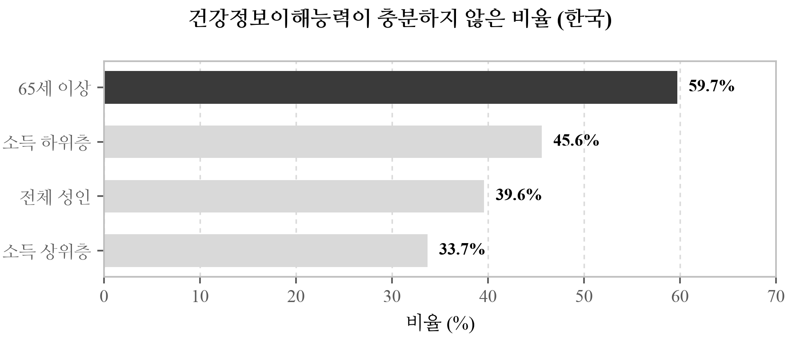

**[그림 3]** 한국 성인의 건강정보이해능력이 충분하지 않은 비율 (질병관리청, *국민건강영양조사 제9기 2차년도*, 2023). 전체 39.6% 에 비해 65세 이상은 59.7% 로, 20.1%p 높다. 소득으로 갈라도 11.9%p 차이가 난다. 이 문제가 나라 사이보다 나라 안에서 더 크게 갈린다는 것을 이 그림에서 읽어야 한다.


문해력을 자기보고가 아니라 직접 측정하면 그림이 더 나빠진다. 31개 선진국이 참여한 국제성인역량조사(PIAAC)에서 성인의 **18%가 문해·수리·적응적 문제해결의 가장 기초적인 수준에 미치지 못했고**, 이들 국가의 성인 문해력은 2012년 이후 오히려 정체하거나 낮아졌다 (OECD, *Programme for the International Assessment of Adult Competencies*; UNESCO, *Youth and Adult Literacy: International Literacy Day 2025 Factsheet*, UNESCO, 2025 재인용). "글을 읽을 줄 안다" 는 자기보고와 "약 봉지의 지시를 따를 수 있다" 는 능력 사이의 거리가 여기서 드러난다.

한국만의 사정도 아니다. OECD 는 18개국의 자료를 종합해 최소 3분의 1이 낮은 건강 문해력을 보인다고 적었고, 같은 보고서가 미국 연구를 인용해 낮은 건강 문해력이 연간 총 의료비의 3~5%에 해당하는 추가 비용을 낳는다고 밝혔다 (Moreira, L., "Health literacy for people-centred care: Where do OECD countries stand?", *OECD Health Working Papers*, No. 107, DELSA/HEA/WD/HWP(2018)4, 2018).

3분의 1 이라는 값이 §1.1 의 비문해율과 다른 층을 말한다는 점이 중요하다. 이 18개국은 글자를 읽지 못하는 사람이 드문 나라들이며, 그럼에도 셋 중 하나가 건강 정보를 다루는 데 어려움을 겪는다.

이 격차는 임상 결과로 이어진다. 96편의 연구를 종합한 체계적 문헌고찰은 낮은 건강 문해력이 입원 증가, 응급 진료 이용 증가, 유방촬영술과 독감 백신 수혜 감소, 약을 올바로 복용해 보이는 능력의 저하, 그리고 라벨과 보건 메시지를 해석하는 능력의 저하와 일관되게 연관된다고 보고했다 (Berkman, N. D., Sheridan, S. L., Donahue, K. E., Halpern, D. J. & Crotty, K., "Low health literacy and health outcomes: an updated systematic review," *Annals of Internal Medicine*, 155(2):97–107, 2011). 사망률의 경우 이 연관이 고령자에서 확인되었다.

현장의 관찰이 이 문헌과 같은 곳을 가리킨다. §5.7 의 간호·보건 구획 9명 가운데 8명이 글을 읽지 못하는 분들이 복약 정보를 제대로 받지 못하고 있다고 답했다(맞다 3명, 부분적으로 5명). 그리고 두 응답자가 그 범위를 문해력 밖으로 넓혔다.

> "그런 기회는 많이 없었지만, 설령 글을 알고 있더라도, 복약정도를 제대로 받지 못하고 있는 사람들도 많다."
> (박남수 교수, 협성대학교)

> "I am not convinced anybody actually gets proper medication information."
> (Celia 교수, University of Pretoria)

뒤의 것은 이 문서가 세운 전제보다 넓은 주장이다. 우리는 읽지 못하는 사람이 정보를 놓친다고 적었는데, 이 응답은 읽을 수 있는 사람도 제대로 받지 못한다고 말한다. 그 주장이 옳다면 이 앱의 대상은 우리가 잡은 것보다 넓고, 동시에 이 앱만으로 풀리는 문제도 아니다.

이 목록에서 우리 문제와 직접 겹치는 것은 뒤의 둘, 곧 약을 올바로 복용해 보이는 능력과 라벨·보건 메시지를 해석하는 능력이다. 앞의 것들이 의료 접근의 문제라면 이 둘은 정보가 전달되는 지점의 문제이며, 진료실 밖에서 일어난다. §1.4 에서 다룰 정책의 사각지대가 정확히 여기다.

### 1.3 복약 오류의 유형과 대가

복약 오류가 어느 유형에 몰리는지를 보면 무엇을 고쳐야 하는지가 좁혀진다. 직접 관찰법으로 조제 단계를 지켜본 연구에서, 약사가 발견한 조제 오류 155건 가운데 누락이 51건(32.9%), 용량 오류가 44건(28.4%), 시각 오류가 36건(23.2%)이었다. 이 셋만으로 전체의 84.5%를 차지한다 (Anacleto, T. A., Perini, E., Rosa, M. B. & César, C. C., "Medication dispensing errors in a Brazilian hospital pharmacy," *Clinics*, 62(3):243–250, 2007).

[표 4] 복약 오류의 유형별 분포와 SnapCare 픽토그램 형태소의 대응

| 오류 유형 | 건수 | 비율 | 그 지시를 담는 형태소 |
|---|---|---|---|
| 누락 | 51 | 32.9% | `finish_course` |
| 용량 오류 | 44 | 28.4% | `qty_one` ~ `qty_five` |
| 시각 오류 | 36 | 23.2% | `time_morning` ~ `time_night` |
| 나머지 | 24 | 15.5% | — |

약사가 발견한 조제 오류 155건 기준 (Anacleto, T. A., Perini, E., Rosa, M. B. & César, C. C., "Medication dispensing errors in a Brazilian hospital pharmacy," *Clinics*, 62(3):243–250, 2007).

같은 분포가 다른 나라와 다른 시기에서도 나오는지 확인했다. 이란 간호사의 투약 오류를 다룬 연구 36편(6,238명)을 종합한 메타분석에서 오류 유형의 상위 둘이 시각 오류 27.3%(95% CI 19~36)와 용량 오류 26.4%(95% CI 20~33)였다 (Fathizadeh, H., Mousavi, S. S., Gharibi, Z., Rezaeipour, H. & Biojmajd, A. R., "Prevalence of medication errors and its related factors in Iranian nurses: an updated systematic review and meta-analysis," *BMC Nursing*, 23:175, 2024, doi:10.1186/s12912-024-01836-w). 2007년 브라질의 한 병원에서 관찰된 순서와 상위 둘이 같다.

두 자료를 나란히 놓을 때 조심할 것이 둘 있다. 첫째, 단계가 다르다. 앞의 것은 약사가 조제하며 낸 오류이고 뒤의 것은 간호사가 투약하며 낸 오류다. 둘 다 환자가 집에서 내는 오류가 아니며, 그 간극은 §1.4 에서 따로 다룬다. 둘째, 이란 자료는 이질성이 매우 크다(I² = 91~96). 값 자체를 그대로 옮길 것이 아니라 순서가 반복된다는 것만 읽어야 한다.

그럼에도 이 반복이 이 절에 필요한 이유가 있다. 우리는 형태소 세트를 이 분포에 맞춰 설계했고(표 8), 분포가 한 병원 한 해의 우연이었다면 그 설계의 근거가 사라진다. 열일곱 해와 두 대륙을 건너 상위 둘이 같다는 것이 그 우연을 줄인다.

표 4는 오류의 대부분이 "무엇을·얼마나·언제" 세 가지에 몰려 있음을 보여준다. 이 셋은 모두 그림으로 옮길 수 있는 정보이며, SnapCare 의 형태소 설계가 정확히 이 분포를 따른다.

이 분포가 20년 가까이 지난 자료라는 점을 생각해 §5.7 에서 같은 것을 다시 물었다. 약국 구획 12명에게 의학적으로 가장 틀리면 안 되는 것을 고르게 했더니 복용량과 횟수가 7명으로 가장 많았고, 병용금기와 상호작용이 3명, 투여 경로와 임의 중단 금지가 각 1명이다. 2007년의 조제 기록에서 용량 오류가 28.4% 였던 것과 2026년의 약사 12명이 용량과 횟수를 첫째로 꼽은 것이 같은 자리를 가리킨다.

한 응답자는 그 이유까지 적었다. 설명은 말로 하지만 환자가 나중에 되돌아볼 수 있는 것은 라벨에 적힌 용량뿐이라는 것이다.

> "The patient is thoroughly explained/counselled about the medication. However, it is only the dose that is written on the label which the patient can refer to when taking the medication."
> (Atif Usman 교수, The Islamia University of Bahawalpur)

말로 한 설명은 약국 문을 나서는 순간 사라지고 종이만 남는다. 그 종이를 읽지 못하면 남는 것도 없다.

여기에 단서를 하나 달아야 한다. 이 분포는 조제하는 쪽에서 난 오류이지 환자가 집에서 저지르는 오류가 아니다. 두 단계를 같은 것으로 취급할 수는 없다. 그럼에도 이 수치를 근거로 삼는 것은, 조제 단계에서 이 셋이 자주 어긋난다는 사실이 그 셋이 전달 과정에서 잃어버리기 쉬운 정보라는 뜻이기 때문이다. 훈련받은 약사가 관리된 환경에서도 이 셋을 놓친다면, 같은 정보를 문자로만 건네받은 환자가 놓치지 않으리라고 볼 이유는 없다. 환자 단계의 분포를 직접 잰 자료는 우리가 찾지 못했으며, 이는 §5.9 에 남긴 미검증 항목에 해당한다.

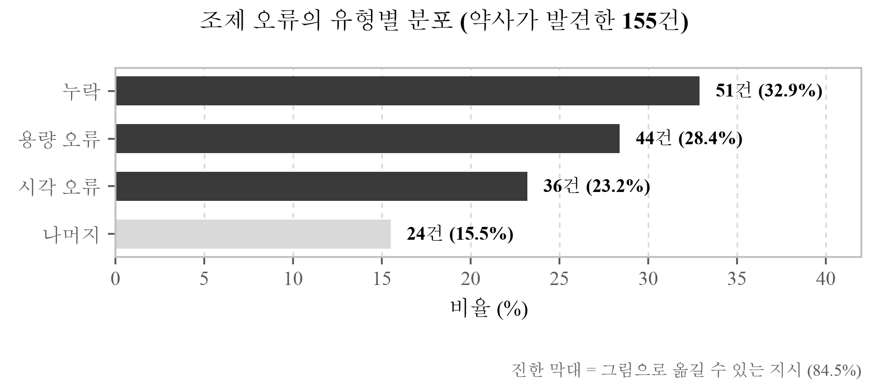

**[그림 4]** 약사가 발견한 조제 오류 155건의 유형별 분포 (Anacleto, T. A., Perini, E., Rosa, M. B. & César, C. C., "Medication dispensing errors in a Brazilian hospital pharmacy," *Clinics*, 62(3):243–250, 2007). 누락·용량·시각 세 유형이 84.5%를 차지한다. 세 유형이 모두 그림으로 옮길 수 있는 정보라는 것이 SIGIL 형태소 설계의 출발점이며, `finish_course`·`qty_*`·`time_*` 가 각각 이 셋에 대응한다.


#### 1.3.1 환자 쪽에서 측정된 오독

앞의 분포는 조제하는 쪽의 기록이다. 환자 쪽에서 무엇이 일어나는지는 따로 측정되어 있다.

미국의 1차 진료기관 세 곳에서 성인 395명에게 실제 약병 라벨 다섯 개를 보이고 지시를 이해했는지 물은 연구에서, 올바로 이해한 비율은 라벨에 따라 **67.1%에서 91.1%** 사이였다. 이 연구가 남긴 가장 날카로운 결과는 따로 있다. 저문해 환자의 **70.7%가 "하루 두 번, 한 번에 두 알" 이라는 지시를 말로는 정확히 되풀이했으나, 하루에 몇 알을 먹어야 하는지 실제로 짚어 보인 사람은 34.7%뿐이었다** (Davis, T. C. et al., "Literacy and misunderstanding prescription drug labels," *Annals of Internal Medicine*, 145(12):887–894, 2006).

지시를 그대로 되풀이하는 것과 그대로 행동하는 것은 별개의 능력이며, 문자를 읽어 주는 것만으로는 이 간극이 메워지지 않는다. 그래서 이것이 SnapCare 가 음성만이 아니라 행동을 그리는 그림을 함께 내는 이유다.

액체 약에서는 오차가 눈에 보이는 양으로 나타난다. 어린 자녀에게 물약을 먹이는 보호자를 무작위 배정한 시험에서, 표준 상담만 받은 대조군의 **47.8%가 처방된 용량에서 20%를 넘게 벗어난 양을 먹였다** (필요시 복용 약에서는 40.0%). 20%는 작은 수가 아니다. 하루 세 번 먹는 약이라면 사흘이면 하루치가 어긋난다.

 복약 오류 관련 전 세계 연간 비용은 약 420억 달러로, 전 세계 보건 지출의 약 1%에 해당한다 (World Health Organization, *Medication Without Harm: WHO Global Patient Safety Challenge*, WHO/HIS/SDS/2017.6, 2017). 미국만 따로 본 값도 있다. 복약 비순응으로 생기는 회피 가능한 의료비가 연 1,000억에서 3,000억 달러로 추정되며 이는 미국 전체 의료비의 3~10%에 해당한다. 고령자 입원의 약 10%가 비순응에 기인하는 것으로 볼 수 있고, 비순응에 딸린 비용의 대부분이 피할 수 있었던 입원에서 나온다 (Iuga, A. O. & McGuire, M. J., "Adherence and health care costs," *Risk Management and Healthcare Policy*, 7:35–44, 2014, doi:10.2147/RMHP.S19801).

이 값을 옮기며 앞 판에서 고친 것 셋을 적어 둔다. 우리는 이것을 병원 홍보 페이지에서 가져와 "직접 비용 1,000억, 간접까지 3,000억" 이라고 적고 있었는데 원문은 직접과 간접을 나누지 않고 회피 가능 비용의 범위로 준다. "입원의 최소 10%" 라고 적은 것도 원문에서는 고령자 입원에 한정된다. 그리고 함께 적었던 "연간 약 125,000명 사망" 은 이 논문의 초록에 없어 뺐다. 널리 인용되는 수이지만 우리가 1차 출처에서 확인하지 못했다.

세계보건기구가 2024년에 낸 첫 세계 환자안전 보고서는 이 규모를 다시 쟀다. 전 세계에서 환자 스무 명 중 한 명(5%)이 예방 가능한 약물 관련 위해를 겪으며, 그중 4분의 1 가까이가 중증이거나 생명을 위협하는 수준이다. 지역별로는 아프리카와 동남아시아가 각각 9%로 가장 높다 (World Health Organization, *Global patient safety report 2024*, ISBN 978-92-4-009545-8, 2024).

저소득·중소득국에서는 해마다 병원에서 1억 3,400만 건의 위해 사건이 일어나고 약 260만 명이 그로 인해 사망한다 (WHO, *Global patient safety report 2024*).

위해가 어디서 일어나는지가 이 연구의 자리를 정한다. 세계보건기구는 진료 과정에서 생기는 위해의 절반 이상(환자 스무 명 중 한 명)이 예방 가능하며, 그중 예방 가능한 위해의 절반이 약과 관련된 것이라고 보고한다. 약으로 인한 위해는 환자 서른 명 중 한 명에게 나타나고 그 가운데 4분의 1 이상이 중증이거나 생명을 위협하는 수준이다. 그리고 이 위해는 병원 안보다 밖에서 더 흔하다. **1차 진료와 외래에서는 환자 열 명 중 네 명까지 위해를 겪으며, 그 위해의 최대 80%(23.6~85%)는 피할 수 있는 것**이다 (World Health Organization, *Patient safety* fact sheet).

이 수치들이 함께 가리키는 것은 약으로 인한 위해가 진료실 밖에서, 피할 수 있는 형태로 일어난다는 점이다. SnapCare 가 다루려는 것이 그 부분이다. 저·중소득국에서는 안전하지 않은 진료로 인한 사망이 100명 중 4명에 이른다 (WHO, *Patient safety*).

다만 이 비용 추정에는 폭이 크고 3,000억 달러라는 상단값의 근거를 두고 이견이 있다는 점을 밝혀 둔다. 우리가 이 수치를 쓰는 목적은 규모의 감각을 주는 데 있지 특정 값을 주장하는 데 있지 않으며, 본 연구가 개선을 주장하는 지표도 비용이 아니라 §5.1 의 전달 성공률이다.

### 1.4 국제 정책과 그 사각지대

세계보건기구는 2017년 제3차 국제 환자안전 과제로 Medication Without Harm 을 선언하고, 5년 안에 중대한 회피 가능 약물 위해를 50% 줄이겠다는 목표를 세웠다 (World Health Organization, *Medication Without Harm: WHO Global Patient Safety Challenge*, WHO/HIS/SDS/2017.6, 2017). 우선 영역으로 고위험 상황, 다제복용, 진료 이행 셋을 지목했다 (World Health Organization, *Medication Without Harm: WHO Global Patient Safety Challenge*, WHO/HIS/SDS/2017.6, 2017).

그러나 선언으로부터 7년이 지난 2024년 기준, 약물 위해 감축에 관한 국가 목표를 수립한 WHO 회원국은 **전체의 18%에 그친다** (World Health Organization, *Medication without harm: policy brief*, ISBN 978-92-4-006276-4, 2024).

같은 해의 세계 환자안전 보고서는 74%의 회원국이 이 과제를 승인하고 이행 중이라고 적는다 (WHO, *Global patient safety report 2024*). 두 수치는 어긋나지 않는다. 앞의 것은 감축 목표를 수를 정해 세운 나라이고 뒤의 것은 과제를 받아들인 나라다. 같은 보고서에서 이 과제를 위한 국가 전문가 조직을 둔 나라는 24%다. 승인에서 목표로, 목표에서 조직으로 갈수록 수가 줄어드는 것이 이 정책이 어디까지 내려와 있는지를 보여 준다.

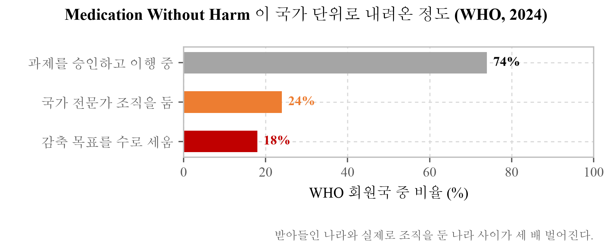

**[그림 5]** Medication Without Harm 이 국가 단위로 내려온 정도 (World Health Organization, *Global patient safety report 2024*, ISBN 978-92-4-009545-8, 2024). 과제를 받아들인 나라는 74%인데 감축 목표를 수로 세운 나라는 18%다. 여기서 볼 것은 선언과 이행 사이의 거리이며, §1.4 가 말하는 사각지대는 정책이 없어서가 아니라 정책이 여기까지 내려오지 않아서 생긴다.

지시가 전달된 뒤에도 남는 간극이 있다. 만성 질환자의 복약 순응도는 선진국에서 평균 50%이며 개발도상국에서는 그보다 낮다 (World Health Organization, *Adherence to long-term therapies: evidence for action*, 2003). 이 수치는 글을 읽을 수 있고 진단도 받은 사람들을 포함해 잰 것이므로, 문해력만 해결하면 되는 문제가 아니라는 뜻이기도 하다.

문해력과 순응도의 관계 자체를 잰 자료도 우리 편이 아니다. 여러 데이터베이스를 훑어 건강문해력과 복약 순응도의 직접적 관계를 잰 연구를 모은 메타분석에서, 둘 사이의 상관은 통계적으로 유의하지만 **약했다.** 가중 상관계수가 0.056에서 0.072 사이다 (Zhang, N. J., Terry, A. & McHorney, C. A., "Impact of health literacy on medication adherence: a systematic review and meta-analysis," *Annals of Pharmacotherapy*, 48(6):741–751, 2014, doi:10.1177/1060028014526562). 저자들은 건강문해력이 순응도를 직접 정하기보다 다른 결정 요인을 매개할 가능성을 제시한다.

더 직접적인 자료도 있다. 저건강문해력 성인 315명을 세 무리로 나눠 같은 만성질환 자기관리 앱을 글의 난이도만 달리해 준 다중기관 무작위 대조시험이다. 3학년 수준(음성 낭독 포함), 6학년 수준, 8학년 수준(대조군)으로 갈랐는데, 세 무리 모두 활성화·자기효능감·건강 관련 삶의 질이 올랐으나 **무리 사이에 차이가 없었고 복약 순응도는 어느 무리에서도 바뀌지 않았다** (Ownby, R. L., Simonson, M., Caballero, J. et al., "A mobile app for chronic disease self-management for individuals with low health literacy: A multisite randomized controlled clinical trial," *Journal of Ageing and Longevity*, 4(2):51–71, 2024, doi:10.3390/jal4020005).

이 결과가 우리에게 아픈 이유는 설계가 우리와 가깝기 때문이다. 저건강문해력을 대상으로 삼았고, 글을 쉽게 만들었고, 음성을 붙였다. 그리고 그 셋을 다 해도 순응도는 움직이지 않았다. 다만 이 시험이 바꾼 것은 글의 난이도이지 매체가 아니다. 8학년 수준의 글과 3학년 수준의 글은 둘 다 글이며, 읽지 못하는 사람에게는 같은 것이다. 우리가 바꾸는 것은 난이도가 아니라 매체라는 점에서 이 결과가 그대로 적용된다고 보지 않지만, 적용되지 않는다고 말할 근거도 우리에게 없다.

이 값을 그대로 읽으면 문해력을 해결해도 순응도는 조금 오른다는 뜻이 된다. 우리는 순응도를 개선하겠다고 주장하지 않으므로(§5.9) 이 결과가 이 연구의 주장을 무너뜨리지는 않지만, 읽을 수 있게 만드는 것과 먹게 만드는 것 사이의 거리를 이 수치가 보여 준다. §5.1 이 재는 것이 앞의 것이고 뒤의 것은 재지 않았다.

저·중소득국만 따로 본 자료도 있다. 22편 92,443명을 종합한 결과 고혈압 약의 비순응은 측정 도구에 따라 25.45%(95% CI 17.23~33.76)에서 63.35%(38.78~87.91)까지 벌어졌고, 대부분의 연구가 그 원인을 세계보건기구 분류의 "사회·경제 요인" 에서 찾았다 (Nielsen, J. Ø., Shrestha, A. D., Neupane, D. & Kallestrup, P., "Non-adherence to anti-hypertensive medication in low- and middle-income countries: a systematic review and meta-analysis of 92443 subjects," *Journal of Human Hypertension*, 31(1):14–21, 2017, doi:10.1038/jhh.2016.31).

같은 현상을 재는 데 도구에 따라 25%와 63%가 나온다는 것 자체가 이 지표의 성격을 말한다. 이 앱이 순응도를 올렸다고 주장하려면 어느 도구로 쟀는지를 함께 말해야 하며, §5.10 의 평가 설계에서 도구를 미리 정해 둔 이유가 그것이다.

본 연구가 이 절반을 전부 상대한다고 주장하지는 않는다. 순응을 떨어뜨리는 요인은 여럿이고 그중에는 약값과 부작용처럼 앱이 손댈 수 없는 것이 많다. 다만 그 여럿 가운데 "지시를 읽지 못해서" 는 앱이 손댈 수 있는 종류이며, 읽지 못하는 사람에게는 그것이 첫 번째 요인이다. 순서상 먼저 해결되어야 나머지 요인을 따질 수 있다.

진료실과 약국 안에서 무엇이 일어나는지는 §5.7 에서 직접 물었다. 지금 글을 읽지 못하는 환자를 만나면 어떻게 하느냐는 물음에 돌아온 답이 이 절의 논지를 보여 준다.

> "Carefully explain to the patient, and have them repeat after me. Also talk to some other relative/caregiver of the patient."
> (Samirah Abdu-Aguye 교수, Ahmadu Bello University, Zaria)

> "Draw pictures. Show them pictures from internet at dispensing counter."
> (Sheron Sir Loon Goh 약학 전임강사, Department of Clinical Pharmacy and Pharmacy Practice)

되말하기를 하고, 보호자에게도 말하고, 인터넷에서 그림을 찾아 보여 준다. 셋 다 제도가 시킨 것이 아니라 그 자리에 있는 사람이 만들어 낸 것이다. 국립공주대학교 김은경 교수가 환자 쪽에서 본 같은 장면을 적었다.

> "당사자는 약사 혹은 약을 받아온 가족들의 설명에 의존합니다."
> (김은경 교수, 국립공주대학교)

왜 그 자리가 마지막인지를 세르비아 University of Belgrade 의 Katarina Vučićević 교수가 한 문장으로 적었다.

> "The pharmacist is the last healthcare professional to interact with the patient before the medication reaches their hands and therefore has a crucial responsibility to ensure that appropriate information is given."
> (Katarina Vučićević 교수, University of Belgrade, Faculty of Pharmacy)

약이 손에 들어가기 전에 만나는 마지막 의료인이 약사라는 것이다. 그 뒤로는 아무도 없다. §1.4 가 "마지막 한 걸음" 이라고 부른 것이 이 문장이 말하는 그 뒤다.

이것이 이 절이 말하는 사각지대의 실제 모습이다. 제도가 닿는 곳까지는 사람이 메우고 있고, 그 사람이 없는 자리부터가 비어 있다. 약사가 그려 준 그림은 약국 안에서만 존재하며 환자가 집에 도착하면 없다.

이 간극은 문제가 인식되지 않았기 때문이 아니다. 국가 정책과 의료 체계가 닿을 수 있는 범위가 진료실과 약국까지이며, 환자가 집에서 약봉지를 여는 순간은 그 범위 밖에 있기 때문이다. SnapCare 가 개입하는 지점이 정확히 그 마지막 한 걸음이다.

그 마지막 한 걸음의 크기는 측정되어 있다. 65세 이상 외래 환자를 30,397인년 동안 추적한 연구에서 약물이상반응 1,523건이 발생했고 그중 27.6%가 예방 가능한 것이었다. 예방 가능했던 421건의 오류가 어느 단계에서 생겼는지를 보면 처방 58.4%, 모니터링 60.8%와 함께 **환자의 복약 단계가 21.1%**를 차지한다 (Gurwitz, J. H. et al., "Incidence and preventability of adverse drug events among older persons in the ambulatory setting," *JAMA*, 289(9):1107–1116, 2003).

여기서 우리 논지를 깎는 자료를 함께 적는다. 같은 WHO 2024 보고서에 따르면 예방 가능한 약물 위해의 절반가량(53%)이 처방 단계에서, 3분의 1가량(36%)이 모니터링 단계에서 일어난다. 그리고 저소득·중소득국에서는 처방 단계의 비중이 80%에 가깝다 (WHO, *Global patient safety report 2024*).

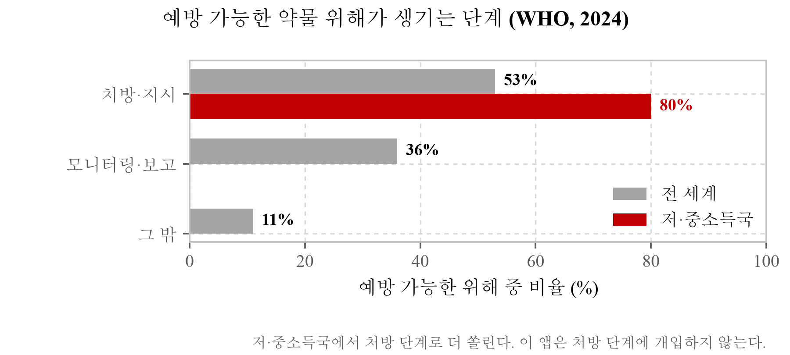

**[그림 6]** 예방 가능한 약물 위해가 생기는 단계 (World Health Organization, *Global patient safety report 2024*, ISBN 978-92-4-009545-8, 2024). 회색이 전 세계, 빨강이 저·중소득국이다. 우리에게 유리한 그림이 아니라서 싣는다.

즉 위해의 무게중심은 환자가 아니라 처방하는 쪽에 있으며, 그 쏠림은 우리가 대상으로 삼는 지역에서 더 심하다. 이 앱은 처방 단계에 개입하지 않는다.

그럼에도 이 연구가 환자 단계를 택한 이유는 두 가지다. 첫째, 처방 단계의 위해는 의료진이 있는 자리에서 일어나므로 처방 검토 시스템과 교육으로 줄일 수 있고, 실제로 그것이 §1.4 앞부분에서 인용한 국제 정책이 하는 일이다. 둘째, 환자 단계는 그 정책이 닿지 않는 유일한 자리다. 비중이 작다는 것과 손댈 수 있는 사람이 있다는 것은 다른 말이며, 우리가 고른 것은 비중이 큰 쪽이 아니라 아무도 서 있지 않은 쪽이다.

이 선택에는 대가가 따른다. 처방이 이미 잘못되어 있으면 이 앱은 잘못된 처방을 정확하게 전달한다. §5.7 에서 약국 12명 가운데 9명이 약사가 매번 검토해야 한다고 답한 것이 이 지점을 가리킨다.

다시 Gurwitz 등의 세 단계로 돌아온다. 처방과 모니터링은 의료진이 있는 자리에서 일어나므로 제도로 고칠 여지가 있다. 나머지 다섯 중 하나는 환자가 집에서 약을 꺼내 드는 순간에 일어나며, 그 자리에는 잘못을 바로잡아 줄 사람이 없다. 같은 연구에서 중증·생명위협·치명적으로 분류된 578건 가운데 42.2%가 예방 가능한 것이었다는 점을 함께 보면, 이 단계에서 놓치는 것이 사소한 종류가 아니라는 것도 분명하다.

그 범위가 어디서 끊기는지는 인력으로도 드러난다. 의사 밀도는 사하라이남 아프리카에서 인구 1만 명당 2.9명인 반면 중·동유럽과 중앙아시아에서는 38.3명으로, 열세 배가 넘게 벌어진다 (GBD 2019 Human Resources for Health Collaborators, "Measuring the availability of human resources for health," *The Lancet*, 399(10341):2129–2154, 2022). 진료 시간이 짧아지면 가장 먼저 줄어드는 것이 복약 설명이고, 그렇게 줄어든 몫은 환자가 혼자 종이를 읽어 메워야 한다. 문해율이 가장 낮은 지역과 의료 인력이 가장 부족한 지역이 겹친다는 것이 이 문제의 구조다.

### 1.5 미진단 인구라는 전제 조건

기존의 개인화 건강 앱은 사용자가 자신의 상태를 알고 있다고 전제한다. 그러나 그 전제가 성립하지 않는다.

20~79세 성인의 당뇨 유병률은 11.1%로 5억 8,900만 명에 이르며, 이 가운데 **2억 5,200만 명, 약 43%가 자신이 당뇨임을 모른다** (International Diabetes Federation, *IDF Diabetes Atlas*, 11th ed., 2025). 당뇨 성인 네 명 중 세 명이 저·중소득국에 산다. 2050년에는 8억 5,300만 명(13%)에 이를 것으로 예측되며, 2024년 한 해 당뇨로 인한 사망은 340만 명, 9초에 한 명꼴이었다 (International Diabetes Federation, *IDF Diabetes Atlas*, 11th ed., 2025).

여기서 우리에게 중요한 수는 유병률이 아니라 **43%** 다. 이들은 병원에 가서 이름을 얻은 적이 없으므로, "당뇨가 있으십니까" 라는 질문에 아니라고 답한다. 그리고 그 답을 받은 앱은 그들에게 당뇨를 고려하지 않은 판정을 내놓는다.

고혈압에서 같은 값이 다시 나온다. 2024년 기준 30~79세 성인 14억 명이 고혈압을 가지고 있는데(이 연령대의 33%), 그중 6억 명인 44%가 자신에게 고혈압이 있다는 것을 모른다. 진단과 치료를 함께 받는 사람은 6억 3,000만 명(44%)이고, 혈압이 실제로 조절되는 사람은 3억 2,000만 명(23%)에 그친다 (World Health Organization, *Hypertension* fact sheet, 2024년 추정).

두 질환에서 43%와 44%가 나온 것은 우연이 아니다. 진단은 검사에 닿을 수 있는 사람에게만 붙는 이름이고, 검사에 닿지 못하는 조건은 문해력이 낮은 조건과 대체로 겹친다. 조건을 진단명으로 묻는 화면은 이 두 집단을 같은 방식으로 놓친다.

식품 알레르기에서도 같은 구조가 나타난다. 자가보고 유병률은 임상 확진 유병률보다 일관되게 높게 나타나며, 이는 진단 수단에 접근하지 못한 사람이 상당수 존재함을 시사한다. 미국에서는 성인 약 1,800만 명, 즉 100명 중 7명이 식품 알레르기를 가지고 있다 (Food Allergy Research & Education, *Food Allergy Facts and Statistics*, 2024).

따라서 "당신은 무슨 알레르기가 있습니까" 라는 질문은 검사를 받아 본 사람만 답할 수 있는 질문이다. 이 전제를 그대로 두면 정작 도움이 가장 필요한 사람이 처음 화면에서 걸러진다.

전제가 하나 더 있다. 글을 읽을 수 있고 그것이 자기 언어라 해도, 그 글자가 눈에 보인다는 보장이 없다. 전 세계에서 최소 22억 명이 근거리 또는 원거리 시력 손상을 가지고 있으며, 그중 최소 10억 명은 예방할 수 있었거나 아직 교정되지 않은 상태다. 원거리 시력 손상의 유병률은 저·중소득 지역에서 고소득 지역의 네 배로 추정되고, 시력 손상과 실명을 가진 사람의 대다수가 50세를 넘긴 사람이다 (World Health Organization, *Blindness and vision impairment* fact sheet).

이 수치는 §1.1 의 비문해 성인 7억 3,900만 명보다 세 배 크다. §5.7 의 전문가 조사에서 다섯 명이 "글을 읽지 못하는 사람 가운데 가장 많은 수는 문맹이 아니라 시각장애인일 것" 이라고 지적했는데, 이 수치가 그 지적을 뒷받침한다. 다만 두 집단이 겹치는 정도와, 시력 손상을 가진 사람 가운데 몇이 실제로 복약 지시를 읽지 못하는지는 이 자료로 알 수 없다.

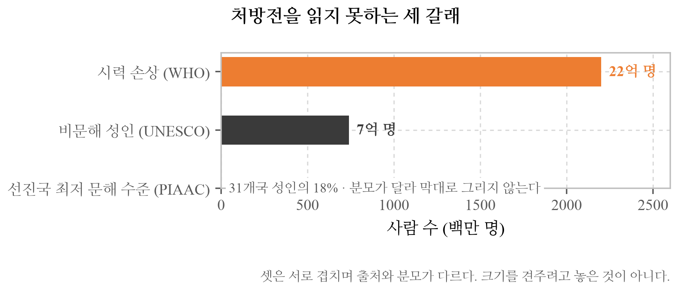

**[그림 7]** 처방전을 읽지 못하는 세 갈래. 셋은 서로 겹치고 출처와 분모가 다르므로 크기를 견주려고 놓은 것이 아니다. 이 문서가 §1.1 부터 다루어 온 것은 가운데 막대이고, 위의 막대는 우리가 다루지 않은 층이다. 아래 줄은 분모가 달라 막대로 그리지 않았다.

그 층에 무엇이 부족한지도 재어져 있다. 전 세계에서 25억 명 넘는 사람이 보조기기를 하나 이상 필요로 하며, 인구 고령화와 비감염성 질환의 증가로 2050년에는 35억 명에 이를 것으로 전망된다. 접근은 고르지 않다. **일부 저소득국에서는 필요한 보조기기에 닿는 사람이 3%인 반면 일부 고소득국에서는 90%다** (World Health Organization, *Assistive technology* fact sheet; WHO & UNICEF, *Global report on assistive technology*, 2022).

이 격차가 우리가 대상으로 삼는 지역과 겹친다. 스마트폰은 §1.6 에서 본 대로 이미 퍼져 있으나 보조기기는 그렇지 않으므로, 손에 든 기기에서 도는 것과 별도의 장비가 필요한 것 사이에 실제 차이가 있다.

이 앱은 시각장애를 대상으로 설계되지 않았다. 그림을 크게 그리고 음성을 붙였으나, 사진을 찍는 행위 자체가 앞을 보지 못하는 사람에게 장벽이 된다는 지적이 §5.7 에서 두 건 나왔다. 우리가 다루지 않은 층이며 §5.9 의 미검증 항목에 해당한다.

또 하나의 전제가 있다. 글을 읽을 수 있다 해도 그 글이 자기 언어라는 보장이 없다. 세계 인구의 40%는 자신이 이해하는 언어로 교육에 접근하지 못하며, 문해력 조사조차 대부분 한 언어만으로 측정한다 (UNESCO, *Youth and Adult Literacy: International Literacy Day 2025 Factsheet*, UNESCO, 2025). 처방전과 성분표는 그 나라의 공용어나 영어로 인쇄되므로, 문해율 통계에서 "읽을 수 있다" 로 집계된 사람 가운데도 자기 앞의 종이를 읽지 못하는 사람이 있다. 그림과 음성은 이 층을 함께 건너뛴다. 음성은 §5.7 의 조사 뒤에 응답자들이 일하는 여섯 나라의 언어를 갖추었으며, 그 경위와 한계는 §5.7 에 있다.

### 1.6 전달 매체의 보급 현황

문제를 해결할 매체 자체는 이미 보급되어 있다. 2025년 조사에서 미국의 65세 이상 스마트폰 보유율은 78%였다. 같은 조사에서 50세 미만은 97%, 50~64세는 90%였고, 전체 성인은 91%로 2011년 첫 조사의 35%에서 올랐다 (Pew Research Center, *Mobile Fact Sheet: Demographics of Mobile Device Ownership and Adoption in the United States*, 조사 기간 2025-02-05~06-18, 2025). 사하라이남 아프리카의 모바일 인터넷 이용자는 2022년 약 2억 8,700만 명에서 2030년 4억 3,800만 명으로, 스마트폰 보급률은 51%에서 88%로 확대될 전망이다 (GSM Association, *The Mobile Economy Sub-Saharan Africa 2023*, GSMA Intelligence, 2023).

[표 5] 연령대별 스마트폰 보유율 (미국, Pew Research Center, *Mobile Fact Sheet*, 2025)

| 연령대 | 보유율 |
|---|---|
| 50세 미만 | 97% |
| 50~64세 | 90% |
| 65세 이상 | 78% |

표 5이 말하는 것은 기기가 없어서 쓰지 못하는 것이 아니라는 사실이다. 고령층의 네 명 중 세 명이 이미 스마트폰을 가지고 있다. 접근을 막는 것은 화면이 읽기를 요구한다는 점이다.

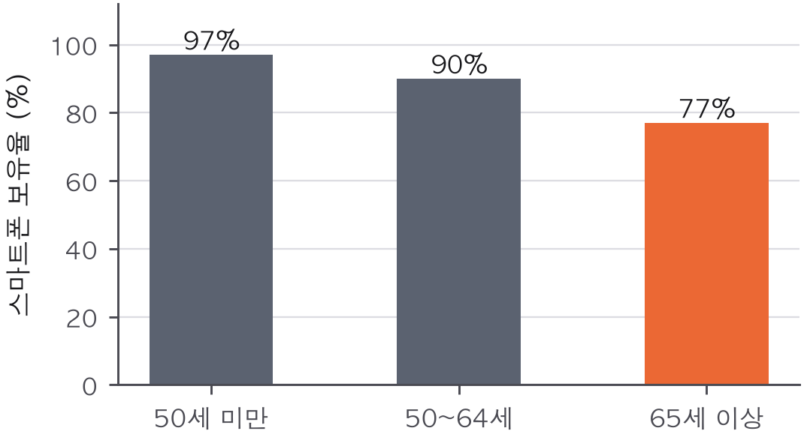

**[그림 8]** 연령대별 스마트폰 보유율 (미국, Pew Research Center, *Mobile Fact Sheet*, 2025). 65세 이상과 50세 미만의 격차는 19%p 로, 이 문제를 "기기 보급" 으로 설명하기에는 이미 좁다. 남은 격차는 화면 쪽에 있다.

다만 기기가 있다는 것과 인터넷에 닿는다는 것은 다른 말이다. 2024년 기준 55억 명이 인터넷을 쓰지만(세계 인구의 68%), 26억 명은 여전히 쓰지 않는다. 세계 인구의 32%, 세 명 중 한 명이다 (International Telecommunication Union, *Measuring digital development: Facts and Figures 2024*, 2024).

기기를 가지고 있다는 것과 그것을 계속 쓸 수 있다는 것도 다르다. §5.7 에서 독거 고령 환자에게 이 앱이 어디서 먼저 실패하겠느냐고 물었을 때, 간호·보건 9명은 화면을 조작하지 못한다(4명)와 기기를 관리하지 못한다(4명)로 갈렸다. 뒤의 것은 충전과 분실이며 우리 설계 밖에 있다. 협성대학교 박남수 교수는 하나만 고르게 한 문항 설계 자체를 지적하며 셋이 함께 온다고 적었다.

> "한가지만 선택하도록 되어 있는데 화면 조작, 기기 관리, 앱의 신뢰성(고령자 특성상)이 원인이 될 수 있다고 생각한다."
> (박남수 교수, 협성대학교)

§4.5 의 오프라인 동작은 통신이 끊긴 경우를 다루지만 기기가 꺼진 경우는 다루지 않는다. 표 5 의 보유율은 이 앱이 닿을 수 있는 사람의 상한이지 실제로 닿는 수가 아니다.

이 26억이 SnapCare 의 설계를 한 곳에서 갈랐다. 손에 든 기기에서 판정이 나야 하고, 서버에 물어야만 답이 나오는 구조라면 이들에게는 앱이 없는 것과 같다. §4.5 와 §5.6 에서 서술하는 오프라인 동작은 그래서 편의 기능이 아니라 전제다. 문해율이 낮은 지역과 인터넷을 쓰지 않는 지역은 대체로 같은 곳이므로, 이 앱은 두 조건이 겹치는 자리에서 동작해야 한다.


### 1.7 고령화의 규모와 지리적 이동

60세 이상 인구는 2020년 10억 명에서 2030년 14억 명으로 증가하며, 2030년에는 세계 인구 여섯 명 중 한 명이 60세 이상이 된다. 2050년에는 21억 명으로 다시 두 배가 되고, 세계 인구에서 차지하는 비중은 2015년 12%에서 2050년 22%로 오른다. 더 중요한 것은 그 분포다. **2050년에는 60세 이상 인구의 3분의 2가 저·중소득국에 살게 된다** (World Health Organization, *Ageing and health* fact sheet).

**[그림 9]** 고령 인구의 규모와 지리적 이동, 그리고 그 사람들이 놓인 자리. 왼쪽에서 2050년 막대만 둘로 갈라 그린 것은 출처가 그 해의 분포만 밝히기 때문이다. 2020년과 2030년을 같은 비율로 갈라 그리면 자료에 없는 것을 그리게 된다. 오른쪽 셋은 한국 65세 이상에서 잰 값이며, 맨 위와 아래의 거리가 이 제안서의 자리다.

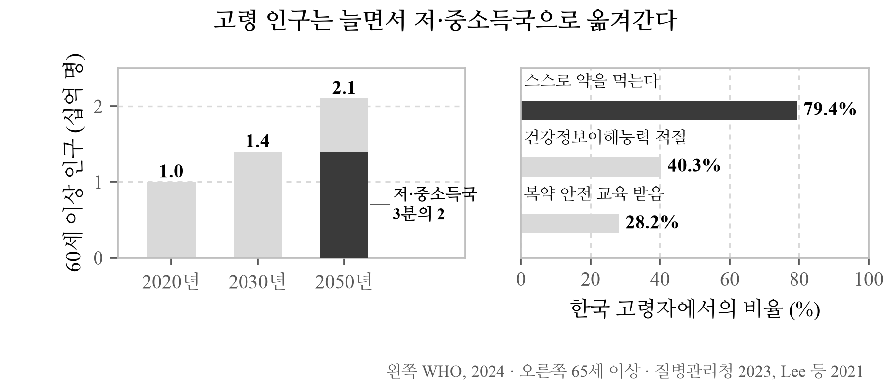

고령화는 흔히 부유한 국가의 문제로 인식되지만 실제로는 반대 방향으로 이동하고 있다. 그리고 저·중소득국의 고령자는 문해력이 낮을 가능성이 높고, 여러 약을 동시에 복용하며, 의료 접근이 어려운 사람 이라는 세 조건이 겹치는 집단이다.

가운데 조건은 수로 확인된다. 56개국 1,662만 명을 다룬 545편을 종합한 결과 고령자의 다제복용 유병률은 50.4%(95% 신뢰구간 48.2~52.7%)이며, 약이 한 종 늘 때마다 사망 위험비가 1.05(1.03~1.06), 응급 진료가 1.02(1.02~1.03), 입원이 1.04(1.02~1.07)씩 오른다 (Tian, F., Chen, Z., Zhang, Y. et al., "Global prevalence, trends, and dose-response associations of polypharmacy in older adults," *The Journals of Gerontology: Series A*, 81(8):glag176, doi:10.1093/gerona/glag176).

고령자의 절반이 다섯 종 이상을 함께 먹는다는 것은 이 앱이 다루는 화면 하나에 약이 여럿 온다는 뜻이기도 하다. §5.7 에서 인도네시아 Universitas Gadjah Mada 의 Niken Nur Widyakusuma 약사가 "여러 약을 한꺼번에 받았을 때 어느 약이 하루 세 번인지 구분하기 어렵다" 고 지적한 것이 이 조건에서 나온다.

한국의 자료가 이 겹침을 구체적으로 보여준다. 65세 이상 131명을 조사한 연구에서 **79.4%가 스스로 약을 복용**하지만 복약 안전 교육을 받은 사람은 **28.2%**에 그쳤다 (Lee, M., Kim, K., Rhew, K. & Choi, K.-H., "A knowledge, attitude, and practice survey on medication safety in Korean older adults," *Healthcare*, 9(10):1365, 2021, doi:10.3390/healthcare9101365). 그리고 그 연령대의 건강정보이해능력이 적절한 비율은 40.3%다 (질병관리청, *국민건강영양조사 제9기 2차년도*, 2023). 스스로 관리해야 하는 사람이 다수인데, 읽어낼 준비를 갖춘 사람은 소수라는 뜻이다.

표본이 131명으로 작고 조사가 2017년에 이루어졌다는 점은 밝혀 둔다. 이 값을 한국 고령자 전체의 추정치로 쓰기에는 무리가 있으며, 여기서 쓰는 것은 비율의 방향이다. 스스로 관리하는 쪽이 교육받은 쪽보다 훨씬 많다는 것.

몰도바에서도 같은 구조가 관찰된다. 2015년부터 2060년 사이에 인구는 31% 줄고 평균 연령은 38세에서 47세로 오르며, **고령 인구 비중은 두 배 이상 늘어 27%에 이를 전망이다.** 질병 부담은 비감염성 질환에 압도적으로 집중되어 있으며, 2008년부터 2015년 사이에 당뇨 유병률이 75%, 순환기 질환이 41% 늘었다 (Voncina, L., Dozol, A., Volovei, I. & Cetinkaya, V., *Human Development Assessment for Moldova: Background Paper on Health*, World Bank, 2022).

건강 문해력과 1차 의료 이용의 관계를 몰도바계 인구에서 직접 다룬 연구도 있다. 다만 이 연구의 대상은 몰도바 거주자가 아니라 **이탈리아 파도바에 사는 몰도바 이주 여성 170명**이며, 문해력이 낮은 쪽에서 흡연율이 높고(33.3% 대 14.3%) 주치의 방문이 적었다는 것을 보고한다 (Vianello, F. A. et al., "Health status of female Moldovan migrants to Italy by health literacy level and age group," *BMC Public Health*, 20:1502, 2020, doi:10.1186/s12889-020-09582-9). 이주민 표본이므로 몰도바 국내 인구에 그대로 옮길 수 없다는 점을 밝혀 둔다. 우리가 이 연구에서 취하는 것은 수치가 아니라 **건강 문해력이 1차 의료 이용과 실제로 연동된다는 관계**이며, 그 관계를 몰도바 현지에서 확인하는 것은 §5.9 의 현지 평가에 속한다.

### 1.8 시각적 전달의 효과와 한계

그림이 문자보다 잘 기억된다는 것은 인지심리학에서 반복 검증된 현상이다. 그림 우월 효과(picture superiority effect)는 그림이 단어보다 회상률이 높고 더 오래 남는다는 것을 가리키며, 이중부호화 이론은 시각 정보가 시각과 언어 두 경로로 부호화되어 회상 경로가 둘인 반면 문자는 시각 부호화가 잘 되지 않는다는 것으로 이를 설명한다 (Paivio, A., *Imagery and Verbal Processes*, Holt, Rinehart & Winston, 1971; *Mental Representations: A Dual Coding Approach*, Oxford University Press, 1986). 보건 의사소통 영역에서도 문자에 밀접히 결합된 그림은 문자 단독 대비 주의와 회상을 뚜렷이 증가시킨다 (Houts, P. S., Doak, C. C., Doak, L. G. & Loscalzo, M. J., "The role of pictures in improving health communication," *Patient Education and Counseling*, 61(2):173–190, 2006).

그러나 여기서 두 가지를 구분해야 한다.

첫째, Houts 등의 결과는 그림을 문자 또는 음성과 밀접히 결합했을 때의 것이다. 원문은 "written or spoken text" 라고 쓴다. 이 구분이 본 연구의 설계에 직접 닿는다. SnapCare 는 그림을 문자와 짝지우지 않고 음성과 짝지우므로, Houts 등이 다룬 두 조건 가운데 뒤쪽에 해당한다. 다만 그 검토에 포함된 연구들이 음성 조건을 문자 조건만큼 많이 다루었는지는 확인하지 못했으며, 문자를 완전히 제거한 화면에서의 효과는 여전히 별도로 검증되어야 한다.

둘째, 그리는 것과 읽히는 것은 다르다. 그래픽 심볼의 국제 표준인 ISO 9186-1 은 사용자의 최소 67%가 올바로 이해할 것을 요구하며 (ISO 9186-1:2014, *Graphical symbols — Test methods — Part 1: Method for testing comprehensibility*), 미국 안전 표지 표준인 ANSI Z535.3 은 50명 이상의 표본에서 85% 이상의 정답률과 **치명적 혼동 5% 이하**를 함께 요구한다 (ANSI Z535.3-2022, *Criteria for Safety Symbols*).

실제로 만들어진 의약 픽토그램이 이 기준을 어느 정도 통과하는지가 문제의 핵심이다.

[표 6] 의약 픽토그램의 이해도 기준 통과율

| 연구 | 대상 | 기준 | 결과 |
|---|---|---|---|
| Gutierrez 등 (2022) | 필리핀 성인 · USP 82종 + FIP 26종 | ANSI 85% | 통과 **108종 중 17종 (15.7%)** |
| Dowse, R., Okeyo, S., Sikhondze, S. & Khumalo, N. (2023) | 남아공 저문해 성인 · 현지 제작 10종 | ISO 66.7% | 통과 **10종 중 8종 (80%)** · 평균 이해도 7.9 ± 1.8 / 10 |
| Dowse & Ehlers (2001) | 남아공 Xhosa 46명(정규교육 ≤7년) · 각 23종 | ANSI 85% | 현지 제작 **23종 중 20종(87%)** vs. USP-DI **23종 중 11종(48%)** |

표 6가 보여주는 것은 픽토그램을 만든다고 해서 읽히는 것이 아니라는 사실이다. 국제적으로 통용되는 USP·FIP 픽토그램 108종을 필리핀 성인에게 시험했을 때 ANSI 85% 기준을 통과한 것은 17종, 여섯에 하나꼴에 그쳤다 (Gutierrez, M. M., Patikorn, C. & Anantachoti, P., "Evaluation of pharmaceutical pictogram comprehension among adults in the Philippines," *Journal of Pharmaceutical Policy and Practice*, 15:30, 2022, doi:10.1186/s40545-022-00426-y).

세 연구를 나란히 놓으면 무엇이 통과율을 가르는지가 보인다. 통과율이 가장 높은 것은 현지에서 만들어 현지 사람에게 시험한 세트다 (Dowse, R., Okeyo, S., Sikhondze, S. & Khumalo, N., *Health SA Gesondheid*, 28:2192, 2023: 10종 중 8종). 가장 직접적인 증거는 Dowse & Ehlers 의 대조 실험이다. 같은 46명에게 같은 지시를 담은 두 세트를 보였을 때, 현지에서 만든 23종 중 20종(87%)이 ANSI 85% 기준을 통과한 반면 USP-DI 23종에서는 11종(48%)만 통과했다 (Dowse, R. & Ehlers, M. S., "The evaluation of pharmaceutical pictograms in a low-literate South African population," *Patient Education and Counseling*, 45(2):87–99, 2001). 같은 사람들에게 같은 뜻을 물었는데 그림의 출신에 따라 두 배 가까이 갈렸다.

의약 픽토그램 밖에서도 같은 것이 관찰된다. 국제 표준으로 정해진 체외진단기기 기호 18종을 네 나라의 보건인력 293명에게 시험한 연구에서, ISO 기준을 넘긴 기호가 벨기에와 쿠바에서는 여섯 종인 반면 콩고민주공화국에서는 두 종, 캄보디아에서는 한 종이었다. 가장 벌어진 것은 생물학적 위험 기호로, 쿠바에서 94.1%가 맞힌 것을 콩고민주공화국에서는 8.0%가 맞혔다 (Hermans, V., Monzote, L., Van den Sande, B. et al., "Assessment of the knowledge of graphical symbols labelled on malaria rapid diagnostic tests in four international settings," *Malaria Journal*, 10:331, 2011).

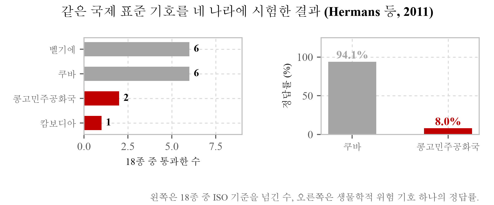

**[그림 10]** 같은 국제 표준 기호를 네 나라에 시험한 결과 (Hermans, V., Monzote, L., Van den Sande, B. et al., "Assessment of the knowledge of graphical symbols labelled on malaria rapid diagnostic tests in four international settings," *Malaria Journal*, 10:331, 2011). 왼쪽은 18종 가운데 ISO 기준을 넘긴 수이고, 오른쪽은 생물학적 위험 기호 하나의 정답률이다. 기호는 같고 나라만 다르다.

같은 그림 하나가 나라를 옮기면 94%에서 8%가 된다. 이 값은 픽토그램의 이해도가 그림의 품질만으로 정해지지 않는다는 것을 가장 뚜렷하게 보여 주는 자료이며, 국제 표준이라는 이름이 이해도를 보장하지 않는다는 뜻이기도 하다.

국제 표준으로 만들어진 것을 다른 문화권에 그대로 가져가면 통과율이 떨어진다는 것이 이 분야가 반복해 관찰한 것이다. 이것이 우리가 몰도바 현지 평가를 계획에 넣은 이유이며 (§5.8), 동시에 우리 세트의 기계 판정 결과를 문화 적응 이전의 값으로 보아야 하는 이유다.

나아가 건강 문해력과 픽토그램 이해도 사이에 통계적으로 유의한 양의 상관이 확인되었다. 남아프리카공화국에서 90명을 대상으로 열 종을 시험한 연구이며, 평균 이해도는 10점 만점에 7.9 ± 1.8, 상관은 *r* = 0.34 (*p* = 0.001), 건강 문해력과의 연관은 *p* = 0.002 다 (Dowse, R., Okeyo, S., Sikhondze, S. & Khumalo, N., "Pharmaceutical indication pictograms for low literacy viewers: Health literacy and comprehension," *Health SA Gesondheid*, 28:2192, 2023, doi:10.4102/hsag.v28i0.2192). 저문해 참여자에서 오독이 더 많았다. 이는 가장 도움이 필요한 사람에게서 그림이 가장 덜 통한다는 뜻이므로, 그림 하나에 전달을 맡기지 않고 음성과 색을 겹치는 §2.1 의 설계로 이어진다. 같은 방향의 보고가 하나 더 있다. 네덜란드 약국 방문자 197명에게 픽토그램 10종을 시험한 연구에서 67% 이해 기준을 넘은 것은 절반이었으나 (개별 범위 31.0~98.5%), **저문해 집단에서는 10종 중 2종만이 그 기준을 넘었다.** 그리고 3종에서 알아보지 못하면서 안다고 믿는 거짓 확신(false confidence) 의 위험이 관찰되었다 (van Beusekom, M. M. et al., "Pharmaceutical pictograms for low-literate patients: Understanding, risk of false confidence, and evidence-based design strategies," *Patient Education and Counseling*, 100(5):966–973, 2017).

이 논문의 결론 한 줄이 본 연구의 판단과 같다. **안전에 관한 정보에서는 67% 이해로 충분하지 않을 수 있다.** 기준을 넘겼다는 것과 믿고 맡길 수 있다는 것은 다른 말이며, 그래서 SnapCare 는 그림이 기준을 넘겨도 음성과 색을 함께 남긴다.

그러나 같은 자리에서 반대 방향의 증거도 분명하다. 앞서 인용한 물약 시험(§1.3)은 무작위 대조시험이었고, 대조군과 갈린 것이 픽토그램이 들어간 지시였다. 픽토그램을 받은 보호자에서 20%를 넘는 용량 오차는 47.8%에서 **5.4%로 떨어졌고**(절대위험 감소 42.4%p), 복약을 지키지 않은 비율도 38.0%에서 9.3%로 낮아졌다 (Yin, H. S. et al., "Randomized controlled trial of a pictogram-based intervention to reduce liquid medication dosing errors and improve adherence among caregivers of young children," *Archives of Pediatrics & Adolescent Medicine*, 162(9):814–822, 2008).

남아공에서 정규교육 7년 이하의 저문해 성인 60명을 대조군과 실험군으로 나눈 시험에서도, 그림을 함께 받은 쪽에서 약 라벨과 복약 안내문 **양쪽 모두 이해도 80%를 넘긴 참여자가 유의하게 많았다** (Mansoor, L. E. & Dowse, R., "Effect of pictograms on readability of patient information materials," *Annals of Pharmacotherapy*, 37:1003–1009, 2003).

무엇을 겹쳐야 하는지를 직접 가른 시험도 있다. 카타르에서 아랍어와 영어를 읽지 못하는 이주노동자 123명을 세 갈래로 무작위 배정해, 글에 구두 설명을 더한 것과 그림만 있는 라벨과 그림에 구두 설명을 더한 것을 견주었다. **그림에 구두 설명을 더한 쪽이 대부분의 지시에서 가장 나았다** (*p* ≤ 0.05) (Kheir, N., Awaisu, A., Radoui, A., El Badawi, A., Jean, L. & Dowse, R., "Development and evaluation of pictograms on medication labels for patients with limited literacy skills in a culturally diverse multiethnic population," *Research in Social and Administrative Pharmacy*, 10(5):720–730, 2014, doi:10.1016/j.sapharm.2013.11.003).

세 갈래 가운데 이긴 것이 SnapCare 의 구성과 같다. 글에 음성을 더한 것도 아니고 그림만도 아니며, 그림에 음성을 더한 것이다. §2.1 에서 세 층을 겹치기로 한 판단이 이 시험에서 직접 지지된다.

같은 연구가 남긴 반대쪽 결과도 적어 둔다. "두 알을 하루 세 번" 이나 "한 방울을 눈에" 는 잘 전달되었으나 **"유제품과 함께 먹지 말 것" 은 그림과 설명을 함께 주어도 여전히 어려웠다.** 추상적이고 부정형인 지시가 남는다는 뜻이며, §5.7 에서 AAC 응답자가 공복이나 상호작용 같은 추상 개념이 먼저 실패할 것이라고 짚은 것과 §5.3 에서 우리가 개선하지 못한 다섯 종이 모두 개념의 문제였던 것이 같은 자리다.

표본을 크게 잡은 것도 있다. 레바논 성인 1,848명에게 같은 처방 지시를 글로만, 그리고 그림을 곁들여 보인 결과 이해도 점수가 9.36(±1.60)에서 10.88(±0.89)로 올랐다 (차이 1.52, 95% CI 1.45~1.60, *p* < 0.001) (Mourad, N., Younes, S., Mourad, L. et al., "Comprehension of prescription orders with and without pictograms," *BMC Public Health*, 23:1926, 2023, doi:10.1186/s12889-023-16856-5).

이 연구에도 우리에게 불리한 결과가 있다. **나이가 많을수록 그림으로 얻는 이득이 작았다** (Beta = −0.019, *p* < 0.001). 이 앱이 고령자를 주요 대상으로 삼는다는 점(§1.7)을 생각하면 이것은 그냥 지나칠 수치가 아니다. §5.7 에서 김은경 국립공주대학교 교수가 "이런 이미지와 친숙하지 않은 고령자들은 더 어려울 것" 이라고 적은 것이 같은 방향의 관찰이다.

개별 시험을 넘어 전체를 모은 것도 있다. 4,160편을 훑어 무작위 대조시험 54편을 고르고 그중 42편을 메타분석한 결과, 그림을 곁들인 건강 정보는 지식·이해와 회상을 전반적으로 중간 정도 높였고, **건강문해력이 낮은 집단(13편)에서는 지식·이해가 크게 올랐다** (Schubbe, D., Scalia, P., Yen, R. W., Saunders, C. H., Cohen, S., Elwyn, G., van den Muijsenbergh, M. & Durand, M.-A., "Using pictures to convey health information: A systematic review and meta-analysis of the effects on patient and consumer health behaviors and outcomes," *Patient Education and Counseling*, 103(10):1935–1960, 2020, doi:10.1016/j.pec.2020.04.010).

같은 논문이 우리 설계에 직접 걸리는 문장을 하나 더 남겼다. **낱말이 적은 아이콘이 가장 도움이 될 수 있다**는 것이다. §5.7 에서 세 나라의 응답자가 한 장에 요소가 너무 많다고 지적한 것과 독립적으로 같은 방향을 가리킨다. 다만 저자들이 결과의 이질성이 크므로 조심해 읽으라고 적어 두었고, 여기서도 그렇게 읽는다. 이 값들은 그림을 쓰라는 근거이지 어떤 그림이든 된다는 근거가 아니다.

정리하면 이 분야는 세 가지를 함께 관찰해 왔다. 잘 만든 그림은 실제로 오류를 줄인다(Yin, H. S. et al., *Arch Pediatr Adolesc Med*, 162(9):814–822, 2008: 47.8% → 5.4%). 그림은 혼자보다 음성과 함께일 때 낫다(Kheir, N., Awaisu, A., Radoui, A., El Badawi, A., Jean, L. & Dowse, R., *Res Social Adm Pharm*, 10(5):720–730, 2014). 그리고 만들었다고 해서 잘 만들어지는 것은 아니다(Gutierrez, M. M., Patikorn, C. & Anantachoti, P., *J Pharm Policy Pract*, 15:30, 2022: 108종 중 17종). 앞의 둘이 이 접근을 택할 이유이고, 뒤의 것이 만든 뒤에 재야 할 이유다.

여기에 이 분야가 아직 답하지 못한 것이 하나 붙는다. 그림으로 얻는 이득이 나이가 많을수록 작아진다는 Mourad 등의 결과와, 낱말이 적은 아이콘이 가장 낫다는 Schubbe 등의 결과는 둘 다 우리가 고령자에게 무엇을 얼마나 보여야 하는지를 묻는다. 어느 쪽도 우리 세트에 대해 답해 주지 않는다. 그것은 §5.10 의 현지 평가에서 우리가 재야 할 것이다.

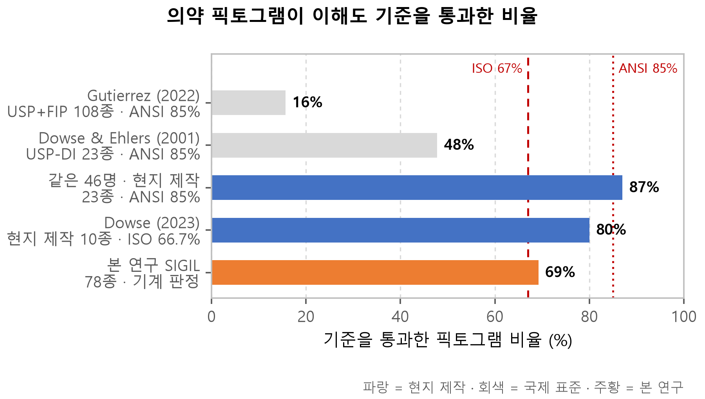

**[그림 11]** 의약 픽토그램이 이해도 기준을 통과한 비율. 막대마다 적용된 기준이 달라 아래에 함께 적었다. 같은 축에 놓았다고 해서 서로 겨룬 값이 아니다. 가운데 두 막대가 같은 연구의 대조군·실험군이며, **같은 46명에게 같은 지시를 담은 두 세트를 보인 결과**다. 그림의 출신이 통과율을 두 배 가까이 가른다. 본 연구 값(69.2%)은 §5.2 의 기계 판정 결과이며 사람에게 묻지 않았으므로 나머지와 직접 비교할 수 없다. 같은 판에 놓은 것은 우열을 주장하기 위해서가 아니라, 우리 값이 이 분야가 관찰해 온 범위 안에 있음을 보이기 위해서다.

이것이 본 연구가 픽토그램을 만드는 데 그치지 않고 그 이해도를 측정하는 절차를 함께 설계한 이유다.


### 1.9 기존 픽토그램 표준의 구조적 제약

현재 가장 널리 쓰이는 의약 픽토그램 표준은 미국약전(USP)의 81종 세트다. 의무(사각형), 금지(원과 사선), 경고(역삼각형)의 세 범주로 구성되며, USP 는 이것을 GIF 와 EPS 형식으로 무상 배포한다 (U.S. Pharmacopeia, *USP Pictograms*, https://www.usp.org/health-quality-safety/usp-pictograms).

세트가 지금의 81종에 이른 경위는 우리가 1차 출처에서 확인하지 못했다. 여러 이차 문헌이 1980년대에 시작해 1990년대에 지금 수에 이르렀다고 적으나 원문을 열지 못했으므로 연도를 적지 않는다. 이 절의 논지는 세트가 언제 만들어졌는지가 아니라 그것이 조합되지 않는다는 데 있고, 그 근거는 아래의 라이선스 조항이다.

이 표준의 한계는 표현력에 있다. **"하루 세 번, 식후 30분, 냉장 보관, 임신부 금기"** 와 같은 하나의 처방 지시는 단일한 USP 픽토그램으로 표현할 수 없으며, 다섯 내지 여섯 개의 심볼을 나열하는 것으로만 전달할 수 있다.

그리고 이것은 설계의 미비가 아니라 명시적 제약이다. USP 는 무상 사용을 허락하면서 네 가지를 조건으로 건다. 오독의 가능성 때문에 픽토그램을 환자에게 정보를 전달하는 유일한 수단으로 쓰지 말 것, USP 의 허락 없이 변형하거나 USP 가 만들지 않은 심볼과 함께 쓰지 말 것, 픽토그램이 바뀔 수 있으므로 최신판만 쓸 것, 그리고 USP 의 저작권 표시를 함께 실을 것이다. USP 는 부적절하게 쓰인다고 판단하면 허락을 거두어들일 권리를 함께 남겨 두었다 (U.S. Pharmacopeia, *USP Pictograms*). 둘째 조항이 조합을 막는다. 표준을 준수하는 한 심볼을 겹치거나 이어 붙이는 일은 앞으로도 불가능하다.

첫째 조항은 반대로 우리와 같은 편이다. 픽토그램을 정보 전달의 유일한 수단으로 쓰지 말라는 것은 표준을 만든 쪽이 그림 하나로는 부족하다고 적어 둔 것이며, SnapCare 가 그림·음성·색 세 층을 겹치는 §2.1 의 설계와 같은 판단이다. 우리는 이 조항에 동의하되 보조 수단을 문자가 아닌 것으로 두었다는 점에서만 다르다.

고정된 목록과 문법의 차이는 개수의 차이가 아니라 종류의 차이다. 81종을 810종으로 늘려도 처방 지시의 조합은 그보다 빠르게 늘어나므로 언젠가 목록에 없는 지시가 나온다. 문법은 반대로 움직인다. SIGIL 은 형태소 78종과 연산자 다섯 개로 되어 있는데, 형태소를 하나 더 만들면 그것이 기존의 모든 연산자·수식어와 결합할 수 있는 자리가 함께 생긴다. 늘어나는 것이 항목 하나가 아니라 조합의 층이다.

이 차이는 셀 수 있다. 머리 57종에는 각각 수식어가 하나 들어갈 자리가 있고, 어느 수식어가 들어갈 수 있는지를 제한하는 목록이 사전에 없다. 그러므로 머리와 수식어를 짝지은 칸이 57 × 21 = 1,197가지이고, 머리만 세운 칸 57가지와 혼자 설 수 있는 시각 형태소 넷을 더하면 1,258가지다. 여기에는 금지·하루 횟수·반쪽 연산자를 아직 적용하지 않았다. 늘어나는 속도는 더 분명하다. USP 세트에 심볼을 하나 그리면 표현이 하나 늘지만, SIGIL 에 수식어를 하나 그리면 머리 57종 전부와 짝지을 자리가 함께 생겨 57가지가 는다. 머리를 하나 그리면 21가지가 는다.

**[그림 12]** 고정 목록과 문법이 늘어나는 방식. 왼쪽은 두 세트가 지금 낼 수 있는 칸 수이고, 오른쪽은 항목을 하나 더 그렸을 때 늘어나는 칸 수다. 오른쪽이 이 절의 논지다. 왼쪽의 1,258은 규모를 자랑하는 수가 아니라 오른쪽이 그렇게 되는 이유일 뿐이다.

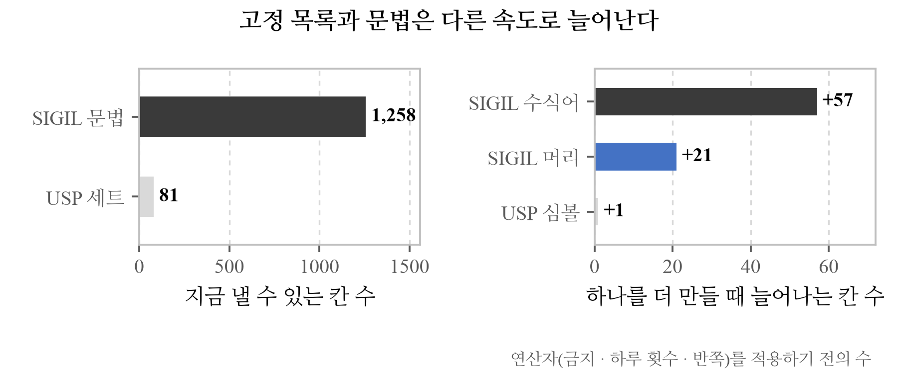

1,258이라는 수를 우리에게 유리하게 읽지 않도록 두 가지를 적어 둔다. 첫째, 이 가운데 뜻이 통하는 것이 몇인지는 세지 않았다. 문법은 `\bandage{allergen_peanut}` 을 막지 않지만 그 그림은 아무것도 말하지 않는다. 문법이 보장하는 것은 조합이 성립한다는 것이지 그 조합이 무엇을 뜻한다는 것이 아니며, 그것을 거르는 일은 §5.2 의 의미 검사가 맡는다. 둘째, USP 의 81종은 사람에게 물어 검증된 세트이고 우리의 1,258가지는 그렇지 않다. 두 수는 같은 자로 잰 것이 아니다. 이 그림이 말하는 것은 우리 세트가 낫다는 것이 아니라 두 접근이 늘어나는 방식이 다르다는 것뿐이다.

이 차이가 실제로 드러나는 자리가 앱이 만들지 못한 개념을 기록으로 남기는 부분이다 (§5.10 의 4단계). 고정 목록에서는 없는 그림을 만나면 그것으로 끝이지만, 문법에서는 무엇이 부족했는지가 형태소 단위로 남으므로 다음에 무엇을 추가할지가 정해진다.

문화권에 따라 이해도가 달라 문화 적응판이 필요하다는 것은 표 6 가 이미 보여 준 바와 같다.

### 1.10 저문해 인터페이스 선행연구

저문해 사용자를 위한 인터페이스 연구는 문자 제거가 필요조건이지 충분조건이 아님을 보여 준다.

Medhi 등은 방갈로르 빈민가의 비문해 가사노동자와의 민족지적 설계를 통해 문자 없는 인터페이스를 구축했으며, 그 기준은 "누구의 개입도 없이 사용할 수 있을 것" 이었다 (Medhi, I., Sagar, A. & Toyama, K., "Text-Free User Interfaces for Illiterate and Semi-Literate Users," *Information Technologies and International Development*, 4(1):37–50, 2007). 이 기준은 설명이 필요한 단계를 만들지 않는다는 것을 뜻한다.

이어진 연구에서 인도·필리핀·남아공의 저문해·저소득 400명을 대상으로 조사한 결과, 장벽은 문해력만이 아니라 인지적 어려움, 문화적 예절, 노출 경험, 위압감, 매개, 동기, 가격, 권력 관계, 사회적 지위까지 얽혀 있음이 확인되었다 (Medhi, I., Cutrell, E. & Toyama, K., "It's not just illiteracy," *Proc. International Conference on Interaction Design & International Development*, 2010).

구조의 문제도 확인되었다. 방갈로르 빈민가의 비문해 성인 20명을 대상으로 터치스크린 휴대폰에서 40개 항목 중 5개를 찾게 한 실험에서, 7쪽에 걸친 다중 페이지 목록형은 평균 25초가 걸린 반면 4단계 깊이의 계층형은 65.5초가 걸렸다 (*t*(18) = 4.6, *p* < 0.001). 정답률도 목록형 100%, 계층형 80%로 갈렸다 (*t*(18) = −3, *p* = 0.0077) (Medhi, I., Toyama, K., Joshi, A., Athavankar, U. & Cutrell, E., "A Comparison of List vs. Hierarchical UIs on Mobile Phones for Non-literate Users," *INTERACT 2013*, LNCS 8118:497–504, doi:10.1007/978-3-642-40480-1_33).

다른 연구진이 다른 과제에서 같은 실패를 찾았다. 만성신장병 5기 환자 10명(REALM 검사로 셋이 3학년 이하, 셋이 7~8학년, 넷이 9학년 이상)에게 휴대기기로 음식의 양을 추정하게 한 연구에서, 액체와 형태가 일정하지 않은 음식은 열 명 모두 또는 여덟 명이 맞혔으나 **고형식을 재는 화면에서는 성공한 사람이 한 명도 없었다.** 저자들이 관찰한 원인은 참여자들이 어느 그림을 골라야 할지 정하지 못했고, 자기가 이미 어느 치수를 쟀는지를 자꾸 잊었다는 것이다 (Chaudry, B., Connelly, K., Siek, K. A. & Welch, J. L., "The design of a mobile portion size estimation interface for a low literacy population," *International Conference on Pervasive Computing Technologies for Healthcare*, 160–167, 2011, doi:10.4108/icst.pervasivehealth.2011.246113).

과제도 연구진도 다른데 실패한 이유가 같다. 화면이 사용자에게 무언가를 머릿속에 들고 있으라고 요구한 것이다. 앞의 연구에서는 어디까지 내려왔는지였고 여기서는 어느 치수를 이미 쟀는지다. SnapCare 가 단계를 없앤 것은 화면 수를 줄이려는 것이 아니라 이 요구를 없애려는 것이다.

이 두 연구가 화면 안의 구조를 다룬다면, §5.7 의 한 응답은 화면에 닿기 전을 지적한다. 협성대학교 박남수 교수는 글을 읽지 못하는 사람이 모바일 기기를 어느 정도 다루는지를 먼저 검토해야 한다고 적고, 이 앱의 프로필 설정 화면에 "본인에게 해당하는 것을 몇 개 고르세요" 라는 지시문이 있다는 것을 예로 들었다. 그 지시문을 읽지 못하면 그 화면부터 막힌다.

문자를 없애는 것이 필요조건이라는 이 절의 첫 문장이 여기서 한 번 더 확인된다. 우리는 판정에 이르는 경로에서 글을 없앴다고 적었는데(§2.1), 그 앞의 설정 화면에는 글이 남아 있었다. 없애기로 한 것과 실제로 없앤 것이 다르다는 것을 조사가 찾아 준 셈이다.

다른 연구진의 것도 하나 놓는다. 저문해 환자를 위한 환자보고결과 측정도구를 사람 중심 설계로 만든 연구인데, 성인 17명(환자 12, 보호자 3, 진료실 직원 2)을 대상으로 했고 그중 46%가 REALM-SF 에서 저문해로 채점되었다. 여섯 가지를 넣었다. 문항마다 붙는 음성 낭독, 동작을 보이는 애니메이션, 멀티미디어를 켜고 끄는 아이콘, 성별 중립·다인종 아바타, 진행 표시, 그림을 붙인 응답 척도다 (Azad, C. L., Beres, L. K., Wu, A. W., Fong, A. & Giladi, A. M., "Developing a multimedia patient-reported outcomes measure for low literacy patients with a human-centered design approach," *PLOS ONE*, 19(6):e0304351, 2024, doi:10.1371/journal.pone.0304351).

이 연구가 우리와 갈리는 자리가 둘이다. 첫째, 저자들은 사용자를 문해 수준으로 셋(비문해·느린 독자·문해)으로 나누었다. §1.5 에서 이한길 부교수가 전맹·저시력·저문해를 가르라고 한 것과 같은 종류의 판단이며, 우리는 그 셋을 하나로 묶어 설계했다. 둘째, 저자들은 멀티미디어를 아이콘으로 켜고 끄게 했다. 문해력이 높은 사용자는 지나가고 낮은 사용자만 받는 구조인데, 이 앱은 §3.5 처럼 모두에게 음성을 내보낸다. 어느 쪽이 옳은지는 이 연구도 우리도 사람에게 물어 정하지 않았다.

같은 문헌이 아이콘에 대해 남긴 관찰도 적어 둔다. 아이콘은 저문해 사용자에게 뜻이 불투명한 경우가 있고, 추상적 기호일수록 문화와 문해의 벽을 넘지 못하며, 사용자는 양식화된 그림보다 구체적이고 사진에 가까운 표현을 선호한다는 것이다. 뒤의 것은 우리 설계와 정면으로 어긋난다. §2.2 의 세트는 흑백 실루엣이고, 그것은 32픽셀에서 살아남기 위한 선택이었다(§5.2). 살아남는 것과 선호되는 것이 같은 방향이 아닐 수 있다는 뜻이며, 이 어긋남은 §5.10 의 현지 평가에서 확인할 항목이다.

저자들은 원인을 중첩(nesting) 개념 자체의 이해에서 찾는다. 계층형에서 상위 그림이 하위 항목의 묶음을 뜻한다는 것을 이해하지 못한 참여자들이 있었고, 잘못 들어간 뒤 상위로 돌아오는 방법을 기억하지 못한 경우도 있었다. 쪽을 넘기는 것 자체는 문제가 되지 않았다. 문제는 어디까지 내려왔는지를 머릿속에 들고 있어야 한다는 데 있다.

### 1.11 문제의 종합

지금까지의 논의는 다섯 갈래로 정리된다.

첫째, 규모. 비문해 성인은 7억 3,900만 명이며, 지역에 따라 절대수가 증가하고 있다 (UNESCO, *Youth and Adult Literacy: International Literacy Day 2025 Factsheet*, UNESCO, 2025). 여기에 건강 문해력 기준을 적용하면 대상은 더 넓어진다. 한국 성인의 39.6%, 65세 이상의 59.7% 가 건강정보이해능력이 충분하지 않다 (질병관리청, *국민건강영양조사 제9기 2차년도*, 2023).

둘째, 대가. 복약 오류는 연간 420억 달러의 비용을 발생시키고 (World Health Organization, *Medication Without Harm: WHO Global Patient Safety Challenge*, WHO/HIS/SDS/2017.6, 2017), 2019년 세균 내성에 직접 기인한 사망은 127만 명으로 HIV/AIDS 나 말라리아보다 많았다 (Murray, C. J. L. et al. (Antimicrobial Resistance Collaborators), "Global burden of bacterial antimicrobial resistance in 2019: a systematic analysis," *The Lancet*, 399(10325):629–655, 2022). 2023년 자료에서 실험실로 확인된 세균 감염 여섯 건 중 한 건이 항생제에 내성을 보였다 (World Health Organization, *Global antibiotic resistance surveillance report 2025 (GLASS)*, 2025).

셋째, 시각적 방법의 효과와 한계. 그림은 문자보다 잘 기억되지만 (Houts, P. S., Doak, C. C., Doak, L. G. & Loscalzo, M. J., "The role of pictures in improving health communication," *Patient Education and Counseling*, 61(2):173–190, 2006), 실제로 만들어진 의약 픽토그램 108종 가운데 ANSI 기준을 통과한 것은 17종뿐이었다 (Gutierrez, M. M., Patikorn, C. & Anantachoti, P., "Evaluation of pharmaceutical pictogram comprehension among adults in the Philippines," *Journal of Pharmaceutical Policy and Practice*, 15:30, 2022).

넷째, 표준의 구조적 제약. USP 81종은 결합이 금지되어 있어 복합 지시를 하나의 그림으로 만들 수 없다 (USP Pictogram Library License Agreement).

다섯째, 전달 경로의 개방. 미국 65세 이상의 78%가 이미 스마트폰을 보유하고 있다 (Pew Research Center, *Mobile Fact Sheet: Demographics of Mobile Device Ownership and Adoption in the United States*, 2025).

이 다섯이 가리키는 결론은 하나다. 처방전에서 픽토그램과 음성까지 자동으로 이어지고, 그 결과가 실제로 읽히는지를 측정하며, 문자를 요구하지 않는 통합 파이프라인이 필요하다.

**[그림 13]** 1장의 다섯 갈래와 그것이 가리키는 셋. 왼쪽의 수는 모두 앞 절에서 인용한 그대로이며 여기서 새로 주장하는 것은 없다. 이 그림이 하는 일은 다섯이 같은 곳을 가리킨다는 것을 한 판에 놓는 것뿐이다. 아래의 붉은 줄이 이 절이 조심하는 자리다.

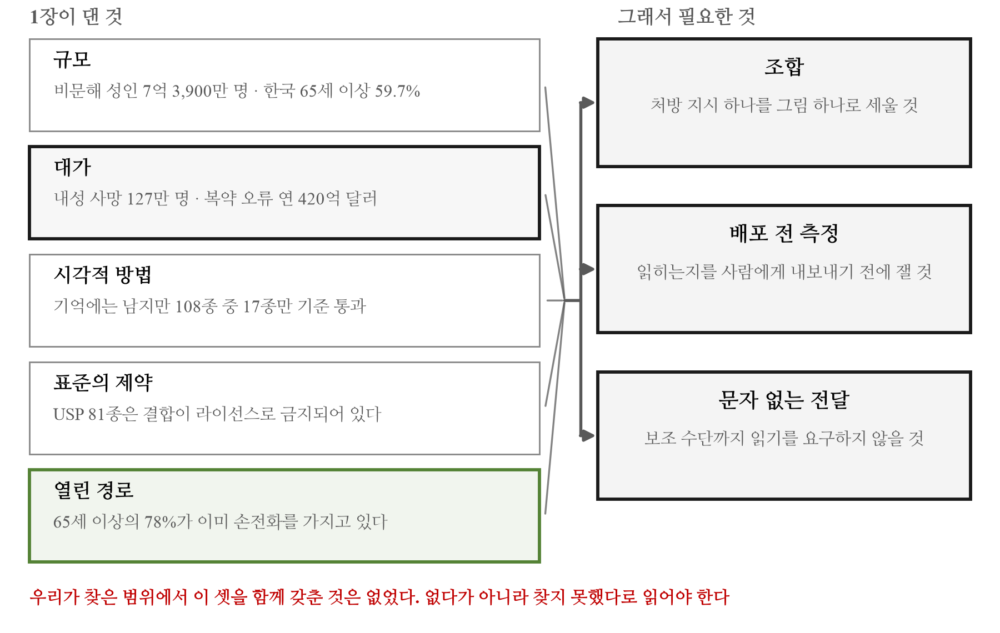

이 다섯 갈래를 세운 뒤에 우리는 그것을 현장에 물었다. §5.7 의 조사가 그것이며, 결과는 다섯 갈래를 대체로 확인해 주었다. 다만 확인해 준 방식이 우리가 기대한 것과 달랐다.

규모(첫째)는 응답자들이 오히려 낮춰 잡았다. 35명 중 15명이 그런 환자를 거의 마주치지 않는다고 답했다. 시각적 방법(셋째)은 지지받았으나 조건이 붙었다. 그림이 도움이 되는 것은 저문해의 경우이고 전맹과 저시력은 다른 층이라는 것이다. 표준의 제약(넷째)에 대해서는 두 응답자가 기존 세트를 참조하라고 권했는데, 그것은 §1.9 에서 우리가 참조할 수 없다고 적은 바로 그 세트다. 전달 경로(다섯째)는 기기 보유가 아니라 기기 관리에서 걸린다는 지적이 나왔다.

가장 자주 나온 것은 다섯 갈래 어디에도 없던 것이다. 사람을 대상으로 한 검증이 없다는 지적이 여섯 명에게서 독립적으로 나왔고, 다섯 구획의 넓은 문항에 답한 다섯 명 중 넷이 그것을 가장 먼저 해결할 것으로 골랐다. 우리가 문제를 정의하는 데 쓴 다섯 갈래는 모두 문헌에서 온 것이고, 이 지적은 그 문헌과 우리 세트 사이에 아직 아무것도 없다는 말이다.

이 장이 쓴 근거가 어느 쪽을 가리키는지를 한자리에 놓는다. 받치는 것보다 깎는 것이 더 길다.

**[그림 14]** 이 접근을 받치는 근거와 깎는 근거. 항목 끝의 절 번호에서 원문 서지와 함께 확인할 수 있다. 불리한 쪽이 일곱으로 더 길고, 그것을 줄이지 않은 것이 이 장의 방식이다. 오른쪽에서 무거운 것이 둘이다. 위해의 무게중심이 처방 단계에 있다는 것은 이 앱이 개입하지 않는 자리를 말하며, §1.4 에서 그럼에도 환자 단계를 택한 이유를 적었다. 마지막 줄은 우리 세트의 형태를 겨눈다. 저문해 사용자가 실루엣보다 사진에 가까운 그림을 선호한다는 관찰인데, 우리가 흑백 실루엣을 고른 것은 32픽셀에서 살아남기 위해서였다(§5.2). 살아남는 것과 선호되는 것이 같은 방향이 아닐 수 있다. 근거를 이렇게 놓는 이유는 유리한 것만 모으면 §5.2 가 형태소에 대해 하는 일을 우리가 문헌에 대해 하지 않는 셈이 되기 때문이다.

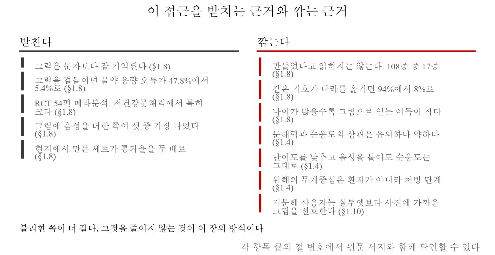

우리가 찾은 범위에서 이 셋을 함께 갖춘 시스템은 없었다. 픽토그램 세트는 있으나 조합되지 않고(§1.9), 조합을 다룬 연구는 이해도를 배포 전에 재지 않으며, 이해도를 잰 연구들(표 6)은 세트를 만든 뒤 사람을 모아 사후에 쟀다. 다만 이것은 체계적 문헌고찰의 결과가 아니라 본 연구를 준비하며 살펴본 범위에서의 관찰이므로, "없다" 가 아니라 "우리가 찾지 못했다" 로 읽어야 한다. 이것이 SnapCare 의 출발점이다.

---

## □ Solution and Main Functions

### 2.1 설계 원칙

SnapCare 의 설계 원칙은 하나다. 사용자가 판단에 이르는 경로 어디에서도 글을 읽거나 입력할 것을 요구하지 않는다.

이 원칙은 앞 절에서 확인한 두 가지 사실에서 나온다. 첫째, 문자를 없애는 것은 필요조건이다. 처방전을 읽지 못하는 사람에게 문자 인터페이스는 종이 처방전과 다르지 않다. 둘째, 문자를 없애는 것만으로는 충분하지 않다. 그림도 읽히지 않을 수 있고 (Gutierrez, M. M., Patikorn, C. & Anantachoti, P., "Evaluation of pharmaceutical pictogram comprehension among adults in the Philippines," *Journal of Pharmaceutical Policy and Practice*, 15:30, 2022), 계층 구조는 그 자체로 장벽이 된다 (Medhi, I., Toyama, K., Joshi, A., Athavankar, U. & Cutrell, E., "A Comparison of List vs. Hierarchical UIs on Mobile Phones for Non-literate Users," *INTERACT 2013*, LNCS 8118:497–504).

따라서 SnapCare 는 세 층으로 답한다. 무엇을 해야 하는지는 그림으로, 그 그림이 무슨 뜻인지는 음성으로, 그리고 지금 이것이 안전한지 위험한지는 색 하나로 전달한다. 세 층은 서로를 대체하지 않고 겹친다. 그림을 못 알아본 사람에게는 음성이 남고, 음성을 듣지 못하는 상황에서는 색이 남는다.

세 층을 하나로 줄이지 않은 이유는 이렇다. 음성만으로 충분하다는 주장이 가능하고, 실제로 음성 안내는 이 분야에서 가장 흔한 접근이다. 그러나 음성은 붙잡아 둘 수 없다. 흘러가고 나면 되감아야 하는데, 되감는 조작이 §1.10 에서 인용한 자동응답 연구가 지적한 바로 그 장벽이다. 그림은 화면에 남아 있으므로 몇 번이든 다시 볼 수 있고, 색은 눈이 화면에 닿는 순간 이미 전달되어 있다. 세 층은 같은 뜻을 세 가지 시간 척도로 내보낸다. 색은 즉시, 그림은 머무는 동안, 음성은 한 번 흐르고 필요하면 다시.

사용자가 하는 동작은 사진을 찍는 것 하나뿐이다.

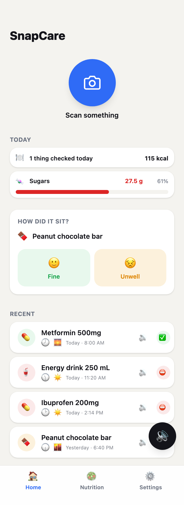

**[그림 15]** 홈 화면. 스크롤하지 않고 보이는 만큼을 그대로 잘랐다. 앱을 열었을 때 실제로 마주치는 화면이 이것이다. 화면에서 가장 큰 요소가 촬영 버튼 하나이고, 메뉴도 검색창도 없다. 선택이 하나뿐이라는 것이 §1.10 에서 확인한 계층 구조 장벽에 대한 대응이다.

§5.7 에서 이 원칙에 대해 서로 반대되는 두 응답이 왔다. University of Pretoria 의 Celia 교수는 그림이 읽지 못하는 사람의 지능을 낮춰 보지 않으면서 그들에게 맞춰진 매체라고 적었다.

> "The picture is more aligned to people who cannot read without under estimating their intelligence."
> (Celia 교수, University of Pretoria)

반대쪽은 §5.7 의 동의대학교 서희정 교수다. 비문해자에게는 그림도 글자로 느껴질 수 있다는 것이다. 두 응답이 같은 매체를 두고 정반대를 말하며, 우리는 어느 쪽이 맞는지 모른다. §5.10 의 현지 평가에서 확인해야 할 것 가운데 이것이 가장 앞에 온다. 그림을 그림으로 인식하는지를 재지 않고 그림의 이해도만 재면, 우리는 이미 통과한 사람만 채점하는 셈이 된다.

### 2.2 픽토그램 합성 엔진 SIGIL

SIGIL(Symbol Intuitive Glyph Image Lab)은 팀이 직접 설계·구현한 픽토그램 합성 엔진이다. 기존 픽토그램 세트가 그림의 목록인 것과 달리, SIGIL 은 형태소와 문법으로 구성된다.

현재 78개의 형태소를 가지며, 이는 57개의 머리(head)와 21개의 수식어(modifier)로 나뉜다. 머리는 그 자체로 설 수 있는 대상이고(약병·안약병·흡입기·땅콩·우유갑), 수식어는 홀로 설 수 없으며 머리 안쪽 자리에 들어간다(아침·정오·저녁·개수·냉장·눈·입).

여기에 다섯 개의 연산자가 있다. `no{}` 는 금지를, `half{}` 는 절반을, `twice_daily{}`·`three_times_daily{}`·`four_times_daily{}` 는 하루 횟수를 얹는다.

[표 7] SIGIL 의 구성

| 구분 | 개수 | 예 |
|---|---|---|
| 머리(head) | 57 | `pill_bottle`, `dropper_bottle`, `allergen_peanut`, `symptom_gut` |
| 수식어(modifier) | 21 | `time_morning`, `qty_two`, `storage_fridge`, `body_eye` |
| 연산자 | 5 | `no{}`, `half{}`, `twice_daily{}` 외 2 |

78종을 무엇으로 정했는지가 이 세트의 성격을 말한다. 그림을 많이 그려 놓고 조합을 나중에 생각한 것이 아니라, **§1.3 의 오류 분포에서 거꾸로 내려왔다.**

[표 8] 형태소 78종의 갈래

| 갈래 | 개수 | 무엇을 말하는가 |
|---|---|---|
| 제형·기기·행위 | 26 | 무엇을. 알약·물약·안약·흡입기·주사기·혈압계 |
| 음식 | 10 | 무엇을. 밥·빵·기름·설탕·채소 |
| 알레르겐 | 9 | 무엇을 피하나. 땅콩·견과·우유·달걀·조개 |
| 증상 | 8 | 무엇을 겪었나. 발열·기침·구토·복통 |
| 상태 | 7 | 누구인가. 아동·청소년·성인·고령·임신·수유 |
| 부위 | 6 | 어디에. 눈·입·코·피부·위 |
| **개수** | **5** | **얼마나** — 하나부터 다섯까지 |
| **시각** | **4** | **언제** — 아침·정오·저녁·밤 |
| 보관 | 3 | 어떻게. 냉장·건조·차광 |

굵게 표시한 두 갈래가 표 4 의 상위 두 오류(용량 28.4%, 시각 23.2%)에 곧바로 대응한다.

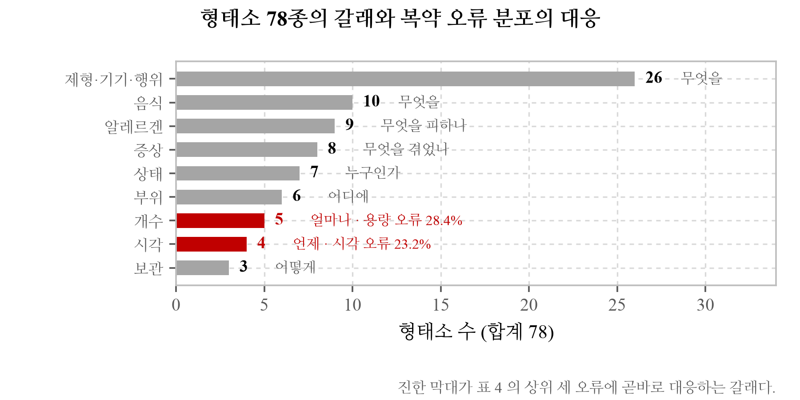

**[그림 16]** 형태소 78종의 갈래와 복약 오류 분포의 대응. 붉은 두 갈래가 표 4 의 상위 오류에 곧바로 걸린다. 갈래의 크기가 오류의 크기와 반대인 것은 그림을 많이 그려야 하는 쪽과 자주 틀리는 쪽이 다르기 때문이다. 개수는 다섯이면 충분하고 제형은 스물여섯이 필요하다. 개수가 다섯에서 멈추는 것과 시각이 넷뿐인 것은 세트를 줄이려는 절약이 아니라 처방이 실제로 그 이상을 요구하지 않기 때문이다. 하루 다섯 번을 넘는 복용은 드물고, 그보다 잦은 것은 "몇 시간마다" 로 표현되지 "언제" 로 표현되지 않는다.

반대로 갈래가 가장 두꺼운 것은 제형이다. 이유는 §2.3 에 있다. 제형이 정해지면 동사와 부위가 함께 정해지므로, 제형 하나를 늘리는 것이 지시 전체를 늘린다. 알레르겐 아홉 종은 국제적으로 표시가 의무인 주요 알레르겐 목록을 따랐다.

흑백 실루엣이라는 제약을 §5.7 이 두 방향에서 건드렸다. 협성대학교 박남수 교수는 계란 알레르기 표시가 흑백만으로는 계란인지 알기 어렵다며 실제와 같은 그림이 필요하다고 적었고, 서울대학교 유명순 교수는 잘못 읽힐 곳으로 "절반의 그림" 을 지목했다. 앞의 것은 §5.7 의 조사 뒤 수정에서 `allergen_egg` 를 깨진 달걀로 다시 그리는 근거가 되었고, 뒤의 것은 `half{}` 연산자가 그리는 반쪽이 절반이라는 뜻으로 읽히지 않을 수 있다는 지적이다. 뒤의 것은 아직 고치지 못했다.

Global Symbols 의 E. A. Draffan 은퇴 언어치료사·접근성 객원연구원은 다른 층을 지적했다. 우리 세트가 흑백인데 AAC 사용자가 익숙한 상징 체계는 대개 색이 있으며, 그 둘이 서로 다르다는 것이다. §3.7 에서 색을 판정에만 쓰고 형태소는 흑백으로 둔 결정이 이 지적과 맞물린다. 색을 쓰면 색각이상 사용자를 잃고, 쓰지 않으면 색 있는 상징에 익숙한 사용자를 잃는다. 우리는 앞쪽을 택했고 그 대가를 여기 적어 둔다.

무엇이 없는지를 응답자들이 직접 짚어 주었다. Sheron Sir Loon Goh 약학 전임강사는 특별 지시를 위한 형태소를 예로 들며 "쓰기 전에 흔들 것" 과 "어린이 손이 닿지 않는 곳에 둘 것" 을 들었다. 둘 다 지금 78종에 없다. 인도네시아 Universitas Gadjah Mada 의 Niken Nur Widyakusuma 약사는 다른 층을 짚었다. 여러 약을 한꺼번에 받았을 때 어느 것이 어느 것인지 가리는 일이 먼저인데, 지금 세트는 약을 제형으로만 구별한다. 같은 캡슐 두 종을 받으면 두 줄이 똑같이 그려진다.

세르비아 University of Belgrade 의 Katarina Vučićević 교수는 상호작용의 범위를 넓혔다. 다른 약뿐 아니라 일반의약품, 건강기능식품, 기저 질환과의 상호작용까지 임상적으로 중요할 수 있다는 것이다. §2.4 의 판정이 다루는 것은 처방된 약과 사용자가 등록한 조건뿐이므로 이 범위는 지금 밖에 있다.

여기서 세트가 닫혀 있지 않다는 점을 밝혀 둔다. 처방에는 이 78종으로 그릴 수 없는 것이 계속 나오며, 그때 앱이 무엇을 하는지는 §2.3 의 `\?개념` 표시와 §5.10 의 확장 경로에서 다룬다.

이 구조가 왜 필요한지는 앞 절의 USP 표준과 대조하면 분명해진다. "하루 세 번, 식후, 냉장 보관, 임신부 금기" 라는 하나의 지시를 USP 로는 다섯 내지 여섯 개의 심볼을 나열하는 것으로만 전달할 수 있으며, 라이선스가 결합을 금지하므로 앞으로도 그렇다 (USP Pictogram Library License Agreement). SIGIL 에서는 이것이 다음과 같이 표현된다.

```
\three_times_daily{ \capsule_strip{\food_bowl} }
\capsule_strip{\storage_fridge}
\no{\state_pregnant}
```

각 줄이 하나의 그림으로 합성되며, 머리 안쪽에 수식어가 들어갈 자리(슬롯)를 뚫고 그 안에 그린다. 형태소를 하나 추가하는 데 필요한 것은 그림 한 장이며, 나머지 조합은 문법이 만들어 낸다.

문법이 규칙으로만 있는 것이 아니라 파서가 강제한다. 재귀 하향 파서의 중심부는 다음과 같다.

```python
def _pictogram(self, in_slot: bool = False) -> Node:
    if self._peek() != "\\":
        raise ParseError(f"expected '\\' at position {self.i}")
    self.i += 1
    name = self._name()

    if self.m.is_operator(name):                     # \no{...} — 자식이 정확히 하나
        if self._peek() != "{":
            raise ParseError(f"\\{name} requires a child: \\{name}{{...}}")
        ...
        return Node(name=name, kind=NodeKind.OPERATOR, children=[child])

    if self.m.is_head(name):                         # 머리 — 슬롯에 수식어만
        children = self._slots()
        for c in children:
            if c.kind != NodeKind.MODIFIER:
                raise ParseError(f"\\{name} slots only accept modifiers; got \\{c.name}")
        return Node(name=name, kind=NodeKind.HEAD, children=children)

    if self.m.is_modifier(name):                     # 수식어 — 홀로 설 수 없다
        if not in_slot:
            raise ParseError(f"\\{name} is a modifier; must appear inside a head's slot")
        return Node(name=name, kind=NodeKind.MODIFIER)

    raise ParseError(f"unknown macro \\{name}")
```

설계 의도. 세 갈래가 각각 문법의 한 조항이다. 수식어가 슬롯 밖에 오면 파스가 실패하고, 머리의 슬롯에 다른 머리를 넣어도 실패하며, 사전에 없는 이름은 그림 대신 오류가 된다. 이것이 중요한 이유는 이 DSL 을 사람이 손으로 쓰는 것이 아니라 언어 모델이 처방 문장을 보고 만들어 내기 때문이다. 모델이 그럴듯한 이름을 지어내면 그것은 화면에서 그럴듯한 그림이 아니라 파스 오류가 되어야 한다. 안전이 걸린 화면에서 확률적 출력에 결정론적 검증 계층을 두는 것이 이 파서의 역할이며, 같은 구조를 §4.2 의 영양 판정에서도 쓴다.


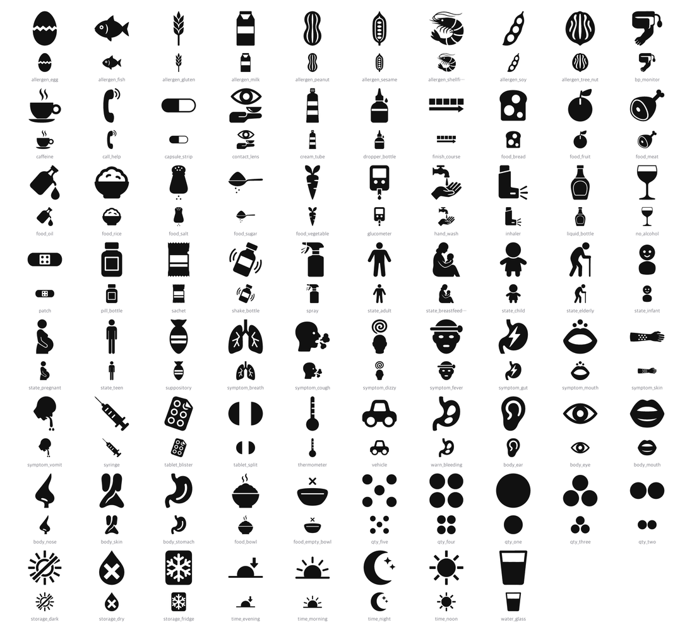

**[그림 17]** SIGIL 형태소 78종 전체(머리 57 + 수식어 21). 각 형태소 아래의 작은 그림은 같은 것을 34픽셀로 줄인 것이다. 축소본을 함께 싣는 이유는 이 그림들이 실제로는 손바닥만 한 화면에서, 때로는 목록의 한 칸으로 쓰이기 때문이다. 크게 그렸을 때만 구별되는 그림은 이 앱에서 쓸 수 없다.

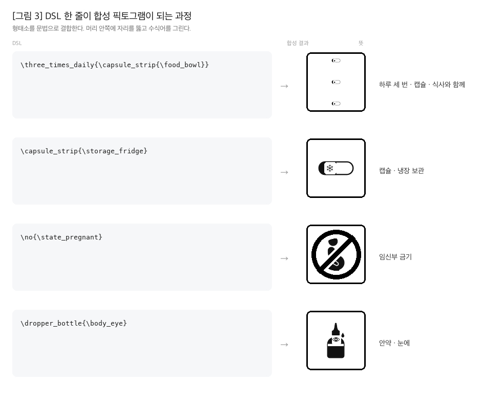

**[그림 18]** DSL 한 줄이 그림 한 장이 되는 과정. 네 예시 모두 실제 엔진을 통과시켜 얻은 결과이며 도식을 위해 다시 그리지 않았다. 머리에 뚫린 슬롯 안으로 수식어가 들어가므로, 형태소 78종에서 나오는 조합은 목록이 아니라 문법이 결정한다.

### 2.3 음성 지시 재구성 엔진 VOCA

VOCA(Voice-Output Composition Architecture)는 OCR 이 읽어 낸 문자열을 그대로 음성으로 변환하지 않는다. 처방전에는 환자가 알 필요가 없는 정보가 많고, 필요한 정보는 흩어져 있다.

VOCA 는 필요한 것만 추려 재구성한 뒤 문장으로 만든다. 이 설계의 근거는 자동응답(IVR) 연구에 있다. 고령 사용자의 사용성 평가는 젊은 사용자보다 일관되게 낮고 완료한 과제 수도 적으며, 문제의 대부분은 모호한 선택지, 말 속도, 선택지의 길이에서 나온다 (Miller, D. I., Bruce, H., Gagnon, M., Talbot, V. & Messier, C., "Improving Older Adults' Experience with Interactive Voice Response Systems," *Telemedicine and e-Health*, 17(6):452–455, 2011, doi:10.1089/tmj.2010.0204). 같은 불만을 젊은 사용자도 말했으나 대부분 스스로 넘어선 반면, 고령 사용자는 넘어서지 못한 경우가 많았다. 즉 음성을 틀어 주는 것만으로는 부족하고 무엇을 말하지 않을지가 설계의 핵심이 된다.

이 연구에는 얼핏 우리 설계와 어긋나 보이는 결과가 하나 있다. 선택지를 더 많이 제시했을 때 두 연령대 모두 더 효율적이었다는 것이다. 그러나 이것은 한 단계에 담는 선택지의 수에 관한 것이고, 그렇게 하면 메뉴의 깊이가 줄어든다. 깊은 계층이 비문해 사용자에게 특히 불리하다는 §1.10 의 결과와 같은 방향이며, 두 연구가 함께 가리키는 것은 "선택지를 줄여라" 가 아니라 "단계를 줄여라" 다. SnapCare 가 택한 것은 그 극단이다. 판정에 이르는 경로에 단계가 하나도 없다.

무엇을 버릴지가 먼저 정해진다. 처방전 한 장에는 환자 등록번호, 의료기관명, 처방 코드, 의사 면허번호, 교부 일자, 약품 코드가 함께 적혀 있다. 여섯 줄 모두 사무와 청구와 추적에 필요한 것이고, 그 자리에서 약을 먹으려는 사람이 할 일은 하나도 바꾸지 않는다. 종이라면 눈이 알아서 건너뛴다. 음성은 건너뛸 수 없다. 듣는 사람은 되감을 수도 앞질러 갈 수도 없으므로, 한 줄을 읽어 주면 그만큼 뒤에 오는 것이 묻힌다. 화면에는 이 정보가 그대로 남는다. 지우는 것이 아니라 읽지 않는 것이다.

남긴 것을 말하는 순서에도 근거가 있다. 1회 용량이 맨 앞에 온다. §5.1 의 형성 평가 첫 측정에서 용량과 보관 정보가 OCR 에서 픽토그램까지는 도달하는데 음성과 문장에는 도달하지 않고 있었고, 그 상태는 §1.3 에서 인용한 실패 유형과 정확히 같은 것이다. 지시를 말로는 정확히 되풀이하면서 하루에 몇 알인지는 짚지 못하는 상태이며, Davis 등(2006)에서 앞을 할 수 있었던 70.7% 가운데 뒤를 할 수 있었던 것은 34.7% 였다. 그다음이 복용법, 그다음이 마무리 문장이고, 보관은 냉장일 때만 붙는다. 실온은 기본값이라 한 문장을 더 얹을 만한 정보가 아니다.

**[그림 19]** VOCA 가 처방전 한 장에서 무엇을 버리고 무엇을 어떤 순서로 말하는가. 버리는 여섯 줄은 화면에서 지워지지 않는다. 읽어 주지 않을 뿐이다. 순서가 곧 중요도인 이유는 듣는 사람이 되감을 수 없기 때문이며, 1회 용량이 맨 앞인 것은 §5.1 의 첫 측정에서 이 항목이 음성까지 도달하지 않고 있었기 때문이다.

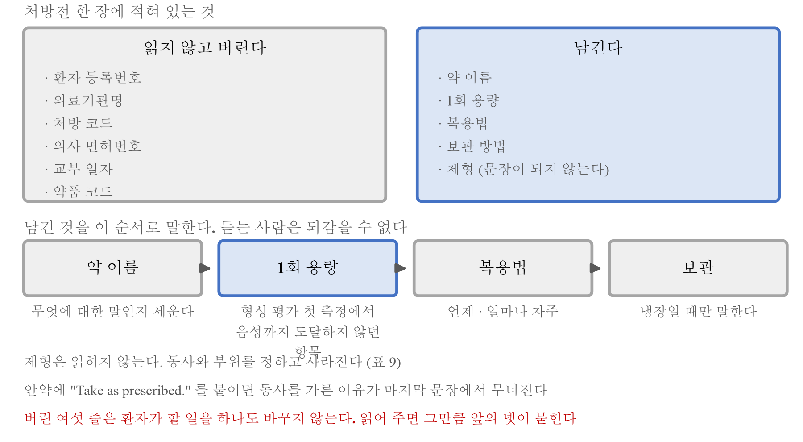

또한 제형에 따라 동사가 달라진다. 알약은 "드세요"이지만 안약은 "넣으세요", 연고는 "바르세요", 흡입기는 "들이마시세요"다. 같은 "복용"이라는 단어가 실제 동작으로는 전혀 다른 것을 가리키기 때문이다.

동사만 갈리는 것이 아니라 부위도 갈린다. 안약을 눈에 넣는다는 것은 지시의 절반인데, 그림에 병만 있고 눈이 없으면 그 절반이 사라진다. 그래서 제형에서 부위를 유도한다.

```ts
/**
 * 제형 → 몸의 어디에 쓰는가.
 *
 * 안약을 '눈에' 넣는다는 것은 지시의 절반인데, 그림에는 병만 있고 눈이 없었다.
 * OCR 이 제형을 알아내는 순간 부위도 정해지므로 따로 물을 필요가 없다.
 */
const FORM_SITE: Record<string, string> = {
  eyedrop: 'body_eye',
  cream:   'body_skin',
  inhaler: 'body_mouth',
  syrup:   'body_mouth',
};
```

제형 아홉 종이 두 채널에서 어떻게 갈리는지를 한자리에 놓으면 규칙이 보인다.

[표 9] 제형에서 유도되는 그림 부위와 음성 (제형 아홉 종 전수)

| 제형 | 그림의 부위 | 음성 동사 | 음성 부위 | 마무리 문장 |
|---|---|---|---|---|
| 점안액 eyedrop | 눈 | Put | in the eye | Use as prescribed. |
| 연고 cream | 피부 | Apply | on the skin | Use as prescribed. |
| 흡입기 inhaler | 입 | Breathe in | 없음 | Use as prescribed. |
| 시럽 syrup | 입 | Take | 없음 | Take as prescribed. |
| 주사 injection | 없음 | Receive | 없음 | Use as prescribed. |
| 좌약 suppository | 없음 | Use | 없음 | Use as prescribed. |
| 정제 tablet | 없음 | Take | 없음 | Take as prescribed. |
| 캡슐 capsule | 없음 | Take | 없음 | Take as prescribed. |
| 산제 sachet | 없음 | Take | 없음 | Take as prescribed. |

부위를 말하는 것은 둘뿐이고 그리는 것은 넷이다. 이 차이가 실수가 아니라는 것을 밝힌다. 음성에서 부위는 동사가 그것을 담지 못할 때만 붙는다. "Put" 은 어디에 넣는지를 말하지 않으므로 "in the eye" 가 없으면 지시가 절반만 전달된다. "Breathe in" 은 들이마시는 자리를 이미 담고 있고, "Take" 도 마찬가지다. 여기에 "in the mouth" 를 붙이면 정보는 하나도 늘지 않고 문장만 길어진다. 앞에서 인용한 IVR 연구가 선택지의 길이를 고령 사용자의 실패 원인으로 지목한 것이 이 판단의 근거다. 그림에는 같은 절약이 적용되지 않는다. 그림에서 입은 동사가 아니라 자리이고, 자리를 비우면 그 자리에 아무것도 없는 것이 된다.

남는 것은 주사와 좌약이다. 둘은 동사가 부위를 담지 못하는데도 부위를 말하지 않고 그리지도 않는다. 이것은 절약이 아니라 아직 메우지 못한 자리다. 주사는 처방전에 놓는 자리가 적히지 않는 경우가 많고 약에 따라 팔·배·엉덩이로 갈리므로, 우리가 하나를 골라 그리면 그 순간 처방에 없는 것을 만들어 낸 것이 된다. 좌약은 자리가 하나로 정해지지만 그림으로 세우려면 사람 몸의 방향을 그려야 하고, 그것은 형태소 78종이 지금 다루는 범위 밖이다. 둘 다 §5.9 의 미검증 항목으로 넘긴다. 지금은 동사만으로 지시가 완성되지 않는다는 것을 적어 두는 것이 우리가 할 수 있는 전부다.

이 표가 다루지 않는 층을 §5.7 의 한 응답이 짚었다. 인도네시아 Universitas Gadjah Mada 의 Niken Nur Widyakusuma 약사는 "하루 세 번" 보다 "8시간마다" 가 낫다고 적었다.

> "Instead of 3 times a day, better to say every 8 hours."
> (Niken Nur Widyakusuma 박사·약사, Universitas Gadjah Mada)

이 지적은 우리 형태소 설계의 경계에 있다. §2.2 의 시각 형태소 넷은 아침·정오·저녁·밤이며 "몇 시간마다" 를 그릴 수 없다. 표 8 에서 시각이 넷뿐인 것을 두고 "처방이 그 이상을 요구하지 않기 때문" 이라고 적었는데, 이 응답은 처방이 요구하는 것이 다른 축일 수 있다고 말한다. 하루 세 번은 언제를 말하고 8시간마다는 간격을 말하며, 항생제처럼 혈중 농도가 중요한 약에서는 뒤의 것이 임상적으로 맞다. 지금 엔진은 간격을 그리지 못하고, 이것은 형태소를 더 그린다고 해결되지 않는다. 시각이라는 축 자체가 다르기 때문이다. §5.10 의 5단계로 넘긴다.

설계 의도. 부위를 사용자에게 묻지 않는다. 묻는 순간 선택지를 읽어야 하고, §1.10 에서 확인한 대로 계층과 선택지를 읽게 하는 것이 이 앱이 없애려는 것이다. OCR 이 "점안액" 을 읽어 낸 시점에 부위는 이미 정해져 있으므로, 물어볼 것이 아니라 유도할 것이다.

모르는 제형을 만났을 때의 처리에도 판단이 들어 있다. 예전에는 표에 없는 제형이 조용히 일반 약병 그림으로 떨어졌다. 흡입기든 네뷸라이저든 화면에는 약병이 떴고, 그런 일이 얼마나 자주 일어나는지 아무 기록도 남지 않았다. 지금은 `\?제형` 이라는 표시를 앞세운다. 이것은 "이 개념의 그림이 우리에게 없다" 는 뜻이며, 온라인 판은 그 자리에서 그림을 만들어 넣고, 온디바이스 판은 비슷한 그림을 대신 보여주지 않고 없다고 알린다. 읽지 못하는 사람에게 틀린 그림은 그림이 없는 것보다 나쁘다. 없으면 음성으로 넘어가지만, 틀린 그림은 자신 있게 틀리고 사용자는 그것이 틀렸다는 것을 알 방법이 없다.

이것이 부분적인 해결에 그친다는 점은 인정한다. 머리(head)는 시각·개수·보관을 그리는 그릇이기도 해서, 제형을 모를 때 그 줄들은 여전히 일반형 약병 위에 그려진다. 제대로 고치려면 그 개념이 정식 형태소가 되어야 하고, 그래서 `/api/glyph` 가 만들지 못한 개념의 목록을 파일로 남긴다. 그 목록이 다음 형태소를 무엇으로 추가할지 정하는 근거가 된다. 사용자가 실제로 마주친 순서대로 쌓인다.

### 2.4 개인별 판정 기준의 유도

SnapCare 는 라벨을 읽어 주는 도구가 아니라 판정하는 도구다. 그리고 그 판정은 사용자마다 다르다.

세계보건기구의 영양 권고는 대부분 총 에너지에 대한 비율로 기술되어 있다. 유리당은 총 에너지의 10% 미만이며 (50 g 에 해당하고, 5% 이하로 더 줄이면 추가 이득이 있을 수 있다), 포화지방도 10% 미만, 트랜스지방은 1% 미만이다. 소금만 성인 1일 5 g 미만(나트륨 2 g)이라는 절대량으로 주어지며, 아동은 에너지 섭취량에 따라 더 적어야 한다 (World Health Organization, *Healthy diet* fact sheet).

이 기술 방식이 중요하다. 권고 자체가 비율로 쓰여 있으므로, 고정된 그램 수 표를 들고 있는 것이 아니라 그 사람의 에너지 요구량에서 유도하는 것이 지침의 올바른 구현이다. 그 결과 같은 음료 한 캔이 7세 아동에게는 경고가 되고 성인에게는 무해가 된다.

유도는 다음 여섯 줄이 전부다.

```ts
/** 나이대 → 대표 나이. 프로필에서 그림으로 고른 값이 문자열 파싱보다 우선한다. */
const BAND_AGE = { child: 7, teen: 15, adult: 35, senior: 70 };

export function referenceFor(member: Member): DailyReference {
  const age = member.ageBand ? BAND_AGE[member.ageBand] : ageFromRole(member.role);
  const { energyKcal, weightKg } = bandFor(age);

  // WHO 백분율 권고를 g 으로 환산 — 이 유도가 엔진의 핵심이다.
  const sugarsLimit = (energyKcal * 0.10) / KCAL_PER_G.carb;   // 유리당  <10 %E
  const satFatLimit = (energyKcal * 0.10) / KCAL_PER_G.fat;    // 포화지방 <10 %E

  // 소금·식이섬유는 절대량 권고 → 에너지 요구량 비율로 소아 하향
  const energyRatio = energyKcal / ADULT_ENERGY_KCAL;
  const saltLimit   = ADULT_SALT_LIMIT_G * Math.min(1, energyRatio);
  ...
}
```

설계 의도. 나이를 대표값 네 개로 접었다. 사용자는 숫자를 입력하지 않고 그림 넷 중 하나를 고르므로(§3.2), 앱이 아는 것은 구간뿐이다. 구간을 그대로 두고 계산하려면 구간별 기준치 표를 손으로 만들어야 하는데, 그러면 WHO 권고가 바뀔 때 표를 다시 짜야 하고 그 표가 어디서 왔는지 아무도 확인할 수 없게 된다. 대표 나이 하나로 접으면 계산이 권고 문장을 그대로 따른다.

`Math.min(1, energyRatio)` 에도 판단이 있다. 소금과 식이섬유는 권고가 절대량이라 비율로 환산할 수 없다. 아동은 에너지 요구량에 비례해 낮추되(§2.4 의 근거가 되는 권고 자체가 "아동은 에너지 섭취량에 따라 더 적어야 한다" 고 말한다), 성인보다 많이 먹는 사람에게 소금 한도를 올려 주지는 않는다. 권고가 상한이기 때문이다.

`basis` 문자열을 함께 돌려주는 것도 의도적이다. 화면 아래에 "70세 기준 1,800 kcal, 유리당 10% 미만" 이 그대로 표시된다(그림 22 의 (b)). 판정이 어디서 나왔는지를 사용자가 볼 수 없으면 그 판정을 검토할 방법도 없다.

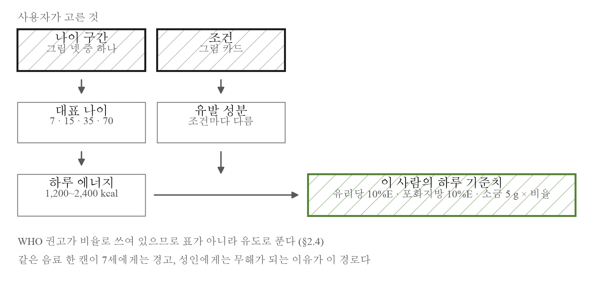

**[그림 20]** 판정 기준이 유도되는 경로. 사용자가 고르는 것은 위의 두 상자뿐이고 나머지는 계산이다. 표가 아니라 유도인 이유는 WHO 권고 자체가 총 에너지에 대한 비율로 쓰여 있기 때문이며, 권고가 바뀌면 표를 다시 짜는 대신 상수 하나를 고치면 된다.

이 유도가 만들 수 있는 위험을 §5.7 의 약국 구획이 두 번 짚었다. 충남대학교 이소영 교수·약사는 상호작용 경고가 오히려 임의 중단을 부를 수 있다고 적었다.

> "약물간 상호작용에 대해서도 이를 고려하여 병용 약물의 용량을 감소하거나 이미 처방에서 중재가 되었음에도 이러한 경고를 보면 환자가 임의로 약물치료를 중단할 가능성이 있음. 임상적 상황에서는 상호작용이 있는걸 알아도 환자 치료를 위해 쓰이는 경우도 있음."
> (이소영 교수·약사, 충남대학교)

세르비아 University of Belgrade 의 Katarina Vučićević 교수는 답을 하나 제시했다. 경고에 "의사나 약사에게 연락하라" 는 지시를 붙이라는 것이다. 지금 이 앱은 회피 판정에서 무엇을 하지 말라고만 말하고 누구에게 물어야 하는지는 말하지 않는다. 판정을 유도로 만든 이 절의 설계가 판정을 종점으로 다루고 있었던 셈이다.

여기에 사용자의 조건이 더해진다. 당뇨가 있으면 당류 기준이 좁아지고, 혈액희석제를 복용 중이면 이부프로펜 계열이 회피 대상이 되며, 임신·수유 중이면 금기 목록이 달라진다.

### 2.5 조건 수집과 알레르기 추론

앞 절에서 확인했듯 당뇨 성인의 약 43%가 자신이 당뇨임을 모르며 (International Diabetes Federation, *IDF Diabetes Atlas*, 11th ed., 2025), 알레르기에서도 자가보고와 확진 사이에 큰 간극이 있다.

따라서 "무슨 알레르기가 있습니까" 라는 질문은 검사를 받아 본 사람만 답할 수 있다. SnapCare 는 이 질문을 세 갈래로 나눈다.

[표 10] 조건을 묻는 방식

| 갈래 | 질문의 형태 | 예 |
|---|---|---|
| 지금 아는 것 | 현재 상태 | 임신 중, 수유 중 |
| 겪은 것 | 경험 | 무언가를 먹고 속이 안 좋았던 적 |
| 진단받은 것 | 진단 | 당뇨, 고혈압 |

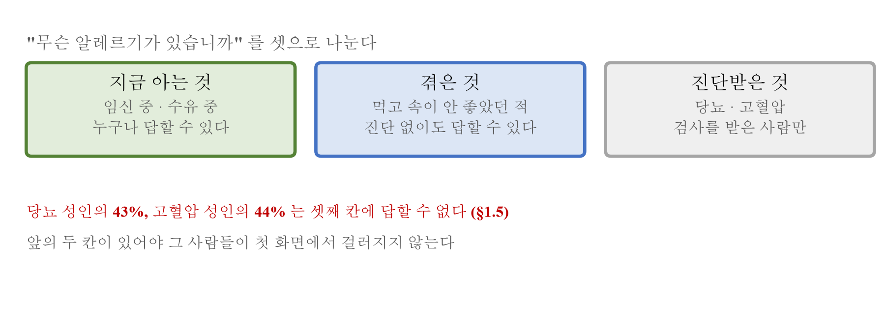

**[그림 21]** 조건을 묻는 세 갈래 (§2.5). 오른쪽으로 갈수록 답할 수 있는 사람이 줄어든다. 기존 앱이 셋째 칸만 묻는데, §1.5 에서 확인한 대로 당뇨 성인의 43%와 고혈압 성인의 44%가 그 칸에 답할 수 없다. 앞의 두 칸을 둔 이유가 그것이다.

나아가 앱은 사용자가 모르는 알레르기를 추론한다. 식이 일지에 대해 Fisher 정확검정을 수행하여, 사용자가 불편을 느낀 끼니에 반복해서 등장하는 성분을 찾는다. 최소 증거 기준과 다중 검정 보정(Bonferroni)을 적용하며, 결과는 진단이 아니라 관찰로 제시되고 사용자가 확인하기 전까지 프로필에 반영되지 않는다.

이 추론이 말하지 않아야 할 때 말하지 않는지를 검사로 고정했다. 통계적 추론을 화면에 내보내는 기능에서 위험한 것은 놓치는 쪽이 아니라 없는 것을 있다고 하는 쪽이기 때문이다. 검사는 다음을 확인한다. 한 성분에서만 반복해 탈이 나면 지목하고, 우연히 겹친 정도로는 지목하지 않으며, 기록이 적으면 비율이 아무리 높아도 말하지 않고, 탈이 나지 않은 끼니(대조군)가 없으면 비교 자체를 성립시키지 않는다. 또한 성분을 여러 개 볼수록 기준을 높이고, 답하지 않은 끼니는 자료로 세지 않으며, 땅콩과 견과류를 하나로 묶지 않는다. Fisher 검정 자체는 알려진 값과 대조해 고정했다.

증상의 양상도 함께 본다. 두드러기·부어오름처럼 알레르기를 시사하는 것과 더부룩함처럼 불내성을 시사하는 것을 갈라, 같은 성분이라도 어느 쪽으로 제시할지를 바꾼다. 알레르기라고 말하는 것과 소화가 잘 안 된다고 말하는 것은 사용자가 취할 행동이 다르다.

말하지 않기 위한 조건이 검정 자체보다 길다.

```ts
export function findTriggers(log: MealFeedback[]): SuspectedTrigger[] {
  // 검사 대상: 기록에 실제로 등장한 성분만. 먹은 적 없는 성분을 검정하면
  // Bonferroni 분모만 키워서 진짜 신호를 죽인다.
  const testable = [...flags].map(...).filter(...);
  const threshold = ALPHA / testable.length;              // Bonferroni

  for (const { flag, condition } of testable) {
    const withIt  = log.filter((m) =>  flagsOf(m.tags).includes(flag));
    const without = log.filter((m) => !flagsOf(m.tags).includes(flag));

    const a = withIt.filter((m) => m.reaction === 'unwell').length;   // 먹고 탈남
    const b = withIt.length - a;                                     // 먹고 괜찮음
    const c = without.filter((m) => m.reaction === 'unwell').length; // 안 먹고 탈남
    const d = without.length - c;                                    // 안 먹고 괜찮음

    if (a < MIN_UNWELL || withIt.length < MIN_EATEN
                       || without.length < MIN_CONTROL) continue;     // 증거 부족
    if (fisherRightTail(a, b, c, d) > threshold) continue;            // 우연 범위
    ...
  }
}
```

설계 의도. `continue` 두 줄이 이 함수가 하는 일의 대부분이다. 첫 줄은 증거의 양을 본다. 탈이 난 횟수, 먹은 횟수, 그리고 먹지 않은 끼니의 수까지 본다. 마지막 것이 없으면 비교가 성립하지 않는다. 매 끼니에 들어가는 성분은 탈이 날 때마다 함께 있었으므로 아무 검정이나 통과시키기 때문이다.

둘째 줄의 문턱은 `ALPHA / 검사한 성분 수` 다. 성분을 열 개 보면 문턱이 10분의 1이 된다. 스무 개를 놓고 각각 5% 문턱으로 보면 아무 관계가 없어도 하나쯤은 걸리는데, 그 하나를 "당신은 이것에 알레르기가 있을 수 있습니다" 로 화면에 띄우는 것이 이 기능의 최악이다.

검사 대상을 기록에 실제로 등장한 성분으로 좁힌 것도 같은 이유다. 먹은 적 없는 성분까지 목록에 넣으면 분모만 커져 진짜 신호가 문턱 아래로 내려간다. 보수적으로 만드는 장치가 지나치면 아무것도 못 찾는 장치가 된다.

Fisher 정확검정을 쓴 이유는 표본이 작기 때문이다. 카이제곱은 기대빈도가 5 미만이면 쓸 수 없는데, 식이 일지의 표는 늘 그렇다. 사람이 한 성분을 스무 번 먹고 그중 몇 번 탈이 났는지를 기록하는 일은 드물다.

### 2.6 기존 접근과의 차별점

이 절은 SnapCare 가 기존의 무엇과 다른지를 정리한다. 비교 대상을 둘로 잡았다. 하나는 일반적인 건강·영양 앱이고, 다른 하나는 의약 픽토그램의 사실상 표준인 미국약전 세트다. 앞의 것은 같은 사용자를 상대한다고 말하지만 문자로 상대하고, 뒤의 것은 문자를 쓰지 않지만 조합하지 못한다.

[표 11] 기존 접근과 SnapCare 의 비교

| 항목 | 일반적인 건강 앱 | USP 픽토그램 표준 | SnapCare |
|---|---|---|---|
| 입력 | 문자 입력·검색 | (해당 없음) | 사진 한 장 |
| 출력 | 문자 위주 | 정적 그림 81종 | 합성 픽토그램 + 음성 + 색 |
| 조합 | — | **라이선스가 금지** | 문법으로 결합 |
| 판정 기준 | 고정 표 또는 없음 | (해당 없음) | 개인의 에너지 요구량에서 유도 |
| 전제 | 사용자가 진단을 안다 | — | 진단을 전제하지 않는다 |
| 이해도 검증 | 없음 | 사후 연구로만 | 배포 전 자동 측정 |
| 네트워크 | 필수 | — | 판정은 기기 안에서 |

표의 각 행은 서로 독립적이지 않다. 첫 행에서 입력을 사진 한 장으로 정하면 사용자가 무엇을 찍었는지 말해 주지 않으므로 앱이 스스로 판별해야 하고(§3.3), 다섯째 행에서 진단을 전제하지 않기로 하면 조건을 묻는 방식이 통째로 달라진다(§2.5). 하나를 정하면 나머지가 따라오는 구조이며, 그 출발점이 §2.1 의 첫 제약이다.

표에서 가장 무거운 행은 셋째, 곧 조합이다. §1.9 에서 본 대로 USP 세트는 라이선스가 파생 저작물을 금지하므로 그 81종을 서로 붙일 수 없다. 처방 하나에 담기는 지시가 대개 여럿이라는 점을 생각하면 이것은 작은 제약이 아니다. "하루 세 번, 식사와 함께, 일주일간" 은 세 지시이며 고정 세트에서는 세 그림을 나란히 놓는 것 말고 할 수 있는 것이 없다. 문법으로 결합하면 같은 78종에서 나오는 조합이 목록이 아니라 규칙으로 정해진다(§2.2).

넷째 행도 겉보기보다 크다. 고정 표로 판정하는 앱은 "설탕 25 g 이상이면 경고" 처럼 하나의 기준을 모든 사용자에게 적용한다. WHO 권고 자체가 총 에너지에 대한 비율로 쓰여 있으므로 그 방식은 원문을 한 번 반올림한 것이다. §2.4 처럼 유도로 풀면 같은 음료 한 캔이 7세에게는 경고가 되고 성인에게는 되지 않는다. 이것은 정밀도의 문제가 아니라 무엇을 재고 있는지의 문제다.

이 표를 §5.7 의 조사에 비추어 다시 읽어야 하는 자리가 하나 있다. 다섯째 행에서 우리는 진단을 전제하지 않는 것을 차별점으로 적었는데, 약국 구획 12명 가운데 9명이 이 앱이 만든 지시를 약사가 매번 검토해야 한다고 답했다. 진단을 묻지 않는 것과 판정을 혼자 내는 것은 다른 말이며, 우리가 없앤 것은 앞의 것이지 뒤의 것이 아니다. §2.6 이 주장하는 차별점은 사용자에게 무엇을 묻지 않느냐이지 전문가 없이 완결된다는 뜻이 아니다.

마지막 두 행이 본 연구가 새로 놓았다고 보는 자리다. 픽토그램의 이해도를 배포 전에 자동으로 측정하는 절차는 우리가 살펴본 범위에서 찾지 못했으며(§1.11 의 단서와 같다), 이는 §5.2 에서 절차와 결과를 함께 서술한다. 표의 나머지 행은 고유한 기여라기보다 설계상의 선택이며, 각각 §2.1~§2.5 에서 근거를 밝혔다.

이 비교의 한계도 적어 둔다. 우리는 일반적인 건강 앱을 하나의 유형으로 묶었으나 그 안에는 서로 다른 것이 많고, 개별 제품을 체계적으로 조사하지 않았다. 표의 왼쪽 열은 우리가 살펴본 범위에서 반복해 관찰한 특징이지 시장 조사의 결과가 아니다. §5.7 에서 GC메디아이 팀장이 "복약지도 관련 솔루션들이 이미 많다" 고 적은 것이 이 한계를 정확히 겨눈다. 이미 있는 것을 우리가 다 보지 못했을 수 있다.

### 2.7 핵심 기능 셋

**기능 1. 처방전을 그림과 음성으로 (Prescription Comprehension)**

사용자가 처방전을 촬영하면 브라우저 안에서 OCR(Tesseract.js)이 문자를 추출하고, SIGIL 과 VOCA 가 동시에 처리한다. 처방전에서 추출하는 정보는 여섯 가지다. 어떤 약을, 하루 몇 번, 언제, 어떤 조건에서, 어떻게 보관하며, 누가 복용하면 안 되는가.

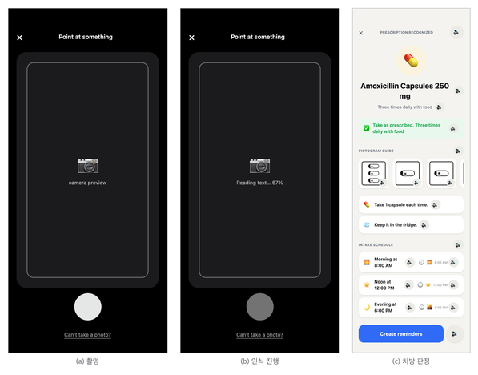

**[그림 22]** 촬영에서 판정까지. (a) 촬영 화면. 무엇을 찍는지 사용자가 고르지 않는다. (b) 인식 진행. 이 단계를 감추지 않은 것은 의도적이다. 아무 표시 없이 멈춘 화면은 고장으로 읽힌다. (c) 처방 판정. 위에서 아래로 무엇인지·안전한지·어떻게 하는지·무슨 뜻인지·언제인지의 순서이고, 맨 아래에 §3.8 의 되짚기가 붙는다. "한 번에 몇 개씩 드세요?" 를 소리로 묻고 답은 그림을 짚는다. 건너뛸 수 있고, 그 아래로 약 정보가 그대로 남아 있다. 줄마다 있던 회색 스피커 원이 보이지 않는 것은 §3.5 에서 걷어냈기 때문이며, 남은 것은 머리글과 픽토그램 카드처럼 줄이 아닌 자리다. (a)와 (b)의 미리보기가 비어 있는 것은 촬영을 자동화한 브라우저에 카메라가 없기 때문이며, 실제 기기에서는 화면이 채워진다.

**기능 2. 음식과 영양성분표 판정 (Personalized Verdict)**

영양성분표를 촬영하면 브라우저 안에서 OCR 이 수치를 읽고, 바코드가 있으면 제품 정보를 조회한다. 밥상 사진을 촬영하면 기기 안에서 영양 추정 모델(EfficientNet-B0, 224px, Nutrition5k 학습)이 에너지·질량·지방·탄수화물·단백질 다섯 값을 회귀한다. 모델은 ONNX 로 내보내 브라우저에서 실행하며, 16 MB 로 서비스워커가 캐시한다 (§4.5). 이 모델의 실측 정확도는 §5.5 에 있다.

어떤 경로로 들어온 값이든 같은 물리 검사를 통과해야 판정에 쓰인다. 값의 범위, 부분집합 관계(포화지방 ≤ 총지방), 질량 보존, 그리고 Atwater 항등식(4·탄수화물 + 4·단백질 + 9·지방 ≈ 에너지)이 그것이다. 이 검사가 필요한 이유는 §5에서 실제 사례와 함께 서술한다.

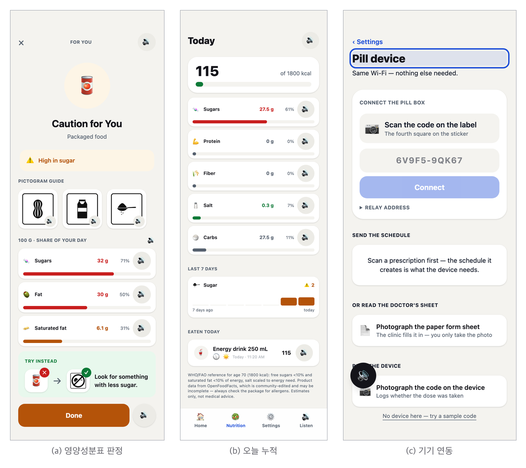

**[그림 23]** 판정 이후. (a) 영양성분표 판정. 수치를 그대로 옮기지 않고 이 사람의 하루 기준치에서 차지하는 비중으로 바꾼다. (b) 오늘 누적. 한 번의 판정이 아니라 하루의 합이다. 아래의 출처 표시를 화면에서 지운 적이 없다. (c) 기기 연동. 앱이 만든 일정을 디스펜서 트레이에 배치한 결과이며, §4.3 의 제약 때문에 이 버튼은 최상위 내비게이션으로 동작한다.

**기능 3. 자동 약 디스펜서 연동 (Device Link)**

앱이 만든 복약 일정을 기기로 보낸다. 기기는 라즈베리파이 3B 기반이며 트레이 3개, LED 링, 부저, 확인 버튼, 실시간시계(DS1302)로 구성된다.

전송 경로의 설계는 여러 제약이 동시에 걸린 결과다. 이는 §4에서 상술한다.

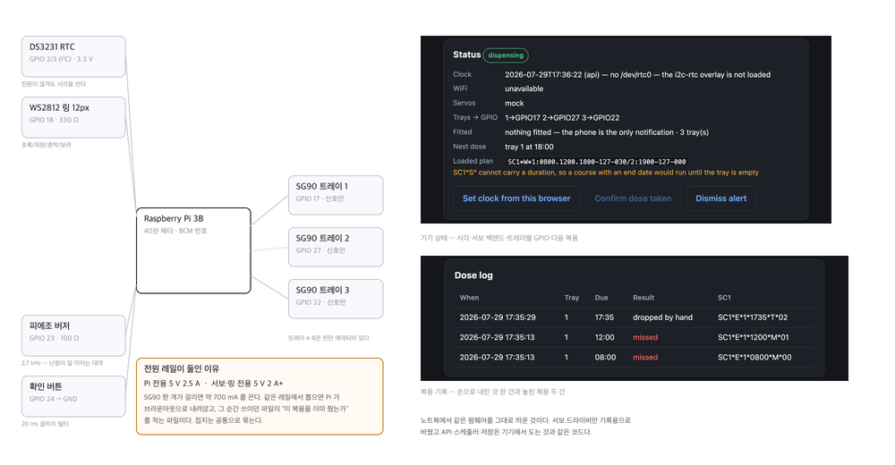

**[그림 24]** 디스펜서의 결선 구조와 기기 자신의 콘솔. 왼쪽은 핀 맵에서 그린 결선이고, 오른쪽은 같은 펌웨어를 서보 드라이버만 기록용으로 바꿔 노트북에서 띄운 화면이다. API·스케줄러·저장은 기기에서 도는 것과 같은 코드다. 실물 사진 대신 이 둘을 싣는 이유는 사진으로는 보이지 않는 것들이 여기서 결정되기 때문이다. 전원 레일을 둘로 나눈 것이 그 예다. SG90 한 개가 걸리면 약 700 mA 를 끄는데, 이를 Pi 와 같은 레일에서 뽑으면 브라운아웃이 나고, 그 순간 쓰이던 파일이 하필 이 복용을 이미 주었는지를 적는 파일이다. 오른쪽 아래의 복용 기록에 놓친 복용 두 건이 남아 있는 것도 같은 이유에서 중요하다. 주지 못한 것을 주지 못했다고 적지 않으면 다음 복용의 번호가 하나씩 밀린다.

---

## □ User Flow of the Web App

### 3.1 전체 흐름

SnapCare 의 사용자 흐름은 한 번의 촬영에서 판정까지 분기 없이 이어지는 것을 원칙으로 한다. 앞 절에서 인용한 대로 비문해 사용자에게 깊은 계층 구조는 평균 65.5초가 걸리는 반면 평면 목록은 25초에 그친다 (Medhi, I., Toyama, K., Joshi, A., Athavankar, U. & Cutrell, E., "A Comparison of List vs. Hierarchical UIs on Mobile Phones for Non-literate Users," *INTERACT 2013*, LNCS 8118:497–504). 따라서 판정에 이르는 경로에서 선택지를 최소화했다.

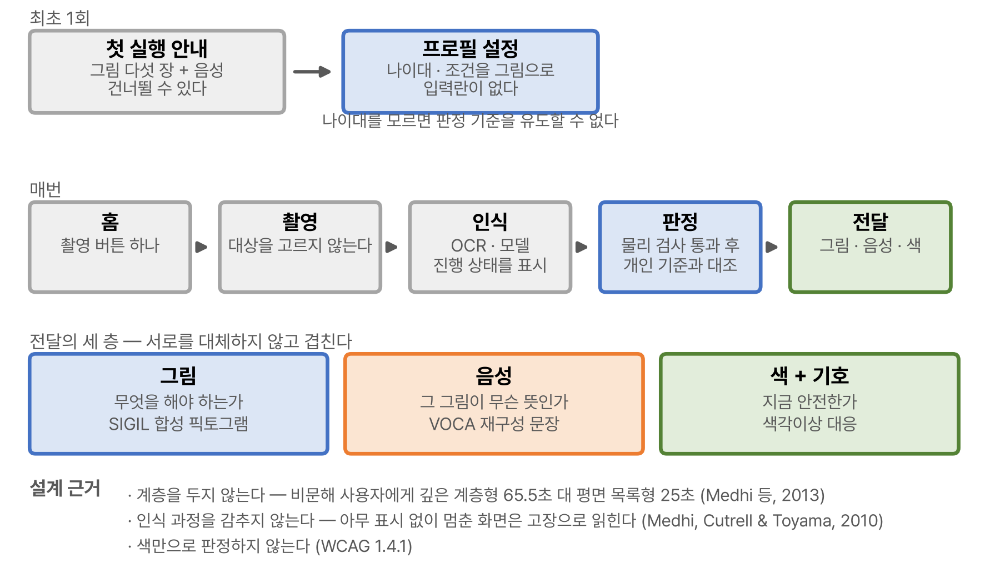

**[그림 25]** 전체 사용자 흐름. 각 단계 아래에 그 단계를 그렇게 만든 근거를 함께 적었다. 흐름도에서 볼 것은 읽기를 요구하는 지점이 어디에도 없다는 점이다.

전체 흐름은 다음 다섯 단계다.

[표 12] 사용자 흐름의 단계와 각 단계에서 요구하는 동작

| 단계 | 화면 | 사용자가 하는 일 | 읽어야 하는 글자 |
|---|---|---|---|
| 1 | 첫 실행 안내 | 다음 누르기 (건너뛰기 가능) | 없음 (그림 + 음성) |
| 2 | 프로필 설정 | 나이·조건 고르기 | 없음 (그림 선택) |
| 3 | 홈 | 촬영 버튼 누르기 | 없음 |
| 4 | 촬영 | 대상에 대고 찍기 | 없음 |
| 5 | 판정 | 보고 듣기 | 없음 |

표 12의 마지막 열이 이 설계의 요점이다. 어느 단계에서도 글을 읽거나 입력할 것을 요구하지 않는다.

이 표에 없는 것이 하나 더 있다. 되돌아가는 단계가 없다. 잘못 찍었으면 다시 찍으면 되고, 판정이 마음에 들지 않으면 닫으면 된다. 취소·수정·확인 같은 중간 단계를 두지 않은 것은 그 단계마다 "지금 무엇을 묻고 있는가" 를 읽어야 하기 때문이다. 다섯 단계 가운데 1번과 2번은 처음 한 번만 거치므로, 두 번째 사용부터 실제 경로는 세 단계다. 홈에서 누르고, 찍고, 본다.

다만 짚어 둘 것이 있다. 이 흐름이 짧은 것은 설계의 결과이면서 동시에 제약이기도 하다. 선택지를 없앤 만큼 사용자가 앱에게 알려 줄 수 있는 것도 없어졌다. 무엇을 찍었는지 사용자가 고르지 않으므로 앱이 잘못 분류하면 바로잡을 방법이 화면에 없고, 다시 찍는 것이 유일한 수단이다. §5.9 에서 이 점을 미검증 항목으로 남겨 두었다.

### 3.2 첫 실행과 프로필 설정

앱을 처음 열면 다섯 장의 안내를 거쳐 프로필 설정으로 간다. 이 단계가 필요한 이유는 §2.4 에서 서술한 판정 방식에 있다. 기준치를 사용자의 에너지 요구량에서 유도하므로 나이대를 모르면 판정이 성립하지 않는다.

나이는 숫자로 입력하지 않는다. 아동·청소년·성인·고령의 네 구간을 우리 형태소(`state_child`·`state_teen`·`state_adult`·`state_elderly`)로 고른다. 이모지를 쓰지 않은 이유가 있다. 이모지는 기기마다 다르게 그려지고, 십대를 뜻할 만한 이모지(🧑‍🎓)는 실제로는 '졸업생' 이라 학교를 다니지 않는 아이에게는 아무 뜻도 아니다. 네 형태소는 한 계열로 그려져 나란히 놓으면 나이 차가 형태로 보인다. 조건도 마찬가지로 §2.5 의 세 갈래(지금 아는 것·겪은 것·진단받은 것)를 그림 카드로 제시한다.

처음에는 이 화면에서 얼굴을 먼저 고르게 했다. 여덟 개의 사람 그림 중 하나를 고르는 단계였는데, 시험해 보고 첫 실행에서 뺐다. 얼굴은 판정에 아무 영향이 없는 표시일 뿐인데(누구인지를 나타낼 뿐이다) 화면에서 가장 먼저 요구되었고, 그러면 처음 여는 사람이 만나는 첫 요구가 아무 값도 없는 선택이 된다. 그러면 뒤이어 나오는 진짜 질문인 나이와 조건까지 같은 무게로 읽히게 된다. 얼굴은 설정 화면으로 옮겼다.

건너뛸 수 있으나, 건너뛴 경우 홈 화면이 "성인 기준으로 보고 있습니다" 를 계속 표시한다. 기본값이 조용히 적용되는 것을 막기 위해서다. 이 표시를 넣은 이유는 §2.4 의 판정이 사람마다 다르다는 주장과 직결된다. 나이를 모르는 채로 나온 판정도 화면에서는 똑같이 초록색과 빨간색으로 보이는데, 그 판정이 누구를 기준으로 한 것인지가 화면에 없으면 사용자는 자기 기준으로 나온 답이라고 읽는다.

잠금은 문자 비밀번호가 아니라 그림 열쇠다. 열두 개의 픽토그램 가운데 미리 고른 넷을 순서대로 누른다. 숫자 네 자리와 경우의 수가 비슷하면서 외우는 대상이 숫자가 아니라 그림이므로, 글자와 숫자를 다루지 못하는 사용자도 쓸 수 있다. 누른 순서는 해시로만 저장한다 (§4.6).

이 잠금 화면에 사람 목록을 함께 두었다 (§3.6). 운영체제의 잠금화면과 같은 구조이며, 얼굴을 고르는 것과 잠금을 푸는 것이 한 화면에서 끝나므로 잘못 골랐을 때 되돌아갈 길을 따로 만들 필요가 없다. 혼자 쓰는 사람에게는 사람 목록이 보이지 않는다. 한 명뿐일 때 고르라고 하는 것은 없는 선택을 시키는 것이다.

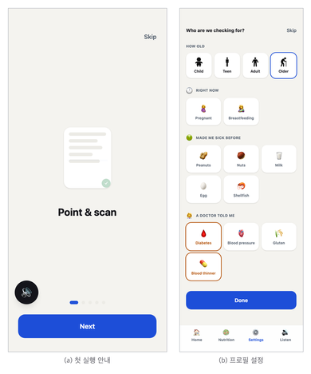

**[그림 26]** 첫 실행. (a) 안내 다섯 장. 모두 그림과 한 문장이고, 화면에 도착하면 그 문장을 스스로 읽는다. (b) 프로필 설정. 나이 구간은 우리 형태소로, 조건은 그림 카드로 고르며 어느 쪽에도 입력란이 없다. 이 단계가 필요한 이유는 §2.4 의 판정 방식에 있다. 기준치를 사용자의 에너지 요구량에서 유도하므로 나이대를 모르면 판정이 성립하지 않는다.

§5.7 에서 이 화면에 대해 정확히 갈리는 두 답이 왔다. 첫 실행에서 어디가 막히겠느냐는 물음에 HCI 응답자 둘 가운데 하나는 카메라 권한 허용을, 다른 하나는 막히지 않는다를 골랐다. 한국장애인개발원 최묘정 연구원이 앞쪽의 이유를 적었다.

> "글을 읽기 어려운 사용자는 최초 권한 허용 단계에서 음성 안내가 함께 제공되지 않을 경우 이후 절차 진행에 어려움을 겪을 수 있으며, 이로 인해 행동이 제한될 가능성이 있음."
> (최묘정 연구원, 한국장애인개발원)

권한 대화상자는 브라우저가 그리는 것이라 우리가 그 안에 음성을 넣을 수 없다. 그 앞에서 무엇을 물을 것인지 미리 말해 주는 것이 우리가 할 수 있는 전부이며, 지금 안내 다섯 장이 그 자리에 있다. 다만 안내가 끝난 뒤 대화상자가 뜨는 순간부터는 우리 화면이 아니다. §5.9 의 미검증 항목에 해당한다.

한국공예디자인문화진흥원 이용한 선임은 다른 쪽을 보았다. 이 앱을 찾아온 사람은 이미 작동 방식을 어느 정도 알고 온다는 것이며, 그렇다면 지금 절차 정도는 그림과 음성이 함께 있으면 충분하다는 것이다. 두 응답이 서로를 부정하지 않는다. 앞의 것은 처음 여는 사람을, 뒤의 것은 찾아온 사람을 말한다. 이 앱이 누구에게 어떻게 도착하는지가 정해지지 않았으므로 둘 다 가능한 조건이다.

### 3.3 촬영에서 판정까지

#### 3.3.1 찍기까지

홈 화면의 파란 원을 누르면 촬영 화면으로 넘어간다. 화면 맨 위에는 "Point at something" 한 줄이 있고, 이 문장은 화면에 도착하는 순간 스스로 소리 내어 읽힌다. 무엇을 하라는 것인지 알기 위해 아무것도 누르지 않아도 된다는 뜻이다.

가운데에는 미리보기 자리가 있고 아래에 64픽셀짜리 흰 원이 하나 있다. 이 원이 셔터다. 화면에 있는 누를 수 있는 것은 이것 하나뿐이며, 무엇을 찍을 것인지 고르는 단계가 없다. 처방전 모드와 성분표 모드와 음식 모드를 두지 않은 것은 그 선택 자체가 §1.10 에서 인용한 계층 구조의 비용을 다시 불러오기 때문이다. 무엇을 찍는지는 사용자가 이미 손에 들고 있으므로, 그것을 앱에게 한 번 더 말하게 할 이유가 없다.

셔터를 누르면 기기의 기본 카메라가 열리고, 찍은 사진이 그대로 앱으로 돌아온다. 앱 안에 별도의 촬영 화면을 만들지 않은 이유는 기기의 카메라가 이미 초점과 노출과 흔들림 보정을 하고 있고, 그것을 다시 구현하면 더 나빠지기만 하기 때문이다.

#### 3.3.2 무엇을 찍었는지 정하는 순서

돌아온 사진은 네 갈래 가운데 하나로 분류된다. 음식·음료·의약품·처방전이다. 이 판별은 한 번에 이루어지지 않고 두 층으로 나뉘어 있다.

첫 층은 기기 안에서 돈다. 사진에서 글자를 먼저 읽고(Tesseract.js, 브라우저 안에서 실행), 읽어 낸 글자에 어떤 표지가 있는지를 본다. `nutrition`·`per 100`·`영양성분`·`1회 제공량` 같은 표지가 있고 영양소 이름이 둘 이상 함께 나오면 영양성분표로 본다. `500 mg` 같은 용량 표기, `tablet`·`capsule` 같은 제형, `twice daily`·`식후` 같은 복용 지시 가운데 둘 이상이 나오면 처방전으로 본다. 둘 중 하나로 정해지면 그 자리에서 전용 해석기가 돌고, 서버를 부르지 않는다.

둘째 층은 첫 층이 실패했을 때만 부른다. 사진에서 읽어 낸 글자가 네 글자에 못 미치거나(음식 사진이 대개 여기에 해당한다) 표지가 어느 쪽에도 맞지 않으면 서버의 시각 모형에 사진을 보낸다.

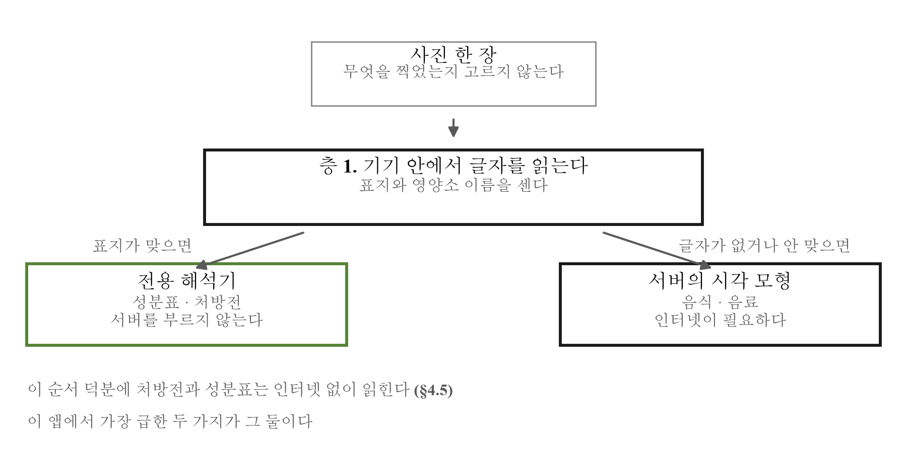

**[그림 27]** 무엇을 찍었는지 정하는 두 층. 왼쪽으로 떨어지면 서버를 부르지 않고, 오른쪽으로 떨어질 때만 통신이 필요하다. 이 갈림이 §4.5 의 오프라인 동작을 가능하게 한다.

이 순서에는 이유가 있다. 글자가 있는 것은 기기 안에서 끝내고 통신이 필요한 것만 밖으로 보내면, 처방전과 성분표는 인터넷이 없어도 읽힌다. 이 두 가지가 이 앱에서 가장 급한 것들이다 (§4.5).

#### 3.3.3 기다리는 동안 보이는 것

인식이 도는 동안 미리보기 자리에는 지금 무엇을 하고 있는지가 글로 표시되고, 같은 문장이 음성으로도 나간다. 실제로 표시되는 문장은 다음 넷이다.

[표 13] 인식 중 표시되는 단계

| 표시 | 언제 나오는가 | 걸리는 시간 |
|---|---|---|
| `Reading text… 43%` | 기기 안에서 글자를 읽는 동안, 백분율이 실시간으로 올라간다 | 대체로 2~6초 |
| `Checking the label…` | 성분표로 보고 읽었으나 값이 검사를 통과하지 못해 서버에 다시 묻는 중 | 1~3초 |
| `Estimating…` | 기기 안의 영양 추정 모형이 돌고 서버 판별을 기다리는 중 | 2~5초 |
| `Loading sample…` | 예시 이미지를 고른 경우 | 1초 미만 |

백분율을 숨기지 않고 그대로 보이는 것은 의도한 것이다. 저문해 사용자 연구에서 지적된 장벽 가운데 하나가 위압감(intimidation)이며 (Medhi, I., Cutrell, E. & Toyama, K., "It's not just illiteracy," *Proc. International Conference on Interaction Design & International Development*, 2010), 아무 표시 없이 멈춘 화면은 고장으로 읽힌다. 숫자가 올라가는 것을 보는 것만으로 "돌고 있다" 가 전달되고, 그것은 글을 읽지 못해도 전달된다. 같은 이유로 인식이 도는 동안 셔터와 아래의 모든 버튼은 눌리지 않게 잠근다. 두 번 눌러서 두 번 도는 일이 없어야 한다.

#### 3.3.4 판정 화면의 세로 순서

판정 화면은 무엇을 찍었느냐에 따라 두 벌로 갈린다. 순서를 정한 기준은 같다. 글을 읽지 않고 위에서 아래로 훑었을 때 필요한 것이 먼저 나와야 한다.

[표 14] 판정 화면의 구성 (음식·음료 / 처방전·의약품)

| 순서 | 음식·음료 | 처방전·의약품 |
|---|---|---|
| 1 | 112px 원형 그림과 판정 문장 | 96px 원형 그림 |
| 2 | 색과 기호가 함께 있는 요약 띠 | 약 이름과 1회 용량 |
| 3 | 픽토그램 시퀀스 | 색과 기호가 함께 있는 안전 띠 |
| 4 | 영양소 막대 (최대 3개) | 픽토그램 시퀀스 |
| 5 | 대안 제시 카드 | 용량 카드와 보관 카드 |
| 6 | 확인 버튼 | 복용 시각 표 |

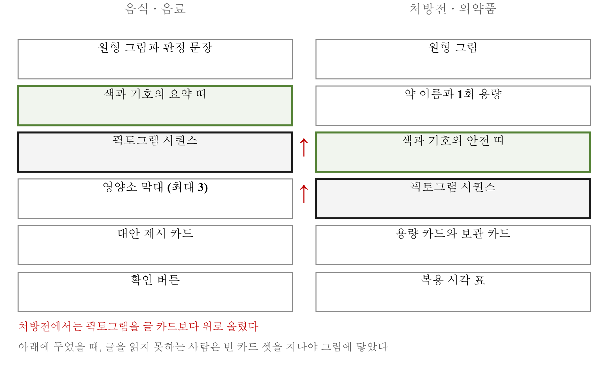

**[그림 28]** 판정 화면의 세로 순서 두 벌. 붉은 화살표가 처방전에서 픽토그램을 두 칸 올린 자리다. 색과 기호의 띠도 함께 밀려 내려간다.

두 벌의 차이가 4번과 3번 자리에 있다. 처방전에서는 픽토그램을 글 카드보다 위로 올렸다. 처음에는 아래에 두었는데, 글을 읽지 못하는 사용자가 위에서부터 훑으면 빈 카드 세 개를 지나야 그림에 닿았다. 순서를 바꾸는 것만으로 그 세 칸이 사라진다.

영양소 막대를 최대 세 개로 자른 것도 같은 기준이다. 하루 기준의 5% 미만인 항목과 이미 충분한 항목은 빼고, 남은 것 가운데 위에서 셋만 보인다. 열 줄을 다 보이면 어느 것이 문제인지가 묻힌다.

#### 3.3.5 판정을 무엇이 결정하는가

색은 세 단계이며 사용자의 조건에서 유도된다. 판정 근거가 여럿이면 가장 나쁜 것이 이긴다.

[표 15] 판정 단계를 올리는 근거

| 근거 | 어떻게 걸리는가 | 결과 |
|---|---|---|
| 사용자 조건과 성분의 충돌 | 사용자가 고른 조건의 유발 성분이 이 품목에 있을 때 | 조건마다 다르다. 땅콩 알레르기는 회피, 당뇨는 주의 |
| 무엇인지 확신하지 못함 | 시각 모형의 확신도가 0.4 미만이거나 영양값이 전부 0으로 나올 때 | 주의로 고정 |
| 한 번에 하루치를 넘김 | 이 사람의 하루 한도 대비 100% 이상일 때 | 주의 |
| 복용 중인 약과의 상호작용 | 이미 등록된 약과 충돌할 때 | 회피로 고정 |

셋째 줄이 이 앱의 판정이 사람마다 다른 이유다. 하루 한도를 표에서 가져오지 않고 사용자의 나이대에서 유도하기 때문에(§2.4), 같은 과자가 65세 사용자에게는 주의로, 성인에게는 안전으로 나올 수 있다.

둘째 줄은 나중에 넣은 것이다. 시각 모형은 확신이 없을 때 값을 전부 0으로 내놓는 경향이 있는데, 0은 §4.2 의 물리 검사를 전부 통과한다. 어느 검사에도 걸리지 않고 초록색 "안전" 으로 표시되는 것이다. 그래서 물리 검사와 별개로 "전부 0이면 못 알아본 것" 이라는 판단을 따로 넣었다.

인식이 진행되는 동안의 화면과 그 결과인 판정 화면은 그림 22 의 (b)·(c) 에 있다.

### 3.4 인식에 실패했을 때의 경로

찍은 것을 읽지 못하는 경우가 있다. 이때 무엇을 보이느냐가 다음 행동을 정한다.

실패 문장은 화면에 뜨는 동시에 스스로 소리 내어 읽힌다. 이 동작을 나중에 넣은 이유가 있다. 앱의 다른 모든 화면은 그림과 음성으로 말하는데, 정작 실패했을 때만 글자 한 줄이 조용히 떠 있었다. 글을 읽지 못하는 사용자에게 그 화면은 아무 일도 일어나지 않은 것과 같다. 가장 도움이 필요한 순간에만 유일하게 글을 요구하고 있었던 셈이다.

문장과 함께 그림 하나와 두 단어짜리 지시가 붙는다.

[표 16] 실패 안내

| 상황 | 그림 | 지시 | 무엇을 하라는 것인가 |
|---|---|---|---|
| 표를 읽었으나 값이 흔들림 | 🔍 돋보기 | Move closer | 더 가까이서 화면을 채워 다시 |
| 종이가 접히거나 기울어짐 | 📄 종이 | Lay it flat | 평평하게 펴고 다시 |
| 흔들림 | 📱 손전화 | Hold steady | 손을 멈추고 다시 |
| 서버에 닿지 못함 | 📡 안테나 | No connection | 다시 찍어도 소용없다. 성분표를 찍거나 예시를 고른다 |
| 알아보지 못함 | 🔄 되돌이 화살표 | Try again | 다시 찍으면 된다 |

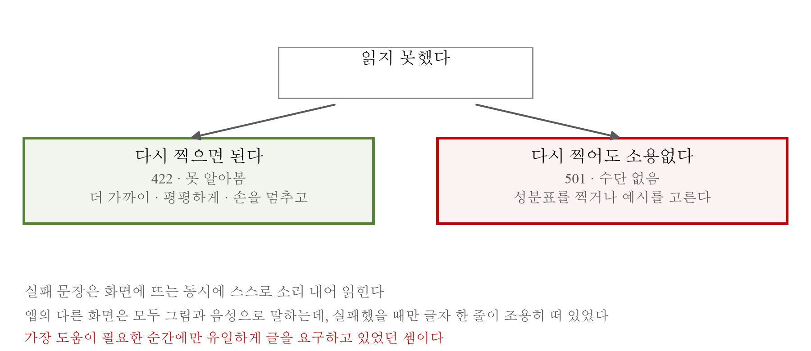

**[그림 29]** 읽지 못했을 때 갈리는 두 길. 왼쪽은 다시 찍으면 되는 실패이고 오른쪽은 다시 찍어도 소용없는 실패다. 서버 응답 422 와 501 을 나누어 처리하는 이유가 이 갈림이다.

이 표에서 중요한 것은 넷째 줄과 다섯째 줄을 나누었다는 점이다. 서버 응답을 501(수단 없음)과 422(못 알아봄)로 나누어 처리한다. 못 알아본 것이면 다시 찍는 것이 답이지만, 통신이 없는 것이면 백 번 다시 찍어도 같다. 두 경우에 같은 문장을 보이면 사용자는 될 때까지 다시 찍게 된다.

실패하면 화면 아래에 예시 목록이 펼쳐진다. 평소에는 접혀 있다가 실패한 순간에만 나온다. 잘 되고 있는 사람에게는 보일 이유가 없고, 막힌 사람에게는 다른 길이 있다는 것이 보여야 하기 때문이다.

별도의 "다시 시도" 버튼은 두지 않았다. 셔터가 그 자리에 그대로 있고 다시 눌리는 상태로 돌아오므로, 버튼을 하나 더 놓으면 같은 일을 하는 것이 화면에 둘이 된다.

### 3.5 음성 접근 경로

음성은 판정 화면에 들어가면 자동으로 한 번 재생된다. 그러나 듣는 사람은 되감을 수 없다. 그래서 화면의 모든 문장이 눌러서 다시 들을 수 있는 대상이다.

이 설계는 §1.10 의 IVR 연구에 대한 대응이다. 그 연구가 고령 사용자의 주된 어려움으로 지목한 것이 말 속도와 선택지 길이였다. 한 번에 다 듣지 못해도 필요한 부분만 다시 들을 수 있다.

#### 3.5.1 조작 가능성의 표시

이 설계에는 개발 중에 드러난 결함이 있었다. **누를 수 있는 자리가 78곳인데 눈에 보이는 표시는 아홉 곳뿐**이었고, 그 아홉도 본문 크기의 0.75배에 투명도 40%인 이모지였다. 기능은 있는데 누를 곳이 보이지 않았고, 시력이 떨어지는 사용자에게 그것은 없는 것과 같다.

표시를 크게 그리는 것만으로는 절반이다. 누르는 것은 소리가 있다는 사실을 이미 아는 사람의 도구이며, 처음 여는 사람에게 스피커 그림은 그저 그림 하나다. 그래서 세 가지를 함께 두었다.

[표 17] 소리에 닿는 세 경로

| 경로 | 무엇을 하는가 | 왜 필요한가 |
|---|---|---|
| 도착하면 스스로 말한다 | 화면마다 "이 화면이 무엇을 묻는가" 한 줄 | 찾을 것이 없어진다. 아무것도 누르지 않아도 된다 |
| 화면을 훑어 듣는다 | 꾹 누른 채 손가락을 미끄러뜨리면 지나가는 것을 차례로 읽는다 | 어디에 소리가 있는지 미리 알 필요가 없어진다 |
| 화면 전체 낭독 | 하단 탭의 한 칸 | 처음부터 끝까지 다시 듣는다 |

도착 안내는 화면당 한 줄만 읽는다. 전부 읽으면 화면을 옮길 때마다 문단이 흘러나오고, 그러면 사용자가 음성을 꺼 버린다. 그것이 이 앱에서 가장 나쁜 결과다. 끄고 나면 아무것도 들리지 않는다.

줄마다 있던 회색 스피커 원은 걷어냈다. 소리를 붙일 수 있는 곳에 다 붙이고 나니 화면 하나에 원이 여덟에서 열 개씩 깔렸는데, 누르는 대상은 줄 전체이고 원은 "여기 소리가 있다" 는 표시일 뿐이었다. 화면에서 가장 많은 자리를 차지하는 것이 기능이 아니라 표시였다.

표시가 필요했던 이유는 소리가 어디 있는지 미리 알려 주어야 한다고 보았기 때문이다. 훑어 들을 수 있으면 그 전제가 사라진다. 꾹 누른 채 손가락을 미끄러뜨리면 지나가는 것이 차례로 읽히므로, 찾지 않고 쓸어 보면 된다. 이는 화면 낭독기의 탐색 방식과 같은 것이며, §1.10 에서 확인한 "설명이 필요한 단계를 만들지 않는다" 는 기준에 더 가깝다.

#### 3.5.2 픽토그램의 음성 해설

가장 늦게 발견한 것은 픽토그램만 말을 하지 않는다는 것이었다. 판정도 제품명도 영양 수치도 눌러서 들을 수 있는데, 정작 본 연구의 핵심 기여인 그림이 조용했다.

§1.8 에서 인용한 van Beusekom 등 (2017) 의 관찰이 이 자리에 그대로 걸린다. 열 종 가운데 셋에서 거짓 확신(알아보지 못하면서 안다고 믿는 것)이 나타났고, 그것은 그림이 없는 것보다 나쁜 실패다. 알아보지 못한 사람은 물어보기라도 하지만, 잘못 알아본 사람은 그대로 행동한다. 같은 논문이 내놓은 처방은 약사가 그림의 뜻을 함께 짚어 주면 이해도가 올라간다는 것이었다. 그림은 말을 대체할 때보다 말과 함께 쓰일 때 더 잘 듣는다.

우리 사용자 곁에는 약사가 없다. 그래서 앱이 그 자리를 대신한다. 그림을 누르면 그 그림이 무엇을 뜻하는지 말한다. 읽어 주는 것은 그림의 생김새가 아니라 그것이 지시하는 행동이다.

```
\three_times_daily{\tablet_blister{\food_bowl}}
    → "A tablet, with food, three times a day."

\no{\allergen_peanut}
    → "Do not eat this. It has peanuts."
```

"알약과 그릇" 이라고 말하는 것은 이미 보고 있는 것을 되풀이할 뿐이고, 정작 모르는 것, 즉 그래서 무엇을 하라는 것인가는 그대로 남는다.

뜻을 모르는 줄은 아예 누를 수 없게 두었다. 지어낸 설명은 바로 그 거짓 확신을 굳혀 주기 때문이다.

### 3.6 기기 공유와 구성원 분리

대상 지역에서 스마트폰은 개인의 물건이 아니라 집에 한 대 있는 물건이다 (§1.6). 그런데 앱이 한 사람만 다루면 할머니와 손주가 같은 폰을 쓸 때 손주가 스캔한 것이 할머니의 하루 누적에 더해지고, 할머니가 쓰는 혈액희석제가 손주의 판정에 걸린다. 기록이 섞이는 데 그치지 않고 판정이 틀린다.

그래서 시작할 때 얼굴을 골라 자기 자리로 들어간다. 자리마다 픽처키가 따로 있고 프로필·기록·알람이 전부 따로 쌓인다. 화면은 운영체제의 잠금화면과 같은 구조다. 사람 목록과 잠금이 한 화면에 있어서, 잘못 골랐을 때 되돌아갈 길을 따로 만들 필요가 없다.

혼자 쓰는 사람에게는 이 화면이 보이지 않는다. 사람이 한 명일 때 고르라고 하는 것은 없는 선택을 시키는 것이다.

가르는 지점은 저장 열쇠 하나다. 첫 사람의 자료는 `snapcare-profile` 에 그대로 있고, 둘째 사람부터는 `snapcare-profile#<id>` 로 간다. 이 규칙을 자료를 읽고 쓰는 층 하나에만 넣었기 때문에 판정·누적·추론 코드는 자기가 몇 명을 다루는지 알 필요가 없다. 나누어야 할 다섯 가지(프로필·기록·알림·세션·제안)에 같은 규칙이 걸린다. 첫 사람의 열쇠에 꼬리를 붙이지 않은 것은 이미 혼자 쓰고 있던 사람의 자료를 옮기지 않기 위해서다.

이름을 묻지 않는 것도 그대로다. 신원은 여덟 개의 얼굴(🧑 🧒 👶 🧓 👩 👨 👦 👧) 가운데 하나이고, 두 사람이 같은 얼굴을 고를 수 없게 이미 쓰이는 얼굴은 목록에서 빠진다. 얼굴만으로 헷갈리는 경우를 위해 색을 하나 더 붙인다.

사람을 바꿀 때는 화면만 갈아 끼우지 않고 앱을 처음부터 다시 연다. 자리에서 자료만 다시 읽으면 이전 사람의 알레르기 정보를 들고 있는 부분이 남을 수 있는데, 그것이 남아 있다는 표시가 화면 어디에도 나타나지 않는다. 그 상태에서 나온 판정은 맞는 판정과 똑같이 생겼다. 다시 여는 데 드는 1초가 그 위험보다 싸다.

사람 목록 화면에서는 지금 쓰고 있는 사람의 조건만 보이고 나머지는 "다른 사람" 으로만 표시된다. 감추려는 것이 아니라 실제로 읽을 수 없기 때문이다. 다른 사람의 자료는 이 세션이 열지 않는 열쇠에 들어 있다.

지우기는 두 번 눌러야 한다. 한 번 누르면 빨간 테두리가 서고, 다시 눌러야 지워진다. "정말 지울까요?" 를 띄우지 않은 것은 그 문장이 이 앱의 사용자에게 읽히지 않기 때문이다. 읽히지 않는 확인 창은 확인이 아니라 한 번 더 누르는 절차일 뿐이므로, 절차 자체를 두 단계로 만들었다. 지금 쓰고 있는 사람과 마지막 한 사람은 지워지지 않는다.

이 절이 다루는 것은 한 기기를 여럿이 쓰는 경우이지 한 사람을 여럿이 돕는 경우가 아니다. §5.7 의 간호·보건 구획 9명 가운데 6명이 환자와 보호자를 각각 다르게 설계해야 한다고 답했고, 튀니지 파스퇴르연구소 Foued Maaoui 연구원이 그 전제를 정면으로 지적했다.

> "The original assumption that the patient will use the app alone does not match common practice, especially among older adults, people with low literacy, cognitive impairment, or complex regimens."
> (Foued Maaoui 연구원, 파스퇴르연구소)

건양대학교 송민선 교수는 같은 것을 다른 말로 적었다. 환자와 보호자가 동시에 이해할 수 있도록 구성해야 한다는 것이다. 반대 의견도 있다. University of Pretoria 의 Celia 교수는 따로 설계할 필요는 없다고 보았고, 협성대학교 박남수 교수는 대상자의 연령과 상태에 따라 달라진다고 답했다.

이 앱은 환자가 혼자 쓴다는 전제로 설계되었다. §3.8 의 되짚기도, §2.4 의 개인별 기준도, 이 절의 구성원 분리도 모두 화면 앞에 한 사람이 있다고 가정한다. 6대 2로 갈린 이 답은 기능 하나가 아니라 그 가정을 겨눈다. 우리는 이것을 고치지 않았다. 보호자를 위한 화면을 따로 만드는 것은 §2.1 이 없애기로 한 단계를 다시 만드는 일이고, 어느 쪽이 옳은지는 사람에게 물어야 알기 때문이다. §5.10 의 현지 평가에서 확인할 항목으로 넣었다.

### 3.7 색 이외의 전달 층

판정은 초록·노랑·빨강 세 색으로 표시된다. 그러나 적록 색각이상은 북유럽계 남성의 약 8%, 여성의 약 0.5%에게 나타나며, 전 세계로는 약 3억 명으로 추정된다 (Colour Blind Awareness; MedlinePlus Genetics).

한 가지 덧붙일 것이 있다. 이 비율은 인종에 따라 다르며 중국·일본계 남성에서는 4~6.5%, 사하라이남 아프리카에서는 더 낮게 보고된다. 즉 이 위험은 지역에 따라 다르며, 사용자가 어디에 있느냐에 따라 북유럽보다 작을 수 있다. 그럼에도 색 하나에 판정을 맡기지 않는 이유는 유병률이 아니라 대가의 비대칭 때문이다. 색을 못 보는 사람에게 색만 주면 판정이 통째로 전달되지 않는 반면, 기호와 문장을 함께 두는 비용은 화면 한 줄이다.

WCAG 1.4.1 은 색만으로 뜻을 전달하지 말 것을 요구하며, 색상 대비만으로는 충분하지 않다는 것이 반복해서 지적되어 왔다. 명도 대비가 높아도 적록색약에게는 색상이 구별되지 않을 수 있기 때문이다 (W3C WCAG 2.x).

그래서 같은 판정이 다섯 갈래로 동시에 나간다.

[표 18] 하나의 판정이 나가는 다섯 갈래

| 갈래 | 안전 | 주의 | 회피 |
|---|---|---|---|
| 색 | 초록 `#0E7A38` | 주황 `#B45309` | 빨강 `#C81E1E` |
| 기호 | ✅ 체크 | ⚠️ 느낌표 삼각형 | ⛔ 진입 금지 |
| 낱말 | Safe | Caution | Avoid |
| 문장 | "Safe to eat." | "Caution for 〈이름〉" | "Do not eat." |
| 그림 | 형태소 그대로 | 그대로 + 경고 형태소 | 부정 연산자를 씌운 형태소 |

마지막 줄이 SIGIL 의 몫이다. 회피 판정은 그림을 빨갛게 칠하는 것이 아니라 그림 자체를 `\no{...}` 로 감싸 사선을 긋는다 (§2.2). 색을 전혀 보지 못해도 그어진 사선은 보인다.

영양소 막대에서도 같은 원칙이 반복된다. 하나의 사실이 막대 길이, 색, 숫자, 영양소별 그림(🔥 🍬 🧂 🧈 🫒 💪 🌾 🍚), 그리고 음성 문장으로 다섯 번 표현된다. 음성은 값만 읽지 않고 "That is high." 처럼 판단하는 낱말을 덧붙인다. 숫자를 듣고 그것이 큰 값인지 스스로 판단하려면 기준을 알아야 하는데, 기준을 아는 것이 바로 이 앱이 전제하지 않기로 한 능력이다.

지금 읽히고 있는 줄에는 테두리가 생긴다. 소리가 어디를 지나고 있는지가 눈으로도 보여야, 듣다가 놓친 사람이 그 자리를 다시 누를 수 있다.

#### 3.7.1 색이 읽히는지를 따로 쟀다

여기까지가 색을 대체하는 층에 관한 것이라면, 색 자체가 읽히는지는 다른 문제다. §5.7 에서 Global Symbols · University of Southampton 의 E. A. Draffan 은퇴 언어치료사·접근성 객원연구원이 WCAG 2.2 모바일 기준을 확인하라고 적었다. AAC 사용자는 시각 손상을 함께 갖는 경우가 많고 훑기(scanning)로 조작하므로 소리 버튼에 닿기 어렵다는 것이 이유였다. 훑어 보니 두 항목이 걸렸다.

첫째는 대비다. 판정 색 다섯이 전부 기준에 못 미쳤다. WCAG 2.2 의 SC 1.4.3 은 본문 글자에 4.5:1 을 요구하는데, 이 색들은 장식이 아니라 판정 문장 자체의 색이다. 표 18 의 다섯 갈래 가운데 하나가 흐려지는 것이 아니라 그 문장이 읽히지 않는 것이다.

[표 19] 판정 색의 명도 대비 (오프화이트 배경 `#F4F3EF` 위, 기준 4.5:1)

| 쓰임 | 이전 | 대비 | 지금 | 대비 |
|---|---|---|---|---|
| 안전 | `#15A34A` | 2.97:1 | `#0E7A38` | 4.90:1 |
| 주의 | `#DE8500` | 2.53:1 | `#B45309` | 4.52:1 |
| 회피 | `#DC2626` | 4.35:1 | `#C81E1E` | 5.17:1 |
| 강조 | `#2F6BF6` | 4.15:1 | `#1D4ED8` | 6.04:1 |
| 보조 글자 | `#6B7280` | 4.35:1 | `#55606E` | 5.76:1 |

다섯을 한 단씩 어둡게 하되 색상은 지켰다. 초록·주황·빨강이라는 것이 한눈에 보여야 갈래가 남기 때문이다. 지금 값은 흰 카드 위, 오프화이트 배경 위, 자기 연한 배경 위, 그리고 색 바탕에 흰 글자를 얹은 경우까지 네 조합 모두에서 4.5:1 을 넘는다.

이 값은 눈으로 지킬 수 없는 종류라 시험으로 잠갔다. 화면에서는 이전 값도 멀쩡해 보였고, 실제로 그래서 여기까지 왔다. 시험은 대비만 재지 않고 세 색이 서로 다른 색상으로 남아 있는지도 함께 잰다. 대비만 재면 전부 어두운 회색으로 수렴시켜 통과할 수 있으며, 그것은 시험을 통과하면서 시험의 목적을 잃는 가장 흔한 방법이다.

둘째는 표적 크기다. SC 2.5.8 은 최소 24픽셀을 요구한다. 큰 조작은 이미 44픽셀이었으나 되읽기 줄과 설정으로 돌아가는 줄 같은 보조 조작이 16에서 20픽셀 사이였다. 훑어 읽는 줄이 짚기에 얇다는 것은 이 앱에서 특히 나쁘다. 그 줄을 짚는 것이 글을 못 읽는 사람이 화면을 읽는 방법이기 때문이다. 최소 24픽셀을 깔았다.

이미 맞고 있던 것도 적어 둔다. 훑기 장치가 소리에 닿는 경로(SC 2.1.1 키보드 조작), 이름 없는 조작의 부재(SC 4.1.2), 375픽셀에서의 가로 스크롤 없음(SC 1.4.10), 가려지는 초점 없음(SC 2.4.11)은 확인 결과 이미 성립했다. 이 넷을 적는 이유는 통과한 것을 자랑하려는 것이 아니라, 훑기의 범위를 밝혀 두어야 통과와 미확인이 구별되기 때문이다.

---

### 3.8 알아들었는지 되짚는 단계

판정 화면이 떴다고 해서 전달이 끝난 것은 아니다. §5.7 에서 Foued Maaoui 파스퇴르연구소(튀니지) 연구원이 지적한 것이 이 지점이다. 화면이 아무리 명확해도 그것을 본 사람이 알아들었는지 확인할 절차가 없으면 되돌아오는 신호가 없는 것이고, 환자 안전의 관점에서 이 고리의 부재는 중대한 위험이다.

임상에서 쓰는 되말하기는 이렇게 한다. 설명이 끝나면 집에 가서 어떻게 드실 것인지 말해 달라고 청하고, 돌아온 말에서 빠진 것을 다시 설명한다. 전제는 고개를 끄덕이는 것이 이해의 증거가 아니라는 것이다. §5.7 에서 인용한 체계적 문헌고찰 20편 중 19편이 이 절차의 긍정적 결과를 보고했다.

이 절차를 우리 사용자에게 그대로 옮길 수는 없다. 글을 읽지 못하고, 마이크는 아예 닫아 두었다(§4.6). 말로 되받게 하려면 음성 인식이 필요하고, 그것은 우리가 열지 않기로 한 권한이다. 그래서 말로 되받는 대신 그림으로 되짚게 한다. 물음은 소리로 나가고 답은 그림을 짚는다. 짚을 그림은 새로 그리지 않고 §2.2 의 형태소를 그대로 쓴다.

여기서 형태소가 아니라 DSL 한 줄을 답지로 쓰면 안 되는 이유가 드러난다. `\qty_two` 는 "두 개" 인데 무엇의 두 개인지가 없다. §2.2 의 문법이 수식어의 단독 사용을 막는 것과 같은 이유이며, 이 자리에서 필요한 것은 문장이 아니라 짚을 그림 하나다.

[표 20] 되짚기에서 묻는 것 (처방전이 말한 것만 묻는다)

| 순서 | 묻는 것 | 소리로 나가는 말 | 답지 | 묻지 않는 경우 |
|---|---|---|---|---|
| 1 | 한 번에 몇 개 | How many do you take at a time? | 개수 형태소 셋 | 처방전에 1회 개수가 없을 때 |
| 2 | 언제 | When do you take it? | 시각 형태소 셋 | 처방에 없는 시각이 둘을 못 채울 때 |
| 3 | 밥과 함께인가 | Do you take it with food? | 밥그릇 · 빈 그릇 | 처방전에 식사 맥락이 적혀 있지 않을 때 |

개수를 맨 앞에 두었다. 표 4 에서 약사가 발견한 조제 오류 155건 가운데 28.4%가 용량 오류였고, §5.7 에서 Atif Usman 교수가 1회 용량과 하루 횟수가 구분되지 않는다고 지적한 것도 같은 자리다. 셋을 다 묻지 않고 최대 둘까지만 낸다. 확인이 길어지면 그 자체가 또 하나의 단계가 되고, 이 앱이 없애려던 것이 단계다.

설계에서 물러서지 않은 것이 셋 있다.

첫째, 막지 않는다. 틀려도 다음으로 가고, 건너뛸 수 있으며, 그동안에도 약 정보가 화면 아래에 그대로 있다. 확인을 통과해야 정보를 주는 앱은 약을 못 먹게 하는 앱이다. 이것은 시험이 아니라 확인이다.

둘째, 처방전이 말한 것만 묻는다. 적혀 있지 않은 것을 물으면 우리가 답을 지어내야 하고, 지어낸 답을 맞다고 가르치게 된다. 식사 맥락을 처방전에 그런 말이 있을 때만 묻는 것이 그 규칙이다.

셋째, 틀리면 그 자리에서 다시 말해 준다. 맞는 그림을 켜 두고 소리로 한 번 더 읽는데, 맞았을 때와 **같은 문장**을 쓴다. 어느 쪽으로 짚었든 마지막으로 듣는 말이 옳은 지시여야 하기 때문이다. 확인의 목적은 점수가 아니라 두 번째 기회다.

묻지 않기로 한 자리도 적어 둔다. 시각을 묻는 물음의 오답은 그 처방에 없는 시각이어야 한다. 실제 복용 시각을 오답으로 내면 옳게 짚은 사람에게 틀렸다고 말하게 되기 때문이다. 그래서 하루 세 번 먹는 약에서는 남는 시각이 하나뿐이라 답지가 둘이 되고, 반반 찍기는 확인이 되지 못한다. 알아들은 사람과 못 알아들은 사람을 가르지 못하면서 물었다는 사실만 남는 물음이므로 아예 내지 않는다. 하루 세 번 먹는 약에는 개수와 식사라는 물어볼 만한 것이 이미 있다.

답지의 순서는 섞되 언제나 같게 섞는다. 볼 때마다 답이 옮겨 다니면 처음에 짚어 본 자리를 기억한 사람이 두 번째에 헤맨다. 여기서 필요한 것은 무작위가 아니라 정답이 늘 첫째 칸에 오지 않는 것뿐이므로, 항목 식별자에서 유도한 값으로 섞는다.

이 단계는 §5.7 의 조사 뒤에 만들어졌다. 사람을 대상으로 한 검증은 아직 하지 않았으며, 그림으로 짚는 것이 말로 되받는 것과 같은 확인 효과를 내는지는 §5.10 의 현지 평가에서 확인할 항목이다.

## □ Development and Implementation

### 4.1 구성 개요

이 절은 무엇을 어떤 도구로 만들었는지를 먼저 밝히고, 이어지는 절들에서 그 가운데 판단이 갈렸던 지점을 하나씩 다룬다. 구성 자체보다 왜 그렇게 골랐는지가 이 절의 내용이다.

[표 21] 기술 구성

| 층 | 기술 | 비고 |
|---|---|---|
| 웹 앱 | Next.js 16 (App Router) · React 19 · TypeScript · Tailwind | 정적 빌드 유지 |
| 픽토그램 엔진 | SIGIL — 자체 DSL · 재귀 하강 파서 · Python/Pillow 합성 | 형태소 78 |
| 음성 엔진 | VOCA — 자체 구성 로직 · Web Speech API | 기기 내장 음성 |
| OCR | Tesseract.js | 브라우저 내 실행 |
| 영양 추정 | EfficientNet-B0 224px (Nutrition5k 학습) · onnxruntime-web | 기기 내 추론 |
| 제품 정보 | OpenFoodFacts API | 서버 경유 |
| 이미지 인식 | Claude Vision | 서버 경유 |
| 하드웨어 | Raspberry Pi 3B · 서보 3 · WS2812 · DS1302 | 트레이 3 |
| 배포 | fly.io (도쿄) · 영속 볼륨 1GB | |

표의 마지막 열만 따로 읽으면 이 구성이 어떻게 짜였는지 보인다. 무거운 것이 기기에 있고 가벼운 것이 서버에 있다. 16 MB 짜리 영양 추정 모델은 브라우저에서 돌고, 사진 한 장이 무엇인지 알아보는 일은 서버로 나간다. 보통의 웹 앱과 반대다. 계산이 무거우면 서버로 보내는 것이 상식이고, 그렇게 하면 기기가 낡아도 되고 모델을 갈아 끼우기도 쉽다.

그 상식을 뒤집은 이유는 하나다. 서버에 있는 것은 인터넷이 끊기면 없는 것이 된다. 그래서 "없으면 판정 자체가 성립하지 않는 것" 만 골라 기기 안으로 옮겼다.

[표 22] 무엇이 어디서 도는가

| 하는 일 | 도는 곳 | 인터넷이 끊기면 |
|---|---|---|
| 사진에서 글자 읽기 | 기기 | 그대로 된다 |
| 성분표 해석과 물리 검사 | 기기 | 그대로 된다 |
| 처방전 해석 | 기기 | 그대로 된다 |
| 종이 서식 판독 | 기기 | 그대로 된다 |
| 영양 추정 (사진) | 기기 | 그대로 된다 |
| 판정과 하루 기준 계산 | 기기 | 그대로 된다 |
| 무엇을 찍었는지 알아보기 | 서버 | 못 알아본 것으로 처리되어 주의로 표시 |
| 제품 정보 조회 | 서버 | 조회 없이 진행 |
| 픽토그램 새로 합성 | 서버 | 이미 만들어 둔 것만 나온다 |

위의 다섯 줄과 아래의 세 줄을 가른 기준은 급한 정도다. 처방전을 읽는 일은 통신이 없다고 미룰 수 있는 종류가 아니고, 제품 정보 조회는 없어도 판정이 나온다. 이 경계가 실제로 그렇게 동작하는지를 §5.6 에서 통신을 끊고 확인했다.

대가가 하나 있다. 모델을 기기에서 돌리기로 하면 모델을 바꿀 때마다 16 MB 를 다시 내려받게 된다. 서버에 두었다면 사용자가 눈치채지 못하는 사이에 갈아 끼울 수 있었을 것이다. 인터넷이 없어도 도는 것과 조용히 고칠 수 있는 것 가운데 앞의 것을 골랐고, 이것은 대상 사용자가 정해진 뒤에는 고민할 여지가 없는 선택이었다.

### 4.2 판정 엔진의 물리 검사

영양 정보는 세 경로로 들어온다. 영양성분표 OCR, 제품 데이터베이스 조회, 그리고 음식 사진 추정이다. 세 경로의 신뢰도는 서로 다르며 사진 추정이 가장 낮다. 이 분야의 최신 모형을 보면 열량의 평균 절대 오차가 **253.7 kcal**, 질량이 98.4 g, 탄수화물이 24.2 g, 단백질이 22.1 g, 지방이 14.3 g 이다 (Chen, T. et al., "NutritionVerse-Direct: Exploring Deep Neural Networks for Multitask Nutrition Prediction from Food Images," arXiv:2405.07814, 2024).

열량 오차 253.7 kcal 이 어떤 크기인지는 §2.4 의 기준치와 견주면 드러난다. 70세 기준 하루 1,800 kcal 에서 이 오차는 **14%**에 해당하며, 한 끼를 700 kcal 로 보면 3분의 1을 넘는다. 사진 한 장으로 "이것을 먹어도 되는가" 를 판정하기에는 충분하지 않은 정확도다. 그럼에도 이 경로를 남겨 둔 것은 대상 지역의 현지 음식이 어느 제품 데이터베이스에도 없기 때문이며, 그래서 이 경로의 값은 다른 두 경로와 똑같은 물리 검사를 통과한 뒤에만 화면에 나간다.

따라서 SnapCare 는 어느 경로로 들어왔는지와 무관하게 같은 검사를 적용한다.

[표 23] 값을 받아들이기 전에 통과해야 하는 검사

| 검사 | 내용 |
|---|---|
| 범위 | 각 영양소가 물리적으로 가능한 범위 안에 있는가 |
| 부분집합 | 포화지방 ≤ 총지방, 당류 ≤ 탄수화물 |
| 질량 보존 | 영양소 합이 총 질량을 넘지 않는가 |
| Atwater 항등식 | 4·탄수화물 + 4·단백질 + 9·지방 ≈ 에너지 |

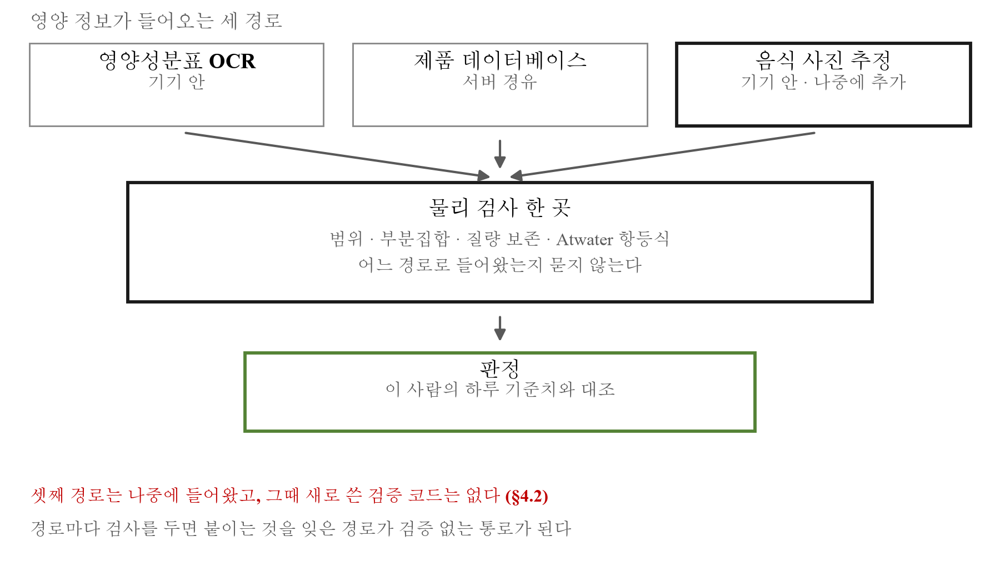

**[그림 30]** 세 경로가 하나의 관문을 지난다 (§4.2). 검사를 경로마다 두지 않고 한 곳에 모은 이유가 아래 붉은 줄이다. 셋째 경로는 이 앱에 나중에 들어왔고, 그때 추가로 작성한 검증 코드는 없다. 이미 있는 관문을 지나가게 했을 뿐이다.

이 검사들이 왜 판정 앞에 있는지를 §5.7 의 한 응답이 요약한다. 이화여자대학교 약학대학 이한길 부교수는 앱이 약국 업무 흐름에 들어갈 수 있겠느냐는 물음에 판단을 유보하며 순서를 지적했다. 편리성보다 정확성이 먼저 담보되어야 한다는 것이다. 이 절의 관문은 그 순서를 코드로 옮긴 것이다. 값이 어디서 왔든 물리적으로 성립하지 않으면 판정에 쓰이지 않으며, 그 대가로 값을 내지 못하는 경우가 생긴다.

Atwater 항등식이 특히 유용하다. 이것은 어떤 출처에서 온 값이든 성립해야 하는 관계이므로, 출처를 신뢰할 필요 없이 값 자체의 일관성을 검사할 수 있다.

이 검사가 실제로 필요했던 사례가 있다. 개발 과정에서 라벨 파서가 지방 값을 실제의 10배로 읽으면서, 올바르게 읽은 탄수화물과 단백질 값을 오히려 버리는 동작이 발견되었다. Atwater 검사는 이 조합을 통과시키지 않는다.

검사는 판정 엔진 앞단의 한 함수에 모여 있다. 세 경로가 모두 이 함수를 통과한 뒤에야 값이 된다.

```ts
export function validateDensity(per100: NutrientAmounts): ValidationResult {
  const problems: string[] = [];

  for (const [k, v] of Object.entries(per100) as [NutrientKey, number][]) {
    const b = BOUNDS[k];                                   // ① 물리적 범위
    if (b && (v < b[0] || v > b[1])) problems.push(`${k}=${v} out of range ${b[0]}–${b[1]}`);
  }

  if (gt(per100.sugars, per100.carbohydrates)) problems.push('sugars > carbohydrates');
  if (gt(per100.saturatedFat, per100.fat)) problems.push('saturatedFat > fat');   // ② 부분집합

  const mass = (['carbohydrates', 'fat', 'protein', 'fiber', 'salt'] as NutrientKey[])
    .reduce((s, k) => s + (per100[k] ?? 0), 0);
  if (mass > MASS_LIMIT) problems.push(`mass ${mass.toFixed(1)} g per 100 g`);     // ③ 질량 보존
  ...
}
```

설계 의도. 검사를 경로마다 두지 않고 한 곳에 모았다. 경로마다 두면 새 경로가 생길 때마다 검사를 다시 붙여야 하고, 붙이는 것을 잊은 경로가 곧 검증 없는 통로가 된다. 실제로 이 앱에는 세 번째 경로(사진 추정)가 나중에 들어왔는데, 그때 추가로 작성한 검증 코드는 없다. 이미 있는 관문을 지나가게 했을 뿐이다.

`problems` 를 참·거짓 대신 문자열 배열로 돌려주는 것도 의도가 있다. 값이 거절되었을 때 화면은 "읽지 못했습니다" 대신 무엇이 어긋났는지를 말할 수 있어야 하고, 개발 중에는 그 문자열이 그대로 로그가 된다. 앞서 지방 값을 10배로 읽던 사례를 찾아낸 것이 이 문자열이었다.


### 4.3 하드웨어 연동 경로의 선정

폰과 디스펜서를 잇는 경로는 여러 제약이 동시에 걸리는 문제였다.

[표 24] 검토한 연결 방식과 각각을 배제한 이유

| 방식 | 배제 사유 | 성격 |
|---|---|---|
| Web Bluetooth | iOS 가 모든 브라우저에 WebKit 을 강제하므로 `navigator.bluetooth` 가 존재하지 않는다 | 플랫폼 제약 |
| HTTPS 페이지에서 기기로 직접 `fetch` | 혼합 콘텐츠 차단. 요청이 브라우저를 떠나지 않는다 | 플랫폼 제약 |
| 클라우드 브로커 (MQTT over wss) | 세 문제를 모두 해결하나 **양쪽 모두에 인터넷을 요구한다** | 대상 환경과 충돌 |
| iOS 지원 포기 | 안드로이드 점유율이 아프리카 86.6%·중남미 90.9%·인도 약 95%로 근거는 있으나, **"누구에게나 통한다"는 제품의 주장과 모순된다** | 자체 원칙 |

앞의 둘은 플랫폼이 정한 것이라 우회할 수 없고, 셋째는 저인프라 지역을 대상으로 하는 이상 받아들일 수 없으며, 넷째는 우리가 스스로 배제했다. 표 24의 마지막 행이 나머지와 성격이 다르다는 점을 밝혀 둔다. 기술이 막은 것이 아니라 제품의 주장을 지키기 위해 선택지를 좁힌 것이다.

남은 경로는 최상위 내비게이션이다. HTTPS 페이지가 HTTP 기기를 `fetch` 할 수는 없지만, 그 주소로 이동하는 것은 차단되지 않는다. 따라서 앱은 기기의 저장 주소로 가는 링크를 만들고, 사용자가 한 번 누르면 기기가 일정을 저장한 뒤 확인 페이지를 보여준다. 브로커도 클라우드도 필요하지 않으며 가정 내에서 완결된다.

#### 4.3.1 릴레이 경로의 추가

표 24 의 셋째 행인 클라우드 브로커를 배제한 이유는 "양쪽 모두에 인터넷을 요구한다" 였다. 그것은 그 경로 하나에만 의존할 때 참인 문장이다. 위의 LAN 경로가 이미 완결되어 있으므로, 그 위에 인터넷 경로를 하나 더 얹는 것은 요구 조건을 늘리지 않는다.

그렇게 판단한 이유는 LAN 경로가 풀지 못하는 문제가 남아 있었기 때문이다. 처방을 관리하는 사람은 대개 그 집에 없다. 보호자는 직장에 있고 복용 시각은 화요일 오후에 바뀐다. 그리고 §4.3 앞부분에서 배제한 두 제약이 LAN 경로에 그대로 남아 있다. 혼합 콘텐츠 때문에 앱은 기기의 API 를 부를 수 없고, 그래서 링크가 실어 나를 수 있는 것은 예전 호환 URL 이 받는 항목뿐이다. 거기에는 요일 칸도 복용 기간 칸도 없다. 월·수·금 처방이 이레 내내 나가고, 30일 처방이 통이 빌 때까지 나간다.

따라서 디스펜서가 릴레이로 나가는 연결 하나를 붙잡고 있게 했다. 방향이 바깥인 것은 가정용 공유기가 디스펜서로 포트를 열어 주지 않기 때문이고, 열어 달라고 부탁할 일도 아니기 때문이다. 릴레이가 HTTPS 이므로 혼합 콘텐츠 문제가 사라지고, 그래서 요일과 기간이 실린다.

릴레이는 자기가 나르는 것을 읽지 못한다. 오가는 것은 전부 AES-256-GCM 이고, 여는 열쇠는 기기에 인쇄된 열 글자에서 양쪽이 각자 유도한다. 어느 쪽도 그 열쇠를 보내지 않는다. 릴레이에게는 같은 유도의 다른 가지를 준다. 사서함을 구분하기에는 충분하고 여는 데는 쓸모없는 값이다.

```
인쇄 코드 ──HKDF──► device id      릴레이의 주소       (릴레이가 본다)
         ──HKDF──► access token   그 사서함의 권한     (릴레이가 본다)
         ──HKDF──► box key        일정을 연다          (절대 못 본다)
```

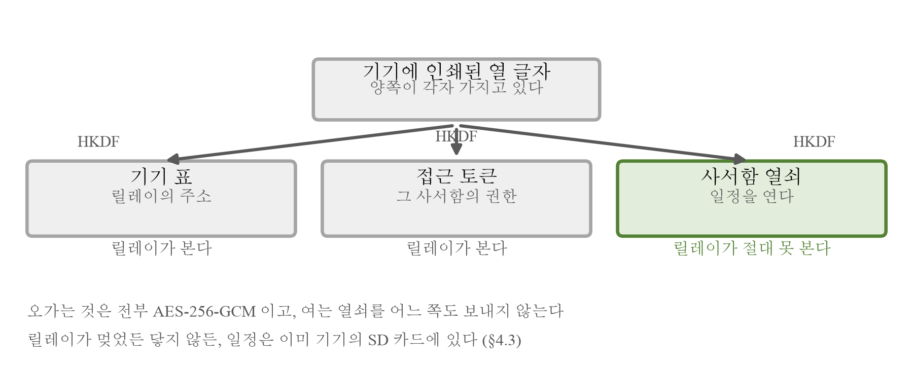

**[그림 31]** 인쇄된 열 글자에서 세 값이 갈라진다. 릴레이는 앞의 둘로 사서함을 구분하고, 마지막 하나는 어느 쪽도 보내지 않으므로 릴레이가 가질 방법이 없다.

이것은 의존이 아니라 통로 하나가 늘어난 것이다. 일정은 이미 기기의 SD 카드에 있고 시각은 실시간시계가 안다. 릴레이가 멎었든, 닿지 않든, 아예 설정되지 않았든 누구의 복용도 놓치지 않는다. 표 24 의 판단은 그대로 유효하다. 우리는 여전히 클라우드를 요구하지 않는다.

### 4.4 종이 서식 판독

디스펜서의 원본 오픈소스 설계는 2.8인치 터치스크린으로 모든 설정을 수행한다. 이는 SnapCare 의 전제와 정면으로 충돌한다. 문자 메뉴를 읽어야 하는 화면은 우리가 없애려는 것 자체다.

따라서 화면을 제거하고 종이 서식으로 대체했다. 의사나 약사가 서식에 표시하면, 환자는 그것을 사진으로 찍기만 하면 된다.

판독기는 처음에 서버의 파이썬과 OpenCV 로 만들었고, 그 뒤 브라우저로 옮겼다. 옮긴 이유는 이 경로만 인터넷을 요구하고 있었기 때문이다. 글자 인식도 영양 추정 모델도 판정 엔진도 픽토그램도 전부 기기 안에 있는데(§4.1), 인터넷이 없는 진료소에서 가장 쓰고 싶은 기능이 서버를 부르고 있었다.

opencv.js 를 통째로 싣지 않고 쓰는 함수만 옮겨 적었다. 가우시안 흐림, 적응형 이진화, 라플라시안 분산, 원근 워프, 오츠 이진화다. 8 MB 를 더 받게 하는 것은 §4.5 에서 모델 16 MB 를 처음 쓸 때 받도록 한 판단과 어긋난다. ArUco 검출도 직접 짰다. 종이에 인쇄한 것은 네 개뿐이므로 사전 50개를 옮길 이유가 없고, 후보가 나머지 46개 중 하나로 "고쳐질" 길도 함께 없어진다.

파이썬 판을 지우지 않고 남겨 두었다. 두 구현이 같은 답을 내는지가 옮긴 것이 맞는지를 판정하는 유일한 방법이기 때문이다.

판독은 네 단계다. 서식 네 귀퉁이의 ArUco 마커를 찾아 원근을 보정하고(1000×1000으로 펴고), 적응형 이진화를 걸고, 설정 파일에 적힌 좌표에서 각 버블의 채움 비율을 재고, 그 비율로 무엇이 표시되었는지 정한다. 마커를 찾지 못하면 값을 지어내지 않고 "종이 전체가 화면에 들어오지 않았다" 는 뜻의 오류를 돌려준다.

값을 정하는 규칙에 한 가지 판단이 들어 있다. 항목마다 하나만 고르는 것(칸 번호·기간·시각)과 여럿 고를 수 있는 것(요일)이 다르게 처리된다. 전자는 가장 진한 칸 하나를 고르되 2등과의 차이가 충분해야 하고, 그렇지 않으면 값을 내지 않고 문제로 보고한다. 애매한 것을 그럴듯하게 고르는 것이 이 경로에서 가장 나쁜 실패이기 때문이다. 잘못 읽은 복용 시각은 아무 값도 읽지 못한 것보다 위험하다.

```python
if group["mode"] == "one":
    ranked = sorted(s.items(), key=lambda kv: -kv[1])
    best, second = ranked[0], ranked[1]

    if best[1] < abs_min:                      # ① 아무것도 안 칠했다
        values[name] = None
        problems.append(f"{name}: nothing filled")

    elif second[1] >= abs_min:                 # ② 둘 다 제대로 칠했다
        # 둘 사이의 간격만 보면, 마음을 바꿔 다른 칸을 칠하고 앞의 것을 지우지
        # 않은 종이에서 펜이 더 덮은 쪽을 조용히 고르게 된다. 종이는 서로 다른
        # 두 가지를 말하고 있고, 어느 쪽이었는지는 그것을 쓴 사람만 안다.
        values[name] = None
        problems.append(f"{name}: two boxes filled ... erase one and retake")

    elif best[1] - second[1] < margin:         # ③ 갈라지지 않는다
        values[name] = None
        problems.append(f"{name}: ambiguous ...")

    else:
        values[name] = best[0]
else:                                          # 여럿 고르는 항목 (요일)
    picked  = [k for k in group["bubbles"] if s[k] >= abs_min]
    unclear = [k for k in group["bubbles"] if abs_min - margin <= s[k] < abs_min]
```

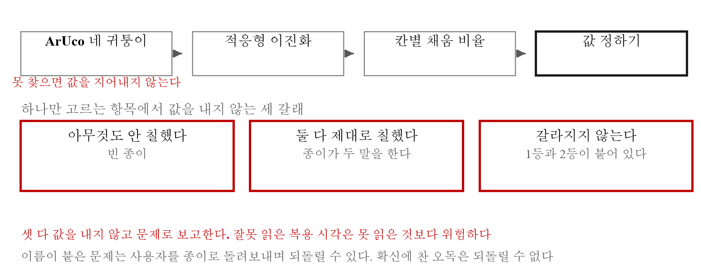

**[그림 32]** 종이 서식을 읽는 네 단계와, 하나만 고르는 항목에서 값을 내지 않는 세 갈래. 붉은 상자 셋이 모두 값을 내지 않는 쪽으로 끝난다.

설계 의도. 갈래 ①②③ 이 모두 값을 내지 않는 쪽으로 끝난다는 것이 이 함수의 성격이다. 특히 ② 가 그렇다. 두 칸이 모두 제대로 칠해져 있으면 더 진한 쪽을 고르는 것이 기술적으로는 쉽지만, 그것은 종이가 하지 않은 말을 만들어 내는 것이다.

이름이 붙은 문제(`problems`)는 사용자를 종이로 돌려보내며 되돌릴 수 있다. 확신에 찬 오독은 되돌릴 수 없다. 판독기가 "모르겠다" 고 말할 수 있어야 하는 이유가 여기 있고, 이것은 §2.2 의 파서가 지어낸 이름을 그림 대신 오류로 만드는 것, §5.2 의 검사기가 통과 기준을 결과에 맞추어 낮추지 않는 것과 같은 원칙이다.

요일처럼 여럿 고르는 항목에서는 `unclear`, 즉 비어 있다고 하기에도 칠했다고 하기에도 애매한 띠를 따로 모아 함께 보고한다. 값은 내되 무엇이 미심쩍은지를 함께 말하는 쪽이, 조용히 빠뜨리는 것보다 낫다.

#### 4.4.1 열화 한계의 측정

파서가 얼마나 험한 사진까지 읽는지를 의견이 아니라 측정으로 남기고 싶었다. 그런데 광학 마크 판독기를 시험하려면 보통 서식을 인쇄하고 손으로 칠하고 여러 조명에서 사진을 찍어야 하며, 코드를 고칠 때마다 그것을 다시 해야 한다. 그러면 아무도 돌리지 않게 되고, 나쁜 조건에서의 동작은 계속 짐작으로 남는다.

그래서 사진을 만들어 낸다. 실제 서식 이미지에서 시작해 사람이 칠하듯 버블을 칠하고(가운데를 벗어나게, 덜 채워지게, 때로는 윤곽을 넘치게), 그 종이를 휴대폰 카메라가 겪는 일들에 통과시킨다. 비스듬히 들어 생기는 원근, 창을 등지고 서서 생기는 조명 기울기, 초점 흐림, 센서 잡음, JPEG 압축. 결과는 파서가 본 적 없는 이미지이고 정답은 정확히 알고 있다.

이 합성기로 각 열화를 판독이 깨질 때까지 밀어 올렸다. 한 지점은 그 지점의 모든 시행이 정확히 읽혔을 때만 통과로 친다.

[표 25] 판독이 100%를 유지한 마지막 지점 (지점당 16장)

| 열화 | 마지막으로 전부 맞힌 값 | 그다음 값에서 |
|---|---|---|
| 초점 흐림 | 2.0 px | 2.5 px 에서 무너짐 |
| 원근 기울기 | 0.18 | 0.22 에서 무너짐 |
| 센서 잡음 | σ = 32 | σ = 48 에서 81.2% |
| 표시 채움 정도 | 0.4 | 0.3 에서 50.0% |
| 그림자 | 0.9 | **시험 범위 안에서 깨지지 않음** |
| 밝기 | 0.25배 | **시험 범위 안에서 깨지지 않음** |
| JPEG 품질 | 8 | **시험 범위 안에서 깨지지 않음** |

아래 세 줄은 한계가 아니라 하한이다. 시험한 가장 험한 값까지 100%를 유지했다는 뜻이며, 더 밀면 어디서 깨지는지는 모른다. 한계로 읽으면 실제보다 나쁘게 적는 것이 되므로 그대로 구분해 적는다.

읽어야 할 값은 표 25 의 왼쪽이 아니라 오른쪽 두 줄이 무엇인가다. 그림자와 밝기에 강한 것은 적응형 이진화가 국소적으로 문턱을 잡기 때문이고, JPEG 품질 8까지 견디는 것은 판독 대상이 미세한 무늬가 아니라 칠해진 면적이기 때문이다. 반대로 무너지는 둘은 성격이 다르다. 초점 흐림과 표시 채움은 버블의 경계 자체를 지운다. 채움 0.3 에서 절반이 틀리는 것은, 그 정도로 옅게 칠하면 칠한 것과 안 칠한 것의 차이가 종이의 얼룩보다 작아지기 때문이다.

여기서 나오는 실무적 지시는 두 가지다. 칠할 때는 칸을 절반 이상 채울 것, 그리고 찍을 때 초점을 맞출 것. 나머지는 걱정하지 않아도 된다. 어둡든, 그림자가 지든, 화질이 나쁘든 상관없다. 종이 서식과 함께 인쇄되는 안내에 이 둘만 적은 것도 그래서다.

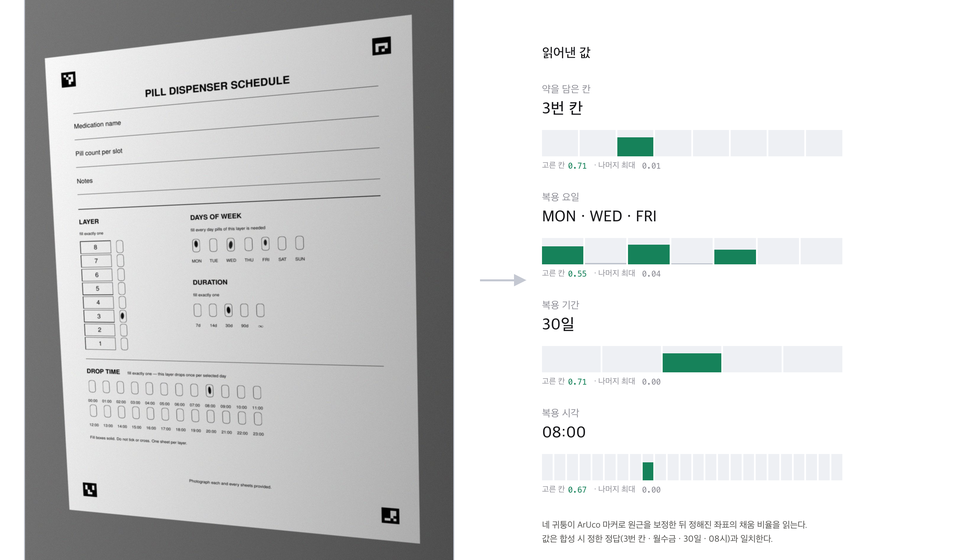

**[그림 33]** 종이 서식과 그 판독 결과. 왼쪽은 실제로 파서에 입력한 사진이며, 원근·조명 기울기·초점 흐림·센서 잡음을 모두 거친 것이다. 오른쪽은 그 사진에서 읽어낸 값과 각 칸의 채움 점수다. 고른 칸과 나머지 칸의 간격(0.67~0.71 대 0.00~0.04)이 판독이 경계에서 아슬아슬하게 맞은 것이 아님을 보여 준다. 값은 이 사진을 만들 때 정한 정답과 정확히 일치한다.

### 4.5 오프라인 동작

앱은 PWA 로 구성되어 서비스워커가 화면·자산·모델을 캐시한다. 자원의 성격에 따라 전략을 달리한다. 화면 이동은 네트워크 우선으로 처리하여 접속 시 항상 최신을 받고, 정적 자산과 픽토그램은 캐시 우선으로 처리한다. 판정 API 는 가로채지 않는다. 오래된 답을 주는 것보다 실패하는 편이 낫기 때문이다.

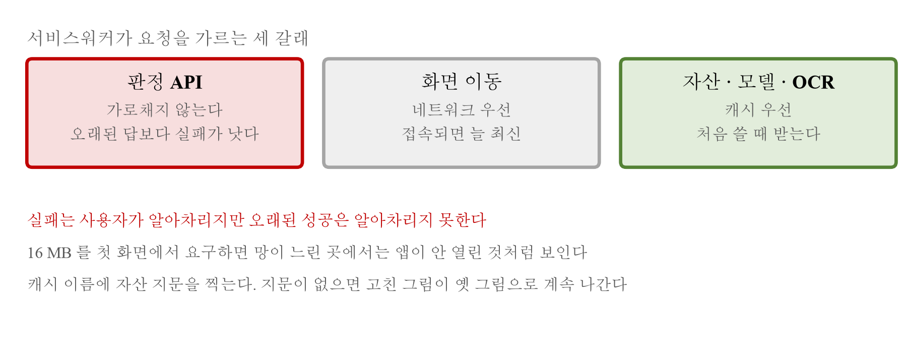

**[그림 34]** 서비스워커가 요청을 가르는 세 갈래. 셋이 각각 다른 판단이며, 붉은 칸이 이 앱이 약을 다루기 때문에 생긴 제약이다.

전략의 갈래는 서비스워커의 `fetch` 처리에 그대로 드러난다.

```js
self.addEventListener('fetch', (event) => {
  const url = new URL(event.request.url);

  // 판정 API 는 가로채지 않는다. 오래된 답을 주는 것보다 실패하는 편이 낫고,
  // 오프라인 대비는 앱 코드(캐시된 프로필·픽토그램)가 이미 하고 있다.
  if (url.pathname.startsWith('/api/')) return;

  if (event.request.mode === 'navigate') {
    event.respondWith(networkFirst(event.request));   // 화면 이동은 최신 우선
    return;
  }

  if (url.pathname.startsWith('/_next/static/') ||
      url.pathname.startsWith('/pictograms/') ||
      url.pathname.startsWith('/models/') ||          // 영양 추정 모델 16MB
      url.pathname.startsWith('/ocr/')) {             // OCR 워커·코어·언어 데이터
    event.respondWith(cacheFirst(event.request));
  }
});
```

설계 의도. 세 갈래가 각각 다른 판단이다.

판정 API 를 가로채지 않는 것은 이 앱이 다루는 것이 약이기 때문이다. 캐시된 판정을 돌려주면 사용자는 그것이 지금의 답인지 어제의 답인지 알 방법이 없다. 실패는 사용자가 알아차리지만 오래된 성공은 알아차리지 못한다.

모델과 OCR 자산을 캐시 우선에 넣은 것은 개발 중에 발견한 결함을 고친 결과다. 앱의 요점이 "인터넷 없이 기기에서 판정한다" 인데 16MB 짜리 추정 모델이 캐시 대상에서 빠져 있었다. 계산은 기기에서 하면서 정작 그 계산을 할 모델을 받아오지 못했으므로, 오프라인 주장이 절반만 참이었다.

그러면서도 이 자산들을 미리 받아 두지 않는다. 처음 쓸 때 받는다. 첫 화면에서 16MB 를 요구하면 망이 느린 곳에서는 앱이 아예 뜨지 않은 것처럼 보이는데, 우리 사용자가 있는 곳이 정확히 그런 곳이다. 앱이 안 열리는 것보다 기능 하나가 늦는 편이 낫다.

캐시 이름에는 자산 지문을 찍는다. 픽토그램의 주소는 DSL 문자열에서 유도되므로 그림을 교체해도 주소가 변하지 않으며, 지문이 없으면 한 번이라도 방문한 사용자에게 옛 그림이 계속 제공된다. 실제로 `qty_four` 를 고쳐 다시 뽑았을 때(§5.2) 지문이 바뀌면서 캐시된 픽토그램 113장이 통째로 다시 렌더되었다. 지문이 없었다면 그 사용자들은 고치기 전의 고리 넷을 계속 보았을 것이다.

### 4.6 개인정보 보호

건강 정보를 다루므로 저장과 전송 양쪽에서 조치가 필요했다.

[표 26] 개인정보 관련 설계

| 항목 | 내용 |
|---|---|
| 사진 | **저장하지 않는다.** 판정 결과만 남기고 이미지는 버린다 |
| 판정 기록 | 90일 경과 시 자동 삭제 |
| 서버 백업 | 기기에서 암호화한 뒤 전송. 서버는 복호화할 수 없다 |
| 신원 확인 | 기기가 생성한 ECDSA 개인키로 요청에 서명. 개인키는 `extractable: false` 로 브라우저 밖으로 나갈 수 없다 |
| 접근 통제 | 저장 위치를 공개키에서 유도한다. 타인의 자료를 요청할 방법이 없다 |
| 전송 | 서명은 요청 헤더로 전달한다. 주소창이나 접속 기록에 남지 않는다 |

이 가운데 마지막 세 항목은 개발 중에 발견된 문제를 고친 결과다. 초기 구현은 무작위 문자열을 주소 질의로 전달했는데, 이는 건강 정보에 접근하는 열쇠가 서버 기록에 그대로 축적되는 구조였고, 그 값을 한 번 관찰한 사람이 그대로 재현할 수 있었다.

고친 방식은 문자열 대신 열쇠 한 쌍을 쓰는 것이다.

```ts
// extractable: false — 이 한 글자가 요점이다. true 면 저장소를 읽은 사람이 열쇠를
// 그대로 가져가고, 그러면 지금 문자열을 쓰는 것과 다를 바가 없다.
const pair = await crypto.subtle.generateKey(ALG, false, ['sign', 'verify']);

export async function sign(method: string, body: string, ts: number): Promise<string> {
  const { privateKey } = await keyPair();
  const digest = await crypto.subtle.digest('SHA-256', new TextEncoder().encode(body));
  const payload = `${ts}.${method}.${b64(digest)}`;
  return b64(await crypto.subtle.sign(SIGN, privateKey, new TextEncoder().encode(payload)));
}
```

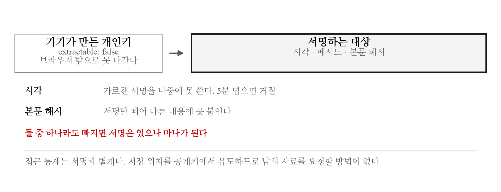

**[그림 35]** 서명에 무엇이 들어가고 각각이 무엇을 막는가. 둘 중 하나라도 빠지면 서명이 있으나 마나가 된다. 저장 위치를 공개키에서 유도하는 것은 서명이 아니라 별개의 접근 통제다.

설계 의도. `generateKey` 의 두 번째 인자가 `false` 라는 것은 개인키를 우리 코드조차 읽을 수 없다는 뜻이다. 브라우저에게 "이것으로 서명해 달라" 고 시킬 수만 있다. 그래서 기기의 저장소를 통째로 가져가도 가져갈 값이 없다. 관찰해서 흉내 낼 수 있는 값이 아니라, 그 기기를 가지고 있어야만 쓸 수 있는 것이 된다.

서명하는 대상의 구성에도 각각 이유가 있다. 시각(`ts`)을 넣는 것은 서명 하나를 가로챈 사람이 그것을 나중에 다시 쓰지 못하게 하기 위해서다. 서명 안에 시각이 들어 있으므로 서버가 오래된 것을 거절할 수 있고, 실제로 5분을 넘긴 요청은 받지 않는다. 본문 해시를 넣는 것은 서명만 떼어 다른 내용에 붙이지 못하게 하기 위해서다. 둘 중 하나라도 빠지면 서명은 있으나 마나가 된다.

쓰지 않는 권한은 브라우저 단계에서 닫아 둔다. 응답 헤더가 카메라만 열고 마이크와 위치는 닫는다.

```ts
res.headers.set('Permissions-Policy', 'camera=(self), microphone=(), geolocation=()');
```

이 한 줄이 §3.8 의 되짚기가 말로 되받지 않고 그림을 짚게 하는 이유이기도 하다. 되말하기를 그대로 옮기려면 음성 인식이 필요한데, 그것은 우리가 열지 않기로 한 권한이다. 권한을 열어 두고 쓰지 않는 것과 아예 닫아 두는 것은 다르다. 앞의 것은 코드가 바뀌면 조용히 쓰이기 시작할 수 있고, 뒤의 것은 브라우저가 막는다.

가구 ID 를 공개키의 SHA-256 해시로 유도한 것도 같은 맥락이다. 등록 절차가 없어지고, 남의 자료를 요청하려면 그 사람의 개인키가 있어야 하는데 그 열쇠는 그 기기 밖으로 나갈 수 없다. 접근 통제가 규칙이 아니라 구조가 된다.


### 4.7 저장소와 협업

웹 앱과 하드웨어 펌웨어와 학습 코드를 하나의 저장소에서 관리한다. 대회 조직의 GitHub 조직으로 이관하여 최종 제출한다.

[표 27] 저장소의 구성 (2026-08-03 기준)

| 영역 | 파일 | 줄 | 담당 |
|---|---|---|---|
| `app` · `components` | 48 | 7,828 | 화면과 흐름 |
| `lib` | 118 | 14,360 | 판정·영양·추론·동기화 |
| `engine` | 107 | 14,200 | SIGIL 형태소와 합성 |
| `pill_dispenser` | 160 | 47,183 | 펌웨어·종이 서식 판독 |
| `nutrition_manager` | 61 | 59,335 | 영양 추정 모델 학습·평가 |
| `docs` | 125 | 116,410 | 제안서와 도판 생성 |

저장소를 나누지 않은 이유가 있다. 이 프로젝트에서 가장 자주 깨지는 것은 각 부분이 아니라 부분들 사이의 약속이다. §5.1 의 형성 평가에서 28회 중 0건이 통과한 원인도 개별 기능의 결함이 아니라 연결의 누락이었다. 저장소가 갈라져 있으면 그 연결을 한 번에 시험할 수 없고, 어느 쪽이 먼저 바뀌었는지도 알 수 없다.

실제로 이 저장소에서는 세 갈래의 시험이 각각 다른 것을 요구한다.

[표 28] 세 갈래의 시험

| 갈래 | 시험 | 결과 | 필요한 것 |
|---|---:|---|---|
| 웹 앱 (`node --test`) | 347 | 346 통과 · 1 실패 | Node 만 |
| 종이 서식·클라우드 릴레이 (`pytest`) | 172 | 169 통과 · 3 건너뜀 | OpenCV |
| 기기 펌웨어 (`pytest`) | 668 | 591 통과 · 77 건너뜀 | 파이썬만 |

2026년 8월 3일에 직접 돌려 센 값이며, 웹 앱의 실패 한 건도 그대로 적는다. 조건 추적 모듈의 기본값이 바뀌면서 시험이 옛 기대값을 들고 있는 것이고 기능의 결함이 아니지만, 통과 수만 적고 실패를 빼면 이 표가 말하는 것이 달라진다.

이 펌웨어 시험이 한동안 한 개도 돌지 않고 있었다는 것을 적어 둔다. 화면 상수 여덟이 커밋 하나에서 사라졌고 시험 파일이 모두 그 모듈을 거치므로 임포트 단계에서 전부 멈춰 있었다. 되살리자 35건이 실패로 드러났고, 그 35건은 화면을 한 장으로 다시 설계하면서 사라졌다. 시험이 없어서 못 잡은 것이 아니라 시험이 돌지 않아서 못 잡은 것이며, 통과 수를 세는 것과 시험이 실제로 도는지 보는 것이 다른 일이라는 뜻이다.

셋 다 기기가 없어도 돌아간다. 서보도, 라즈베리파이도, 네트워크도 필요하지 않다. 디버거를 붙일 수 없는 장치에서 도는 코드를 누구나 몇 초 만에 검증할 수 있게 하는 것이 이 구성의 목적이며, `make run` 으로 펌웨어 전체를 노트북에서 띄우는 것(그림 23 오른쪽)도 같은 원칙에서 나왔다.

역할은 이렇게 나뉘었다. 웹 앱과 SIGIL·VOCA 엔진은 남윤수가, 하드웨어 펌웨어와 종이 서식 판독과 영양 추정 모델은 김도훈이, 3D 출력과 기구 설계와 화면 설계는 몰도바 팀이 맡았다. 17일 동안 320개의 커밋이 쌓였다.

여기에도 조건이 붙는다. 본 프로젝트는 개발 전 과정에서 AI 코딩 도구를 사용했으며, 이를 숨기지 않는다. 도구가 만든 것을 그대로 둔 곳은 없다. 이 문서가 기록한 결함들이 모두 사람이 다시 확인해 찾은 것이다. 처음 대조한 인용 37종 가운데 12종이 원문과 달랐고(저장소의 `citations.md` 에 무엇이 어떻게 틀렸는지 건별로 남겼다), 형태소 검사기는 고리 넷을 "네 개" 로 통과시켰으며(§5.2), 표본 처방전에는 임상 오류가 다섯 건 있었다(§5.7). 도구를 썼다는 사실보다 그 결과를 어떻게 검증했는지가 이 저장소가 보여 주려는 것이다.

---

## □ Results and Expected Impact (SDG 3 Contribution)

### 5.1 형성 평가. 정보 도달률

앱이 완성된 뒤 가장 먼저 물어야 할 것은 "필요한 정보가 실제로 화면에 도달하는가" 였다.

이를 재현 가능한 방식으로 측정하기 위해, 표본 처방전 네 종과 사용자 조건 일곱 가지를 조합한 28회의 시행을 구성하고, 각 시행의 산출물을 여섯 항목으로 채점했다. 채점은 사람의 판단이 아니라 화면에 실제로 존재하는 문자열과 음성 대상에 대한 규칙 대조로 이루어진다. 따라서 재현 가능하며, 채점 규칙이 잘못되었다면 규칙을 고쳐 다시 돌릴 수 있다.

시행 하나가 남기는 기록은 다음과 같다.

```json
{
  "stimulus": "antibiotic",   "kind": "rx",   "member": "none",
  "glyphs": 9,                "reached": true,
  "scores": {
    "D1 대상 식별": true,  "D2 1회 용량": true,  "D3 1일 횟수": true,
    "D4 시각·맥락": true,  "D5 보관":     true,  "D6 금기·상호작용": true
  },
  "all6": true
}
```

설계 의도. 채점 결과를 참·거짓 하나로 내지 않고 항목별로 남긴다. "27/28" 이라는 수치만 남기면 무엇이 왜 실패했는지 알 수 없고, 다음에 고칠 곳도 알 수 없다. 실제로 §5.1 이 밝힌 실패 한 건이 어느 항목이었는지(`D5`), 어떤 조건에서였는지(`member: none`)를 이 기록에서 그대로 읽었다.

`glyphs` 를 함께 세는 것에도 이유가 있다. 여섯 항목이 전부 참이어도 그림이 한 장도 뜨지 않을 수 있다. 문장과 음성으로만 전달되고 픽토그램 경로가 죽은 상태다. 수정 전 28회 중 8회가 정확히 그랬고, 항목 채점만 보고 있었다면 그 8회는 "일부 통과" 로 지나갔을 것이다.

[표 29] 형성 평가의 채점 항목

| 항목 | 무엇을 확인하는가 |
|---|---|
| D1 대상 식별 | 무엇을 찍은 것인지가 전달되는가 |
| D2 1회 용량 | 몇 알·몇 mL 인지가 어딘가에 있는가 |
| D3 1일 횟수 | 하루 몇 번인지가 명시되는가 |
| D4 시각·맥락 | 열거된 시각 수가 횟수와 맞고, 식사 맥락이 전달되는가 |
| D5 보관 | 냉장이 필요할 때 그것이 전달되는가 |
| D6 금기·상호작용 | 회피해야 할 때 그것이 뜨고, 불필요할 때 뜨지 않는가 |

초기 측정에서 **28회 중 여섯 항목을 모두 만족한 시행은 0건**이었다. 원인은 개별 기능의 결함이 아니라 연결의 누락이었다. 용량과 보관 정보가 OCR 에서 픽토그램까지는 도달하는데 음성과 문장에는 도달하지 않았고, 임신 금기가 판정 엔진에 전달되지 않았으며, 픽토그램 캐시가 비어 있는 상태에서는 판정 화면에 그림이 하나도 뜨지 않았다.

이를 수정한 뒤 같은 28회를 다시 돌린 결과 **27건이 여섯 항목을 모두 만족했다.**

만족하지 못한 한 건이 무엇이었는지 밝힌다. 시리얼을 아무 조건도 등록하지 않은 사용자가 찍은 시행에서 D5(대체 제안)가 뜨지 않았다. 같은 시리얼을 땅콩·글루텐·혈액희석제 조건을 가진 사용자가 찍은 나머지 세 시행에서는 모두 떴다.

이것을 결함으로 고치지 않았다. 대체 제안은 §2.7 에서 서술한 대로 회피 사유에서 유도되는데, 회피할 이유가 없는 사용자에게는 유도할 사유가 없다. 조건이 없는 사람에게 "이것 대신 저것을 고르라" 고 말하려면 그 근거를 만들어 내야 하고, 그것은 이 앱이 하지 않기로 한 일이다. 즉 이 한 건은 채점 항목이 모든 시행에 일률적으로 적용된 결과이지 기능이 동작하지 않은 것이 아니다. 채점표를 조건별로 나누면 28/28 이 되지만, 채점 기준을 결과에 맞추어 고치지 않는다는 원칙에 따라 그대로 둔다.

[표 30] 형성 평가 결과

| | 수정 전 | 수정 후 |
|---|---|---|
| 여섯 항목 모두 만족 | 0 / 28 | **27 / 28** |
| 픽토그램 0장으로 끝난 시행 | 8 / 28 | 0 / 28 |

이 평가가 측정한 것은 정보의 도달이지 사람의 이해가 아니라는 점을 분명히 해 둔다. 후자는 사람에게 물어야 하며, 본 평가의 범위 밖이다.

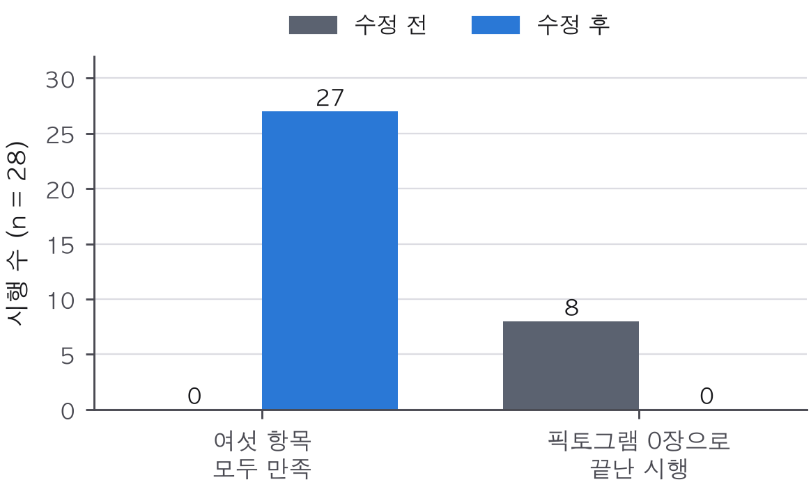

**[그림 36]** 형성 평가의 수정 전후 (n = 28). 왼쪽 쌍은 여섯 항목을 모두 만족한 시행 수, 오른쪽 쌍은 픽토그램이 한 장도 뜨지 않은 채 끝난 시행 수다. 수정 전 0건이었던 것이 27건이 된 것보다, **픽토그램 0장이 8건에서 0건이 된 쪽**이 이 평가에서 얻은 것이다. 그 8건은 기능이 없어서가 아니라 캐시가 비어 있어 생긴 것이었고, 측정하지 않았다면 시연에서 처음 드러났을 것이다.


### 5.2 픽토그램 이해도 검증 절차

§1.8 에서 확인했듯 픽토그램은 만든다고 읽히는 것이 아니다. 국제 표준 픽토그램 108종 가운데 ANSI 85% 기준을 통과한 것은 17종에 그쳤다 (Gutierrez, M. M., Patikorn, C. & Anantachoti, P., "Evaluation of pharmaceutical pictogram comprehension among adults in the Philippines," *Journal of Pharmaceutical Policy and Practice*, 15:30, 2022).

그러나 이해도 시험은 사람을 모아야 하므로 비용이 크고 반복하기 어렵다. 그 결과 대부분의 픽토그램 세트는 만들어진 뒤에 평가되며, 문제가 발견되어도 이미 배포된 뒤다.

본 연구는 이 순서를 뒤집는 절차를 설계했다. 픽토그램 각각에 대해 두 개의 관문을 둔다.

[표 31] 픽토그램 검증의 두 관문

| 관문 | 무엇을 판정하는가 | 방법 |
|---|---|---|
| 1. 기계 검사 | 작게 줄여도 형태가 살아남는가 | 잉크 비율, 내부 구멍의 32px 생존, 분리된 덩어리 개수 |
| 2. 의미 검사 | 의도한 것으로 읽히는가 | 그림을 제시하고 **"무엇으로 보이는가"** 를 열린 질문으로 묻는다 |

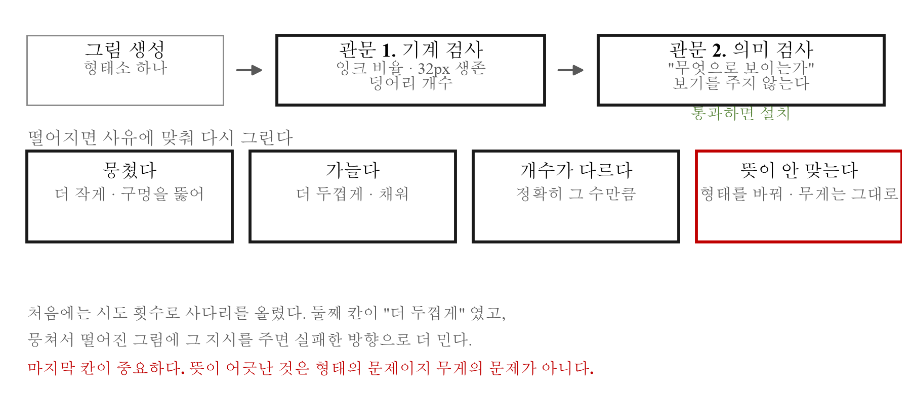

**[그림 37]** 형태소 하나가 배포되기까지 지나는 두 관문과, 떨어졌을 때 오르는 사다리. 사다리는 시도 횟수가 아니라 실패 사유에 걸려 있다.

두 번째 관문의 질문 방식이 중요하다. "이것이 땅콩입니까" 라고 물으면 대개 그렇다고 답한다. 따라서 보기를 주지 않고 서술하게 한 뒤, 그 답이 의도와 일치하는지를 별도로 판정한다. 이는 ISO 9186 의 이해도 시험이 보기를 제시하지 않는 것과 같은 이유다.

이 절차가 정당한지를 §5.7 에서 직접 물었다. HCI·디자인 구획 두 명 모두 "조건이 붙으면 정당하다" 고 답했고, 그 조건을 각각 다르게 적었다.

> "최종 결론이 아닌 사전 선별용으로는 얼마든지 활용 가능하다고 생각합니다. 다만 결국 사람에게 쓰일 예정이기에, 사전 선별의 결과가 실제 사람에게 테스트했을 때 적용할 수 없는 결론이 난다면 이를 폐기할 수 있는 결단력만 있으면 될 것 같습니다."
> (이용한 선임, 한국공예디자인문화진흥원)

> "시각 언어 모델을 활용한 정보 선별 과정에서 연구자가 선별 기준을 명확히 설정·인지하고 있으며, 해당 기준이 이론적 근거에 기반하여 타당성이 입증될 수 있다면, 연구 절차상 정당성을 확보할 수 있을 것으로 판단됨."
> (최묘정 연구원, 한국장애인개발원)

두 조건이 다르다. 앞의 것은 결과를 버릴 수 있느냐를 묻고, 뒤의 것은 기준이 미리 서 있느냐를 묻는다. 뒤의 것은 이 절이 두 관문의 판정 기준을 미리 적어 둔 것으로 어느 정도 답이 되지만, 앞의 것은 아직 시험해 보지 않았으므로 답할 수 없다. §5.10 의 현지 평가에서 기계 판정과 사람의 답이 어긋나는 형태소가 나오면 그때 이 조건이 시험된다. 그 자리에서 기계 쪽을 버릴 수 있어야 이 절차가 정당해진다.

또한 512px 원본과 32px 축소본을 함께 제시하고 축소본을 기준으로 답하게 한다. 목록에서 실제로 보이는 크기가 그것이기 때문이다.


#### 5.2.1 재시도 전략

관문을 두는 것만으로는 절반이다. 떨어진 그림을 다시 만들어야 하고, 그 재시도가 수렴해야 한다.

처음에는 시도 횟수에 따라 고정된 지시 사다리를 올렸다. 첫 시도가 실패하면 1번 지시, 두 번째가 실패하면 2번 지시를 덧붙이는 방식이다. 이 사다리의 두 번째 칸이 "형태를 더 두툼하게 그려라" 였는데, 너무 뭉쳐서 떨어진 그림에 이 지시를 하면 실패한 방향으로 더 미는 것이 된다. `food_bread` 의 잉크 비율이 0.52 → 0.47 → 0.51 로 세 번을 헛돈 것이 그래서다. 재시도가 수렴하지 않고 진동했다.

검사기는 이미 왜 떨어졌는지를 알고 있다. 그 사유를 쓰지 않고 횟수만 세는 것은 같은 주사위를 다시 굴리는 것과 같고, 굴릴 때마다 요금이 나간다. 그래서 지시를 사유에 걸었다.

```python
def escalate(c: 'Check | None') -> str:
    """직전 실패의 **사유에 맞춰** 다시 시킨다."""
    r = ' · '.join(c.reasons)

    if '뭉쳤다' in r:
        return (' The shape came out far too heavy. Draw it noticeably smaller inside the frame '
                'with wide empty white space around it, and punch two or three much larger white '
                'holes through it. Keep it a solid filled black silhouette — do not turn it into '
                'a hollow outline drawing with an empty white interior.')
    if '가늘다' in r:
        return (' The shape came out too thin and sparse. Make every black part much thicker and '
                'heavier, and let it fill more of the frame.')
    if '개수' in r:
        return (' The number of separate shapes was wrong. Draw exactly the number stated, each '
                'one fully detached from the others with wide white space between them.')
    if '뜻이 안 맞는다' in r:
        return (f' The previous attempt was misread: it {r.split("—")[-1].strip()}. '
                'Redraw it so the object is unmistakable at a glance: change the shape and the '
                'outline, not the weight.')
```

설계 의도. 네 갈래가 각각 다른 방향으로 민다. 특히 마지막 갈래가 중요하다. 뜻이 어긋난 것은 형태의 문제이지 무게의 문제가 아니므로, 굵기를 건드리라고 하면 잘못 그린 그림을 더 선명하게 잘못 그리게 된다. 이 분기를 넣은 뒤 앞서 통과하지 못하던 네 종이 모두 두 번째 시도에서 통과했다.

첫 갈래의 마지막 문장에도 대가를 치른 이유가 있다. 처음에는 "속을 비워라" 라고만 썼는데, 그러자 채운 실루엣이 아니라 윤곽선 그림이 나왔다. 무게는 줄었지만 세트의 나머지가 전부 채운 실루엣이라 시각 언어가 섞였고, 무엇보다 `qty_one` 이 채운 점이 아니라 고리가 되어 '1' 이 아니라 '0' 으로 읽혔다. 그래서 줄이는 방법을 "더 작게, 구멍을 뚫어서" 로 한정하고 "속이 빈 윤곽선으로 바꾸지 말 것" 을 명시했다.

같은 결함이 뒤에 한 번 더 나왔다. `qty_four` 가 채운 점 넷이 아니라 고리 넷으로 남아 있었는데, 세는 그림에서 빈 고리는 0 으로 읽히고 같은 세트의 하나·둘·셋·다섯은 모두 채운 점이라 세트 안에서 혼자 규칙이 달랐다. 검사기가 이것을 통과시킨 이유는 분명하다. 고리 넷도 "네 개" 로는 맞기 때문이다. 개수를 세는 검사와 의미를 묻는 검사를 모두 통과하면서도 틀릴 수 있다는 뜻이며, 이것이 §5.4 에서 이 절차의 한계로 다시 다루는 지점이다.

#### 5.2.2 78종 적용 결과

이 절차를 형태소 78종 전체에 적용한 결과는 다음과 같다.

[표 32] 형태소 78종의 의미 검사 결과

| 구분 | 개수 |
|---|---|
| 의도한 대로 읽힘 | 54 |
| 다르게 읽힘 | **24** |

다르게 읽힌 24종 가운데 실제로 화면에 노출되는 것은 7종이었고, 나머지 17종은 사전에만 존재하고 앱이 호출하지 않는 형태소였다. 노출되는 7종에 대해 오독 내용을 프롬프트에 반영하여 재작업한 결과, 다음과 같이 개선되었다.

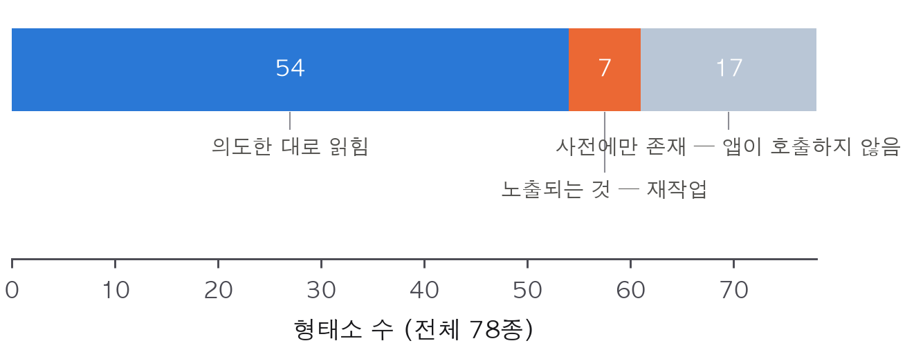

**[그림 38]** 형태소 78종의 1차 의미 검사 결과와, 오독 24종의 내역. 오독을 하나로 묶지 않고 나눈 이유는 둘의 성격이 다르기 때문이다. 화면에 노출되는 7종은 사용자가 실제로 보게 되므로 고쳐야 하고, 사전에만 있는 17종은 아직 아무도 보지 않는다. 전자를 먼저 고친 것이 자원 배분의 결과이지 후자가 괜찮다는 뜻은 아니다.


[표 33] 재작업으로 개선된 형태소

| 형태소 | 이전에 읽힌 것 | 이후 |
|---|---|---|
| `tree_nut` | cracked egg (깨진 달걀) | walnut |
| `inhaler` | letter l (알파벳 L) | inhaler spraying |
| `symptom_gut` | lightning bolt icon | stomach with lightning bolt |
| `glucometer` | key fob (차 열쇠) | glucose meter |
| `sugar` | three hexagons / three dice | spoon with powder |
| `tablet_blister` | die showing four (주사위) | pill blister pack |
| `food_bowl` | circle with line | bowl of hot food |

`tree_nut` 의 개선이 특히 중요하다. 이 형태소가 "깨진 달걀"로 읽히는 것은 단순한 오독이 아니라 세트 안에 `egg` 라는 다른 알레르겐이 존재하기 때문이다. 서로 다른 두 알레르기 경고가 같은 그림으로 읽히는 상태였다.

### 5.3 개선 불가로 판정한 형태소

재작업을 시도했으나 개선되지 않은 다섯 종이 있다. 이들은 성격이 앞의 일곱과 다르다.

[표 34] 개선하지 못한 형태소와 그 이유

| 형태소 | 문제 | 판단 |
|---|---|---|
| `suppository` | 총알과 형태가 같다. 포장을 씌우자 "bomb"·"rocket" 으로 읽혔다 | 형태만으로 갈라지지 않는다 |
| `body_skin` | 결로 그리면 물결, 팔로 그리면 뭉치고, 손가락으로 그리면 발자국 | '피부' 는 홀로 설 수 있는 물체가 아니다 |
| `time_evening` | 해가 뜨는 것과 지는 것은 **방향으로만** 갈린다 | 정지한 그림에 방향이 없다 |
| `sesame` | 꼬투리에 씨를 넣은 그림이 흩뿌린 씨보다 나았으나, `soy` 가 이미 콩 꼬투리다 | **세트 안에서 충돌**한다 |
| `sachet` | 약 봉지의 뜯는 톱니와 사탕 껍질의 주름이 실루엣에서 같은 모양이다 | 형태만으로 갈라지지 않는다 |

표에 없는 것 하나를 §5.7 이 더했다. Sheron Sir Loon Goh 약학 전임강사는 캡슐 그림에 점 하나가 붙은 것이 "하루 한 번" 으로 읽히지 않는다고 적었다. 음성을 듣지 않으면 그 관계가 보이지 않는다는 것이다.

이 지적은 §5.2 의 의미 검사가 잡지 못하는 종류다. 검사는 형태소 하나를 따로 보이고 무엇으로 보이는지 묻는데, 이 문제는 형태소 둘이 한 칸에 들어갔을 때 그 관계가 읽히느냐이기 때문이다. 점 하나는 점 하나로 잘 읽히고 캡슐은 캡슐로 잘 읽힌다. 둘을 겹쳤을 때 "하루 한 번" 이 되는지는 아무도 묻지 않았다. §5.2 의 절차가 형태소를 검사하고 조합을 검사하지 않는다는 것이 여기서 드러난다.

이 다섯을 명시하는 이유는 픽토그램이라는 매체의 한계가 어디에 있는지를 보여 주기 때문이다. 개선 가능했던 일곱은 모두 더 나은 대상을 고르면 풀렸으나, 이 다섯은 개념 자체가 단독 실루엣으로 성립하지 않는다.

`sachet` 의 재작업 기록을 남겨 둘 만하다. 두 방향을 시도했고 둘 다 실패했다.

첫째, 옆구리 톱니를 빼고 가루를 작은 흰 점으로 그리게 했다. 여전히 "candy wrapper" 였다. 원인이 홈이 아니라 톱니라고 본 진단 자체가 틀렸던 것이 아니라, 톱니를 빼도 남는 것이 여전히 사탕 껍질이었다. 더 나쁜 것은 "작은 흰 점" 쪽이다. 그 점들이 32픽셀에서 **통째로 사라졌다(21개 → 0개).** §5.2 의 기계 검사가 잡으라고 있는 바로 그 실패를, 그것을 피하려던 지시가 만들어 냈다.

둘째, 대상을 바꿔 봉지를 기울여 붓는 순간으로 그리게 했다. "ice cream cone", "cocktail shaker pouring" 으로 읽혔다. 넓어지는 쐐기는 콘이 된다. 세 번째 시도는 이미지 생성 API 가 거절했다. "가루를 붓는" 그림 요청이 약물 오남용으로 분류되었다.

실패한 그림은 설치하지 않았다. 자산은 이전 상태 그대로이며, 프롬프트도 되돌렸다. 남긴 것은 시도의 기록뿐이다. 다만 검사기의 기대값을 개념 이름에서 문장으로 바꿨다. 이름만 대조하면 느슨해서, 다음에 누가 같은 검사를 돌릴 때 이 실패가 통과로 보일 수 있기 때문이다.

이 다섯 가운데 넷은 화면에서 음성이 그 자리를 메운다. §3.5 에서 서술한 대로 그림을 누르면 그 그림이 무엇을 뜻하는지 말하므로, `sachet` 은 알아보지 못해도 "The powder sachet." 를 들을 수 있다. 그림이 실패한 자리에서 층이 하나 더 있다는 것이 §2.1 의 세 층 설계가 실제로 하는 일이다.

### 5.4 측정의 한계

앞의 두 절이 내놓은 숫자에는 공통된 성격이 있다. 둘 다 사람에게 물은 것이 아니라 기계가 기계를 채점한 것이다. 이 절은 그 숫자들이 무엇을 말하고 무엇을 말하지 않는지를 정리한다.

본 절의 결과에는 두 가지 한계가 있으며, 이를 결과와 함께 밝힌다.

첫째, 사람에게 묻지 않았다. 위의 의미 검사는 사람이 아니라 시각 언어 모델에게 물은 것이다. 따라서 표 6의 선행 연구 수치(ANSI 통과 17/108)와 직접 비교할 수 없다. 이 절차의 값어치는 사람 대상 시험을 대체하는 데 있지 않고, 사람에게 묻기 전에 명백한 오독을 걸러 시험 한 번의 비용을 아끼는 데 있다.

둘째, 판정이 경계에서 흔들린다. 같은 그림에 대해 실행마다 통과와 실패가 갈리는 사례가 있었다(`symptom_cough` 가 "person breathing out" 으로 읽힌 경우). 따라서 이 검사는 관문이지 판결이 아니며, 모든 항목이 통과할 때까지 판정 기준을 조정하지 않는 것을 원칙으로 삼았다.

셋째, 채점하는 쪽과 채점받는 쪽이 같은 종류의 실패를 공유할 수 있다. 시각 언어 모델은 세상의 그림을 학습해 만들어졌으므로, 널리 쓰이는 관습적 표현일수록 잘 알아본다. 그런데 그 관습이 바로 문화권에 따라 달라지는 것이고(표 6), 우리가 걱정하는 것도 그 부분이다. 즉 이 검사는 "흔한 관습을 따랐는가" 를 재는 데는 강하고 "이 관습을 모르는 사람에게도 통하는가" 를 재는 데는 약하다. 검사를 통과한 54종이 몰도바 고령 사용자에게 그대로 통한다는 보장이 여기서 나오지 않는다.

이 셋을 합치면 §5.2 의 절차가 무엇인지가 분명해진다. 사람에게 묻기 전에 명백한 오독을 걸러 내는 체이지, 사람에게 묻는 일을 대신하는 것이 아니다. 실제로 걸러 낸 24종은 사람에게 보였더라면 시험 시간을 쓰고 같은 답을 받았을 것들이다.

이 셋 위에 §5.7 이 하나를 더했다. Global Symbols 의 E. A. Draffan 은퇴 언어치료사·접근성 객원연구원은 AAC 사용자에게 이 세트를 어떻게 시험할 것이냐는 물음에, 시험을 해 볼 수는 있으나 **어느 층에서 실패했는지는 끝내 알 수 없을 것** 이라고 답했다. 변수가 너무 많다는 것이다.

이 지적이 §5.2 의 절차에 그대로 걸린다. 형태소 하나가 의미 검사에서 떨어졌을 때 우리는 그림이 잘못되었다고 읽는다. 그러나 떨어진 이유가 그림인지, 32픽셀이라는 크기인지, 판정하는 쪽이 그 개념을 모르는 것인지는 이 절차가 가르지 못한다. §5.3 에서 다섯 종을 개선 불가로 판정한 것도 같은 한계 위에 있다. 세 번 시도해서 세 번 떨어진 것과 그 개념이 실루엣으로 성립하지 않는 것은 다른 말이며, 우리는 앞의 것을 보고 뒤의 것을 적었다.

### 5.5 영양 추정 모델의 실측

밥상 사진 경로에 쓰는 모델을 Nutrition5k 의 공식 RGB 테스트 split 으로 채점했다. 배포되는 파일 그대로(`web.onnx`)를 브라우저와 같은 전처리로 돌렸다. 짧은 변을 258 로 맞춘 뒤 224 중앙 크롭, 255 로 나눔.

[표 35] 영양 추정 모델의 항목별 오차 (n = 507)

| 항목 | MAE | MAE% | 테스트 집합의 평균 |
|---|---|---|---|
| 열량 | 58.12 kcal | 22.75% | 255.5 kcal |
| 질량 | 32.97 g | 16.61% | 198.5 g |
| 지방 | 4.21 g | 32.82% | 12.8 g |
| 탄수화물 | 6.02 g | 30.60% | 19.7 g |
| 단백질 | 5.41 g | 30.96% | 17.5 g |
| **평균** | (| **26.75%** |) |

MAE% 는 공식 정의를 따랐다. 절대오차의 평균을 정답의 평균으로 나눈 값이며, 접시마다의 비율을 평균한 것이 아니다. 채점한 507개는 테스트 split 709개 가운데 오버헤드 프레임이 존재하는 것 전부다. 공식 프로토콜이 오버헤드 프레임만 쓰기 때문이며, 측면 프레임을 섞으면 다른 숫자가 나오고 비교할 수 없는 값이 조용히 만들어진다.

내보낸 모델의 메타데이터에도 같은 수치가 기록되어 있었으나 그것을 옮겨 적지 않고 자료를 받아 다시 쟀다. 다섯 항목 모두 소수점 둘째 자리까지 일치했다.

이 값이 지금은 다시 잴 수 없다는 것을 밝혀 둔다. Nutrition5k 원본이 지워지면서 공식 테스트 분할의 오버헤드 프레임 3,262장이 사라졌고, 테스트 507접시에는 측면 프레임이 하나도 없어 대체할 수도 없다. 위의 수치는 자료가 있을 때 잰 것이며 그 절차는 §11 의 스크립트에 남아 있으나, 지금 다시 돌리면 자료가 없다는 것을 알리고 멈춘다.

대신 남아 있는 것으로 잰 값이 있고, 그쪽이 이 앱에는 더 맞는 값이다.

[표 36] 두 가지 채점의 차이

| | 공식 테스트 분할 | 남은 자료로 다시 잰 것 |
|---|---|---|
| 무엇을 | 테스트 507접시 | 홀드아웃 259접시 4,805프레임 |
| 어느 각도에서 | 오버헤드 프레임만 | 측면 프레임 |
| 무엇을 돌려서 | `web.onnx` | `web.onnx` (같은 파일) |
| 평균 MAE% | 26.75% | 31.7% |
| 지금 다시 잴 수 있는가 | 아니오 (원본이 없다) | 예 |

두 값의 차이는 모델이 나빠진 것이 아니라 무엇을 재느냐가 다른 것이다. 공식 프로토콜은 접시를 바로 위에서 찍은 프레임만 쓰는데, 이 앱의 사용자는 밥상 앞에 앉아 비스듬히 찍는다. 측면 프레임이 그 각도에 가깝고, 그래서 31.7% 가 이 앱이 실제로 마주할 조건에 더 가까운 값이다. 벤치마크와 견줄 수 있는 값은 앞의 것이고 우리 사용자에게 해당하는 값은 뒤의 것이므로, 둘을 함께 적고 어느 쪽이 무엇인지를 표에 밝힌다. 이 문서에서 인용을 대조하며 확인한 것이 있다면, 어딘가에 적혀 있는 값과 그 출처가 실제로 말하는 값이 자주 다르다는 것이다.

**이 수치를 §4.2 의 인용과 나란히 놓아서는 안 된다.** NutritionVerse-Direct 의 열량 오차 253.7 kcal 은 NutritionVerse-Real 이라는 다른 자료에서 잰 것이고, 우리 58.12 kcal 은 Nutrition5k 에서 잰 것이다. 자료가 다르면 난이도가 다르므로 두 값의 크기를 견주는 것은 의미가 없다. 두 수치를 함께 싣는 이유는 우열이 아니라, 이 분야 전체가 아직 사진 한 장으로 영양을 맞히지 못한다는 것을 보이기 위해서다.

실제로 우리 값이 그것을 그대로 보여 준다. 질량은 16.61% 로 비교적 낫지만 지방·탄수화물·단백질은 30% 를 넘는다. 지방 4.21 g 은 절대값으로는 작아 보이나 테스트 집합의 평균 지방이 12.8 g 이므로 **세 접시 중 하나꼴로 지방을 3분의 1 만큼 틀린다**는 뜻이다. 열량 58.12 kcal 은 §2.4 의 70세 기준 하루 1,800 kcal 에서 3.2% 에 해당해 하루 단위로는 견딜 만하지만, 한 끼를 700 kcal 로 보면 8% 다.

따라서 이 경로의 값은 정확도를 근거로 신뢰되지 않는다. §4.2 의 물리 검사를 통과했다는 것, 그리고 판정이 이 값 하나가 아니라 사용자의 기준치 대비 비중으로 제시된다는 것이 이 경로를 화면에 내보내는 근거다. 성분표가 있는 제품에서는 이 경로를 쓰지 않는다.

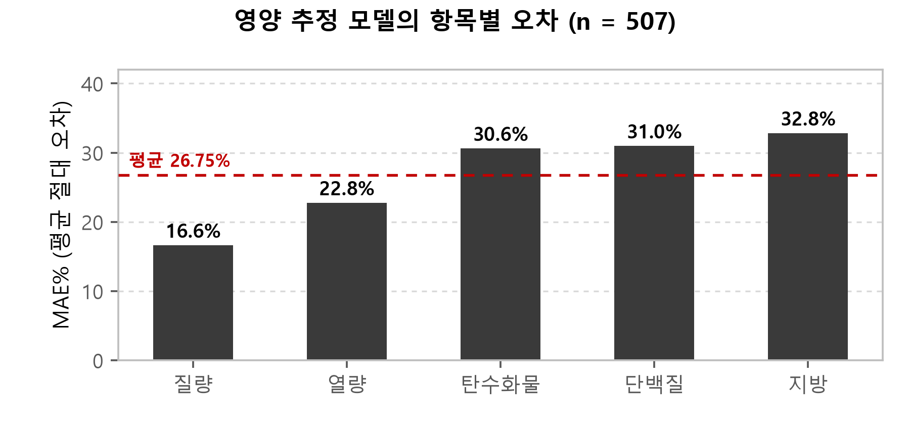

**[그림 39]** 영양 추정 모델의 항목별 MAE% (n = 507). 점선은 다섯 항목의 평균(26.75%)이다. 질량과 열량이 상대적으로 낫고 미량 항목으로 갈수록 나빠지는데, 이는 접시 사진에서 부피는 보이지만 조성은 보이지 않기 때문이다. 같은 크기의 밥과 같은 크기의 튀김은 질량이 비슷하고 지방이 전혀 다르다.

#### 5.5.1 양자화 미적용

모델을 4.86 MB 로 줄이는 int8 양자화본도 함께 내보냈으나 배포하지 않았다.

[표 37] float32 와 int8 의 비교

| | 크기 | 평균 MAE% | 열량 MAE |
|---|---|---|---|
| float32 (배포본) | 16.04 MB | **26.75%** | 58.12 kcal |
| int8 | 4.86 MB | 52.51% | 106.21 kcal |

크기는 3분의 1 이 되지만 오차는 거의 두 배가 된다. 망이 느린 곳을 대상으로 하는 앱에서 11 MB 를 아끼는 것은 작지 않은 유혹이지만, 열량 오차가 58 kcal 에서 106 kcal 로 늘어나는 것은 판정이 뒤집히는 구간을 넓힌다. **§4.5 에서 이 모델을 미리 받지 않고 처음 쓸 때 받도록 한 것이 이 선택과 짝을 이룬다.** 크기를 줄여 정확도를 내주는 대신, 크기를 유지하되 받는 시점을 늦췄다.

### 5.6 오프라인 동작의 실측

"인터넷 없이 기기에서 판정한다" 는 주장을 검증했다. 배포용으로 빌드한 뒤 서버를 종료한 상태에서 다음을 확인했다.

[표 38] 오프라인 동작 확인

| 확인 항목 | 결과 |
|---|---|
| 앱이 열리는가 | 정상 |
| 영양 추정 모델(16MB)이 응답하는가 | 캐시에서 200 응답 |
| 화면 이동이 되는가 | 정상 |

이 과정에서 서비스워커의 캐시 대상에 모델 파일이 누락되어 있음을 발견하고 수정했다. 수정 전에는 계산은 기기에서 수행하면서 정작 모델을 내려받지 못하는 상태였다. 등록된 서비스워커가 있다는 것과 통신이 끊긴 상태에서 앱이 끝까지 도는 것은 다른 사실이며, 이 결함은 앞의 것만 확인했다면 드러나지 않았다.

통신이 끊겼을 때 무엇이 살아남고 무엇이 살아남지 않는지는 이렇게 갈린다. 통신이 끊긴 상태에서 처방전과 영양성분표는 그대로 읽힌다. 글자 인식과 서식 해석이 전부 기기 안에서 돌기 때문이다 (§3.3). 음식 사진 추정은 절반만 산다. 기기 안의 영양 추정 모델은 캐시에서 돌지만 그것이 무엇인지를 판별하는 시각 모형이 서버에 있으므로, 값은 나오되 품목을 알아보지 못한 것으로 처리되어 주의로 표시된다. 픽토그램은 정적 목록에 있는 것은 나오고 새로 합성해야 하는 것은 나오지 않는다.

이 구분이 §4.5 에서 서술한 경계와 일치한다. 급한 것부터 기기 안에 두었고, 그래서 통신이 끊겼을 때 먼저 죽는 것은 가장 덜 급한 경로다. 다만 이 확인은 개발자 도구로 통신을 끊어 본 것이지 실제 저대역폭 환경에서 잰 것이 아니다. 통신이 아예 없는 경우와 느린 경우는 다르게 실패하며, 뒤의 것은 아직 재지 않았다 (§5.9).

이 측정이 무엇을 말하지 않는지도 적어 둔다. 통신을 완전히 끊은 상태만 쟀으므로, §5.9 의 다섯째 항목에서 적은 대로 느린 통신은 재지 않았다. 그리고 서비스워커가 캐시를 이미 채운 뒤를 쟀다. 처음 여는 사람은 16 MB 를 내려받아야 하며, 그 내려받기가 대상 지역의 통신에서 얼마나 걸리는지도 재지 않았다. 즉 이 절이 보이는 것은 한 번 설치된 뒤의 동작이지 설치 자체가 아니다.

### 5.7 전문가 의견 조사

§5.4 에서 밝힌 대로 앞선 측정은 모두 기계가 기계를 채점한 것이다. 그래서 사람에게 물었다. 다만 물은 상대는 저문해 환자가 아니라 그 환자를 매일 상대하는 사람들이다. 이 구분이 중요하므로 먼저 밝힌다. **이 조사는 §5.9 의 이해도 시험을 대신하지 않는다.** 전문가가 "환자가 읽을 수 있을 것 같다" 고 답한 것은 환자가 실제로 읽었다는 뜻이 아니다.

#### 5.7.1 명단을 어떻게 만들었는가

명단은 한 번에 만들지 않았다. 여덟 영역으로 나누어 따로 조사한 뒤 합쳤다. 한 사람이 순차로 찾으면 먼저 찾은 영역의 기준이 뒤 영역까지 끌려가 표본이 한쪽으로 쏠린다. 영역별로 따로 조사하면 각 분야의 기준으로 사람을 고르게 된다.

[표 39] 명단의 여덟 영역 (합계 846명)

| 영역 | 인원 | 어떤 기준으로 골랐는가 |
|---|---|---|
| 국내 약학대학 | 109 | 복약지도·환자 커뮤니케이션 직접 접점 8, 사회약학 16, 임상약학·약물치료학 45, 약물역학·의약품정책·의료정보학 26 |
| 국내 간호·보건 | 64 | 건강정보이해력 연구자 18, 디지털·e헬스 리터러시 10, 이주민·다문화 건강 5, 노인·지역사회간호 11, 보건교육·정책 12 |
| 국내 HCI·디자인 | 86 | HCI 핵심 23, 정보디자인·픽토그램·유니버설디자인 21, 보안·프라이버시 15, 음성·오디오 6 |
| 국내 문해·특수교육 | 92 | AAC·픽토그램 상징 설계 11, 성인문해교육·평생교육 19, 지적장애·특수교육공학 38, 다문화 5 |
| 해외 픽토그램 | 78 | 의약품 픽토그램 이해도와 검증 38, 의약품 라벨 이해도와 건강 문해력 27, 기관 공식 주소 5 |
| 해외 약학 | 221 | 개인이 아니라 학과 단위. 위트레흐트대 71, 오하이오주립대 30, 노팅엄대 25, 웨스턴케이프대 17 등 |
| 해외 HCI | 88 | 문자 없는 UI·저문해·ICT4D 12, 픽토그램 이해도 13, AAC 와 그래픽 상징 체계 16, 접근성 18, 쉬운 언어 9 |
| 국제기구 | 108 | WHO·UNESCO·UNICEF 등. 주소 확인 91, 문의 양식만 있거나 미공개 17 |

여덟 영역의 합은 846명이다. 나머지 257명은 아래에 적을 지역 확장에서 왔으며, 그 결과 최종 명단은 1,103명이 되었다.

각 영역은 다시 우선순위 구간으로 나뉘며 구간 이름 자체가 그 영역의 선정 기준이다. 예를 들어 국내 간호·보건의 최우선 구간 이름은 "건강정보이해력 자체를 연구하는 사람" 이고, 그 기준을 쓴 이유는 §1.2 의 전제를 검증받기 위해서다.

항목마다 출처 URL 을 함께 적었다. 599개이며 고유 296개, 호스트 169종이다. 상위 호스트는 논문에서 교신저자 주소를 확인한 `pmc.ncbi.nlm.nih.gov` 94개, 몰도바 보건부 공개 디렉터리 32개, `who.int` 11개다.

주소를 찾지 못한 경우에는 지어내지 않고 별도 구간에 남겼다. 국내 약대 14명, 국내 간호·보건 8명, 국내 HCI 15명, 국내 문해·특수교육 17명, 해외 픽토그램 8명, 국제기구 17곳이 그렇게 분류되어 발송에서 빠졌다. 국제기구 시트의 해당 구간 이름은 `Contact-form-only or address-not-published (no address fabricated)` 이다.

초기 명단은 국내와 영어권에 쏠려 있었다. 이 앱이 특정 지역을 위한 것이 아니라고 주장하는 이상 (§1.2) 검토하는 사람도 한 나라에 몰려서는 안 된다고 보아, 동유럽 105명, 중동·북아프리카 100명, 남아시아 96명, 중남미 50명, 동남아시아 49명, 아프리카 47명을 따로 조사해 넣었다. 이 여섯 묶음이 447명으로 전체의 40.5%다. 응답이 다섯 대륙에서 온 것은 이 단계의 결과다.

몰도바는 판단이 갈렸다. 보건부 디렉터리에서 31명의 주소를 얻었으나 셋만 보냈다. 한 부처에서 31통이 한꺼번에 나가면 그 자체로 스팸으로 보이고, 팀의 몰도바 쪽 협업 관계에도 좋지 않다고 판단했다.

명단을 다루는 규칙을 따로 문서로 두었다. 정보통신망법 제50조의2(전자우편주소의 무단 수집행위 등 금지)를 근거로 삼아, 한 통에 여러 명을 넣지 않고 개별 발송할 것, 명단을 팀 밖으로 내보내지 않을 것, 수집 거부를 게시한 페이지에서 얻은 주소는 발송에서 뺄 것, 회신이 없으면 다시 보내지 않을 것을 정했다. 수집 거부를 확인한 두 기관의 주소가 발송 대상에 남아 있지 않음을 도메인과 소속 문자열 양쪽으로 검증했고 0건이었다.

수신자에게는 이메일에서 유도한 열 자리 토큰을 부여했다. 토큰만으로는 누구인지 알 수 없고, 토큰과 사람을 잇는 대응표는 우리 손의 엑셀에만 있다. 응답 서버는 토큰만 저장하며, 도커 이미지를 만들 때 명단이 든 폴더를 제외했으므로 서버에는 명단 자체가 없다. 배포된 이미지 안에 명단이 없음을 접속해 확인했다.

#### 5.7.2 어떻게 보냈는가

2026년 7월 31일 04시 48분부터 07시 50분까지 182분에 걸쳐 1,103명에게 한 통씩 따로 보냈다. 평균 간격 9.9초이며 거부된 주소는 없었다. 단체 메일이나 숨은참조를 쓰지 않은 것은 명단 규칙상 주소가 서로에게 노출되어서는 안 되고, 링크에 사람마다 다른 토큰이 들어가므로 한 통에 여러 명을 담을 수 없기 때문이다.

전송 서비스를 쓰지 않고 개인 메일 계정의 SMTP 를 썼다. 전송 서비스는 1,103통을 몇 분에 보낼 수 있으나 SPF·DKIM 을 설정할 도메인이 필요한데, 우리 도메인은 `snapcare.fly.dev` 로 하위 도메인이라 DNS 레코드를 붙일 수 없다. 새 도메인을 사더라도 갓 만든 도메인에서 대학과 정부 메일서버로 1,103통을 보내면 더 걸러진다. 속도만 빠르고 도달률은 떨어진다.

하루 발송 한도는 짐작하지 않았다. 공개되어 있지 않기 때문이다. 대신 막혔을 때 죽지 않는 구조로 만들고 한 번에 시도했다. 보낸 사람을 한 줄씩 파일에 적고 디스크에 밀어 넣으므로 중간에 끊겨도 다시 돌리면 이어진다. 기록 시점을 발송 직후로 잡았는데, 기록하고 보내기에 실패하면 그 사람은 영영 받지 못하고 보내고 기록에 실패하면 한 번 더 갈 수 있어 뒤가 덜 나쁘다고 보았다. 일시 거절이면 기다렸다 다시 보내고 대기 시간을 늘리며, 없는 주소는 세고 넘어가고, 한 통에 세 번 실패하면 계정이 막힌 것으로 보고 멈춘다.

선정 근거가 가장 뚜렷한 41명을 발송 순서 맨 앞에 두었다. 명단이 등급 순이 아니어서 그대로 보내면 이들이 세 시간에 걸쳐 흩어지고, 중간에 계정이 막히면 그중 일부가 받지 못한다. 순서만 바꾸면 그 위험이 없어진다. 실제로 41명 전원이 시작 7분 안에 발송되었다.

언어는 이메일 최상위 도메인만 보고 정했다. 소속 문자열에서 나라 이름을 찾는 방식은 쓰지 않았다. 선정 이유 칸에 "몰도바" 가 적혀 있으면 WHO 와 포르투갈 연구자까지 몰도바로 잡히며, 실제로 그 방식으로 시험했을 때 30명이 잡혔고 상당수가 오분류였다. 도메인만 보면 34명이 나오고 전원이 실제 루마니아어권 기관이다.

메일 제목은 세 번 고쳤다. 처음에는 `SnapCare` 로 시작했는데 받는 분에게 그 이름은 아무 뜻이 없고, 모르는 이름으로 시작하는 제목은 광고로 읽힌다. 다음에는 부처 이름을 대괄호로 앞세웠는데 그것은 더 나빴다. 학생이 조언을 구하는 메일이 아니라 기관이 보낸 공문처럼 읽히고, 그 권위를 빌리는 인상을 준다. 최종본은 대괄호를 떼고 대회 이름만 앞에 둔다.

본문에서 뺀 것에도 판단이 있다. 초안에는 "복약 안내와 저문해 사용자 쪽에서 일해 오신 분들께 여쭙고 있습니다" 가 있었는데, 1,103명에는 컴퓨터공학 교수도 법학자도 있으므로 상당수에게 사실이 아니다. 자기 경력과 다른 말을 읽으면 나머지 문장도 믿지 않게 된다. "공개된 연구와 활동을 보고 연락드렸습니다" 로 바꿨다. 이것은 전원에게 사실이며 "왜 나에게" 에도 답이 된다.

글자 판과 HTML 판을 함께 보냈다. 글자만 있는 메일에서는 주소가 눌리지 않아 손으로 옮겨 적어야 하고 거기서 그만두는 사람이 생긴다. HTML 판에는 그림도 추적 픽셀도 넣지 않았다. 바깥에서 받아오는 것이 하나라도 있으면 스팸으로 걸릴 확률이 올라가고, 누가 열었는지 알 필요도 없다.

발송 전에 시험 발송으로 세 가지 결함을 잡았다. 해외 수신자 63명의 인사말에 한글이 섞여 나갈 상태였던 것, 메시지 생성이 머리글 처리에서 예외로 죽던 것, 링크가 눌리지 않던 것이다.

설문은 세 화면이다. 동의, 우리가 만든 것을 보여 주는 화면, 그리고 응답자가 고른 분야의 문항이다. 둘째 화면에 표본 처방전 두 장과 그것을 엔진에 통과시킨 결과를 나란히 놓았다. 여기 실린 DSL 은 사람이 적은 것이 아니라 엔진의 실제 출력이다. 처음에는 사람이 적었는데 그렇게 하니 다섯 줄이 나왔고, 같은 처방전을 엔진에 넣으니 열 줄이 나왔다. 완주·금주·임신 금지·수유 주의가 손으로 적을 때 빠져 있었다. 보여주고 싶은 것만 보여주게 되는 것이다.

선택지에는 우리에게 불리한 답을 반드시 남겼다. "놓을 자리가 없다", "근본적으로 어긋난다", "검증이 없다는 것" 이 그것이다. 그 답이 나오는 것이 대회가 끝난 뒤에 아는 것보다 낫다고 판단했다.

형태소 이해도 시험은 설문에서 뺐다. 교수가 우리 픽토그램을 읽어 낸다고 해서 저문해 환자가 읽어 낸다는 뜻이 되지 않으며, 그 숫자를 ISO 67% 충족으로 적으면 사실과 다른 말이 된다.

#### 5.7.3 누가 답했는가

2026년 8월 2일 기준 35명이 답했다. 발송 대비 3.2% 이며, 자유 서술 117건이 함께 왔다.

[표 40] 응답자 구성 (n = 35)

| 분야 | 응답 | 분야 | 응답 |
|---|---|---|---|
| 약국·복약지도 실무 | 12 | HCI·디자인 | 2 |
| 간호·보건 | 9 | 성인문해교육 | 1 |
| 그 밖 | 9 | AAC·특수교육 | 1 |
| | | 산업 실무 | 1 |

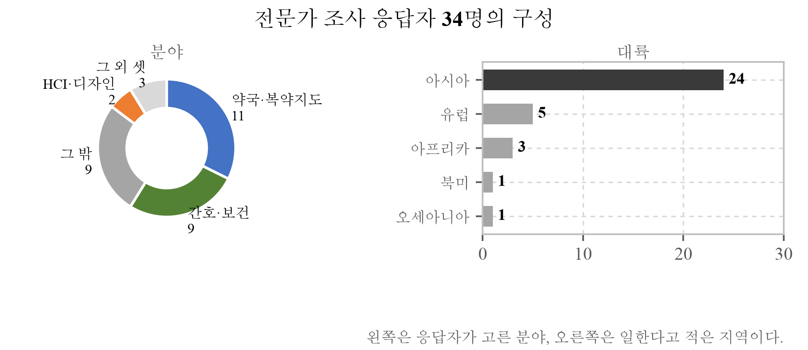

**[그림 40]** 응답자 35명의 구성. 왼쪽이 분야, 오른쪽이 대륙이다. 약국과 간호가 21명으로 5분의 3을 차지하는데, 이 둘이 데모를 보고 환자의 이해를 판정할 자격이 있다고 본 다섯 구획의 중심이다. 아시아가 25명인 것은 명단이 국내에서 시작해 지역별로 넓혀 간 순서를 그대로 반영한다.

응답자가 일한다고 적은 나라는 다섯 대륙에 걸쳐 20개국이며, 한국만 적은 사람이 17명이다. 응답자 전원이 실명과 소속을 밝히는 인용에 동의했으므로 아래에 그대로 적는다.

[표 41] 응답자 35명 (전원이 실명·소속 인용에 동의했다)

| 성함 | 직함 | 소속 | 국가 |
|---|---|---|---|
| **약국·복약지도 실무 (12명)** | | | |
| 윤휘열 | 교수 | 충남대학교 약학대학 | 대한민국 |
| 이한길 | 부교수 | 이화여자대학교 약학대학 | 대한민국 |
| 이소영 | 교수·약사 | 충남대학교 | 대한민국 |
| 하동문 | 교수 | 국립목포대학교 | 대한민국 |
| Niken Nur Widyakusuma | 박사·약사 | Universitas Gadjah Mada | 인도네시아 |
| Samirah Abdu-Aguye | Professor | Ahmadu Bello University, Zaria | 나이지리아 |
| Atif Usman | Professor | The Islamia University of Bahawalpur | 파키스탄·말레이시아 |
| Srikanth Malavalli Siddalingegwod | Assistant Professor | JSS College of Pharmacy, JSS Academy of Higher Education & Research | 인도 |
| Maria Stefanova | Researcher | Medical University of Sofia | 불가리아 |
| Katarina Vučićević | Professor | University of Belgrade, Faculty of Pharmacy | 세르비아 |
| E. Michael Murphy | Assistant Professor of Clinical Pharmacy | The Ohio State University College of Pharmacy | 미국 |
| Sheron Sir Loon Goh | Pharmacy Lecturer | Department of Clinical Pharmacy and Pharmacy Practice | 말레이시아 |
| **간호·보건 (9명)** | | | |
| 조성일 | 교수 | 서울대학교 | 대한민국 |
| 유명순 | 교수 | 서울대학교 | 대한민국 |
| 송민선 | 교수 | 건양대학교 | 대한민국 |
| 박남수 | 교수 | 협성대학교 | 대한민국·일본·대만 |
| Rahul Malhotra | Associate Professor | Duke-NUS Medical School | 싱가포르 |
| Raghupathy Anchala | Professor | Public Health Foundation of India | 인도 |
| Celia | Professor | University of Pretoria | 남아프리카공화국 |
| Foued Maaoui | Researcher | Pasteur Institute of Tunis | 튀니지 |
| Aliya Naheed | Senior Scientist | International Centre for Diarrhoeal Disease Research (icddr,b) | 방글라데시 |
| **AAC·특수교육 · 성인문해교육 · HCI·디자인 · 산업 실무 (5명)** | | | |
| E. A. Draffan | 은퇴 언어치료사 · 접근성 객원연구원 | Global Symbols · University of Southampton | 영국 |
| 김은경 | 교수 | 국립공주대학교 | 대한민국 |
| 이용한 | 선임 | 한국공예디자인문화진흥원 | 대한민국 |
| 최묘정 | 연구원 | 한국장애인개발원 | 대한민국 |
| 박철현 | 팀장 | 보이스아이 | 대한민국 |
| **그 밖 (9명)** | | | |
| 이교구 | 교수 | 서울대학교 | 대한민국 |
| 이경화 | 교수 | 숭실대학교 | 대한민국 |
| 서희정 | 교수 | 동의대학교 | 대한민국 |
| 이영미 | 교수 | 이화여자대학교 언어병리학과 | 대한민국 |
| 박경서 | 대리 | 한국장애인개발원 | 대한민국 |
| (성함 비공개) | 팀장 | GC메디아이 의사랑 서비스센터 | 대한민국 |
| Raisa Kravchenko | Deputy Director | All Ukrainian NGO Coalition for Persons with Intellectual Disabilities | 우크라이나 |
| Afonso Cavaco | Professor | Faculdade de Farmácia, Universidade de Lisboa | 포르투갈 |
| Mustapha Taibi | Professor of Translation and Interpreting | Western Sydney University | 오스트레일리아 |

응답자의 절반이 한국 밖에서 일한다. 이 앱이 특정 지역을 위한 것이 아니라고 주장하는 이상 (§1.2) 그것을 검토하는 사람도 한 나라에 몰려서는 안 된다고 판단해, 명단을 만들 때 동유럽·중동북아프리카·남아시아·중남미·동남아시아·아프리카 묶음을 따로 조사해 넣었다. 그 묶음이 명단 1,103명의 40.5%다.

여기에 밝혀 둘 것이 있다. 응답자의 43%(15명)가 글로 된 복약 지시를 읽지 못하는 사람을 "거의 마주치지 않는다" 고 답했다. 거의 매일 마주친다고 답한 사람은 4명이다. 그리고 그 사실을 응답자 한 분이 직접 지적했다. 이 문항의 답이 곧 §1.1 의 전제에 대한 자료이기도 하다는 뜻이며, 우리에게 유리한 방향은 아니다.

#### 5.7.4 무엇을 답했는가

데모를 보고 판단하는 문항은 다섯 구획에만 붙였다. 법·표준·산업 구획에는 붙이지 않았다. 환자의 이해를 판정하는 것은 그 자리에서 할 수 있는 일이 아니며, 자격이 없는 응답을 분모에 섞으면 그 비율은 무엇에 대한 비율도 아니게 된다.

[표 42] 글을 읽지 못하는 환자가 이 화면만으로 혼자 약을 제대로 복용할 수 있겠는가 (판단 자격 다섯 구획, n = 25)

| 답 | 응답 |
|---|---|
| 부분적으로. 일부는 되고 일부는 안 된다 | 17 |
| 예, 가능할 것 같다 | 7 |
| 판단할 근거가 없다 | 1 |
| 아니오 | 0 |

"아니오" 가 0건인 것과 "부분적으로" 가 3분의 2인 것을 함께 읽어야 한다. 접근 자체가 틀렸다고 답한 사람은 없었고, 이대로 충분하다고 답한 사람도 소수였다. 다섯 구획의 넓은 문항에 답한 다섯 명 중 네 명은 가장 먼저 해결할 것으로 "사람을 대상으로 한 검증이 없다는 것" 을 골랐다.

약국 구획에서는 12명 중 9명이 이 앱이 만든 지시를 약사가 매번 검토해야 한다고 답했고, 처음 한 번이면 충분하다는 답이 3명이었다. 놓일 자리로는 약사 설명을 보조하는 도구 7명, 환자가 집에서 혼자 확인하는 수단 3명, 약사가 닿지 못하는 환자의 대체 경로 2명이다. 의학적으로 가장 틀리면 안 되는 것으로는 복용량과 횟수 7명, 병용금기와 상호작용 3명, 투여 경로와 임의 중단 금지가 각 1명이다.

간호·보건 구획에서 건강 결과를 바꿀 수 있겠느냐는 물음에 9명 중 8명이 조건이 갖춰지면 바꿀 수 있다고 답했고, 한 명이 다르게 답했다. Public Health Foundation of India 의 Raghupathy Anchala 교수는 복용 행동은 바뀌어도 건강 결과까지는 아니라고 보았다. §5.9 의 셋째 항목에서 우리가 임상 결과에 대한 주장을 하지 않는다고 적은 것과 같은 자리이며, 여덟 대 하나로 갈렸으나 우리 문서가 서 있는 쪽은 하나 쪽이다.

간호·보건 구획에서는 9명 중 6명이 환자와 보호자 둘을 각각 다르게 설계해야 한다고 답했다. 이 앱은 환자 혼자 쓰는 것을 전제로 설계되었으므로, 기능이 아니라 전제가 걸린 셈이다.

#### 5.7.5 숫자를 어디까지 말할 수 있는가

n = 34 는 작다. 그래서 비율만 적지 않고 그 비율이 얼마나 흔들리는지를 함께 적는다. 아래 구간은 Wilson 방법으로 구한 95% 신뢰구간이다. 표본이 작을 때 정규근사를 쓰면 구간이 0 아래로 내려가거나 1을 넘는데, Wilson 은 그런 일이 없다.

[표 43] 판단 문항의 비율과 95% 신뢰구간 (n = 25)

| 답 | 응답 | 비율 | 95% 신뢰구간 |
|---|---|---|---|
| 부분적으로 | 17 / 25 | 68.0% | 48.4% ~ 82.8% |
| 예, 가능할 것 같다 | 7 / 25 | 28.0% | 14.3% ~ 47.6% |
| 판단할 근거가 없다 | 1 / 25 | 4.0% | 0.7% ~ 19.5% |
| 아니오 | 0 / 25 | 0.0% | 0.0% ~ 13.3% |

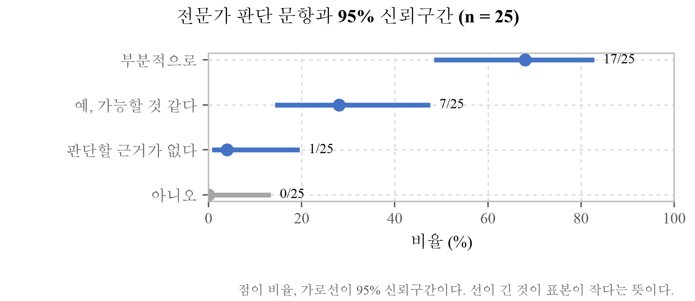

**[그림 41]** 판단 문항의 비율과 95% 신뢰구간 (n = 25). 점이 비율, 선이 구간이다. 구간이 넓은 것이 이 표본의 크기이며, 그림에서 읽어야 할 것은 점의 위치가 아니라 선의 길이다. "아니오" 가 0건이라도 구간은 13.3% 까지 뻗는다.

마지막 줄이 이 표에서 가장 조심해야 할 자리다. "아니오" 가 0건이라고 해서 그렇게 답할 사람이 없다는 뜻이 아니다. 이 표본으로 말할 수 있는 것은 그 비율이 13.3% 아래일 것이라는 정도이며, 25명 중 셋까지는 나와도 이 결과와 어긋나지 않는다.

이어서 집단 사이에 차이가 있는지를 검정했다. 모두 Fisher 정확검정을 썼다. 칸의 기대빈도가 5 미만이면 카이제곱을 쓸 수 없는데, 이 표본의 표는 늘 그렇다. §2.5 에서 알레르기 추론에 같은 검정을 쓴 것과 같은 이유다.

[표 44] 집단 간 차이 검정

| 무엇과 무엇 | 관찰값 | 검정 | p | 판정 |
|---|---|---|---|---|
| 접촉 빈도와 판단 | 자주 마주침 2/4, 드물게 5/21 이 "가능" | Fisher | 0.548 | 차이를 말할 수 없다 |
| 직군과 판단 | 약국 4/12, 간호 3/9 가 "가능" | Fisher | 1.000 | 차이를 말할 수 없다 |
| 등급 A 와 B 의 응답률 | 0/41 대 35/1,062 | Fisher | 0.637 | 차이를 말할 수 없다 |
| 언어와 판단 | 한국어 0/11, 영어 7/14 가 "가능" | Fisher | **0.0078** | 보정 문턱을 넘는다 |
| 언어와 소요 시간 | 중앙값 7.1분 대 24.0분 | Mann-Whitney | 0.029 | 보정 후 문턱 미달 |
| 소요 시간과 자유 서술량 | rho = 0.723 | Spearman | < 0.0001 | 유의 |

검정을 다섯 번 돌렸으므로 Bonferroni 보정 문턱은 0.010 이다. 그 문턱을 넘는 것은 두 줄이다. 마지막 줄은 오래 머문 사람이 더 길게 적었다는 것으로 내용에 관한 발견이 아니다. 넷째 줄은 다르다. 한국어로 답한 열한 명 가운데 "가능" 이라고 답한 사람이 하나도 없고 영어로 답한 열넷 중에서는 절반이 그렇게 답했다.

이 줄을 그대로 주장으로 삼지 않는 이유를 적는다. **한 사람이 늘어서 문턱을 넘었다.** 응답 34건일 때 이 값은 0.019 로 보정 문턱에 못 미쳤고, 한국어로 답하며 "가능" 이 아닌 쪽을 고른 응답자 한 명이 더해지자 0.0078 이 되었다. 결론이 사람 하나로 뒤집히는 자리에서는 결론보다 그 사실이 더 정확한 정보다. 이 절은 앞 판까지 "집단 간 차이를 말할 수 있는 것은 없다" 고 적고 있었고, 그 문장을 지금 고치면서 이것을 함께 적는다.

두 번째 이유는 앞서 적은 것과 같다. 언어는 응답자의 국가·직군·화면과 얽혀 있다. 한국어 응답자 열여덟 명 가운데 열일곱 명이 한국만 적었고, 소요 시간 중앙값도 7.1분 대 24.0분으로 갈린다. 차이가 있다 해도 그것이 언어 때문인지, 응답에 들인 시간 때문인지, 아니면 한국에서 저문해 환자를 마주칠 일이 드물다는 §1.2 의 조건 때문인지 이 자료로는 가를 수 없다.

유의하지 않은 검정을 빼고 유의한 것만 싣는 것이 이 표본에서 할 수 있는 가장 나쁜 일이므로, 돌린 것을 모두 적었다. 문턱을 넘은 줄을 굵게 적은 것도 같은 이유다. 넘었다는 사실을 감추지 않고, 넘은 경위를 함께 둔다.

여섯째 줄만 따로 읽어 둘 만하다. 소요 시간과 자유 서술량의 순위상관이 0.723 이라는 것은 오래 머문 사람이 실제로 더 많이 적었다는 뜻이며, 응답의 성의를 재는 대리 지표로 쓸 수 있다. 소요 시간 중앙값은 9.3분, 사분위는 6.0분에서 40.5분이다. E. A. Draffan 은퇴 언어치료사·접근성 객원연구원은 도중에 방해를 받았으므로 자신의 소요 시간을 실제 소요로 읽지 말라고 따로 적어 두었다.

자유 서술은 35명 중 30명이 적었고 117건이다. 같은 지적이 몇 명에게서 독립적으로 나왔는지를 낱말로 훑어 세면 검증 부재 6명, 한 장의 요소 과다 5명, 시각장애인 6명, 금지 표시 4명, 기존 세트 참조 4명이다. 다만 이것은 우리가 고른 낱말로 센 것이므로 본문에는 사람이 직접 읽고 확인한 건수를 쓴다.

#### 5.7.6 여러 나라에서 같은 지적이 나온 것

가장 무거운 지적은 금지가 금지로 읽히지 않는다 는 것이었다. 임신 금기를 나타내는 형태소 `state_pregnant` 는 임신부 그림 하나이며 금지 표시가 없다. 처방전에 "임신 중 사용 금지" 라고 적혀 있고 음성도 그렇게 말하지만, 그림만 보는 사람에게는 반대로 읽힌다.

> "처방전은 임신 중 사용하지 말라고 적혀 있는데 픽토그램은 임신부를 보여주어 환자가 임신 중 사용해도 안전하다고 생각하게 만든다."
> (Atif Usman 교수, The Islamia University of Bahawalpur, 영어 원문을 옮김)

> "임신부 상징을 넣는 것만으로는 안전하지 않다는 뜻이 되지 않으니 X 표시를 넣어야 한다."
> (Sheron Sir Loon Goh 약학 전임강사, Department of Clinical Pharmacy and Pharmacy Practice, 영어 원문을 옮김)

우크라이나 All Ukrainian NGO Coalition 의 Raisa Kravchenko 부대표는 "위험 표시가 없어 임산부에게 권장되는 것으로 이해할 수 있다" 고 적었고, 김은경 국립공주대학교 교수는 "'이렇게 해야 한다' 와 '안 된다' 는 표시가 제대로 구분되지 않는다. 특히 안 된다를 강조해야 하지 않을까" 라고 짚었다. 서로 다른 네 나라에서 같은 말이 나왔다.

**이것이 §1.8 에서 인용한 ANSI Z535.3 의 치명적 혼동에 해당한다.** 그리고 §2.2 에서 서술한 대로 엔진에는 `\no{}` 연산자가 이미 있어 금지 원과 사선을 그릴 수 있다. 같은 데모의 `\no{\contact_lens}` 는 사선이 그어져 나온다. 금기를 내보내는 코드가 그것을 쓰지 않고 있었을 뿐이다. 기능이 없어서 생긴 결함이 아니라 있는 기능을 부르지 않아서 생긴 결함이며, 이는 §5.1 에서 28회 중 0건이 통과했던 것과 같은 종류다.

같은 종류의 뒤집힘이 완주 형태소에서도 지적되었다.

> "검은 점이 끝까지 차 있지 않으므로 나에게는 완주하지 않아도 된다는 뜻으로 읽힌다."
> (Sheron Sir Loon Goh 약학 전임강사, Department of Clinical Pharmacy and Pharmacy Practice, 영어 원문을 옮김)

`finish_course` 는 §5.8 의 SDG 3.d 기여에서 이 앱이 겨냥한다고 적은 바로 그 형태소다. 그것이 정반대로 읽힌다는 지적이다.

한 장에 요소가 너무 많다 는 지적이 세 나라에서 나왔다. 최묘정 한국장애인개발원 연구원은 "점안액병 픽토그램 내에 작은 이미지로 추가 정보를 제시할 경우 정보가 중첩되어 가독성이 저하될 수 있으므로, 제형은 초반에 제시하고 세부 정보는 분리하라" 고 적었고, 한국공예디자인문화진흥원 이용한 선임은 두세 개로 나누어 설명하는 방법을 제안했다. §2.2 에서 머리 안쪽 슬롯에 수식어를 넣도록 설계한 SIGIL 의 구조가 여기서 걸린다.

대상 인구가 우리 전제와 다르다 는 지적이 다섯 건이다. 한국공예디자인문화진흥원 이용한 선임은 "글을 읽지 못하는 사람 가운데 가장 많은 수는 문맹이 아닌 시각장애인일 것이며, 시각장애인에게는 사진을 찍는 행위 자체가 장애 요소가 된다" 고 말했다. 인도네시아의 Niken Nur Widyakusuma 약사도 시각장애 환자를 훨씬 많이 본다고 답했고, 윤휘열 충남대학교 약학대학 교수는 한국에서는 주로 외국인 환자라고 답했다. §1.5 에서 "글을 읽을 수 있다 해도 그 글이 자기 언어라는 보장이 없다" 고 쓴 것과 같은 방향이며, 우리가 대상을 좁게 잡았다는 뜻이다.

이화여자대학교 약학대학 이한길 부교수는 여기서 한 칸 더 들어갔다. 셋을 갈라야 한다는 것이다.

> "명백한 시각장애가 있는 환자를 제외하고 글을 읽지 못하는 여부를 바로 알기 어려운 경우도 있음. 전맹이라 글을 보지 못하는 경우와 저시력자, 문해력이 부족한 경우는 구분되어야 함. 픽토그램은 문해력이 부족한 경우에 도움이 될 수 있다고 생각됨."
> (이한길 부교수, 이화여자대학교 약학대학)

앞의 다섯 응답이 "시각장애인이 더 많다" 고 말했다면 이 응답은 그 안을 다시 가른다. 전맹은 그림을 볼 수 없고, 저시력은 크기와 대비의 문제이며, 저문해는 글자의 문제다. 셋이 요구하는 것이 다르다. 그리고 픽토그램이 듣는 자리는 셋 가운데 마지막이라는 것이 이 응답의 판정이다. §1.5 에서 우리가 시각 손상 22억 명을 적으면서 "두 집단이 겹치는 정도를 이 자료로 알 수 없다" 고 남긴 자리에, 현장에서 그 셋이 실제로 어떻게 갈리는지가 붙는다.

같은 응답자가 우리가 몰랐던 제도적 자료를 지목했다. 의약품 점자 표시에 관한 국내외 가이드라인 비교 연구(약학회지)와 식약처의 「의약품(의약외품) 점자 및 음성·수어영상변환용 코드 표시 가이드라인」이다. 우리가 다루지 않기로 한 층에 이미 표준과 지침이 있다는 뜻이며, §5.9 에서 시각장애를 미검증 항목으로 남긴 것을 다시 보게 한다. 이 앱이 그 층을 다루게 된다면 새로 설계할 것이 아니라 이 지침을 따라야 한다.

#### 5.7.7 개별 지적

Foued Maaoui 파스퇴르연구소(튀니지) 연구원은 되말하기(teach-back)의 부재를 지적했다. 환자가 제대로 이해했는지 확인할 절차가 없으며 환자 안전 관점에서 이 피드백 고리의 부재는 중대한 위험이라는 것이다.

이 지적에는 근거가 있다. 되말하기를 다룬 20편을 종합한 체계적 문헌고찰에서 19편이 긍정적 결과를 보고했으며, 제2형 당뇨 환자에서 복약 순응도와 식이 개선이 유의하게 나타났다 (Talevski, J., Wong Shee, A., Rasmussen, B., Kemp, G. & Beauchamp, A., "Teach-back: A systematic review of implementation and impacts," *PLOS ONE*, 15(4):e0231350, 2020). 나이지리아 Ahmadu Bello University 의 Samirah Abdu-Aguye 교수가 현재 실무에서 하고 있다고 답한 것이 바로 이 절차다. 이 지적을 받아 되짚기 단계를 만들었고 §3.8 에 서술했다. 말로 되받게 하는 대신 그림을 짚게 하는데, 그 대체가 같은 확인 효과를 내는지는 아직 사람에게 묻지 않았다. 같은 응답자는 검증 설계도 제시했다. 저문해자를 대상으로 하되 교육받은 자원자로 대체하지 말 것, 사전에 정의된 채점 기준과 눈가림 평가자를 둘 것, 픽토그램만·음성만·둘 다를 따로 시험할 것, 깨끗한 데모가 아닌 실제 처방전을 쓸 것. §5.10 의 평가 설계를 이에 맞추어 고쳤다.

Celia 교수(University of Pretoria)는 손으로 쓴 처방전에서는 동작하지 않을 것이라고 보았다. 조사 시점까지 우리는 인쇄된 표본으로만 시험했으므로 답할 수 없는 지적이었고, 조사 뒤에 세 번 재서 답했다.

먼저 실물 한 장을 넣었다. 라고스 Eye Foundation Hospital 의 공개(CC0) 손글씨 처방전 사진이다. 결과가 지적보다 나빴다. 동작하지 않은 것이 아니라 **틀리게 동작했다.** 종이의 "8hrly"(8시간마다)를 "8mg" 으로 읽어 빈도가 용량이 되었고, 종이에 없는 복용 시각 셋이 붙었으며, 그 위에 초록 판정이 켜졌다. 못 읽는 것과 다르다. 못 읽으면 사용자가 사람에게 묻지만, 이렇게 읽으면 확신을 갖고 틀린다. 셋을 고쳤다. 빈도 약어(hrly·od·bd·tds·nocte 등)를 인식에 박았고, 종이에 없는 시각을 지어내지 않고 일정을 비우게 했으며, 손글씨로 판정되면 초록불이 켜지지 않고 화면이 사람에게 물으라고 말하면서 종이 서식(§4.4)이라는 다른 길을 함께 내민다. 읽은 내용은 지우지 않는다. 지우는 것은 확신이다.

고치다 하나가 더 나왔다. 주의 판정이 픽토그램에 사선을 긋고 있었다. 손글씨라서 주의가 붙자마자 녹내장 안약 그림에 금지 표시가 그어진 것인데, 읽기 어렵다는 이유로 약을 끊으라고 말한 셈이다. 이 앱이 막으려던 실패의 정확한 거울상이며, 사선은 회피에만 나가도록 고치고 시험으로 잠갔다.

한 장은 사례이지 측정이 아니므로 공개 자료로 다시 쟀다. 방글라데시 실제 처방전에서 잘라낸 손글씨 약 이름 5,578장(RxHandBD, Zenodo 18478741, MIT)의 시험셋에서 500장을 뽑았다. 방글라데시는 응답자 Aliya Naheed 수석연구원의 나라다. 500장 전부가 읽혔고 실패는 0건이다. 결과는 정확히 읽음 45.2%, 한두 글자 어긋남 28.2%, 전혀 다르게 읽음 26.6%다. 가운데가 더 위험하다. Escilex 가 Eslilex 로 읽히는 식인데, 한 글자 건너편에 실제로 존재하는 다른 약이 있을 수 있고 이 자료 안에도 Inderen 과 Indever 가 나란히 있다.

확신도로 거를 수 있는지도 쟀다. 못 거른다. 그런데 못 거르는 방식이 우리가 처음 생각한 것과 다르다.

문턱을 0.4 로 두면 45%가 남고 그중 71.6%가 정확하다. 0.5 에서 20.4%가 남고 83.3%로 꼭대기에 이른 뒤, **문턱을 더 올리면 정확도가 오히려 떨어진다.** 0.6 에서 79.5%, 0.7 에서 76.9%, 0.8 에서 50.0%다. 남는 표본이 줄어 흔들리는 것을 감안해도 방향이 위로 가지 않는다.

이것이 200장을 쟀을 때와 결론이 달라진 자리다. 그때는 "정확도와 적용 범위를 함께 만족시키는 문턱이 없다" 였다. 500장에서는 더 강하게 말할 수 있다. **높은 확신이 정확의 증거가 아니다.** 확신을 거름망으로 쓸 수 없다는 결론은 같지만, 못 쓰는 이유가 범위가 좁아서가 아니라 상관이 위로 이어지지 않기 때문이다.

**[그림 42]** 손글씨 약 이름 500장의 성적과, 확신도로 걸러낼 수 없다는 것. 오른쪽 판이 설계 근거다. 남는 비율(회색)이 가파르게 떨어지는 동안 남은 것의 정확도(파랑)는 0.5 에서 꼭대기를 찍고 다시 내려간다. 문턱을 올릴수록 정확해지는 것이 아니므로 확신을 거름망으로 쓸 수 없다. 왼쪽의 붉은 칸이 이 측정에서 가장 무거운 발견이다. 전혀 다르게 읽힌 것은 틀린 줄 알 수 있지만 한두 글자 어긋난 것은 실제로 존재하는 다른 약일 수 있다.

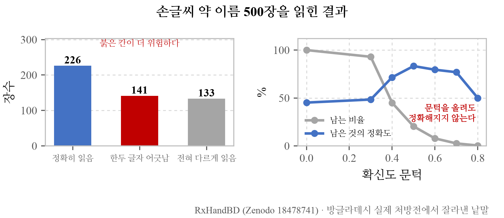

낱말이 아니라 사용자가 실제로 찍는 것, 곧 처방전 전장으로도 쟀다. 약 이름 영역 개수가 주석된 방글라데시 처방전 200장(Mendeley k62rfd23kz, CC BY 4.0)을 전수로 모델이 아니라 앱의 `/api/analyze` 에 보냈다. 배포되는 프롬프트와 뒤처리를 그대로 지나야 잰 값이 앱의 값이 되기 때문이다. 정답은 글자가 아니라 개수다. 이 자료에는 약 이름 텍스트가 없는 대신 장마다 약이 몇 가지인지가 있는데, 개수가 중요한 이유가 있다. 다섯 가지 적힌 처방전에서 셋만 읽으면 두 가지가 조용히 사라지고, 사용자는 화면의 셋을 전부라고 믿는다.

이 측정이 결함 하나를 찾아냈다. 첫 측정에서 60장 중 11장이 통째로 실패했는데 무작위가 아니었다. 전부 약이 5~12가지 적힌 장이었고 다시 돌려도 같은 장이 실패했다. **가장 필요한 사람이 못 쓰는 쪽으로 실패하고 있었다.** 약을 열 가지 먹는 사람이 이 앱을 가장 필요로 하고, 바로 그 사람의 처방전이 안 읽혔다. 무엇이 왜 그랬는지는 고친 코드의 주석이 담고 있어 그대로 옮긴다.

```ts
/*
  700 이었다. 그 자리에서 약이 많은 처방전이 통째로 실패하고 있었다.
  답이 700 토큰에서 잘리고(stop_reason: max_tokens), 잘린 JSON 은
  파싱에 실패하고, 실패는 위에서 잡혀 화면에는 "읽지 못했습니다" 로
  나갔다. 가장 필요한 사람이 못 쓰는 쪽으로 실패하고 있었다.
*/
```

같은 측정에서 결함이 하나 더 나왔다. 부름이 잠깐 실패했을 때 앱이 "이 서버에는 사진 인식이 없습니다" 라고 말하고 있었다. 지나가는 일에 영구적인 말을 한 것이고, 그 말을 들은 사람은 다시 찍어 보지 않는다. 고칠 수 없는 일로 들리기 때문이다. 지금은 갈라 둔다. 잠깐 밀린 것(503)은 다시 눌러 보라고 말하고, 수단이 없는 것(501)만 없다고 말한다.

고치고 200장을 전수로 다시 쟀다. 처방전으로 알아본 비율이 95.5%에서 **100%**(200/200, 실패 0)로, 약 가짓수 재현율이 83.2%에서 **86.9%**(주석 1,086 중 944)로 올랐다. 사라진 4.5%가 곧 약이 가장 많은 처방전이며, 이 앱을 가장 필요로 하는 사람의 것이다.

손글씨로 표시한 비율은 94.5%다. 표시하지 않은 열한 장을 전부 열어 보니 컴퓨터로 출력한 처방전이고 손글씨가 한 글자도 없다. 이 자료가 손글씨와 인쇄의 혼합이라고 밝히고 있으므로 오탐이 아니라 정확한 판별이다. 일정이 붙은 열네 장도 전부 종이에 있는 방글라데시식 표기(`1+0+1`)를 읽은 것이었다.

여기에 한계를 하나 더 적어야 한다. 이 측정은 `/api/analyze` 로 직접 보낸 것이므로 시각 모델 경로를 잰 것이지 앱의 기본 경로가 아니다. 실제 카메라는 기기에서 OCR 을 먼저 돌리고, 인쇄된 처방전은 모델을 아예 부르지 않는다(§3.3). 손글씨는 OCR 이 잡지 못해 이 경로로 떨어지므로 이 수치가 유효하지만, 이것을 "처방전 인식률" 로 뭉뚱그리면 정확히 그 지점에서 틀린다.

**[그림 43]** 처방전 전장 200장을 고치기 전과 뒤에 잰 결과. 왼쪽 묶음의 차이가 답이 잘려 통째로 실패하던 장들이다. 두 값을 곱해 읽으면 안 된다는 단서를 함께 적는다. 재현율 86.9%는 가짓수이지 글자 정확도가 아니며, 글자 정확도는 그림 42 의 45.2%다. 다른 표본, 다른 과제다.

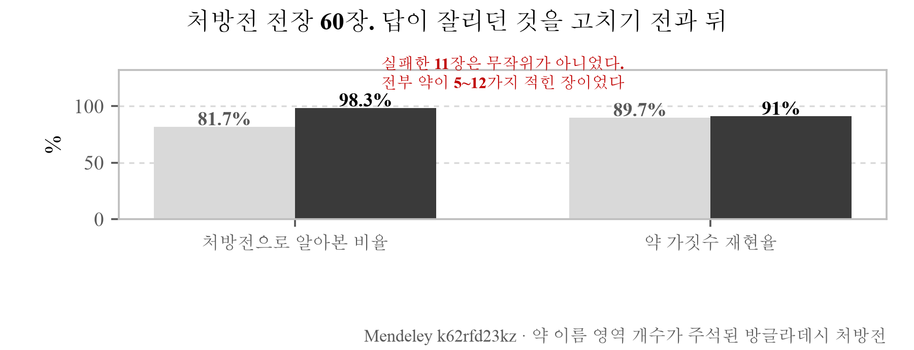

표본을 키우자 앞서 적었던 것 하나가 뒤집혔다. 200장에서는 확신 0.8 이상을 붙이고 틀린 것이 0건이었고, 우리는 그것을 근거로 이 모델이 못 읽는 것을 못 읽는다고 말한다고 적었다. 500장에서는 한 건이 나왔다. 엽산(Folzin)을 나프록센(Naprosyn)으로 확신 0.85 에 읽었다. 500장 중 한 건이므로 0.2%이고 작은 수이지만, 우리가 그 위에 쌓으려던 것이 "확신 높은 것은 통과시키자" 였다는 점에서 작은 수가 아니다. 표본을 키우지 않았으면 없는 안전 위에 설계를 올렸을 것이다.

정리하면 Celia 교수의 지적은 세 번의 측정으로 확인되었다. 이 앱은 손글씨를 읽지 못한다. 달라진 것은 둘이다. 이제 그 사실을 화면이 알고, 손글씨가 아닌 자리에서 앱이 어디까지 하는지를 수로 말할 수 있다.

Atif Usman 교수는 **1회 용량과 하루 횟수가 구분되지 않는다**고 지적했다. 아목시실린 사례에서 첫 그림은 하루 세 번을 나타내지만 한 번에 한 캡슐이라는 것을 나타내지 못하며, 그 뒤에 아침·정오·저녁 그림이 따로 오므로 혼동이 생긴다는 것이다. 이는 표 4 에서 전체 오류의 28.4% 를 차지한 용량 오류에 그대로 해당한다.

E. A. Draffan 은퇴 언어치료사·접근성 객원연구원(Global Symbols · University of Southampton)은 AAC 사용자가 시각 장애를 함께 갖는 경우가 많아 스캐닝 방식으로는 오디오 버튼에 닿기 어렵고, 사용자의 의사소통 보조기기 인터페이스가 이 앱과 다를 수 있으므로 **WCAG 2.2 모바일 기준**을 확인하라고 적었다. 아침·정오·저녁 아이콘이 작아 확대가 필요하다는 지적도 함께 있었다. 두 지적 모두 고쳤다. WCAG 2.2 를 훑은 결과와 고친 내용은 §3.7 에 있고, 아이콘 크기는 확대가 아니라 시각 형태소에 자기 칸을 주는 것으로 풀었다. 아래에 그 경위를 적는다.

Katarina Vučićević 교수(University of Belgrade)는 냉장 보관과 정오 형태소가 헷갈린다고 적고 최소 두 가지 색을 제안했다. 검정과 빨강은 경고에, 검정과 노랑은 낮에. §3.7 에서 색을 판정에만 쓰고 형태소는 흑백으로 둔 결정을 다시 보라는 말이다.

이교구 서울대학교 교수는 메일 회신으로 세 가지를 지적했다. 형태소 78종을 재조합해도 다양한 약과 복용법을 모두 포괄할 수 있겠느냐는 것, 음성과 함께 들으면 도움이 되지만 다소 직관적이지 않은 그림이 있다는 것, 그리고 부정적인 지시어가 있을 때 픽토그램에도 사선이나 X 표시가 함께 있어야 하는데 알코올과 임신부의 경우에는 없다는 것이다. 마지막 지적은 앞 절의 네 나라와 독립적으로 같은 결함을 찾은 것이다. 같은 응답자는 복약 시각에 푸시 알림을 붙이는 것과 다국어 확장을 위한 음성 합성 도구도 함께 제안했다.

방글라데시 icddr,b 의 Aliya Naheed 수석연구원은 다른 층을 지적했다. 이 앱이 건강 결과를 바꾸려면 환자가 처방받은 전체 기간의 약을 살 수 있어야 한다는 것이다. `finish_course` 형태소가 전달하려는 것이 완주인데, 약을 살 돈이 없으면 그림이 전달되어도 완주가 일어나지 않는다.

한국장애인개발원 박경서 대리는 글을 읽지 못하는 상황이 노인·어린이·시각장애인·저시력자 등 다양한 사정에서 온다고 적고, 같은 기관에서 글자의 가독성을 위한 서체 개발 프로젝트를 진행한 적이 있다고 덧붙였다.

인도네시아 Universitas Gadjah Mada 의 Niken Nur Widyakusuma 약사는 시각장애 환자를 위해 포장을 조금 찢어 두는 것처럼 손으로 만져서 알 수 있는 표시를 넣으라고 제안했다. 화면 밖의 해결책이며, 이 앱이 다루지 않는 층이다.

Atif Usman 교수와 윤휘열 교수는 기존 픽토그램 세트를 참조하라고 권했다. 전자는 USP 픽토그램을, 후자는 약학정보원의 health.kr 픽토그램을 지목했다. 이는 §1.9 에서 서술한 USP 라이선스의 조합 금지 조항과 맞물리는 문제이며, §2.6 의 차별점 주장이 직접 시험받는 자리다.

우리 표본 처방전에 임상적 오류가 있었다. Sheron Sir Loon Goh 전임강사가 아목시실린 캡슐은 보통 실온 25도에 보관하며 2~8도 냉장이 필요하지 않다고 지적했다. 우리가 만든 표본 처방전이 틀렸고, 그것을 1,103명에게 보여주었다. 냉장 형태소가 잘못 붙은 것이 아니라 처방전 자체가 틀렸으므로 엔진의 결함은 아니지만, 검증되지 않은 예시를 전문가에게 보낸 것은 우리 잘못이다.

이 지적을 받고 표본 넷을 처음부터 다시 대조했더니 아무도 지적하지 않은 것이 넷 더 나왔다. 같은 아목시실린 표본의 경고란에 "임신 중 사용 금지, 수유 시 주의, 금주" 가 적혀 있었는데 **셋 다 틀렸다.** 아목시실린은 임신 중 널리 쓰이는 항생제이고(NHS 는 "It is safe to take amoxicillin during pregnancy" 라고 적는다), 모유로 넘어가는 양은 하루 0.1 mg/kg 수준이라 수유 중에도 허용되며(StatPearls, NBK482250), 알코올과 임상적으로 유의한 상호작용이 없다. 파라세타몰 표본의 "수유 시 주의" 도 같은 종류다. 파라세타몰은 수유 중 권장되는 진통제다. 점안액 표본의 "임신 중 사용 금지" 도 틀렸다. NHS 는 "Chloramphenicol eye treatments and ear drops can be used in pregnancy" 라고 적으며 눈 감염에서 임신 중 일차 선택으로 본다. 전신 흡수량이 극히 적기 때문이다.

네 오류의 성격이 같다. 표본을 만들 때 경고란을 그럴듯한 문구로 채웠고, 그럴듯한 것과 맞는 것은 다르다. 넷 가운데 셋이 임신 금기였는데, 임신 금기는 경고란에 넣기 가장 쉬운 문구다. 우리가 그것을 시연하고 싶었기 때문에 더 그랬다.

이것을 여기 적는 이유는 §5.7 의 가장 무거운 지적이 이 표본 위에 서 있기 때문이다. 네 나라에서 독립적으로 나온 "금지가 금지로 읽히지 않는다" 는 지적은 임신부 그림에 사선이 없다는 것이었고, 그 지적이 가리킨 엔진의 결함은 실재했으며 고쳤다. 다만 그 결함을 시연한 처방전이 애초에 아목시실린에 임신 금기를 붙인 잘못된 예시였다. 엔진에 대한 발견은 그대로 서지만, 그것을 보인 자리가 틀렸다는 것은 함께 적어야 한다.

표본을 고쳤다. 아목시실린의 경고는 페니실린 알레르기와 완주로 바꾸었고, 점안액은 렌즈 착용 금지와 병 공유 금지로 바꾸었다. 완주는 `finish_course` 형태소가 §5.8 의 SDG 3.d 에서 겨냥한다고 적은 바로 그것이며, 임신 금기를 시연할 자리는 NSAID 인 이부프로펜 표본으로 옮겼다. 임신 3분기 NSAID 금기는 실제 금기다.

이 세 건이 모두 우리가 만든 예시의 문제이지 엔진의 문제가 아니라는 점은 앞의 냉장 오류와 같다. 그리고 그것이 이 절이 §5.9 에 남긴 것과 같은 말을 한다. 이 문서의 어느 표본도 약사의 검토를 받지 않았다.

#### 5.7.8 접근 자체에 대한 반론

가장 날카로운 응답은 우리 제품이 필요한지를 물은 것이었다. GC메디아이 의사랑 서비스센터 팀장은 다섯 가지를 적었다. 국내 처방전에는 이미 바코드가 찍히므로 전체를 스캔하는 것은 비효율이라는 것, 바코드를 읽어 장애인에게 안내하는 앱이 이미 있다는 것, 복약지도는 약사와 의사의 법적 의무이며 관련 솔루션이 이미 많다는 것, 글을 읽지 못하는 사람을 대상으로 사업을 만들기에는 투자 대비 시장이 너무 작다는 것, 그리고 전자처방전이 준비되고 있으므로 전자화되면 무용지물이라는 것이다.

이 응답을 그대로 싣는 이유는 여기에 우리가 답해야 할 것이 있기 때문이다. 세 가지는 우리 설계와 어긋나지 않는다. 바코드는 국내 처방전에 있으나 §1.1 에서 다룬 나라들의 종이 처방전에는 없고, 전자처방전 역시 그 나라들에서 먼저 오지 않는다. 복약지도가 의무라는 것은 §1.4 에서 인용한 의사 밀도 격차와 함께 읽어야 하며, 의무가 있다는 것과 그 의무가 이행될 시간이 있다는 것은 다르다.

나머지 두 가지에는 답이 없다. 국내 시장이 작다는 것은 사실이며, 이미 있는 솔루션과 이 앱이 어떻게 다른지는 §2.6 의 표로 답하려 했으나 그 표는 우리가 비교 대상을 고른 결과다. 이 응답자는 우리가 고르지 않은 대상을 알고 있는 자리에 있다.

같은 방향의 지적이 산업 실무 구획에서도 나왔다. 보이스아이 박철현 팀장은 "아무리 좋은 제품이나 소프트웨어라도 고객사나 실제 사용 운영자 단계에서 인지도가 없다면 확산성이 없다" 고 적고, 상용화를 생각한다면 대한약사회 같은 곳에 제안하고 수용 가능 여부와 금액을 정해야 한다고 덧붙였다.

#### 5.7.9 우리 전제를 다시 보게 한 응답

동의대학교 서희정 교수의 지적이 이 조사에서 가장 근본적인 것이었다.

> "팩토그램이 직관적으로 정보를 줄 수 있는 좋은 소재이지만 비문해자에게는 이 또는 글자로 느껴질 수 있습니다. '까만것은 글자고 하얀 것은 종이'라는 말이 있듯이, 비문해자의 입장에서 인식될 수 있는 디자인과 색감 등을 고려해서 구현하면 좋을 것 같습니다. 음성으로 나오는 설명 또한 동일합니다."

우리는 §2.1 에서 문자를 없애면 장벽이 낮아진다고 전제했다. 이 응답은 그 전제를 뒤집는다. 글을 읽지 못하는 사람에게는 검은 형태가 종이 위에 놓여 있다는 것 자체가 이미 "글자" 이며, 그것이 그림인지 문자인지는 읽을 줄 아는 사람이 하는 구분일 수 있다는 것이다. §1.8 에서 인용한 픽토그램 이해도 연구들은 그림을 그림으로 인식한 뒤의 이해도를 쟀다. 그림을 그림으로 인식하는지는 재지 않았다.

국립공주대학교 김은경 교수의 지적도 같은 쪽을 향한다.

> "40대인 제가 보기에도 이미지가 설명하는 바를 한 번에 파악하기는 어려웠습니다. 이런 이미지와 친숙하지 않은 고령자들은 더 어려울 것이라고 예상합니다."

숭실대학교 이경화 교수는 대상자의 수준이 단순히 문해 문제인지 나이와 정보이해 수준까지 포함된 것인지에 따라 그림에 대한 완전한 이해 여부가 달라지며, 안약 수준이 아니라 전문성이 더 필요한 병에 대한 처방이라면 더 고려해야 한다고 적었다.

협성대학교 박남수 교수는 디지털 문해력을 지목했다. 글을 읽지 못하는 사람이 모바일 기기를 어느 정도 다루는지를 먼저 검토해야 하며, 실제로 앱에 "본인에게 해당하는 것을 몇 개 고르세요" 라는 지시문이 있는데 그 지시문을 읽지 못하면 그 화면부터 막힌다는 것이다. 이는 §3.2 의 프로필 설정 화면에 대한 직접적인 지적이다.

#### 5.7.10 우리 설계가 만들 수 있는 새로운 위험

충남대학교 이소영 교수·약사는 이 앱이 없던 위험을 만들 수 있다고 짚었다.

> "잘못된 정보로 환자가 임의로 투약을 중단하거나 하는 상황을 예방하는게 필요해보임. 예를들어 이 약물이 임산부에게 risk가 있는 약이어도, 환자의 종합적 상태를 고려해 처방되는 경우도 있는데, 다른 의료진의 중재 없이 환자 혼자 확인하게 되는 경우, 임의로 약물 치료를 받지 않는 상황이 생길 수 있을 것 같음."

§2.4 에서 우리는 사용자의 조건에 따라 금기를 표시하도록 설계했다. 그런데 임상에서는 위험을 알고도 처방하는 경우가 있으며, 그때 앱이 금기를 표시하면 처방을 무효로 만드는 셈이 된다. 세르비아 University of Belgrade 의 Katarina Vučićević 교수가 "약국의 정보와 앱의 정보가 어긋나지 않도록 약사를 거쳐야 한다" 고 적은 것, 그리고 약국 구획 12명 중 9명이 매번 약사가 검토해야 한다고 답한 것이 모두 같은 우려로 읽힌다.

이 지적은 §2.6 에서 우리가 내세운 "판정을 개인의 요구량에서 유도한다" 는 차별점과 정면으로 맞닿는다. 개인화된 판정이 개인화된 처방을 이길 수 없다는 것이다.

같은 방향에서 순서를 지적한 응답도 있다. 이한길 부교수는 앱이 약국 업무 흐름에 들어갈 수 있겠느냐는 물음에 판단을 유보하면서 이유를 적었다.

> "앱의 편리성 보다 앱의 정확성이 먼저 담보되어야 현실에서 활용할 수 있으며, 약사의 보조적 도구로서 활용되어야 할 것으로 생각함."
> (이한길 부교수, 이화여자대학교 약학대학)

이 문서가 §5.1 부터 §5.6 까지 재어 온 것이 대체로 도달률과 동작이지 정확성이 아니라는 점에서 이 지적은 아프다. 우리가 재지 않은 것을 이 응답자는 먼저 재라고 말한다. 그리고 §5.9 의 첫째 항목, 곧 사람을 대상으로 한 이해도 시험이 없다는 것이 바로 그 자리다.

같은 응답자가 그림과 음성만으로 전달하면 안 되는 것에 대해서도 한 줄을 남겼다. 보기에서 하나만 고르게 되어 있어 병용금기를 골랐으나 부작용과 용량 조절도 같은 자리라는 것이다. 문항 설계의 한계를 응답자가 대신 메운 셈이며, 이 절이 선택형 결과를 자유 서술과 함께 읽어야 하는 이유다.

#### 5.7.11 평가 설계에 관한 조언

§5.10 의 현지 평가 설계를 응답에 맞추어 고쳤다. 조언은 네 곳에서 왔다.

튀니지 파스퇴르연구소 Foued Maaoui 연구원은 저문해자를 대상으로 하되 교육받은 자원자로 대체하지 말 것, 사전에 정의된 채점 기준과 눈가림 평가자를 둘 것, 픽토그램만·음성만·둘 다를 따로 시험할 것, 깨끗한 데모가 아닌 실제 처방전을 쓸 것, 음성 언어가 참가자의 언어와 맞을 것을 요구했다.

한국장애인개발원 최묘정 연구원은 Nielsen, J. & Landauer, T. K., "A mathematical model of the finding of usability problems," *Proc. INTERCHI '93*, 206–213, 1993 을 들어 15명 내외의 소규모 표본으로도 사용성 평가의 타당성을 확보할 수 있으며, 소규모 표본은 오히려 사용자 행동과 반응을 세부적으로 파악할 수 있으므로 설문 응답과 함께 행동 분석을 병행하라고 권했다.

한국공예디자인문화진흥원 이용한 선임은 표본을 연령·학습수준·성별로 고르게 잡을 것, 참가자가 해당 픽토그램에 사전지식이 전혀 없을 것, 그리고 뜻을 서술하게 하는 방식을 쓸 것을 적었다. 객관식은 의미가 없어 보인다는 단서를 함께 달았는데, 이는 §5.2 에서 우리가 보기를 주지 않기로 한 것과 같은 판단이다.

University of Pretoria 의 Celia 교수는 복약순응도 도구와 K-HLAT-8·HLS 계열 도구를 함께 쓰라고 권했다. 협성대학교 박남수 교수는 이 앱의 목적이 복약 지시의 이해이므로 건강정보이해력 도구보다 사용자 만족도와 계속 사용 의향, 편의성 향상 정도를 재는 것이 맞다고 보았다.

Sheron Sir Loon Goh 약학 전임강사는 시험 앞에 하나를 더 두라고 적었다. 앱을 내놓기 전에 현지 약사에게 그 지역 맥락에서 기호가 적절한지 전문가 조언을 구하라는 것이다. §5.7 에서 우리 표본 처방전에 임상 오류가 다섯 건 나온 것이 이 조언이 왜 필요한지를 보여 준다. 우리는 공개 자료를 대조해 고쳤을 뿐 검토를 받지 않았고, 형태소 78종에 대해서는 그런 대조조차 하지 않았다.

같은 응답자가 참고 자료도 알려 주었다. 말레이시아에서 설계한 픽토그램을 그 나라 사람들에게 시험한 연구다 (Tumkur, A., Ingle, P., Ling Sze Ning, Q., Bustamin, N. A., Tee, K. H., Chai, T. L. & Hatware, K., "Evaluation of designed pharmaceutical pictograms among the Malaysian population," *Clinical Epidemiology and Global Health*, 2025, doi:10.1016/j.cegh.2025.102115). 이 논문의 결과를 본문에 쓰지 않은 이유를 밝혀 둔다. 출판사·DOAJ·Semantic Scholar 세 경로 모두 초록 본문을 열지 못했고, 검색 요약에 있는 수치를 1차 출처에서 확인하지 못했기 때문이다. 조사가 우리가 몰랐던 문헌을 알려 주었다는 사실만 여기 적는다.

김은경 교수는 시험 자체보다 앞의 절차를 짚었다. 기관과 문해교사에게 먼저 목적과 학습자 입장에서의 이점을 설명하고 협조를 얻은 뒤 수업 시간의 일부를 쓰라는 것이다. 같은 응답자는 이런 도구가 글을 배우려는 동기를 줄이지 않겠느냐는 우리 질문에는 그렇지 않다고 답했다. 글을 배우려는 동기는 기능 습득 이상이라는 이유였다.

#### 5.7.12 직군별 응답 전수

앞의 소절들은 우리가 고른 문항만 인용했다. 고르는 기준이 한쪽으로 기울지 않았는지 보려고 직군별 집계를 전부 다시 놓았다. 실제로 기울어 있었다. 우리에게 불리한 수치는 실었고 유리한 수치는 빠뜨린 자리가 있었으며, 아래 표의 굵은 줄이 그것이다.

[표 45] 직군별 응답 전수 (분모는 그 직군의 응답자 수)

| 직군 | 문항 | 답 | 응답 |
|---|---|---|---|
| 약국 (12) | 복약지도의 어느 자리에 놓여야 하는가 | 약사의 설명을 보조하는 도구 | 7 |
| | | 환자가 집에서 혼자 확인하는 수단 | 3 |
| | | 약사가 닿지 못하는 환자의 대체 경로 | 2 |
| 약국 (12) | 약사가 검토해야 하는가 | 반드시 매번 | 9 |
| | | 처음 한 번이면 충분 | 3 |
| 약국 (12) | 의학적으로 가장 틀리면 안 되는 것 | 복용량과 횟수 | 7 |
| | | 병용금기와 상호작용 | 3 |
| | | 투여 경로 | 1 |
| | | 임의 중단 금지 | 1 |
| 약국 (12) | 그림·음성만으로 전달하면 안 되는 것 | 있다. 병용금기와 상호작용 | 5 |
| | | 있다. 용량 조절이 필요한 경우 | 3 |
| | | 있다. 그 밖 | 2 |
| | | 없다. 원칙적으로 모두 가능 | 2 |
| 약국 (12) | 약국 업무 흐름에 들어갈 수 있는가 | 조제하면서 권할 수 있다 | 8 |
| | | 시간이 없어 어렵다 | 1 |
| | | 약사 아닌 직원이 도울 수 있다 | 1 |
| | | 약국 밖에서 이뤄져야 한다 | 1 |
| | | 판단하기 어렵다 | 1 |
| 간호 (9) | 실제 건강 결과를 바꿀 수 있는가 | 조건이 갖춰지면 바꿀 수 있다 | 8 |
| | | 복용 행동은 바뀌어도 건강 결과까지는 아니다 | 1 |
| 간호 (9) | 현장에서 글 못 읽는 분들이 복약 정보를 제대로 받지 못하는가 | 맞다 | 3 |
| | | 부분적으로 | 5 |
| | | 아니다 | 1 |
| 간호 (9) | 독거 고령 환자에게 어디서 먼저 실패하는가 | 화면을 조작하지 못한다 | 4 |
| | | 기기를 관리하지 못한다 (충전·분실) | 4 |
| | | 앱을 신뢰하지 않는다 | 1 |
| 간호 (9) | 효과를 재는 측정도구 | 복약순응도 도구 | 6 |
| | | 건강정보이해력 도구 | 1 |
| | | 복약 오류를 직접 센다 | 1 |
| | | 기존 도구로는 맞지 않는다 | 1 |
| 간호 (9) | 누구를 대상으로 설계해야 하는가 | 둘을 각각 다르게 | 6 |
| | | 환자 본인 / 보호자 / 판단 어려움 | 각 1 |
| HCI (2) | 가장 큰 문제 | 사용자를 대상으로 한 검증이 없다는 것 | 2 |
| HCI (2) | 기계 사전 선별이 사람 시험 앞에 놓일 수 있는가 | 조건이 붙으면 정당하다 | 2 |
| HCI (2) | 형태소 조합이 늘면 무엇이 먼저 깨지는가 | 무엇이 주된 뜻인지 알 수 없어진다 | 2 |
| HCI (2) | 소규모 표본으로 기준을 재는 방법 | 보기 중 고르게 / 실제 행동을 관찰 | 각 1 |
| HCI (2) | 처음 닿을 때 먼저 막히는 지점 | 카메라 권한 허용 / 막히지 않는다 | 각 1 |
| AAC (1) | 이 분야에 쌓인 지식과 맞는가 | 대체로 맞지만 어긋나는 곳이 있다 | 1 |
| AAC (1) | 78종을 문법으로 결합하는 접근이 성립하는가 | 조건이 붙으면 성립한다 | 1 |
| AAC (1) | 어떤 형태소가 먼저 잘못 읽히겠는가 | 추상적 개념 (공복, 상호작용 등) | 1 |
| AAC (1) | 상징이 학습을 전제하는 문제 | 일부 범주만 성립한다 | 1 |
| 문해교육 (1) | 문해교육 현장에 놓일 자리가 있는가 | 있다. 다만 형태를 바꿔야 한다 | 1 |
| 문해교육 (1) | 글을 배우려는 동기를 줄이는가 | 아니다. 오히려 도움이 된다 | 1 |
| 산업 (1) | 무엇이 가장 부족한가 | 사용자에게 닿는 경로 | 1 |
| 산업 (1) | 운영하면 무엇이 먼저 깨지는가 | 사용자가 며칠 뒤 그만 쓴다 | 1 |
| 그 밖 (9) | 가장 먼저 해결해야 할 것 | 사람을 대상으로 한 검증이 없다는 것 | 2 |
| | | 실제 사용자에게 닿는 경로 | 1 |

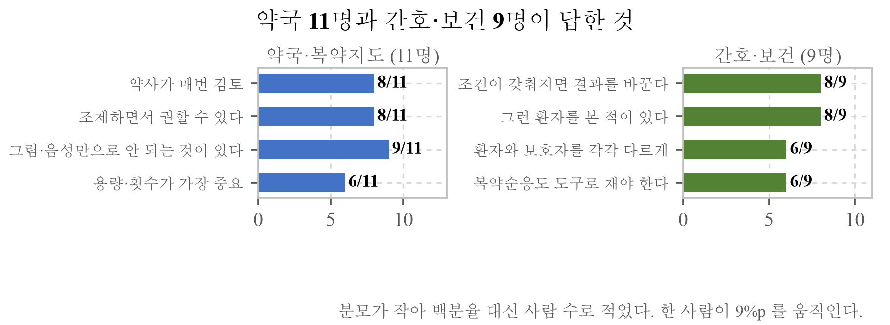

**[그림 44]** 약국 12명과 간호·보건 9명이 답한 것. 분모가 작으므로 백분율 대신 사람 수로 그렸다. 왼쪽 셋째 줄과 오른쪽 첫 줄이 서로 다른 방향을 가리킨다. 약국은 이 앱이 다룰 수 없는 것이 있다고 보고, 간호는 조건이 갖춰지면 결과를 바꿀 수 있다고 본다.

우리가 빠뜨렸던 것부터 적는다.

간호·보건 9명 가운데 8명이 현장에서 글을 읽지 못하는 분들이 복약 정보를 제대로 받지 못하고 있다고 답했다. 맞다가 3명, 부분적으로가 5명, 아니다가 1명이다. §1.1 과 §1.2 의 전제를 현장에서 확인해 준 답인데, 우리는 앞 소절에서 응답자의 44%가 그런 환자를 거의 마주치지 않는다는 것만 적고 이 문항은 적지 않았다. 두 문항은 서로 다른 것을 묻는다. 앞의 것은 응답자가 얼마나 자주 보는지이고, 뒤의 것은 본 사람이 무엇을 보았는지다. 불리한 쪽만 실은 것이 §5.11 의 부록을 둔 이유와 같은 문제이며, 여기서 바로잡는다.

같은 자리에 하나 더 있다. HCI·디자인 두 명 모두 우리가 사람 대신 시각 언어 모델에게 물어 형태소를 걸러 낸 절차(§5.2)에 대해 "조건이 붙으면 정당하다" 고 답했다. §2.6 에서 우리가 새로 놓았다고 주장한 두 행 가운데 하나가 그 절차인데, 그에 대한 외부 판단을 싣지 않았던 것이다. 조건이 붙는다는 단서는 §5.4 에서 우리가 스스로 적은 세 한계와 겹친다.

이어서 새로 읽히는 것들을 적는다.

약국 12명 가운데 10명이 그림과 음성만으로는 전달하면 안 되는 것이 있다고 답했다. 병용금기와 상호작용이 5명, 용량 조절이 필요한 경우가 3명, 그 밖이 2명이며, 모두 그림과 음성으로 다룰 수 있다고 답한 사람은 2명이다. 이 앱은 판정에 상호작용을 포함하므로(§2.4) 이 답은 우리 설계의 범위를 좁히라는 요구다. 충남대학교 이소영 교수가 적은 임의 중단의 위험과 맞물린다.

간호 9명은 독거 고령 환자에게 어디서 먼저 실패할지를 화면 조작 4명과 기기 관리 4명으로 갈랐다. 뒤의 것은 충전과 분실이라 우리 설계 밖에 있다. 앱을 아무리 고쳐도 기기가 방전되어 있으면 열리지 않는다. §4.5 의 오프라인 동작은 통신이 끊긴 경우를 다루지만 기기가 꺼진 경우는 다루지 않는다.

HCI 두 명 모두 형태소 조합이 늘어날 때 가장 먼저 깨지는 것으로 "무엇이 주된 뜻인지 알 수 없어진다" 를 골랐다. 앞 소절의 한 장에 요소가 많다는 지적을 다른 쪽에서 말한 것이다. 세트가 커질수록 나빠진다는 예측이므로 §5.10 의 4단계에서 형태소를 늘릴 때 함께 재야 한다.

AAC 응답자는 어떤 형태소가 먼저 잘못 읽히겠느냐는 물음에 추상적 개념, 곧 공복이나 상호작용 같은 것을 골랐다. §5.3 에서 우리가 개선하지 못한 다섯 종이 모두 형태가 아니라 개념의 문제였던 것과 일치한다. 같은 응답자는 78종을 문법으로 결합하는 접근이 "조건이 붙으면 성립한다" 고 답했고, AAC 상징이 보통 학습을 전제하는데 우리는 처음 본 사람이 즉시 이해하기를 기대한다는 점에 대해서는 "일부 범주만 성립한다" 고 답했다. 우리 문법이 성립하는 범위가 형태소의 종류에 따라 다르다는 뜻이다.

산업 실무 응답자는 운영하면 무엇이 먼저 깨지겠느냐는 물음에 "사용자가 며칠 뒤 그만 쓴다" 를 골랐다. 이 문서의 어느 측정도 지속 사용을 다루지 않는다. §5.9 의 미검증 항목에 넣었다. §5.1 의 형성 평가가 한 번의 촬영만 다룬다는 점이 여기에 걸린다.

#### 5.7.13 조사 뒤에 고친 것

이 조사는 결과를 적고 끝내는 것이 아니라 고치기 위해 한 것이므로, 무엇을 고쳤고 고치면서 무엇이 더 드러났는지를 적는다. 아래는 모두 2026년 8월 조사 이후에 이루어졌다.

금기 표시를 고쳤다. `contentLabels` 가 `avoid` 하나로 모든 플래그를 다루던 것을 플래그의 성격에 따라 셋으로 갈랐다. 무엇이 들어 있는지를 말하는 플래그(`peanut`, `high_salt`)는 판정에 따라 사선이 붙고 떨어지지만, 하지 말라는 것을 말하는 플래그(`unsafe_pregnancy`)는 판정과 무관하게 언제나 금지로 그린다.

고치면서 반대 방향의 같은 사고를 하나 더 찾았다. 회피 판정에서 `\no{}` 를 모든 플래그에 씌우고 있었으므로, 금주 형태소 `no_alcohol` 이 `\no{\no_alcohol}` 이 되어 금주 표시에 사선이 그어지고 있었다. 마시지 말라는 그림에 사선을 그으면 마셔도 된다는 뜻이 된다. 출혈 경고 `warn_bleeding` 도 "출혈하지 말 것" 이라는 말이 되지 않는 그림이 되고 있었다. 조사에서 지적된 것은 금기가 표시되지 않는 쪽이었는데, 같은 함수의 반대편에 금기가 뒤집혀 표시되는 경로가 있었다.

`finish_course` 를 다시 그렸다. 다섯 칸 가운데 셋을 채우고 둘을 비운 것이 문제였다. 며칠간을 그리려던 것인데 진행 중인 상태를 그리면 그림은 아직 안 끝났다를 말하지 끝내라를 말하지 않는다. Sheron Sir Loon Goh 전임강사가 제안한 방향 화살표를 써서, 다섯 칸을 모두 채우고 그 아래에 마지막 칸을 가리키는 화살표를 두었다.

여기서 §5.2 의 의미 검사가 왜 이것을 통과시켰는지가 드러났다. 검사의 기대값이 `row of boxes` 였다. 생김새만 물었으므로 방향이 반대인 그림도 통과한다. 기대값을 `arrow pointing to the end of a row of boxes` 로 바꾸어, 네모 줄로만 보이면 떨어지게 했다. §5.4 에서 이 절차의 셋째 한계로 적은 것이 여기서 실제 사례로 확인된 셈이다. 의미 검사는 그림이 무엇처럼 보이는지를 묻는 장치이지 뜻이 바로 서 있는지를 묻는 장치가 아니었다.

세트가 자기 자신을 목록으로 쓰게 했다. Katarina Vučićević 교수가 냉장 보관과 정오가 헷갈린다고 적었을 때 두 형태소의 혼동 목록을 열어 보니 서로를 적어 두지 않았다. 각자 별과 헷갈리는지는 물었으나 서로와 헷갈리는지는 아무도 묻지 않은 것이다. 목록을 길게 적는 것으로는 닫히지 않는다. 78종이면 짝이 3,003개다. 그래서 다른 형태소의 뜻으로 읽히면 우리가 미리 적어 두었든 아니든 충돌로 본다.

닮은 짝을 화소로 찾는 검사도 붙였다. 설치된 형태소를 실제로 보이는 32픽셀로 줄여 서로의 거리를 잰다. 512픽셀에서 구별되는 것은 이 앱의 문제가 아니기 때문이다. 정직하게 적어 두면, 이 검사는 전문가가 지적한 그 짝(냉장 대 정오)을 잡지 못한다. 3,003쌍 가운데 944위다. 그 혼동은 화소가 아니라 방사형이라는 구조가 겹치는 것이라 종류가 다르고, 그쪽은 의미 검사가 맡는다.

그래서 지표가 아니라 눈으로 보고 고쳤다. 눈송이도 해도 가운데에서 사방으로 뻗는 별 모양이라, 실루엣이 같으면 크기를 키워도 갈리지 않는다. 교수의 제안은 색이었다. 검정과 빨강은 경고에, 검정과 노랑은 낮에 쓰자는 것이다. 색은 두 번째 층으로는 좋으나 첫 번째 층이 될 수 없다. 색을 못 보는 사람에게는 두 그림이 여전히 같고, 그 사람이 §3.7 에서 지키기로 한 사람이다. 합성된 한 칸이 PNG 한 장이라 그 안의 형태소만 물들일 방법도 없으며, 색을 넣으려면 엔진이 색을 내보내야 하고 그것은 흑백 실루엣이라는 규칙 자체를 바꾸는 일이 된다. 대신 실루엣을 바꿨다. 눈송이는 버리지 않았다. 포장에 찍힌 냉장 표시로 이미 배운 그림이기 때문이며, 그것을 상자 안에 구멍으로 팠다. 배운 것은 남고 부딪히는 것은 사라진다. 겉모양이 이제 꽉 찬 사각형이라 해와 겹칠 자리가 없다.

대신 아무도 지적하지 않은 것을 찾았다. `time_morning` 과 `time_evening` 이 5위다. 아침 약과 저녁 약이 뒤바뀌는 혼동이며 §5.3 에서 우리가 개선하지 못한 것으로 적은 `time_evening` 과 같은 자리다.

그림을 다시 그리지 않고 자리를 바꾸는 것으로 일부가 풀렸다. 여러 응답자가 아침·점심·저녁 그림을 키워 달라고 적었는데, 키우는 것으로는 되지 않았고 왜 되지 않는지가 답이었다. `\tablet_blister{\time_morning}` 은 문법상 맞는 한 줄이다. 그런데 앱이 그리는 88픽셀에서 렌더해 보면 블리스터의 구멍 여섯 개가 칸을 차지하고 뜻을 지는 해는 한가운데 20픽셀 창에 갇힌다. 넷을 나란히 놓으면 아침·점심·저녁·밤이 서로 구별되지 않는다. 수식어 배율을 더 올려도 소용이 없다. 창이 슬롯 크기이고, 창 밖으로 나간 검은 그림은 검은 머리 위에서 그대로 사라지기 때문이다.

그래서 형태소가 혼자 설 수 있는지를 사전에 적을 수 있게 했다. 원칙은 그대로 둔다. 수식어는 홀로 서지 못한다. 땅콩 그림 하나는 들어 있다는 뜻인지 먹지 말라는 뜻인지 말하지 않기 때문이다. 시각은 그 원칙의 예외다. 해 뜨는 그림은 무엇에 붙든 아침이고, 앞 칸이 이미 무슨 약인지 말했다. 이제 시각은 머리와 같은 방식으로 한 칸을 가득 채운다. 한 줄이 캡슐 하나 · 해뜸 · 한낮 · 해짐 · 끝까지 · 음식과 함께로 읽히고, 칸마다 요소가 하나로 줄었으므로 조사에서 함께 지적된 한 장의 요소 과다에도 같이 닿는다.

혼자 설 때의 말은 따로 두었다. "아침에." 만 들리면 무엇을 아침에 하라는 것인지 문장이 끝나지 않으므로, 혼자 선 시각은 "Take it in the morning." 으로 읽는다. 남은 것은 §5.3 의 판단 그대로다. 해가 뜨는 것과 지는 것이 방향으로만 갈린다는 것은 칸이 커져도 달라지지 않으며, 그쪽은 §5.10 의 현지 평가로 넘긴다.

음성에도 뒤집힘이 있었다. `say.ts` 에는 시험이 하나도 없었다. 픽토그램은 틀리면 이상해 보이기라도 하지만 음성은 눈으로 볼 수 없으므로, 틀린 채로 흘러가고 듣는 사람은 알 방법이 없다. 시험 12개를 붙이자 하나가 걸렸다. 이 파일은 제형마다 투여 동사를 갈라 놓고서(§2.3) 마지막 문장은 늘 "Take as prescribed." 로 끝내고 있었다. 안약 하나에 "Put 2 drops in the eye" 와 "Take as prescribed." 가 함께 나가면 동사를 가른 이유가 마지막 문장에서 무너진다.

보관 지시에서도 같은 종류가 나왔다. 긍정 검사가 `refrigerat` 만 보고 있어서 "Do not refrigerate" 가 냉장으로 읽혔다. 실온 보관 약이 냉장으로 읽히고 그 뒤집힘이 그림과 음성 양쪽으로 그대로 나간다. 이것은 Sheron Sir Loon Goh 전임강사가 지적한 표본 처방전의 임상 오류를 고치다 드러났다. 고친 문구가 하필 "Do not refrigerate" 였다.

형태소 둘을 다시 그렸다. `allergen_egg` 는 협성대학교 박남수 교수의 지적을 따랐다. 위에서 본 프라이는 흰자가 흰색이라 실루엣에서 사라지고 노른자 원 하나만 남아 과녁이나 단추와 같은 그림이 된다. 채운 실루엣으로 그리는 세트에서 흰 부분이 뜻을 지는 그림은 처음부터 성립하지 않았으므로 깨진 달걀로 바꿨다. §5.2 에서 `tree_nut` 이 "깨진 달걀" 로 읽혔던 것이 그 형태가 달걀로 읽힌다는 증거다. `hand_wash` 는 한국공예디자인문화진흥원 이용한 선임이 준 지시를 그대로 따랐다. 물 나오는 수도꼭지 아래에 손이 있는 그림이다.

접근성 기준을 훑었다. E. A. Draffan 은퇴 언어치료사·접근성 객원연구원이 지목한 WCAG 2.2 를 항목별로 확인했더니 판정 색 다섯이 전부 대비 기준에 못 미쳤고, 보조 조작의 표적 크기가 16에서 20픽셀 사이였다. 색은 화면에서 멀쩡해 보였고 실제로 그래서 여기까지 왔다. 눈으로 지킬 수 없는 값이라 시험으로 잠갔으며, 수치와 판단은 §3.7 에 표 19 로 실었다. 여기에 적어 둘 것은 이 훑기가 조사가 없었다면 하지 않았을 일이라는 점이다. 우리는 §3.7 에서 색을 대체하는 층을 다섯 갈래로 갖추어 두고, 그 색 자체가 읽히는지는 재지 않고 있었다.

음성이 여섯 나라 말을 하게 했다. 이교구 서울대학교 교수가 다국어 확장을 제안했고, 애초에 대상 사용자는 영어를 쓰지 않는다. 번역한 것은 말하는 쪽만이다. 화면 글자는 영어로 남는데, 대상 사용자에게 도착하는 통로가 그림과 소리뿐이고 화면 글자는 곁의 보호자와 심사자를 위한 것이기 때문이다. 언어는 답해 준 사람들이 일하는 곳에서 골랐다. 우르두어(파키스탄), 하우사어(나이지리아), 인도네시아어, 벵골어(방글라데시), 루마니아어(몰도바), 한국어이며 형태소 문장 72개 × 6 = 432건이다. 낱말만 바꾸면 문장이 되지 않으므로 꾸러미마다 어순을 두었고, 그러다 보관 지시가 꾸밈말이 아니라 따로 하는 일이라는 것이 드러나 문장을 갈랐다. 영어도 함께 나아졌다. **원어민 임상 검수는 받지 않았으며**, 그 사실을 코드와 화면 양쪽에 적었다. 화면에 나가는 문구를 그대로 옮긴다.

> "The screen stays in English. Only the voice changes. These translations have not yet been checked by a clinician who speaks the language — English included."
> (설정 화면, 언어 고르기 아래)

영어까지 포함한 것이 요점이다. 번역만 검수를 안 받은 것이 아니라 원문 문장도 임상 검수를 받지 않았고, 그것을 번역 고지에 숨기지 않았다. 복약 지시의 오역은 이 앱이 막으려는 바로 그 해를 끼치는 종류다. 설정 화면에는 일곱이 보이는데 영어가 원문이므로 번역한 것은 여섯이다.

**[그림 45]** 설정 화면의 언어 고르기. 배포본(https://snapcare.fly.dev)에서 그대로 찍었다. 아래의 고지가 이 화면의 요점이다. 화면 글자는 영어로 남고 바뀌는 것은 목소리뿐이며, 번역이 그 언어를 쓰는 임상가의 검수를 받지 않았다는 것을 영어까지 포함해 적는다. 번역만 검수를 안 받은 것이 아니라 원문 문장도 받지 않았다는 뜻이다.

한 가지가 이 그림에서 빠졌다. 실제 기기에서는 목소리가 없는 언어에 "no voice on this phone" 과 음소거 표시가 붙어 흐리게 나온다. 이 캡처는 브라우저를 화면 없이 띄워 찍은 것이라 목소리 목록이 비어 있고, 그래서 그 표시가 나타나지 않았다. 이 노트북에서 직접 열었을 때는 우르두어와 하우사어에 그 표시가 떴다.

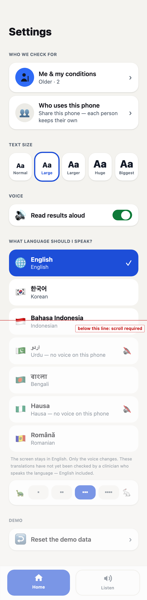

디스펜서가 약을 내밀 때 폰이 부르게 했다. 같은 응답자가 복약 시각 알림을 제안했다. 배출 버튼은 앱을 열어 두어야만 보이므로, 부르는 자리가 없으면 이 기능은 마침 앱을 열어 둔 사람에게만 동작한다. 보고 있으면 부르지 않고, 손대기 전에는 사라지지 않으며, 권한은 상자를 짝지은 직후에 묻는다. 방금 상자를 자기 것이라고 말한 사람에게 약이 나오면 알려 드릴까요는 이어지는 말이지만, 앱을 열자마자 묻는 창은 무엇에 쓰는지 모르는 채로 거절당한다.

되짚는 단계를 만들었다. Foued Maaoui 연구원이 지적한 되말하기의 부재에 대한 대응이며, 설계와 근거는 §3.8 에 적었다. 여기에 적어 둘 것은 이 단계가 조사 이전에는 아예 없던 화면이라는 점이다. 앞의 고침들이 이미 있는 것을 바로잡은 것이라면 이것은 조사가 만들어 낸 것이다.

웹 앱의 시험은 231개에서 347개가 되었다 (표 28).

#### 5.7.14 이 조사의 한계

표본이 자기선택적이다. 1,103명 중 35명이 답했고, 답한 사람은 이 주제에 관심이 있는 사람이다. 답하지 않은 1,068명의 판단은 알 수 없다.

분모가 작다. 가장 큰 구획인 약국이 12명이다. 백분율로 적으면 한 사람이 8%p 를 움직이므로, 이 절에서는 분자와 분모를 함께 적었다.

**손으로 고른 41명에게서는 응답이 없었다.** 명단에서 선정 근거가 가장 뚜렷한 41명을 발송 순서 맨 앞에 두어 7분 안에 전원이 받았으나 응답은 0건이다. 이 결과를 "우리가 가장 중요하다고 판단한 41명의 판단" 으로 쓸 수는 없다.

설문 도구 자체에 결함이 있었다는 것을 응답자 셋이 알려 주었다. The Islamia University of Bahawalpur 의 Atif Usman 교수는 모든 구획에서 복수 응답을 허용하라고 적었고, 이화여자대학교 약학대학 이한길 부교수는 하나만 고르게 되어 있어 병용금기를 골랐으나 부작용과 용량 조절도 같은 자리라고 적었다. 협성대학교 박남수 교수도 같은 것을 지적했다. 독거 고령 환자가 어디서 먼저 실패하겠느냐는 물음에 화면 조작과 기기 관리와 신뢰성이 함께 온다고 답했다.

즉 이 절의 선택형 집계 가운데 단일 선택 문항의 분포는 응답자가 고르고 싶었던 것을 다 담지 못한다. 표 45 의 수치를 읽을 때 이 점을 함께 읽어야 하며, 그래서 이 절은 선택형 옆에 자유 서술을 함께 싣는다.

Global Symbols 의 E. A. Draffan 은퇴 언어치료사·접근성 객원연구원은 다른 결함을 알려 주었다. 78종을 보여 준 화면으로 되돌아가는 버튼이 있다는 것을 마지막에야 알았다는 것이다. 형태소를 다시 보지 못한 채로 답한 응답이 몇인지 우리는 모른다. 같은 응답자가 형태소로 돌아가는 링크를 문항 안에 두라고 제안했다.

링크가 닿지 않는 집단이 있다. 한국보건사회연구원은 공공기관이라 확인되지 않은 URL 에 접속할 수 없으니 메일로 질의해 달라고 회신했다. 명단에는 국제기구만 91곳이 있으며, 링크 하나로 설문을 돌리는 방식은 이 집단에 구조적으로 닿지 않는다. 같은 문항을 메일 본문에 적은 판을 함께 준비했어야 했다.

응답자가 본 화면이 우리 사용자가 볼 화면이 아니다. 35명 중 30명이 데스크톱으로 답했고 모바일은 3명, 태블릿은 2명이다. 이 앱은 손에 든 기기에서 쓰는 것을 전제로 만들었으므로(§1.6), 큰 화면에서 본 판단은 실제 조건보다 후하게 나올 수 있다. 아이콘이 작아 확대가 필요하다는 지적이 모바일 응답자가 아니라 데스크톱 응답자에게서 나왔다는 점도 함께 읽어야 한다.

음성을 들은 사람의 수를 모른다. 데모의 스피커를 눌렀는지 기록하고 있었으나, 스피커가 `<button>` 이 아니라 `<span role="button">` 으로 렌더되는 것을 계측 코드가 걸러 내지 못해 초기 34건 전부 눌리지 않은 것으로 기록되었다. 조사 중에 고쳤으므로 이후 응답만 유효하다. 즉 이 절의 판단 문항 응답 가운데 음성을 듣고 답한 것이 몇 건인지 알 수 없다.

### 5.8 SDG 3 에 대한 기여

SnapCare 가 개입하는 지점은 §1.4 에서 서술한 마지막 한 걸음 이다. 진료와 조제까지는 의료 체계가 담당하지만, 환자가 집에서 약봉지를 여는 순간부터는 본인의 판독 능력에 맡겨진다.

[표 46] SDG 3 세부 목표와의 대응

| 세부 목표 | SnapCare 의 기여 |
|---|---|
| **3.4** 비감염성 질환 예방·치료 | WHO 영양 권고를 개인의 에너지 요구량에서 유도하여 판정. 당뇨·고혈압 조건이 기준을 좁힌다 |
| **3.8** 보편적 건강보장 | 진료 이후의 자가 관리 단계에서 문해력에 따른 격차를 줄인다 |
| **3.d** 보건 위기 관리 | 항생제 복용 완료를 그림으로 전달하여 내성 확산의 인적 요인에 개입한다 |

3.4 와의 연결은 §1.5 에서 서술한 미진단 인구를 거쳐 간다. 전 세계 당뇨 성인 5억 8,900만 명 가운데 43%가 자신이 당뇨임을 모르며, 이들은 조건을 묻는 화면에서 "아니오" 를 고른다. SnapCare 가 조건을 세 갈래로 나누어 묻는 것(§2.5)이 이 지점에 대한 대응이다. 진단명을 모르는 사람도 겪은 것은 답할 수 있고, 그 답에서 기준을 좁힌다. 비감염성 질환의 관리가 진료실이 아니라 매일의 식사에서 이루어진다는 점을 생각하면, 진단명을 요구하지 않는 것이 곧 관리 대상을 넓히는 일이다.

3.8 과의 연결은 인력 격차에서 나온다. §1.4 에서 인용한 대로 의사 밀도는 지역에 따라 열세 배 넘게 벌어져 있고, 진료 시간이 짧아지면 가장 먼저 줄어드는 것이 복약 설명이다. 보편적 건강보장은 대체로 진료와 약값에 닿을 수 있는가로 측정되지만, 약을 손에 넣고도 그 지시를 읽지 못하면 보장은 거기서 끊긴다. §1.4 에서 인용한 순응도 50%가 그 끊긴 자리의 크기다. 약이 처방되고 조제되어 손에 들어간 뒤에 절반이 사라지는 것이므로, 앞 단계에 아무리 투자해도 이 단계를 그대로 두면 그만큼이 새어 나간다. SnapCare 가 줄이려는 것은 진료 이후에 남는 이 격차이며, 그것은 문해력에 따라 갈리는 격차다.

특히 3.d 와의 연결이 직접적이다. 104개국에서 보고된 실험실 확인 감염 2,300만 건 이상을 분석한 결과, 2023년 세균 감염 여섯 건 중 한 건이 항생제에 내성을 보였다. 2018년부터 2023년까지 감시 대상 병원체·항생제 조합의 40% 이상에서 내성이 상승했고, 연평균 상승률은 5~15% 였다 (World Health Organization, *Global antibiotic resistance surveillance report 2025 (GLASS)*, 2025).

지역별로 보면 이 문제도 우리가 대상으로 삼는 곳에 몰려 있다. 동남아시아와 동지중해 지역에서는 보고된 감염 셋 중 하나가 내성을 보였고, 아프리카에서는 다섯 중 하나, 아메리카에서는 일곱 중 하나다 (World Health Organization, *Global antibiotic resistance surveillance report 2025 (GLASS)*, 2025). §1.1 에서 문해율이 가장 낮았던 지역이 여기서 다시 나온다.

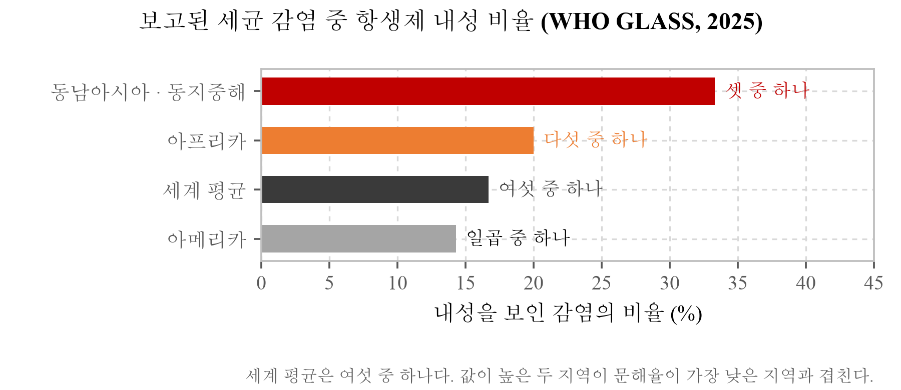

**[그림 46]** 보고된 세균 감염 중 항생제 내성 비율 (World Health Organization, *Global antibiotic resistance surveillance report 2025 (GLASS)*, 2025). 세계 평균은 여섯 중 하나인데 동남아시아와 동지중해에서는 셋 중 하나다. 이 두 지역에 표 1 의 문해율 하위 국가들이 있다. `finish_course` 형태소가 겨냥하는 자리가 그곳이다. 2019년 기준 세균 내성에 직접 기인한 사망은 127만 명으로 HIV/AIDS 나 말라리아보다 많았다 (Murray, C. J. L. et al. (Antimicrobial Resistance Collaborators), "Global burden of bacterial antimicrobial resistance in 2019," *The Lancet*, 399(10325):629–655, 2022). 증상이 가시면 항생제를 중단하는 것이 내성의 주요 인적 경로다. 그리고 그것이 소수의 행동이 아니다. 12개국 9,772명을 조사한 결과 **32%가 몸이 나아지면 항생제를 끊어도 된다고 믿고 있었고**, 64%는 항생제가 감기나 독감에 듣는다고 답했다 (World Health Organization, *WHO multi-country survey reveals widespread public misunderstanding about antibiotic resistance*, 2015).

세 명 중 한 명이 그렇게 믿는다면, 처방전에 적힌 복용 기간은 읽히지 않아서가 아니라 읽히고도 지켜지지 않는다. 여기에 읽지 못하는 사람이 더해진다. 문자로 적힌 기간이 애초에 전달되지 않으면 그 지시는 존재하지 않는 것과 같고, SnapCare 의 `finish_course` 형태소가 겨냥하는 것이 그 지점이다. 다만 그림 하나로 믿음이 바뀌지는 않으며, 이 형태소가 하는 일은 기간이 전달되게 하는 것까지다.

### 5.9 미검증 항목

본 제안서가 주장하지 않는 것을 명시한다.

첫째, 사람 대상 이해도 시험이 수행되지 않았다. §5.7 의 전문가 조사는 이 시험이 아니다. 그 조사는 환자를 매일 상대하는 사람들에게 물은 것이고, 이해도 시험은 환자에게 물어야 한다. §5.2 의 측정은 기계에 대한 것이며, ISO 9186 이 요구하는 67% 기준의 충족 여부는 사람을 대상으로 확인해야 한다. 나아가 복약 지시는 오독이 곧 위해로 이어지므로, ANSI Z535.3 이 요구하는 **치명적 혼동 5% 이하** 를 함께 보는 것이 타당하다고 판단한다. 현지 평가에서 오답을 단순 오답과 반대 뜻 오답으로 나누어 집계할 계획이다.

둘째, 문화 적응이 검증되지 않았다. 같은 46명에게 두 세트를 보인 대조 실험에서 현지 제작 픽토그램은 23종 중 20종이 ANSI 기준을 통과한 반면 USP-DI 는 23종 중 11종에 그쳤다 (Dowse, R. & Ehlers, M. S., "The evaluation of pharmaceutical pictograms in a low-literate South African population," *Patient Education and Counseling*, 45(2):87–99, 2001). 즉 픽토그램의 이해도는 문화권에 따라 달라진다. 본 세트는 한국에서 설계되었으며 몰도바 사용자에 대한 검증이 필요하다.

셋째, 임상 결과에 대한 주장을 하지 않는다. §1.4 의 Ownby 등(2024)이 이 항목을 무겁게 만든다. 저건강문해력 315명에게 난이도를 낮춘 앱과 음성을 주고도 복약 순응도가 움직이지 않았다. 우리는 매체를 바꾸므로 다르다고 보지만, 그 판단이 옳은지는 재야 알 수 있고 우리는 재지 않았다. 본 연구는 정보의 도달을 측정했을 뿐, 복약 순응도나 건강 결과의 개선을 측정하지 않았다.

넷째, 잘못 분류했을 때의 회복 경로를 재지 않았다. 무엇을 찍었는지 사용자가 고르지 않는 설계이므로(§3.3), 앱이 음식을 의약품으로 잘못 보면 사용자가 그것을 바로잡을 수단이 화면에 없고 다시 찍는 것이 유일한 방법이다. 이 설계는 선택 단계를 없애는 대가로 오분류를 사용자가 감당하게 만든 것인데, 그 오분류가 실제로 얼마나 자주 일어나는지를 재지 않았다. 잘못 읽은 것을 사용자가 알아차릴 수 있는지도 확인하지 않았다.

다섯째, 느린 통신에서의 동작을 재지 않았다. §5.6 의 확인은 통신을 완전히 끊은 상태에서 한 것이다. 통신이 아예 없는 경우와 느린 경우는 다르게 실패하며, 뒤의 것에서는 요청이 실패하지 않고 오래 매달린다. 그동안 화면에 `Estimating…` 이 계속 떠 있게 되는데, 얼마를 기다린 뒤 포기하고 다른 길을 안내할지가 정해져 있지 않다. 대상 지역의 통신 환경을 생각하면 이것이 완전한 단절보다 흔한 조건일 가능성이 높다.

여섯째, 투여 부위가 두 제형에서 비어 있다. 표 9 에서 보인 대로 주사와 좌약은 음성 동사가 부위를 담지 못하는데도 부위를 말하지 않고 그리지도 않는다. 나머지 일곱 제형에서는 동사가 자리를 담거나(Take, Breathe in) 부위가 따로 붙지만(Put in the eye, Apply on the skin), 이 둘은 어느 쪽도 아니다. 주사에서 자리를 하나 골라 그리는 것은 처방에 없는 것을 만들어 내는 일이 되므로 하지 않았고, 좌약은 형태소 78종이 사람 몸의 방향을 그리지 못해 세우지 못했다. 이 두 제형이 실제 처방에서 차지하는 비중과, 부위 없이 나가는 지시를 사용자가 어떻게 받아들이는지를 재지 않았다.

일곱째, 표본 처방전이 약사의 검토를 받지 않았다. 이 문서와 §5.7 의 조사에 쓰인 표본 넷은 우리가 공개 자료를 보고 만든 것이며, 약사나 의사가 검토한 것이 아니다. 실제로 다섯 건의 임상 오류가 뒤늦게 드러났다. 보관 조건 하나는 응답자가 지적했고, 경고 문구 넷은 그 지적을 받고 다시 대조하다 우리가 찾았다. 넷 다 엔진이 아니라 예시의 문제였으나, 그 예시가 §5.7 의 가장 무거운 지적이 서 있는 자리였다. 남은 것이 더 없다고 말할 근거가 우리에게는 없다. 지금 고친 문구도 공개 자료를 대조해 고친 것이지 검토받은 것이 아니다.

여덟째, 지적장애를 가진 사용자를 다루지 않았다. 우크라이나 All Ukrainian NGO Coalition 의 Raisa Kravchenko 부대표는 음성은 훌륭하나 그림은 지적장애를 가진 사람들과 함께 시험해야 한다고 적었다. 이 앱은 저문해를 대상으로 설계되었고 지적장애는 다른 조건이다. §3.8 의 되짚기가 그 방향에 가장 가까운 기능이지만 그 집단을 위해 설계된 것은 아니다.

아홉째, 문화 간 오독을 재지 않았다. Universidade de Lisboa 의 Afonso Cavaco 교수는 설계가 탄탄한 시험을 거쳐야 하며 특히 문화를 건너갈 때 해석 오류가 생길 수 있다고 적었다. 이는 §1.8 의 표 6 과 그림 10 이 이미 보인 것이며, 우리 세트는 한국에서 설계되어 아직 어디에서도 시험되지 않았다. 이 절의 둘째 항목과 같은 자리이나, 그 항목이 문화 적응의 부재를 말한다면 이것은 적응 이전에 오독이 어느 방향으로 일어나는지를 재지 않았다는 것이다.

열째, 여섯 언어의 음성 번역이 원어민 임상 검수를 받지 않았다. 형태소 문장 72개를 여섯 언어로 옮긴 것은 우리와 기계이지 그 언어로 복약지도를 해 본 사람이 아니다. 복약 지시의 오역은 이 앱이 막으려는 바로 그 해를 끼치므로, 검수 전까지 이 번역은 §5.7 의 표본 처방전과 같은 지위에 있다. 그럴듯하지만 확인되지 않았다.

열한째, 계속 쓰는지를 재지 않았다. §5.1 의 형성 평가는 한 번의 촬영을 다루며, 같은 사람이 이 앱을 며칠 뒤에도 여는지는 재지 않았다. §5.7 의 산업 실무 응답자가 운영하면 가장 먼저 깨질 것으로 고른 것이 그 지점이다.

### 5.10 향후 계획

[표 47] 대회 이후 계획

| 단계 | 내용 | 근거 |
|---|---|---|
| 1 | 전문가 의견 조사 (**완료**, §5.7) | 1,103명에게 보내 35명이 답했다. 지적된 결함은 아래 3·5단계로 넘어간다 |
| 2 | 몰도바 고령 사용자 대상 대면 평가 | §5.9 의 첫째·둘째 한계에 대응 |
| 3 | 오독으로 확인된 형태소 재설계 | §5.3 의 다섯 종은 개념 자체의 재검토가 필요 |
| 4 | §5.7 에서 지적된 결함의 수정 (일부 완료) | 금기 표시, `finish_course`, 되말하기(§3.8)는 만들었다. 한 장의 요소 수 상한은 현지 평가 뒤에 정한다 |
| 5 | 실행 중 생성된 형태소의 정식 편입 | 앱이 남기는 누락 기록을 근거로 세트를 확장 |

2단계가 가장 중요하다. 본 연구의 모든 측정은 정보가 화면에 도달하는지를 확인했을 뿐이며, 그것이 사람에게 읽히는지는 사람에게 물어야만 알 수 있다.

그 평가를 어떻게 할지는 이미 정해 두었다. 방법은 ISO 9186-1 을 따른다. 보기를 주지 않고 그림 하나를 보여 준 뒤 무엇으로 보이는지 말하게 하고, 그 답이 의도와 일치하는지를 별도로 판정한다. 이것이 §5.2 의 기계 검사와 같은 질문 방식인 것은 우연이 아니다. 기계 검사를 그 형태로 만든 이유가 애초에 사람 대상 시험과 같은 것을 재기 위해서였다.

집계는 두 갈래로 나눈다. 단순 오답과 반대 뜻 오답을 따로 센다. ANSI Z535.3 이 85% 정답률과 함께 치명적 혼동 5% 이하를 요구하는 것도 같은 판단에서 나왔다. 복약 지시에서는 후자가 더 중요하다. `no{}` 가 씌워진 그림을 "이것을 드세요" 로 읽는 것은 그림이 없는 것보다 나쁘다.

표본은 몰도바 고령 사용자를 대상으로 하되, 표 6 가 보여 준 대로 문화 적응 이전과 이후를 갈라 재는 것이 목표다. Dowse & Ehlers 가 같은 46명에게 두 세트를 보인 방식이 그대로 우리에게 필요한 설계다. 현재 세트를 그대로 시험하고, 오독이 확인된 형태소를 현지에서 다시 그린 뒤 같은 사람들에게 다시 물으면, 우리 세트에 대해서도 87% 대 48% 에 해당하는 값을 얻을 수 있다.

얻지 못할 수도 있다. 표 6 의 통과율이 15.7%에서 87%까지 벌어져 있다는 것은, 이 분야에서 세트 하나의 이해도가 미리 예측되지 않는다는 뜻이다. 본 연구가 내놓는 것은 좋은 세트라는 주장이 아니라 세트를 배포 전에 재는 절차이며, 그 절차가 우리 세트에 대해 무엇을 말하든 그것이 결과다.

<!-- 부록 시작. survey_appendix.py 가 생성한다. 손으로 고치지 말 것 -->
### 5.11 부록. 자유 서술 전문

§5.7 은 우리가 고른 응답만 인용한다. 고르는 순간 우리에게 유리한 쪽으로 기울 수 있으므로, 받은 자유 서술 117건을 문항별로 그대로 싣는다. 줄바꿈만 없애고 손대지 않았다. 오타와 띄어쓰기도 고치지 않는다. §5.7 의 인용 블록도 같은 원칙을 따르므로 부록의 문장과 글자 단위로 같으며, 영어로 답한 것을 우리말로 옮긴 자리에서만 다르다. 짧은 답("N/A", "Yes.")도 뺐다가 넣었다 하지 않고 그대로 둔다.

**묻지 않았지만 덧붙이고 싶은 것** (14건)

| 응답자 | 직책 | 소속 | 내용 |
|---|---|---|---|
| 이교구 | 교수 | 서울대학교 | - 픽토그램에 정의되어 있는 "단어"의 수가 78개인데 재조합을 한다고 해도 매우 많은 다양한 약의 종류와 복용법 등을 모두 포괄할 수 있을까요? - 음성과 함께 들으면 픽토그램을 이해하는데 도움이 되지만 다소 직관적이지 않은 것들도 있어 보입니다. - 부정적인 지시어가 있을 경우 픽토그램에도 "/" 또는 "X"와 같은 표시가 같이 있으면 좋겠습니다(일부는 그렇지만 알콜, 임산부 등의 경우에는 없음). - 푸시 알람 등과 연계되어 복약 시간을 알려주고 읽어주면 더 큰 도움이 될듯 합니다. - Supertonice TTS를 사용하시면 다국어 확장이 용이할 것으로 보입니다(https://huggingface.co/spaces/Supertone/supertonic-3). |
| (성함 비공개) | 팀장 | GC메디아이 의사랑 서비스센터 | 1. 국내 처방전에는 바코드가 찍히고 있고, 바코드만 읽히면 되는데 전체를 스캔하는 것은 비효율 적입니다. 2. 이미 바코드를 인식하여 장애인에게 안내 가능한 앱이 있습니다. 3. 복약지도는 약사와 원내처방시 의사의 의무로 관련 솔루션들이 이미 많습니다. 4. 글을 읽지 못하는 사람을 대상으로 비지니스 모델을 만들기에는 투자대비 시장이 너무 작습니다. 5. 이미 전자처방전이 준비되고 있습니다. 전자화 될시 무용지물 입니다. |
| 박경서 | 대리 | 한국장애인개발원 | 글을 읽지 못하는 상황에 놓인 건 노인, 어린이, 시각장애인, 저시력자 등 다양한 개개인의 사정때문입니다. 충분히 필요한 사항이며 저희원에서도 글자의 가독성 등을 위한 서체 개발 등 프로젝트를 진행한 바가 있습니다. |
| 이용한 | 선임 | 한국공예디자인문화진흥원 | 해당 내용에 대해서는 어쩌면 현직에 있는 분들보다 훨씬 더 많이 고민하고 있는 것이 지금 이 설문 만으로도 충분히 느껴지고, 그것이 또 더 나은 세상을 만들기 위한 고민과 노력이어서 응원을 보냅니다. |
| 서희정 | 교수 | 동의대학교 | 글을 읽지 못하는 사람들이 느낄 수 있는 어려움을 도울 수 있는 실제적인 아이디어라 생각합니다. 제가 공학적 관점에서의 알고리즘을 구현하는 것은 잘 알지 못해서 기술적 측면에서 조언할 부분은 없을 것 같지만, 사용하게 될 비문해자 입장에서 느낀 점이 있어 간략히 이야기하려 합니다. 팩토그램이 직관적으로 정보를 줄 수 있는 좋은 소재이지만 비문해자에게는 이 또는 글자로 느껴질 수 있습니다. '까만것은 글자고 하얀 것은 종이'라는 말이 있듯이, 비문해자의 입장에서 인식될 수 있는 디자인과 색감 등을 고려해서 구현하면 좋을 것 같습니다. 음성으로 나오는 설명 또한 동일합니다. 잘 만들어진 기능을 비문해자가 효율적으로 활용할 수 있도록 이들의 인식수준을 고려하여 정확한 정보 안내 및 설명이 이루어지면 좋을 것 같습니다. |
| 이경화 | 교수 | 숭실대학교 | 체계적으로 구성되어 있습니다. 다만, 대상자의 수준도 고려되어야 할 것 같습니다. 단순히 문해 문제인지, 나이와 정보이해 수준도 포함된 것인지에 따라 그림에 대해 완전한 이해가 될 수있을 지에 대한 점도 조금은 염려됩니다. 처방전이 단순히 안약 수준이 아니라 전문성이 더 필요한 병에 대한 처방이라면 더 고려될 필요가 있을 것 같습니다. |
| 조성일 | 교수 | 서울대학교 | 나라마다 상황이 다른 점을 앞으로 반영할 계획 필요 |
| Niken Nur Widyakusuma | 박사 · 약사 | Universitas Gadjah Mada | There is not much patient who can not read without visual impairment (children, adults); i see more patients with visual impairment (therefore thay cant read). It is important for them to tell each medicine apart. It would be hard for them to take picture |
| Atif Usman | 교수 | The Islamia University of Bahawalpur | Kindly allow multiple responses in all the sections. Also, refer to USP pictograms instead of developing a new set. You can definitely develop your own when and if these are not available elsewhere to suit your local context. |
| Afonso Cavaco | 교수 | Universidade de Lisboa | Nothing. Good look! |
| Mustapha Taibi | 번역·통역학 교수 | Western Sydney University | N/A |
| E. A. Draffan | 은퇴 언어치료사 · 접근성 객원연구원 | Global Symbols · Univ. of Southampton | I was interrupted during this survey so the time it took should not be taken as being the actual time taken.  I did not realise there was a back button to look at the 78 symbols until I got to the bottom of the page!  I think the idea of this app is good but may suit many people and not just AAC or those with literacy difficulties but it is hard to judge how easy it would be to actually use the app with a some of the complex disabilities that arise due to brain damage such as stroke even though it sounds ideal - taking photos of smally prescription notes is not that physically easy |
| Sheron Sir Loon Goh | 약학 전임강사 | Dept. of Clinical Pharmacy and Pharmacy Practice | 1) you can add symbols for special instructions:  like 1) shake the medication before use. 2) Please keep it away from children. Examples of special instruction: https://wisconsinliteracy.org/health-literacy/programs/health-literacy-programs/lets-talk-about-medicines/lets-talk-about-medicines-workbooks/special-instructions.html 2) amoxicillin capsule we normally keep at room temperature 25 celcius. No need to keep refrigerated at 2-8 celcius |
| 박남수 | 교수 | 협성대학교 | 아이디어를 잘 발전시켜 좋은 결과물이 실제로 현장에 의미있게 활용될 수 있기를 기대합니다. |

**혼자 복용할 수 있겠는가, 그 이유** (13건)

| 응답자 | 직책 | 소속 | 내용 |
|---|---|---|---|
| 이용한 | 선임 | 한국공예디자인문화진흥원 | 앞서 상기한대로, 글을 읽지 못하는 사람에는 여러 유형이 있을텐데 사실 가장 많은 수는 '문맹'이 아닌 시각장애인일 것 같습니다. 애당초 시각장애인을 대상으로 고려했는지는 모르겠으나, 만약 이 부분도 함께 담고 싶다면 시각장애인에게는 '사진을 찍는 행위'도 장애요소가 될 수 있습니다. 시각장애인의 스마트폰 사용이 현재 불가능하진 않으니 이런 부분에 대한 연결도 고려하면 좋을 것 같습니다. |
| Rahul Malhotra | 부교수 | Duke-NUS Medical School | Pictograms need to validated for understanding before use |
| 조성일 | 교수 | 서울대학교 | 그림이 무슨 뜻인지 모르거나 잘못 해석할 수 있음 |
| 이소영 | 교수 · 약사 | 충남대학교 | 글자도 못읽고 연세도 있으신 분들이라면 음성을 듣기 위해 누르는 것도 어려워할수 있어보입니다. 이 경우 그림만으로도 무엇을 의미하는지 보일수 있게 직관적으로 그림을 좀 더 다듬으면 좋을 것 같습니다. |
| 최묘정 | 연구원 | 한국장애인개발원 | 픽트그램과 소리를 결합한 복합 인지체계 기반의 정보 제시는 적절한 방향으로 판단됨. 다만, 하나의 픽토그램에 많은 정보가 포함될 경우 인지의 명확성이 저하될 수 있으므로, 핵심 정보를 중심으로 단순화할 필요가 있음 |
| Celia | 교수 | University of Pretoria | It is clear and concise |
| Foued Maaoui | 연구원 | Pasteur Institute of Tunis | Although the demonstration screens are visually clear, several critical limitations remain. Many individual pictograms are highly abstract, including symbols representing treatment completion, dosage quantity, administration timing, and warning or prohibition messages. Without prior training or accompanying text, patients may misinterpret the prescribed dose, the timing of medication in relation to meals, or the intended meaning of specific warning icons. The project itself acknowledges that the pictograms have not yet undergone formal comprehension testing. In addition, the speech component is currently available only in English. While the rewritten audio represents a significant improvement over conventional text-to-speech, patients who cannot read the accompanying text and do not understand spoken English must rely exclusively on pictograms. Furthermore, clinically important information may still be lost or inaccurately conveyed through a purely visual and limited audio approach. Distinctions such as "30 minutes after meals" versus "with food," "wash hands before use" as a required sequence of actions, "contraindicated during pregnancy" versus "use with caution while breastfeeding," or whether refrigeration is mandatory or merely recommended are essential for safe medication use but are not guaranteed to be communicated accurately by pictograms alone. The system lacks a teach-back or confirmation mechanism that would allow patients to verify that they have correctly understood the instructions. From a patient safety perspective, the absence of such a feedback loop represents a significant risk, particularly for individuals with limited literacy. |
| Atif Usman | 교수 | The Islamia University of Bahawalpur | In second example, the prescription read not to use the eyedrops in pregnancy while the pictogram showed a pregnant woman making the patient assume it is safe to use in pregnancy. |
| Srikanth Malavalli Siddalingegwod | 조교수 | JSS College of Pharmacy | it will be a so much helpful lot of patient with disabilities and illiterate. |
| E. A. Draffan | 은퇴 언어치료사 · 접근성 객원연구원 | Global Symbols · Univ. of Southampton | I am assuming you are expecting the person to use this on a tablet /phone, however the user's communication aid may have a very different interface so your app may not be totally accessible to them - make sure you have checked all W3C WCAG 2.2. criteria for mobile devices https://www.w3.org/TR/wcag2mobile-22/ |
| Katarina Vučićević | 교수 | University of Belgrade | Based on what I have just seen, I think that the provided information are sufficient/detailed enough so the patient can that the medicine correctly. |
| Sheron Sir Loon Goh | 약학 전임강사 | Dept. of Clinical Pharmacy and Pharmacy Practice | Some symbols need to be improvise to make it self explanatory. Once a day dose, I dont see the relationship by just looking at the capsule symbol with 1 dot means once a day without hearing the audio for explanation. Putting a pregnant mother symbol does not explains that it is not safe for pregnant mother to consume the meds. Perhaps you will need to add a "X" symbol somewhere in the picture |
| 박남수 | 교수 | 협성대학교 | health literacy, digital literacy, 개개인의 건강수준 편차 등으로 인해 개인간의 차이가 발생할 수 있을것 같다. |

**잘못 읽힐 만한 곳** (9건)

| 응답자 | 직책 | 소속 | 내용 |
|---|---|---|---|
| 김은경 | 교수 | 국립공주대학교 | '이렇게 해야 한다'와 '안된다'는 표시가 제대로 구분되지 않는 것 같습니다. 특히, 안된다를 강조해야 하지 않을까 생각합니다. |
| 이용한 | 선임 | 한국공예디자인문화진흥원 | 깊이 들어가자면 모든 약에 대한 이미지 DB도 필요할 것 같습니다. 일반적으로 알약 한 알만 처방받는 일은 드물고, 그렇다면 여러 약을 처방받았을 때 각 약에 대한 처방이 다를 수 있기 때문에, 그 약을 구분하는 것부터 시작해야 할지도 모릅니다. 또한 이미지도 많이 고민한 결과로 보이긴 하나, 더 직관적으로 다가와야 할 것 같습니다. 예를 들면 손을 닦고 먹으라는 이미지의 경우 직관적이지 않습니다. 물 나오는 수도꼭지 아래에 손이 있는 그림이 훨씬 잘 와닿을 것 같습니다. 사실 이런 픽토그램의 경우 이미 개발된 것들이 많이 있을 것이니 참고해 차용하셔도 좋을 것 같습니다. 말로 설명하기 전에 그림으로 의미가 어느 정도 전달된다면 처방의 의미도 훨씬 수월하게 전달 가능할 것 같습니다. |
| 최묘정 | 연구원 | 한국장애인개발원 | 점안액병 픽토그램 내에 작은 이미지로 추가 정보를 제시할 경우 정보가 중첩되어 가독성이 저하될 수 있음. 따라서 ‘점안액’ 혹은 '알약'이라는 정보는 초반에 제시하고, 아침·저녁 사용 여부 및 1회 2방울 등 세부 정보는 점안액병 이미지와 분리하여 제시하는 것이 보다 명료할 것으로 판단됨 |
| Celia | 교수 | University of Pretoria | The picture is more aligned to people who cannot read without under estimating their intelligence |
| E. A. Draffan | 은퇴 언어치료사 · 접근성 객원연구원 | Global Symbols · Univ. of Southampton | I think the size of the icons with dawn, midday and sun down may be a problem so you may want to offer magnification if possible.  Also the complexity of some may require some learning which can be hard for those with lower IQ and comprehension or even audio or visual perceptual difficulties. |
| Katarina Vučićević | 교수 | University of Belgrade | fridge vs at mid-day Maybe at least two colours would be beneficial to some patients - black + red (warnings), black+yellow (for day); ... |
| Sheron Sir Loon Goh | 약학 전임강사 | Dept. of Clinical Pharmacy and Pharmacy Practice | Yes. |
| 유명순 | 교수 | 서울대학교 | 절반의 그림 |
| 박남수 | 교수 | 협성대학교 | 검정색 아이콘의 경우 - 계란 알러지 표시할때 흑백으로만 제시되었을때는 그게 계란인지 명확하게 알기 어려움. 아이콘 구성시 실제와 동일한 이미지의 그림 필요 |

**무엇이 잘못되었다고 보는가** (3건)

| 응답자 | 직책 | 소속 | 내용 |
|---|---|---|---|
| Raisa Kravchenko | 부대표 | All Ukrainian NGO Coalition | The soulds are perfect. But the way the pictogram are depicted should be improved and tested with persons with intellectual disfunctions |
| Afonso Cavaco | 교수 | Universidade de Lisboa | The design needs robust testing. It looks to me that interpretation errors may happen, especially in cross-cultural practice. |
| Mustapha Taibi | 번역·통역학 교수 | Western Sydney University | N/A |

**프로젝트 전체를 어떻게 보는가** (3건)

| 응답자 | 직책 | 소속 | 내용 |
|---|---|---|---|
| Raisa Kravchenko | 부대표 | All Ukrainian NGO Coalition | It is OK with problem framing and 2 ways of presentation of the medicine intake solutions. |
| Afonso Cavaco | 교수 | Universidade de Lisboa | The pictograms need to be tested in the real world to ascertain their utility in patient information and medication use. |
| Mustapha Taibi | 번역·통역학 교수 | Western Sydney University | The project is likely to solve an issue for people who are unable to read healthcare information. From my perspective, it looks straightforward and effective, but feedback needs to be sought from potential users. |

**참고할 자료** (1건)

| 응답자 | 직책 | 소속 | 내용 |
|---|---|---|---|
| Afonso Cavaco | 교수 | Universidade de Lisboa | Maybe you can consult the "International Organization for Standardization. ISO 9186-1:2014. Graphical symbols – Test methods – Part 1: Method for testing comprehensibility. Geneva: ISO; 2014." Additionally, there is a recent paper: https://pubmed.ncbi.nlm.nih.gov/37214531/. |

**약국 관점에서 전체를 어떻게 보는가** (4건)

| 응답자 | 직책 | 소속 | 내용 |
|---|---|---|---|
| 이소영 | 교수 · 약사 | 충남대학교 | 잘못된 정보로 환자가 임의로 투약을 중단하거나 하는 상황을 예방하는게 필요해보임. 예를들어 이 약물이 임산부에게 risk가 있는 약이어도, 환자의 종합적 상태를 고려해 처방되는 경우도 있는데, 다른 의료진의 중재 없이 환자 혼자 확인하게 되는 경우, 임의로 약물 치료를 받지 않는 상황이 생길 수 있을 것 같음. |
| Srikanth Malavalli Siddalingegwod | 조교수 | JSS College of Pharmacy | Moreover, it will help to achieve proper medication adherence and to get desired therapeutic outcome |
| Katarina Vučićević | 교수 | University of Belgrade | I believe that the information from App should pass pharmacist during dispensing to ensure that patients do not receive conflicting information. |
| Sheron Sir Loon Goh | 약학 전임강사 | Dept. of Clinical Pharmacy and Pharmacy Practice | The symbols need to be self explanatory even can be use for the deaf and to minimise potential risk for being misinterpreted. Perhaps your team can check out the symbols used from other sources as well. e.g : https://www.sciencedirect.com/science/article/pii/S2213398425002040 Tumkur, A., Ingle, P., Ning, Q. L. S., Bustamin, N. A., Heng, T. K., Leen, C. T., & Hatware, K. (2025). Evaluation of designed pharmaceutical pictograms among the Malaysian population. Clinical Epidemiology and Global Health, 34, 102115. |

**약사 검토가 필요한 이유** (3건)

| 응답자 | 직책 | 소속 | 내용 |
|---|---|---|---|
| 이소영 | 교수 · 약사 | 충남대학교 | 환자에게 불필요한 정보를 주어 약물치료를 중단하는 사례도 있을 수 있을 것 같음. |
| Atif Usman | 교수 | The Islamia University of Bahawalpur | Because the instructions have to be standardized/ validated for public use. |
| Katarina Vučićević | 교수 | University of Belgrade | The pharmacist is the last healthcare professional to interact with the patient before the medication reaches their hands and therefore has a crucial responsibility to ensure that appropriate and consistent information is provided |

**지금 실무에서는 어떻게 하는가** (7건)

| 응답자 | 직책 | 소속 | 내용 |
|---|---|---|---|
| 윤휘열 | 교수 | 충남대학교 약학대학 | 한국인은 글을 읽지 못하는 비율이 거의 0에 가깝기에 주로 외국인 환자 분들이 많습니다. 그래서 영어로 설명 합니다. |
| Niken Nur Widyakusuma | 박사 · 약사 | Universitas Gadjah Mada | Simplify the regimen. Embed something that can be feel by patient with visual impairment, such as  tearing the packages a bit. |
| Samirah Abdu-Aguye | 교수 | Ahmadu Bello University, Zaria | Carefully explain to the patient, and have them repeat after me. Also talk to some other relative/caregiver of the patient |
| Atif Usman | 교수 | The Islamia University of Bahawalpur | The patient is thoroughly explained/ counselled about the medication. However, it is only the dose that is written on the label which the patient can refer to when taking the medication. |
| Katarina Vučićević | 교수 | University of Belgrade | Explain verbally, and ensure the patient understands how to use it correctly. |
| Sheron Sir Loon Goh | 약학 전임강사 | Dept. of Clinical Pharmacy and Pharmacy Practice | Draw pictures. Show them pictures from internet at dispensing counter |
| 이한길 | 교수 | 이화여대 | 명백한 시각장애가 있는 환자를 제외하고 글을 읽지 못하는 여부를 바로 알기 어려운 경우도 있음 전맹이라 글을 보지 못하는 경우와 저시력자, 문해력이 부족한 경우는 구분되어야 함. 픽토그램은 문해력이 부족한 경우에 도움이 될 수 있다고 생각됨. |

**의학적으로 틀리면 안 되는 것** (4건)

| 응답자 | 직책 | 소속 | 내용 |
|---|---|---|---|
| Niken Nur Widyakusuma | 박사 · 약사 | Universitas Gadjah Mada | To tell the medicines apart (when a patient receive many medicines at the same time). It still hard for the patients to tell which medicine is 3 times a day, which medicine should be stopped when symptoms gone, etc |
| Atif Usman | 교수 | The Islamia University of Bahawalpur | Plenty of things. In first example, the amoxicillin capsule is given in three times a day. First pictogram is although correct, but does not depict that patient has to take ONLY ONE capsule three times daily. It is followed by three separate pictograms depicting morning, evening and night. Such confusions shall be dealt beforehand. Similarly, drug disease interactions are also missing. And etc... |
| Katarina Vučićević | 교수 | University of Belgrade | Interactions with other medicines/OTC/dietary supplements/health-care condition that may be clinically significant. |
| Sheron Sir Loon Goh | 약학 전임강사 | Dept. of Clinical Pharmacy and Pharmacy Practice | The symbol do not show what it means. For me it means I do not need to finish the course as your black dots did not complete the fully. you may want to add a arrow symbol for direction so that its clearer? |

**그림·음성만으로 전달하면 안 되는 것** (5건)

| 응답자 | 직책 | 소속 | 내용 |
|---|---|---|---|
| Niken Nur Widyakusuma | 박사 · 약사 | Universitas Gadjah Mada | Instead of 3 times a day, better to say every 8 hours |
| 이소영 | 교수 · 약사 | 충남대학교 | 약물간 상호작용에 대해서도 이를 고려하여 병용 약물의 용량을 감소하거나 이미 처방에서 중재가 되었음에도 이러한 경고를 보면 환자가 임의로 약물치료를 중단할 가능성이 있음. 임상적 상황에서는 상호작용이 있는걸 알아도 환자 치료를 위해 쓰이는 경우도 있음. |
| Atif Usman | 교수 | The Islamia University of Bahawalpur | Except first, actually all of the above because the pictograms can be used as a reference by the patient at home to recall the message that was given by the pharmacist. |
| Katarina Vučićević | 교수 | University of Belgrade | Instruction to contact MD or pharmacist. |
| 이한길 | 교수 | 이화여대 | 그림으로만 설명하기에는 복합적인 내용임 보기를 하나만 선택할 수 있도록 되어 있어서 병용금기를 선택하였으나, 부작용, 용량 조절 필요한 경우도 그림, 음성 외에 약사 설명이 필요한 부분으로 생각됨 |

**참고할 자료 (약국)** (4건)

| 응답자 | 직책 | 소속 | 내용 |
|---|---|---|---|
| 윤휘열 | 교수 | 충남대학교 약학대학 | https://health.kr/mediCounsel/pictogram.asp 전세계약사들을 위한 픽토그램 정보를 확인하실 수 있습니다. |
| Atif Usman | 교수 | The Islamia University of Bahawalpur | Yes, USP pictograms. |
| Sheron Sir Loon Goh | 약학 전임강사 | Dept. of Clinical Pharmacy and Pharmacy Practice | Tumkur, A., Ingle, P., Ning, Q. L. S., Bustamin, N. A., Heng, T. K., Leen, C. T., & Hatware, K. (2025). Evaluation of designed pharmaceutical pictograms among the Malaysian population. Clinical Epidemiology and Global Health, 34, 102115. |
| 이한길 | 교수 | 이화여대 | 약학회지, 의약품 점자 표시 국내외 가이드라인의 비교분석 연구 식약처, 의약품(의약외품) 점자 및 음성･수어영상변환용 코드 표시 가이드라인 |

**약국 업무 흐름에 들어갈 수 있는가** (2건)

| 응답자 | 직책 | 소속 | 내용 |
|---|---|---|---|
| Sheron Sir Loon Goh | 약학 전임강사 | Dept. of Clinical Pharmacy and Pharmacy Practice | however, please get professional advice especially from your local pharmacists on the appropriateness of the symbols in local contexts before you launch your apps |
| 이한길 | 교수 | 이화여대 | 앱의 편리성 보다 앱의 정확성이 먼저 담보되어야 현실에서 활용할 수 있으며, 약사의 보조적 도구로서 활용되어야 할 것으로 생각함. |

**건강 결과를 바꿀 수 있는가** (5건)

| 응답자 | 직책 | 소속 | 내용 |
|---|---|---|---|
| Celia | 교수 | University of Pretoria | This will only work for typed text |
| Foued Maaoui | 연구원 | Pasteur Institute of Tunis | The project currently includes a well-defined problem diagnosis, a privacy-preserving technical architecture, a scalable pictogram composition method, and a rewritten speech system that provides conceptually richer communication than conventional text-to-speech approaches. However, many essential components are still missing before it can be considered an evidence-based public health intervention. In particular, the system has not yet demonstrated measured comprehension, quantified error rates, performance in real prescription settings, cultural validation, multilingual clinical accuracy, clearly defined safety boundaries, or any evidence of improving medication adherence or clinical outcomes. A major priority is the cultural, visual, and cognitive validation of the 78-morpheme pictogram set. This validation should involve testing across diverse populations differing in age, educational level, cultural background, and visual abilities to ensure broad interpretability. It is also necessary to verify that abstract pictograms, such as those representing treatment completion, alcohol consumption, or pregnancy, are consistently understood as intended and do not generate potentially harmful misunderstandings. Furthermore, accessibility must be evaluated for individuals with colour blindness, low vision, and cognitive impairments. Such validation is particularly important because pictograms that perform well among young, highly educated participants in Korea may not be equally effective or intuitive for the populations that stand to benefit most from this technology. |
| 송민선 | 교수 | 건양대학교 | 만성질환이 많은 노인대상자들이라면 복약순응도가 높아지면 건강결과는 바뀔수 있습니다. |
| 박남수 | 교수 | 협성대학교 | 디지털리터러시에 대한 관점에서의 조건 충족 필요 --> 글을 읽지 못하는 분들이 모바일이나 디지털 기기에 대한 이해도, 활용도가 어느 정도 될지 사전에 검토 필요  --> 이러한 부분까지 고려해서 앱 이용시 최대한 심플하게 음성이나 그림으로 지시문을 전달하도록 구성 필요 있습니다. (예를 들어  본인에게 해당하는 것을 몇개 고르세요 라는 지시문이 있는데 이 지시문을 읽지 못하는 경우에는 이 앱을 어떻게 잘 이용할 수 있을지) 대부분 복약지시의 워딩이 어려워서 이해를 못하는 경우도 동시에 발생합니다.  그림이나 녹음으로 전달하는 복약지시사항도  의학적 의미를 포괄하면서 최대한 이해하기 쉬운 용어로 재구성되어야 할것입니다. 시각장애인, 청각장애인과 같은 취약계층그룹에서 이용하는데 불편함이 없는지에 대해서도 동일한 관점에서 검토해보면 더 좋은 프로젝트 결과물이 나올것 같습니다. |
| Aliya Naheed | 수석연구원 | icddr,b | Affordability of the patient to purchase the medicines as per prescription for the full course. |

**효과를 어떻게 잴 것인가** (4건)

| 응답자 | 직책 | 소속 | 내용 |
|---|---|---|---|
| 조성일 | 교수 | 서울대학교 | 위 1,2,3 모두 가능 |
| Celia | 교수 | University of Pretoria | I suggest two instruments should be used the medication adherence and the K-HLAT-*, HLS Family |
| Foued Maaoui | 연구원 | Pasteur Institute of Tunis | Yes, counting dosing errors is the right method, but only under certain conditions. Testing must be done with people who truly have low or no literacy, not with educated volunteers. A pre-defined scoring rubric is required, with blinded raters, and the pictograms alone, the speech alone, and both together must be tested separately. The prescriptions used must be realistic, not just the clean demo examples. Even a low error rate only shows that the information is understood in the moment; it does not prove that the patient will take the medicine correctly over time or that health outcomes will improve. The language of the speech synthesis must match the participant’s language, otherwise the audio channel is effectively unusable. |
| 박남수 | 교수 | 협성대학교 | 응답은 건강정보이해력으로 했으나  이 앱의 목적은 글을 읽지 못하는 환자가 복약지시를 제대로 이해하는 것이므로, 앱 이요자 만족도, 앱 이용자의 계속 사용에 대한 인식, 편이성 향상정도 등을 알아보는 것이 필요해 보임. e-health 문해력 도구는 앱을 개발하는 단계에서 사전에 활용되어야 하는 도구로 보임 |

**독거 고령 환자에게 어디서 먼저 실패하는가** (2건)

| 응답자 | 직책 | 소속 | 내용 |
|---|---|---|---|
| Celia | 교수 | University of Pretoria | The app should be introduced and facilitated by human contact first with older adults - i am also feeling if could be used for people who cannot see so well |
| 박남수 | 교수 | 협성대학교 | 한가지만 선택하도록 되어 있는데  화면 조작, 기기 관리, 앱의 신뢰성 (고령자 특성상) 이 원인이 될 수 있다고 생각한다. |

**인과를 주장할 수 있는가** (1건)

| 응답자 | 직책 | 소속 | 내용 |
|---|---|---|---|
| Celia | 교수 | University of Pretoria | No |

**복약 정보를 놓치는 환자를 본 적이 있는가** (2건)

| 응답자 | 직책 | 소속 | 내용 |
|---|---|---|---|
| Celia | 교수 | University of Pretoria | I am not convinced anybody actually gets proper medication information |
| 박남수 | 교수 | 협성대학교 | 그런 기회는 많이 없었지만, 설령 글을 알고 있더라도,  복약정도를 제대로 받지 못하고 있는 사람들도 많다. |

**참고할 자료 (간호·보건)** (2건)

| 응답자 | 직책 | 소속 | 내용 |
|---|---|---|---|
| Celia | 교수 | University of Pretoria | Not that i know off |
| 송민선 | 교수 | 건양대학교 | 노인 문해력 관련 연구, 노인 약물 순응도 연구를 참고하십시오. 특히 글을 읽지 못하는 대상자를 주로 누구를 할 것인지 포커스하여 구상하시는 것을 제언드립니다. |

**환자와 보호자 중 누구를 대상으로 설계할 것인가** (4건)

| 응답자 | 직책 | 소속 | 내용 |
|---|---|---|---|
| Celia | 교수 | University of Pretoria | Although i do not feel  separate designs will be required |
| Foued Maaoui | 연구원 | Pasteur Institute of Tunis | The original assumption that the patient will use the app alone does not match common practice, especially among older adults, people with low literacy, cognitive impairment, or complex regimens. In those situations a carer (family member or paid helper) frequently handles the medicines. Designing solely for the patient therefore risks low real-world use. Designing solely for the carer, however, can sideline the patient and reduce their understanding and agency. The practical solution is to support both pathways: a direct patient mode that remains as simple and accessible as possible, and a distinct carer mode that allows the helper to capture the prescription, generate the pictograms and speech, and then share or explain the output with the patient. Without that dual approach the tool will miss a large part of the population it aims to help. |
| 송민선 | 교수 | 건양대학교 | 환자와 보호자가 동시에 이해할 수 있도록 구성해야 합니다. |
| 박남수 | 교수 | 협성대학교 | 앱의 주 사용자 타겟의 연령자, 환자의 상태에 따라 다를수 있음. |

**HCI 관점에서 가장 먼저 해결할 것** (2건)

| 응답자 | 직책 | 소속 | 내용 |
|---|---|---|---|
| 이용한 | 선임 | 한국공예디자인문화진흥원 | 앞선 설문에서 실제로 글을 읽지 못하는 사람의 약 처방을 얼마나 봤냐고 질문했는데, 거의 없다고 대답한 부분과 연결지어 실제 그러한 사람에 대한 검증이 진행되지 않은 것으로 보입니다. 실제 사용자에 대한 검증은 반드시 필요할 것 같은데, 이게 아무리 실사용자의 입장에 서서 연구를 진행한다고 해도, 본인이 그러한 불편을 직접 겪는 것이 아닌 이상 빠트리거나 놓치는 부분이 생길 수 밖에 없습니다. 문맹인 사람은 주변에 흔치 않겠지만, 시각장애인이나 타국적자(외국인인데 한글로 된 처방전을 받을 경우 또는 한국인인데 외국어로 된 처방전을 받을 경우 등) 등의 방향으로 충분히 검증대상을 찾을 수 있을 것 같습니다. 첫줄에 상기한 앞선 질문과 관련해 조금은 꼰대처럼 첨언하자면, '실제 글을 읽지 못하는 사람의 처방을 얼마나 봤냐'는 질문이 실험의 전제와 연결된다고 했는데, 아마도 거의 없다는 사람이 대부분일 것 같습니다. 그럼에도 이 프로젝트가 의미가 작을거라고 생각하지는 않으면 좋겠습니다. 단 한명이어도 이 프로젝트를 통해 약 복용을 제대로 할 수 있다면 그 사람에게는 큰 변화인 것이고, 기본적으로 사회적 약자를 위한 개발은 다수의 이익의 논리로 설명될 수 없는 것이기 때문입니다. |
| 최묘정 | 연구원 | 한국장애인개발원 | 현재는 시안 제시 단계로 사용자 평가는 아직 실시되지 않은 것으로 보이나, 사용성 평가는 개발 전 과정에 반영될 수 있으며 결과물의 실효성 제고에 기여할 수 있음 |

**소규모 표본으로 무엇을 알 수 있는가** (2건)

| 응답자 | 직책 | 소속 | 내용 |
|---|---|---|---|
| 이용한 | 선임 | 한국공예디자인문화진흥원 | 소규모라는 것이 어느 정도인지 알 수 없으나, 규모로는 의미를 부여하기 어려운 상황이라면 연령, 학습수준, 성별 등의 여러 요소를 고려해 표본을 최대한 고르게 잡는 것이 중요할 것 같습니다. 그리고 해당 픽토그램에 대한 사전지식이 전혀 없어야 하며, 설명을 통해 해당 픽토그램을 고르는 방식, 또는 해당 픽토그램의 의미를 서술하는 방식(이 경우 객관식은 의미가 없어보임) 등으로 표본조사를 진행해야 할 것 같습니다. |
| 최묘정 | 연구원 | 한국장애인개발원 | Nielsen과 Landauer(1993) 등 선행연구에서는 15명 내외의 소규모 표본으로도 사용성 평가 결과의 타당성을 확보할 수 있다는 근거를 제시하고 있음. 또한 소규모 표본 평가는 대규모 표본 조사에 비해 사용자 행동과 반응을 세부적으로 파악할 수 있다는 장점이 있으므로, 설문 응답과 함께 실제 평가 과정에서의 행동 분석을 병행할 경우 연구 결과의 타당성을 높일 수 있을 것으로 판단됨 |

**기계 사전 선별이 정당한가** (2건)

| 응답자 | 직책 | 소속 | 내용 |
|---|---|---|---|
| 이용한 | 선임 | 한국공예디자인문화진흥원 | 최종 결론이 아닌 사전 선별용으로는 얼마든지 활용 가능하다고 생각합니다. 다만 결국 사람에게 쓰일 예정이기에, 사전 선별의 결과가 실제 사람에게 테스트했을 때 적용할 수 없는 결론이 난다면 이를 폐기할 수 있는 결단력만 있으면 될 것 같습니다. |
| 최묘정 | 연구원 | 한국장애인개발원 | 시각 언어 모델을 활용한 정보 선별 과정에서 연구자가 선별 기준을 명확히 설정·인지하고 있으며, 해당 기준이 이론적 근거에 기반하여 타당성이 입증될 수 있다면, 연구 절차상 정당성을 확보할 수 있을 것으로 판단됨 |

**한 그림에 요소가 몇이면 무너지는가** (1건)

| 응답자 | 직책 | 소속 | 내용 |
|---|---|---|---|
| 이용한 | 선임 | 한국공예디자인문화진흥원 | 약에 대한 픽토그램이기에, 결국 정확한 의미 전달이 가장 중요할 것입니다. 요소가 많아질수록 담을 수 있는 정보는 많아지겠지만, 해당 정보를 해석해야 하는 사람이 문맹, 시각장애인, 외국인 등등일 경우 그 해석의 역량이 높다고 보긴 어려울 것 같습니다. 보통이라면 한 번에 설명 가능한 정보라도, 요소를 나눠 두세개의 픽토그램으로 설명하는 방법도 고려하면 좋겠습니다. |

**첫 실행에서 어디가 막히는가** (2건)

| 응답자 | 직책 | 소속 | 내용 |
|---|---|---|---|
| 이용한 | 선임 | 한국공예디자인문화진흥원 | 질문이 좀 답하기 어려운 것이, 이 앱을 찾는 사람은 아마도 앱의 작동방식을 어느 정도 알고 찾을 것 같습니다. 만약 그렇다면 지금 이 절차 정도는 그림과 음성 설명이 동반된다면 충분히 가능할 것 같습니다. |
| 최묘정 | 연구원 | 한국장애인개발원 | 글을 읽기 어려운 사용자는 최초 권한 허용 단계에서 음성 안내가 함께 제공되지 않을 경우 이후 절차 진행에 어려움을 겪을 수 있으며, 이로 인해 행동이 제한될 가능성이 있음 |

**성인문해교육 관점에서 어떻게 보는가** (1건)

| 응답자 | 직책 | 소속 | 내용 |
|---|---|---|---|
| 김은경 | 교수 | 국립공주대학교 | 대상자들이 고령자임을 감안할 때 디자인을 조금 더 구체화해야 하고, 그들이 평소에 주로 보는 이미지를 적극 활용해야 합니다. 40대인 제가 보기에도 이미지가 설명하는 바를 한 번에 파악하기는 어려웠습니다. 이런 이미지와 친숙하지 않은 고령자들은 더 어려울 것이라고 예상합니다. |

**지금 학습자들은 어떻게 하는가** (1건)

| 응답자 | 직책 | 소속 | 내용 |
|---|---|---|---|
| 김은경 | 교수 | 국립공주대학교 | 저도 들은 얘기입니다. 당사자는 약사 혹은 약을 받아온 가족들의 설명에 의존합니다. |

**수업에서 시험해 볼 수 있는가** (1건)

| 응답자 | 직책 | 소속 | 내용 |
|---|---|---|---|
| 김은경 | 교수 | 국립공주대학교 | 사전에 기관(그리고 문해교사)과 먼저 소통하며 목적, 취지, 학습자들 입장에서의 이점 등을 잘 설명해야 합니다. 협조가 된다면 수업 시간의 일부를 활용하여 학습자들에게 직접 설명하고 수정해야 할 의견을 들어볼 수 있을 것 같습니다. |

**참고할 자료 (문해교육)** (1건)

| 응답자 | 직책 | 소속 | 내용 |
|---|---|---|---|
| 김은경 | 교수 | 국립공주대학교 | 교육부에서 제작한 성인문해교육 교재들이 있습니다. 수원제일평생학교 박영도 교장선생님 등을 만나봐도 좋겠습니다. 평생을 문해교육에 헌신하신 분이고, 지금도 활동 중입니다. |

**글을 배우려는 동기를 줄이지 않는가** (1건)

| 응답자 | 직책 | 소속 | 내용 |
|---|---|---|---|
| 김은경 | 교수 | 국립공주대학교 | 글을 배우려는 동기는 단순히 기능을 습득하는 것 이상입니다. 따라서 이런 도구가 학습 동기를 줄일 것이라고 생각하지 않습니다. |

**AAC 관점에서 전체를 어떻게 보는가** (1건)

| 응답자 | 직책 | 소속 | 내용 |
|---|---|---|---|
| E. A. Draffan | 은퇴 언어치료사 · 접근성 객원연구원 | Global Symbols · Univ. of Southampton | I think there are so many variables involved - many AAC users also have visual difficulties and 'scanning' can make access to all the icons difficult so actually reaching the audio buttons may not be easy. |

**조합형 문법이 성립하는가** (1건)

| 응답자 | 직책 | 소속 | 내용 |
|---|---|---|---|
| E. A. Draffan | 은퇴 언어치료사 · 접근성 객원연구원 | Global Symbols · Univ. of Southampton | See above and also the black and white symbols are different compared to the coloured ones |

**어떤 형태소가 실패할 것인가** (1건)

| 응답자 | 직책 | 소속 | 내용 |
|---|---|---|---|
| E. A. Draffan | 은퇴 언어치료사 · 접근성 객원연구원 | Global Symbols · Univ. of Southampton | I cannot go back in this survey  to look at the black and white symbols so I would say the astract symbols. - you need to have a link to the morphemes as a reminder! |

**AAC 사용자에게 어떻게 시험할 것인가** (1건)

| 응답자 | 직책 | 소속 | 내용 |
|---|---|---|---|
| E. A. Draffan | 은퇴 언어치료사 · 접근성 객원연구원 | Global Symbols · Univ. of Southampton | Offer the AAC user a trial as long as they appear capable and willing to take part.  The problem is that you will never know the level at which failure occurs as again too many variables.  It may be an off day, you may offer too many symbols, the person tires easily or they cannot demonstrate their understanding in the way you are presenting the options and gesture and facial expression may show you they understand, but they cannot access the app - think physical difficulties such as athetoid cerebral palsy and switch access where you scan across and down a grid or app. |

**이런 사용자를 본 적이 있는가** (1건)

| 응답자 | 직책 | 소속 | 내용 |
|---|---|---|---|
| E. A. Draffan | 은퇴 언어치료사 · 접근성 객원연구원 | Global Symbols · Univ. of Southampton | I have in the past met people who miss medication information through lack of literacy skills but they are not necessarily AAC users so this app could help those who have severe dyslexia or have never learnt to read or require the perscription to be auto translated and the audio in their language of choice. |

**참고할 자료 (AAC)** (1건)

| 응답자 | 직책 | 소속 | 내용 |
|---|---|---|---|
| E. A. Draffan | 은퇴 언어치료사 · 접근성 객원연구원 | Global Symbols · Univ. of Southampton | There are many studies about the need for symbol transparency, but once again it will depend on the user as to which symbol set best suits their needs so perferences will vary hugely. Cultural settings and availability of suitable symbols for this type of interactive app will also need to be considered. |

**학습이 필요한가** (1건)

| 응답자 | 직책 | 소속 | 내용 |
|---|---|---|---|
| E. A. Draffan | 은퇴 언어치료사 · 접근성 객원연구원 | Global Symbols · Univ. of Southampton | Again that depends on the user and their ability to learnt just the symbols or to listen to the audio, but generally being able to navigate the app's features which seemed quite complex. |

**산업 관점에서 가장 먼저 해결할 것** (1건)

| 응답자 | 직책 | 소속 | 내용 |
|---|---|---|---|
| 박철현 | 팀장 | 보이스아이 | 상용화 계획이 있다면, 완성도 향상 필요, 추가로 정책, 인지도,  한국약사협회 등 제안과 수용 가능 여부, 금액 등 설정 필요 |

**어디서 이탈하는가** (1건)

| 응답자 | 직책 | 소속 | 내용 |
|---|---|---|---|
| 박철현 | 팀장 | 보이스아이 | 시각 장애인 입장에서의 접근성, 편리함 부족, 특정 APP이 있거나, 가이드 라인이 없음. |

**보급의 조건** (1건)

| 응답자 | 직책 | 소속 | 내용 |
|---|---|---|---|
| 박철현 | 팀장 | 보이스아이 | 아무리 좋은 제품이나 SW 라도 고객사나 실제 사용 운영자 단계에서 인지도가 없다면, 확산성이 없음. 좋은 개발,좋은 아이디어 옆엔 좋은 영업이나 제안 파트너가 필요 |

**지속 가능한 운영 형태** (1건)

| 응답자 | 직책 | 소속 | 내용 |
|---|---|---|---|
| 박철현 | 팀장 | 보이스아이 | 운영 주체, 제휴 반드시 필요, 다만 자본금이나 투자에 대한 확실성이 있다면 스타트업으로 준비하는 것도 하나의 방향이고 선택지임 |

### 5.12 부록. 선택형 응답 전수

자유 서술과 같은 이유로 선택형도 전부 싣는다. 분모는 그 문항을 받은 사람의 수이며, 구획에 따라 문항이 다르므로 문항마다 분모가 다르다.

**주 분야**

| 선택지 | 응답 | 비율 |
|---|---|---|
| Pharmacy / medication counselling | 12 | 34% |
| Other | 9 | 26% |
| Nursing / public health | 9 | 26% |
| HCI / design | 2 | 6% |
| Adult literacy education | 1 | 3% |
| Industry practitioner (building / operating products) | 1 | 3% |
| AAC / special education | 1 | 3% |

**글로 된 복약 지시를 읽지 못하는 사람과 마주치는 빈도**

| 선택지 | 응답 | 비율 |
|---|---|---|
| Almost never | 15 | 43% |
| A few times a year | 15 | 43% |
| Almost daily | 4 | 11% |
| About monthly | 1 | 3% |

**성인문해교육 관점에서 이 접근이 성립하는가**

| 선택지 | 응답 | 비율 |
|---|---|---|
| Yes — but the form would have to change | 1 | 100% |

**이 화면만으로 혼자 약을 제대로 복용할 수 있겠는가**

| 선택지 | 응답 | 비율 |
|---|---|---|
| Partly — some of it, not all | 17 | 68% |
| Yes, probably | 7 | 28% |
| I have no basis to judge | 1 | 4% |

**지금 학습자들은 복약 정보를 어떻게 다루는가**

| 선택지 | 응답 | 비율 |
|---|---|---|
| 저도 들은 얘기입니다. 당사자는 약사 혹은 약을 받아온 가족들의 설명에 의존합니다. | 1 | 100% |

**수업에서 시험해 볼 수 있는가**

| 선택지 | 응답 | 비율 |
|---|---|---|
| As part of a class session | 1 | 100% |

**글을 배우려는 동기와 충돌하는가**

| 선택지 | 응답 | 비율 |
|---|---|---|
| No — it helps, if anything | 1 | 100% |

**HCI 관점에서 가장 먼저 해결할 것**

| 선택지 | 응답 | 비율 |
|---|---|---|
| That there is no validation with users | 2 | 100% |

**소규모 표본에서 무엇을 재야 하는가**

| 선택지 | 응답 | 비율 |
|---|---|---|
| Multiple-choice matching | 1 | 50% |
| Observing what they actually do | 1 | 50% |

**기계 사전 선별이 정당한가**

| 선택지 | 응답 | 비율 |
|---|---|---|
| Defensible with conditions | 2 | 100% |

**한 그림에 요소가 많아지면 무엇이 무너지는가**

| 선택지 | 응답 | 비율 |
|---|---|---|
| It stops being clear which element carries the main meaning | 2 | 100% |

**첫 실행에서 어디가 막히는가**

| 선택지 | 응답 | 비율 |
|---|---|---|
| They do not get stuck | 1 | 50% |
| Granting camera permission | 1 | 50% |

**약사 검토가 필요한가**

| 선택지 | 응답 | 비율 |
|---|---|---|
| Yes, every time | 9 | 75% |
| Once at the start is enough | 3 | 25% |

**의학적으로 가장 틀리면 안 되는 것**

| 선택지 | 응답 | 비율 |
|---|---|---|
| Dose and frequency | 7 | 58% |
| Contraindications and interactions | 3 | 25% |
| Route of administration — oral, rectal, topical, inhaled | 1 | 8% |
| Do not stop early — finishing an antibiotic course | 1 | 8% |

**약국 업무 흐름에 들어갈 수 있는가**

| 선택지 | 응답 | 비율 |
|---|---|---|
| Yes, while dispensing | 8 | 67% |
| No — there is no time | 1 | 8% |
| A non-pharmacist staff member could help | 1 | 8% |
| It should happen outside the pharmacy | 1 | 8% |
| Hard to say | 1 | 8% |

**효과를 재는 측정도구**

| 선택지 | 응답 | 비율 |
|---|---|---|
| A medication-adherence instrument | 6 | 67% |
| Count actual dosing errors directly | 1 | 11% |
| None of the existing instruments fit | 1 | 11% |
| A health-literacy instrument (K-HLAT-8, HLS family) | 1 | 11% |

**독거 고령 환자에게 어디서 먼저 실패하는가**

| 선택지 | 응답 | 비율 |
|---|---|---|
| They cannot keep the device going — charging, loss | 4 | 44% |
| They cannot operate the screen | 4 | 44% |
| They do not trust the app | 1 | 11% |

**복약 정보를 놓치는 환자를 본 적이 있는가**

| 선택지 | 응답 | 비율 |
|---|---|---|
| Partly | 5 | 56% |
| Yes | 3 | 33% |
| No | 1 | 11% |

**실제 건강 결과를 바꿀 수 있는가**

| 선택지 | 응답 | 비율 |
|---|---|---|
| It could, if certain conditions are met | 8 | 89% |
| Taking behaviour might change, but not outcomes | 1 | 11% |

**누구를 대상으로 설계해야 하는가**

| 선택지 | 응답 | 비율 |
|---|---|---|
| Both, with separate designs | 6 | 67% |
| The patient themselves | 1 | 11% |
| Hard to say | 1 | 11% |
| The carer | 1 | 11% |

**산업 관점에서 가장 먼저 해결할 것**

| 선택지 | 응답 | 비율 |
|---|---|---|
| A route to the people who would use it | 1 | 100% |

**어디서 이탈하는가**

| 선택지 | 응답 | 비율 |
|---|---|---|
| Users stop after a few days | 1 | 100% |

**in1_breaks__why**

| 선택지 | 응답 | 비율 |
|---|---|---|
| 시각 장애인 입장에서의 접근성, 편리함 부족, 특정 APP이 있거나, 가이드 라인이 없음. | 1 | 100% |

**지속 가능한 운영 형태**

| 선택지 | 응답 | 비율 |
|---|---|---|
| Something else | 1 | 100% |

**전체를 볼 때 가장 먼저 해결할 것**

| 선택지 | 응답 | 비율 |
|---|---|---|
| That there is no validation with people | 2 | 67% |
| A route to the people who would use it | 1 | 33% |

**nu3_causal**

| 선택지 | 응답 | 비율 |
|---|---|---|
| No | 1 | 100% |

**AAC 관점에서 전체를 어떻게 보는가**

| 선택지 | 응답 | 비율 |
|---|---|---|
| Mostly, but parts of it do not | 1 | 100% |

**조합형 문법이 성립하는가**

| 선택지 | 응답 | 비율 |
|---|---|---|
| It holds up with conditions | 1 | 100% |

**AAC 사용자에게 어떻게 시험할 것인가**

| 선택지 | 응답 | 비율 |
|---|---|---|
| Have them choose from options | 1 | 100% |

**어떤 형태소가 실패할 것인가**

| 선택지 | 응답 | 비율 |
|---|---|---|
| Abstract concepts such as empty stomach or interaction | 1 | 100% |

**이런 사용자를 본 적이 있는가**

| 선택지 | 응답 | 비율 |
|---|---|---|
| Yes | 1 | 100% |

**학습이 필요한가**

| 선택지 | 응답 | 비율 |
|---|---|---|
| It holds for some categories only | 1 | 100% |

<!-- 부록 끝 -->
